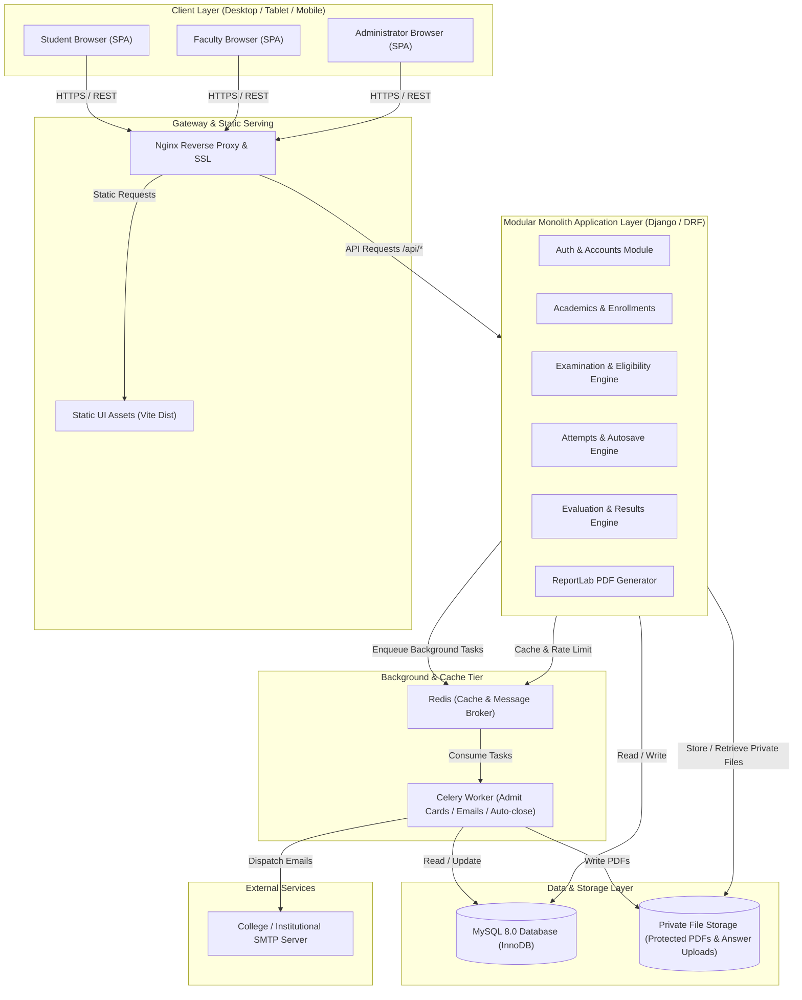
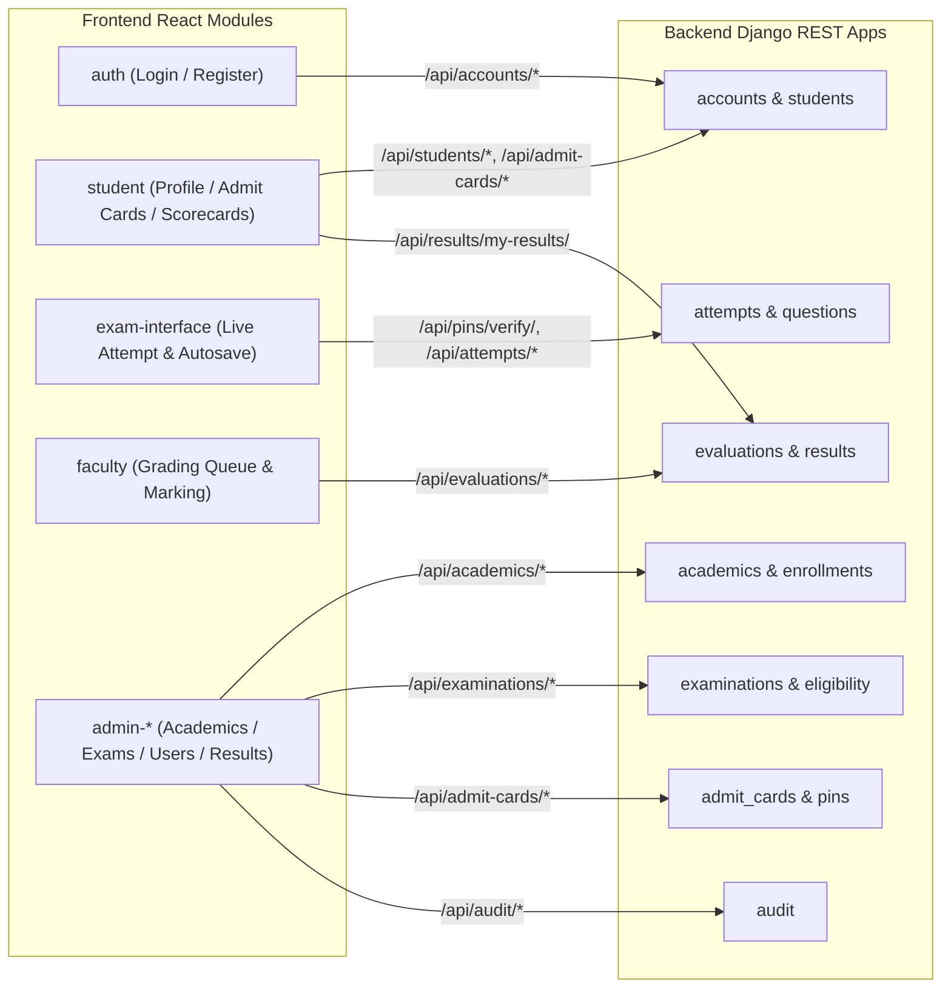
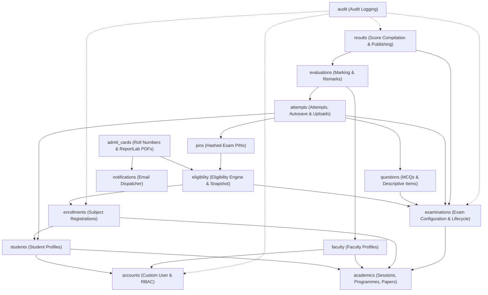
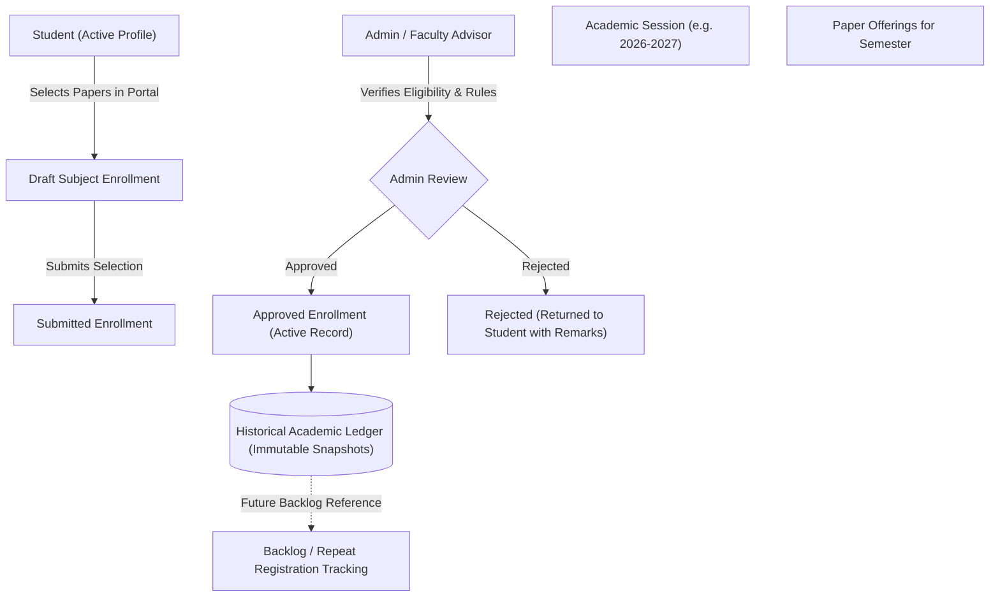
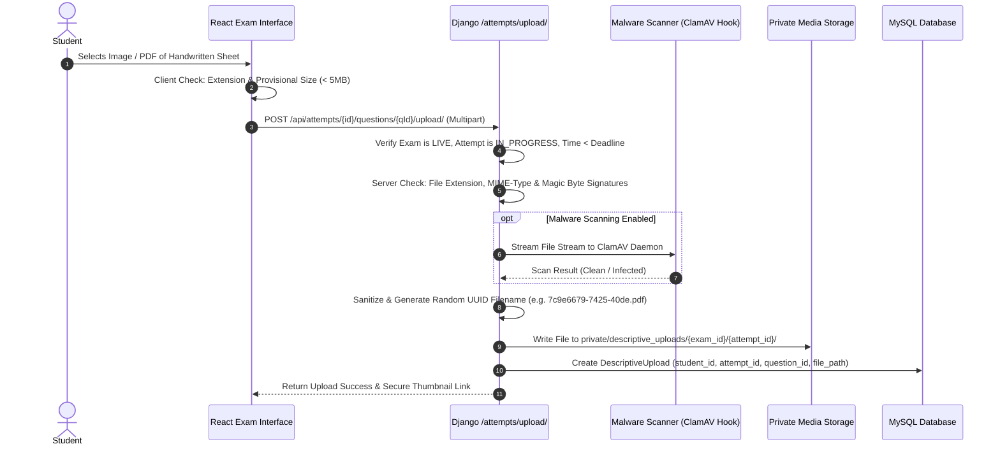
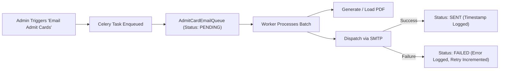
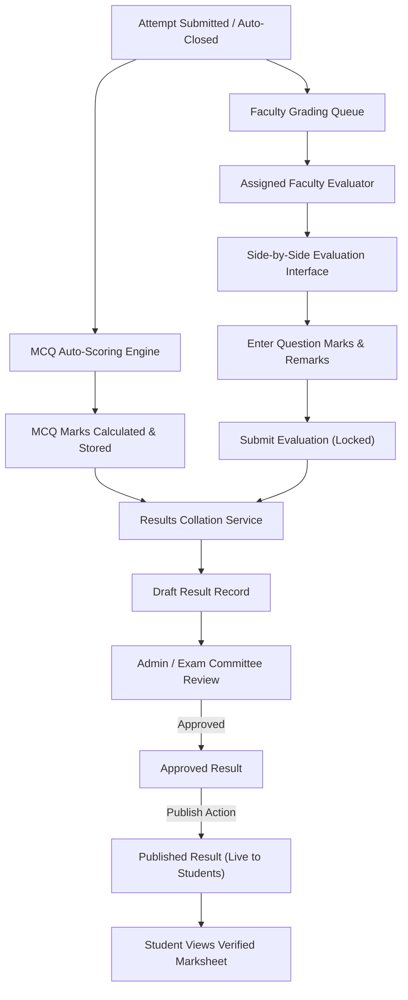

# College Online Examination System — System Architecture Specification

**Project Context:** College Online Examination System (Gauhati University FYUGP Academic Context)  
**Document Status:** Architecture Baseline (Chunk 01)  
**Last Updated:** 2026-11-02  

---

## 1. Executive Summary & Architecture Principles

The College Online Examination System is designed as a secure, responsive, and robust **Modular Monolith**. It supports the Gauhati University Four-Year Undergraduate Programme (FYUGP under NEP 2020) academic hierarchy and examination lifecycle.

### Key Architectural Principles

1. **Modular Monolith over Microservices:** Single deployable codebase with strictly decoupled domain applications. Avoids the network latency, distributed transaction failures, and operational overhead of microservices while maintaining clean boundaries.
2. **Backend-Authoritative Integrity:** All business rules, eligibility calculations, countdown timers, autosave versioning, mark computations, and role permissions are strictly enforced on the server. The client is strictly an interactive view.
3. **Explicit Academic State:** No student is eligible for an examination based on programme, department, or semester alone. Eligibility strictly requires an active, approved enrollment in the exact paper offering being examined.
4. **Defense in Depth for Security & Privacy:**
   - Multi-tier authentication: Account credentials establish identity; separate, hashed Examination PINs authorize live exam sessions.
   - Private storage for all exam assets (admit cards, answer uploads); zero public URL access.
   - Monotonic versioning on autosave to prevent race conditions over unstable mobile connections.
   - Immutable audit logging for all administrative, eligibility, evaluation, and publishing events.

---

## 2. Technology Stack & Responsibilities

| Tier / Component | Technology | Role & Architectural Responsibilities |
| :--- | :--- | :--- |
| **Frontend SPA** | React 18+ / Vite | Single Page Application; responsive layouts for desktop/tablet/mobile; state management and client-side form validation. |
| **Styling & UI** | Tailwind CSS | Utility-first CSS framework; accessible, mobile-first design; dark/light examination contrast mode. |
| **Routing** | React Router v6+ | Client-side routing with role-based route guards (`AdminRoute`, `FacultyRoute`, `StudentRoute`, `ExamGuard`). |
| **Backend Framework**| Python 3.11+ / Django 5.x | Core monolith framework; ORM, migrations, user session management, signal dispatching, and security middleware. |
| **API Framework** | Django REST Framework (DRF) | RESTful API endpoints; serializers; object-level permissions; rate-limiting throttles; JSON API responses. |
| **Database** | MySQL 8.0 (InnoDB) | Relational persistence; ACID compliance; foreign key constraints; row-level locking (`SELECT ... FOR UPDATE`); transaction isolation. |
| **PDF Generation** | ReportLab (Pure Python) | Pixel-perfect admit-card generation; zero external OS library dependencies (no cairo/pango required); fast programmatic PDF rendering. |
| **Email Dispatch** | Django Mail + SMTP | Transactional email delivery with HTML templates and PDF attachments. |
| **Task Queue / Worker**| Celery + Redis (or DB Queue) | Asynchronous execution of bulk PDF admit-card generation, batch email dispatch, and background deadline supervisor. |
| **Web / App Server** | Nginx + Gunicorn | Reverse proxy handling SSL termination, static asset compression, and WSGI application serving. |

### Evaluation of Redis and Celery

* **Role:** Bulk operations in examination workflows—such as compiling 1,000 admit-card PDFs, sending 1,000 emails, or evaluating heavy batches—cannot run inside a synchronous HTTP request cycle without causing gateway timeouts (HTTP 504).
* **Architecture Decision:**
  * Celery with Redis broker is the designated background processing engine for batch jobs, cache-based rate limiting (PIN attempts), and exam session heartbeat tracking.
  * To maintain operational simplicity during initial development and CI/CD testing, task execution is abstracted through a unified interface (`TaskQueueService`), enabling synchronous eager execution (`CELERY_TASK_ALWAYS_EAGER = True`) in local test environments without requiring an active Redis server.

---

## 3. System Architecture Diagrams

### 3.1 High-Level System Architecture



---

## 4. Frontend Architecture

### 4.1 Module Structure & Responsibilities

The React application is structured into domain-aligned modules:

```
frontend/src/
├── app/                  # Application bootstrap, routing configuration, global providers
├── assets/               # Logos, brand icons, styling variables
├── components/           # Shared UI primitives (Button, Modal, Input, Table, Alert, Badge)
├── hooks/                # Custom React hooks (useAuth, useExamTimer, useAutosave, useNetwork)
├── services/             # Axios API client, interceptors, and typed endpoint contracts
└── modules/
    ├── auth/             # Public self-registration, login, email verification, password reset
    ├── student/          # Student portal: profile, enrollment view, admit cards, results
    ├── exam-interface/   # Distraction-free live exam UI, question palette, answer inputs, timer
    ├── faculty/          # Faculty portal: assigned papers, descriptive script grading queue
    ├── admin-academics/  # Sessions, programmes, departments, semesters, subjects, paper offerings
    ├── admin-students/   # Student registration approvals, profile management
    ├── admin-enrollment/ # Student subject enrollment approvals & backlog records
    ├── admin-exams/      # Exam setup, eligibility computation, roll allocation, PIN management
    ├── admin-results/    # Result compilation, moderation review, and publishing controls
    └── admin-audit/      # System audit log viewer and security monitoring
```

### 4.2 Role-Based Route Guards

Client-side routes are guarded by high-order route wrappers:
* `PublicOnlyRoute`: Accessible only to unauthenticated users (`/login`, `/register`, `/forgot-password`).
* `ProtectedRoute`: Requires active authentication and verified account status.
* `RequireRole(['admin'])`: Enforces administrator role.
* `RequireRole(['faculty'])`: Enforces faculty role.
* `RequireRole(['student'])`: Enforces student role with `status == ACTIVE`.
* `LiveExamGuard`: Enforces active examination state; blocks navigation away without confirmation; disables distracting global layout navigation bars.

### 4.3 API Communication Layer & Security

* **Centralized API Client:** Axios instance configured with `withCredentials: true` to pass HTTP-only session cookies and CSRF tokens (`X-CSRFToken`).
* **Error Interceptor:** Automatically captures 401 (redirects to login with return path), 403 (insufficient permissions alert), and 429 (rate-limit warnings).
* **Network Resilience:** The exam interface tracks browser online/offline status (`navigator.onLine`). When offline, autosave actions queue in IndexedDB/localStorage and auto-flush immediately upon reconnection.

---

## 5. Backend Architecture & Domain Modules

### 5.1 Django Application Modules

```
backend/
├── manage.py
├── core/                 # Django settings, WSGI/ASGI, base models, global middleware
└── apps/
    ├── accounts/         # Custom User, authentication, session tokens, permissions
    ├── academics/        # Sessions, Programmes, Departments, Semesters, Subjects, PaperOfferings
    ├── students/         # StudentProfile, registration approvals, academic status
    ├── faculty/          # FacultyProfile, PaperAssignments
    ├── enrollments/      # StudentSubjectEnrollment, backlog management, approval workflow
    ├── examinations/     # Examination model, lifecycle states, scheduling, configurations
    ├── eligibility/      # Eligibility computation engine, overrides, snapshot tables
    ├── admit_cards/      # ReportLab PDF generation, roll-number allocation, download endpoints
    ├── pins/             # ExaminationPIN model, cryptographic generation, rate-limited validation
    ├── questions/        # Question banks, MCQ options, descriptive question rules
    ├── attempts/         # ExamAttempt, StudentAnswer (versioned), DescriptiveUpload
    ├── evaluations/      # Faculty script assignments, marks entry, remarks, locks
    ├── results/          # Result calculation, grade mapping hooks, approval & publication
    ├── notifications/    # Email queue, templates, SMTP dispatcher, retry engine
    └── audit/            # AuditLog model, signals, diff recording, change tracking
```

### 5.2 Frontend and Backend Module Communication



### 5.3 Backend Module Dependency Graph



---

## 6. Authentication & Authorization Architecture

### 6.1 Account Authentication vs. Examination Authorization

A strict conceptual and technical boundary exists between **Identity Authentication** and **Examination Authorization**:

1. **Account Authentication (Who you are):**
   - Establishes identity via email/username and salted password hash.
   - Enforces user status: `PENDING_VERIFICATION`, `PENDING_APPROVAL`, `ACTIVE`, `INACTIVE`.
   - Issues secure HTTP-only session cookie.
2. **Examination Authorization (What you are allowed to enter):**
   - Having an active student account **does not** permit opening an examination.
   - Access requires fulfilling all five authorization gates:
     1. Account authenticated as Student with `status == ACTIVE`.
     2. Student exists in the locked `ExaminationEligibility` snapshot for this specific exam.
     3. Examination status is currently `LIVE` (or `SCHEDULED` during the configured early-access waiting room buffer).
     4. Entry Window Rules:
        - *New Attempt Initialization:* Permitted **only** when server time is within the configured entry window `[start_time, entry_cutoff_time]`. (During the early-access buffer `[start_time - early_access_buffer, start_time]`, PIN verification grants access strictly to the "Waiting Room / Instructions Hall"; question papers and attempt timers remain locked until `start_time`).
        - *Active Attempt Resumption:* Permitted **only** for attempts with `status == IN_PROGRESS` when server time is $\le \text{end\_time}$.
        - *Post-Deadline / Finalized Attempts:* Strictly prohibited. Attempts marked `SUBMITTED` or `AUTO_CLOSED_DEADLINE` are permanently locked.
     5. Correct, unrevoked, unexpired **Examination PIN** is supplied and verified against its salted hash.

### 6.2 Student Self-Registration & Approval Workflow

```mermaid
sequenceDiagram
    autonumber
    actor Student
    participant Frontend as React SPA
    participant Backend as Django /accounts
    participant DB as MySQL Database
    actor Admin as College Administrator

    Student->>Frontend: Fill Registration Form (Name, Email, Mobile, Reg No, Programme)
    Frontend->>Backend: POST /api/accounts/register/
    Backend->>DB: Create User (status=PENDING_VERIFICATION) & StudentProfile
    Backend-->>Student: Send Email Verification Link (Secure Token)

    Student->>Frontend: Clicks Verification Link in Email
    Frontend->>Backend: GET /api/accounts/verify-email/?token=...
    Backend->>DB: Update User (status=PENDING_APPROVAL)
    Backend-->>Frontend: Email Verified; Awaiting Admin Approval

    Admin->>Frontend: View Pending Student Registrations
    Frontend->>Backend: GET /api/admin/students/pending/
    Admin->>Frontend: Verify College Identity & Click "Approve"
    Frontend->>Backend: POST /api/admin/students/{id}/approve/
    Backend->>DB: Update User (status=ACTIVE, approved_by, approved_at)
    Backend-->>Student: Send "Account Approved" Welcome Email
    Student->>Frontend: Login with Email & Password -> Access Student Portal
```

### 6.3 Authentication and Examination PIN Verification Flow

```mermaid
sequenceDiagram
    autonumber
    actor Student
    participant SPA as React Student Portal
    participant AuthAPI as Django /accounts
    participant ExamAPI as Django /examinations & /pins
    participant DB as MySQL Database

    Student->>SPA: Enters Email & Password
    SPA->>AuthAPI: POST /api/accounts/login/
    AuthAPI->>DB: Verify Credentials & Active Status
    AuthAPI-->>SPA: HTTP 200 (Sets Secure Session Cookie)

    Student->>SPA: Selects Scheduled Examination
    SPA->>ExamAPI: GET /api/examinations/{id}/entry-check/
    ExamAPI->>DB: Check Eligibility Snapshot, Exam LIVE Status & Entry Cutoff Window
    ExamAPI-->>SPA: Status = READY_FOR_PIN (Prompts for PIN)

    Student->>SPA: Submits 6-character Examination PIN
    SPA->>ExamAPI: POST /api/examinations/{id}/verify-pin/ (PIN)
    ExamAPI->>DB: Check Lockout Counter (< 5 attempts) & Entry Window
    alt Hash Matches Stored Hash & Within Permitted Window
        ExamAPI->>DB: Reset Lockout Counter; Log Success
        ExamAPI-->>SPA: HTTP 200 (Issues Ephemeral Exam Session Token)
        SPA->>Student: Redirect to /student/exams/{id}/live (or Waiting Room if before start_time)
    else Invalid PIN (Failed Attempt)
        ExamAPI->>DB: Increment Lockout Counter (Lock if == 5)
        ExamAPI-->>SPA: HTTP 400 (Invalid PIN, Remaining Attempts: N)
        SPA->>Student: Display Error Alert with Remaining Attempts
    end
```

---

## 7. Academic Workflow Architecture

### 7.1 Configurable Academic Hierarchy (FYUGP NEP 2020)

The academic structure is purely data-driven, avoiding hardcoded assumptions:

* `College`: Top-level institution.
* `AcademicSession`: e.g., `2024-2025`, `2025-2026`, `2026-2027` (with active flags).
* `Programme`: e.g., `B.A. (FYUGP)`, `B.Sc. (FYUGP)`, `B.Com. (FYUGP)`, `B.C.A.`.
* `Department`: e.g., `Department of Political Science`, `Department of Chemistry`.
* `Semester`: Configurable semesters (1 through 8).
* `SubjectCategory`: Configurable database model (e.g., `Major`, `Minor`, `MDC`, `AEC`, `SEC`, `VAC`).
* `Subject`: Broad academic discipline (e.g., `Political Science`, `Mathematics`).
* `PaperOffering`: Exact academic unit offered in a given session and semester:
  - `paper_code`: e.g., `POL1014`, `VAC1012`.
  - `title`: e.g., `Foundations of Political Theory`, `Environmental Studies`.
  - `category`: Linked to `SubjectCategory`.
  - `credits`: Configurable integer/float.
  - `is_common_paper`: Boolean flag allowing papers like AEC/VAC to enroll students from multiple programmes.

### 7.2 Student Subject Enrollment & Historical Preservation



---

## 8. Examination Workflow Architecture

### 8.1 Complete End-to-End Examination Lifecycle

```mermaid
flowchart TD
    Step1["1. Admin Creates Examination (Title, Type, Date, Duration, Marks)"]
    Step2["2. Admin Links Exact Paper Offering"]
    Step3["3. Eligibility Engine Computes Registered Students"]
    Step4["4. Admin Reviews & Locks Confirmed Eligibility Snapshot"]
    Step5["5. Roll Number Service Allocates College-Format Numbers"]
    Step6["6. Admit Card Service Generates ReportLab PDFs"]
    Step7["7. Notification Service Dispatches Admit Cards via Email"]
    Step8["8. Student Logs into Student Portal"]
    Step9["9. Student Provides Separate Examination PIN"]
    Step10["10. Backend Verifies PIN, Eligibility, Exam Status & Time Window"]
    Step11["11. Student Starts Exam Attempt (Server Authoritative Clock)"]
    Step12["12. Answers Autosaved with Monotonic Version Sequences"]
    Step13["13. Descriptive Files Uploaded to Private Storage"]
    Step14["14. Student Submits or Server Auto-Closes at Deadline"]
    Step15["15. MCQ Auto-Evaluation & Faculty Descriptive Evaluation"]
    Step16["16. Admin Reviews, Approves & Publishes Results"]

    Step1 --> Step2 --> Step3 --> Step4 --> Step5 --> Step6 --> Step7
    Step7 -.-> Step8 --> Step9 --> Step10 --> Step11 --> Step12 --> Step13 --> Step14 --> Step15 --> Step16
```



### 8.2 Failure & Recovery Paths

1. **Network Drop During Examination:**
   - Client stores unsaved keystrokes in a private, student-scoped browser cache (`exam_cache_{student_id}_{examination_id}_{attempt_id}`).
   - Client-supplied timestamps are **never trusted** by the server as proof of pre-deadline completion.
   - Autosave worker retries every 10 seconds with exponential backoff while connection is down.
   - UI displays clear persistent status banner: `⚠️ Offline - Changes cached locally`.
   - **Conflict-Free Lifecycle:** Unsynchronized answers are **never silently deleted** prior to explicit server acknowledgement; user logout does **not** purge unsynchronized data. Shared-device isolation ensures subsequent users on the same workstation cannot access or view another candidate's scoped cache.
   - On reconnect prior to the official deadline (`end_time`), pending changes flush to the server with sequence numbers; write acceptance is determined strictly by the server's trusted arrival timestamp ($T_{\\text{arrival}} \le \text{end\_time}$). UI displays `✅ All answers saved`.
   - If network reconnects *after* the official deadline, any answers cached offline cannot be accepted for write. The server rejects them with HTTP 410, and the client marks them locally as `REJECTED_DEADLINE_EXCEEDED` (preserved in a diagnostic recovery bundle for appeal, but never treated as synchronized). The attempt is closed based strictly on the valid answers received by the server on or before `end_time`.
2. **Accidental Tab Close / System Restart:**
   - Student navigates back to exam URL.
   - Backend recognizes active `ExamAttempt` (`status == IN_PROGRESS`); resumes existing attempt only if server time is $\le \text{end\_time}$.
   - Countdown timer reflects remaining server time (no time lost, no timer reset).
   - All previously saved answers and file uploads load immediately into the UI.
3. **Deadline Reached & Strict Server-Authoritative Enforcement:**
   - The official examination deadline (`end_time`) is strictly server-authoritative and marks the absolute cutoff for answering questions.
   - Write requests (autosave updates and manual submissions) are accepted **only** when their trusted reverse-proxy arrival timestamp ($T_{\\text{arrival}}$ using high-precision Nginx `$msec`) is $\le \text{end\_time}$.
   - Requests first received after `end_time` are rejected for write, regardless of any client-side claims or offline timestamps.
   - Internal processing latency between reverse-proxy receipt and WSGI application completion is accommodated (distinguishing arrival from processing completion), but network transport latency that results in late arrival after `end_time` does **not** permit late writes.
   - At or immediately following `end_time`, any remaining open attempt is transitioned to `AUTO_CLOSED_DEADLINE`, and all write APIs strictly reject further modifications.
4. **Email Delivery Failure:**
   - Failed email attempts are captured in `AdmitCardEmailQueue` with error message.
   - Admin monitor displays failed records; provides single-click "Retry Failed Emails" batch action.
   - Students can always directly download their admit card from their authenticated student portal.

---

## 9. Examination PIN Design & Security

### 9.1 PIN Architecture & Generation

* **Scope & Uniqueness:** A unique, cryptographically random Examination PIN is generated per student per examination (`(examination_id, student_id)` unique constraint).
* **Generation Strategy (CSPRNG):** Generated using Python's `secrets` module (`secrets.choice` utilizing system OS entropy `/dev/urandom`), producing a 6-character alphanumeric string. Ambiguous glyphs (e.g., `0`, `O`, `1`, `I`, `l`) are explicitly excluded from the character alphabet to prevent transcription errors.
* **Storage & Hashing:** Plaintext PINs are **never stored** in the database. PINs are hashed immediately upon generation using Django's standard password-hashing framework (`PBKDF2PasswordHasher` with SHA-256 and unique per-record salt, or Argon2). Plaintext is held in memory only during immediate admit card rendering or email dispatch, and discarded immediately.
* **Separation from Roll Number:** The Roll Number is an institutional public identifier displayed on admit cards, attendance rosters, and answer script metadata. The Examination PIN is a confidential authentication secret required solely to unlock the live exam interface.

### 9.2 Verification, Session Creation, and Resumption

* **Session Creation vs. Non-Consumption:**
  - Successful PIN verification **does not consume or destroy** the PIN during an active examination.
  - Consuming the PIN on first entry would prevent students from recovering from common real-world disruptions (accidental browser tab closure, browser crashes, system reboots, or network disconnects).
  - Upon successful PIN verification, the backend issues an authorized, time-bound, cryptographically signed **Examination Session Token** (or secure HTTP-only cookie) scoped specifically to `(student_id, examination_id, attempt_id)`.
  - The PIN remains valid for session re-entry and attempt resumption throughout the examination's active window (`start_time` to `end_time`).
  - Once the attempt is transitioned to `SUBMITTED` (manual submission) or `AUTO_CLOSED_DEADLINE` (deadline expiration), the attempt is locked permanently; subsequent PIN entries are rejected.
* **Reconciled Validity Windows:**
  - *New Attempt Initialization Window:* The PIN is valid to initialize a new examination attempt **only** from `start_time` up to the examination's configured `entry_cutoff_time` (e.g., `start_time + 15m` or `start_time + 30m`, which can never exceed `end_time`). After `entry_cutoff_time`, new attempt initialization is rejected (HTTP 403 `ENTRY_WINDOW_CLOSED`).
  - *Early-Access Buffer (`start_time - early_access_buffer` to `start_time`):* Students may verify their PIN early (default: 15 minutes before start) to authenticate and enter the virtual "Waiting Room / Instructions Hall". However, question payloads are withheld and attempts cannot be started until server time reaches `start_time`.
  - *Attempt Resumption Window:* For students with an already-started `IN_PROGRESS` attempt, PIN verification permits session resumption until `end_time`.
  - *Strict Expiration at Deadline:* PIN validity for all attempts **strictly expires at `end_time`**. Under **no circumstances** does the PIN authorize a new attempt or grant write access after the official examination deadline.

### 9.3 Rate Limiting, Failed Attempts, and Lockout Policy

* **Proposed Lockout Policy (Subject to Institutional Security Review):**
  - Verification requests are rate-limited per student per examination attempt.
  - **Threshold:** Maximum of 5 consecutive failed PIN attempts.
  - **Lockout Action:** On the 5th failed attempt, the PIN is locked for 15 minutes, and an alert entry is written to `AuditLog`.
  - **Progressive Backoff:** Subsequent failures after the initial lockout period trigger progressive exponential lockouts (e.g., 30 minutes).
  - *Institutional Review Note:* This policy is proposed as a security baseline; the college administration may review and adjust the attempt threshold or lockout duration during final operational sign-off.

### 9.4 Administrator Reissue & Revocation Workflow

* **Revocation & Emergency Reissue:**
  - If a student is locked out due to repeated failures, suspects PIN compromise, or loses access, a college administrator can reissue the PIN from the Admin Examination Dashboard.
  - The re-issue operation:
    1. Marks the existing `ExaminationPIN` record as revoked (`is_revoked = True`).
    2. Generates a fresh cryptographically random PIN and stores its salted hash.
    3. Records an immutable entry in `AuditLog` capturing `administrator_id`, `student_id`, `examination_id`, timestamp, and administrative justification.
    4. Provides the new PIN to the administrator for direct delivery or triggers a secure notification to the student.

### 9.5 Protection Against Disclosure in Logs & APIs

* **Zero Plaintext Logging:** Plaintext PINs are strictly excluded from Django application logs, web server access logs (via `POST` body submission, never URL parameters), and `AuditLog` change payloads.
* **API Protection:** No API endpoint ever exposes stored PIN hashes or plaintext PINs. Verification endpoints return only boolean verification status and ephemeral session tokens.

### 9.6 PIN Delivery Channels & Security Implications

The delivery mechanism for Examination PINs presents operational and security trade-offs that require explicit institutional configuration:

| Delivery Option | Operational Mechanism | Security Implications & Trade-offs |
| :--- | :--- | :--- |
| **Option A: Printed on Admit Card** | PIN is rendered on the downloadable/emailed admit card PDF alongside candidate details. | **Advantage:** Guarantees offline availability in the exam hall; zero reliance on network or SMS infrastructure on exam day.<br>**Implication:** Admit cards are distributed days in advance. Anyone with access to the student's email, printed paper, or shared cyber-cafe computer gains knowledge of the PIN. While backend rules strictly block exam entry before `start_time`, advance PIN exposure removes just-in-time confidentiality.<br>**Mitigation:** Admit cards must be served exclusively via authenticated, private download endpoints. |
| **Option B: Just-In-Time Separate Delivery** | PIN is distributed 15 minutes before exam start via SMS blast, portal notification, or verbal announcement by invigilators in the hall. | **Advantage:** Maximizes live confidentiality; eliminates risk of advance credential leakage.<br>**Implication:** High dependency on real-time telecommunications and student connectivity on exam morning; potential operational bottlenecks if SMS deliveries fail. |

* **Mandatory Institutional Configuration Gate:**
  - The delivery method is **NOT defaulted** to `ADMIT_CARD` or any other option.
  - It is an **explicit institutional configuration decision** (`EXAM_PIN_DELIVERY_METHOD`), initialized as `UNCONFIGURED`.
  - The system **strictly prevents PIN generation and examination scheduling** until the college administrator explicitly selects, configures, and approves the delivery method for the institution or examination.

---

## 10. Roll-Number Architecture

### 10.1 Configurable Format Generator (Illustrative Only)

> [!IMPORTANT]
> The pattern below is **strictly illustrative** to demonstrate the generator's template architecture. It is **not** an approved college format or an authoritative system default. The actual roll-number format must be configured by college administrators once the official Gauhati University or institutional convention is supplied.

The roll-number engine is completely configurable and avoids any hardcoded numbering conventions:

```python
# Conceptual Roll Number Template Engine
class RollNumberScheme(models.Model):
    name = models.CharField(max_length=100) # e.g. "College FYUGP Examination Format"
    # Illustrative pattern only; fully configurable with parameters:
    # {COLLEGE_CODE}, {YEAR}, {SESSION}, {PROG_CODE}, {DEPT_CODE}, {SEMESTER}, {SEQUENCE:04d}
    pattern = models.CharField(
        max_length=255, 
        help_text="Customizable pattern template using dynamic parameters"
    )
    sequence_start = models.PositiveIntegerField(default=1)
    current_sequence = models.PositiveIntegerField(default=1)
    scope = models.CharField(max_length=50, choices=[
        ('PER_EXAM', 'Per Examination Instance'),
        ('PER_SESSION_PROGRAMME', 'Per Academic Session and Programme'),
        ('PER_COLLEGE_ANNUAL', 'College-Wide Annual Sequence')
    ])
```

### 10.2 Concurrency, Uniqueness & Administration

* **Transaction-Safe Atomic Sequence Allocation:** Roll numbers are allocated in bulk during the transition from `ELIGIBILITY_REVIEW` to `READY`. Allocation runs inside an atomic database transaction using row-level locking (`SELECT ... FOR UPDATE` on the `RollNumberScheme` sequence counter) to guarantee sequential ordering without duplicate sequence gaps or collisions.
* **Database Integrity Constraints:** Database-level composite unique constraint enforces uniqueness:
  - Scoped to `(examination_id, roll_number)` or `(academic_session_id, roll_number)` depending on the configured scheme scope.
* **Administrator-Controlled Corrections & Re-issues:**
  - If a student is added late (manual eligibility addition) or an allocation error occurs, administrators can re-allocate or manually assign a corrected roll number.
  - Manual overrides require an administrative justification note and generate an immutable record in `AuditLog` preserving the previous number, the new number, and the authorizing administrator.
* **Historical Immutability:** Once admit cards are compiled and published, the roll-number mapping is locked permanently for that examination attempt to preserve historical examination records.

---

## 11. Descriptive Answer Upload Architecture

### 11.1 Configurable Upload Policies (Provisional Defaults)

> [!NOTE]
> The thresholds below represent **provisional system defaults** designed for general mobile network feasibility. All parameters are stored as configurable database settings and may be customized per examination or institutional policy.

* **File Count Limit:** Provisional default of maximum 3 files per descriptive question (configurable).
* **File Size Limit:** Provisional default of maximum 5 MB per individual file (configurable).
* **Total Upload Quota:** Configurable per attempt (provisional default: 50 MB total across all questions).
* **Allowed File Types:** Configurable extension whitelist (provisional default: `.pdf`, `.jpg`, `.jpeg`, `.png`).

### 11.2 Security & Storage Pipeline



### 11.3 Multi-Tier Validation & Malware Protection

1. **Client-Side Preliminary Validation:** React exam interface validates file extension and size prior to network transmission, providing immediate student feedback without wasting uplink bandwidth.
2. **Server-Side Whitelist Enforcement:** File extension is checked against the active examination configuration whitelist.
3. **MIME-Type & Magic-Byte Signature Inspection:** Using binary signature inspection (`python-magic` or header byte analysis), the server verifies the actual binary content matches legitimate PDF, JPEG, or PNG formats, rejecting renamed executable binaries, PHP scripts, or shell payloads.
4. **Pluggable Malware Scanning Interface:** The architecture provides a pluggable antivirus hook (supporting ClamAV daemon via TCP/Unix socket). When enabled in production, files are streamed to the scanner before committing to disk; infected files are discarded immediately and logged in `AuditLog`.

### 11.4 Private Storage & Controlled Access

* **Private Storage Outside Webroot:** Stored in `MEDIA_ROOT/private/descriptive_uploads/{exam_id}/{attempt_id}/`. Web server configurations explicitly block direct URL alias access to this path.
* **Randomized UUID Filenames:** Original client filenames (which may contain path traversal characters or malicious naming) are stripped; files are saved exclusively as `uuid4()` identifiers.
* **Authenticated Download Endpoint:**
  - `GET /api/attempts/{attempt_id}/uploads/{upload_id}/download/`
  - Access is granted **only** if:
    1. Caller is the authenticated student who owns the attempt, OR
    2. Caller is the faculty examiner assigned to evaluate this paper offering, OR
    3. Caller is an authorized college administrator.
  - In production, files are delivered efficiently via Nginx `X-Accel-Redirect` (or Django `FileResponse` in development), eliminating Python memory overhead.

### 11.5 Retention & Archival Policy Considerations

* **Active Retention:** Uploads must be retained in active high-performance storage throughout the live examination, evaluation, result compilation, and re-evaluation appeal windows (typically 6 months post-publication).
* **Archival vs. Purging:** Following the expiration of the appeal period, the system supports an automated archival job to bundle scripts into compressed cold storage or permanently purge files per college statutory document retention regulations. Specific retention schedules require institutional policy confirmation.

---

## 12. PDF & Email Architecture (ReportLab)

### 12.1 Admit-Card Generation with ReportLab

* **Engine:** Pure Python `reportlab.platypus` (Canvas, SimpleDocTemplate, Table, Paragraph, Image).
* **Zero System Dependencies:** Does not require OS-level `libpango`, `libcairo`, or fontconfig packages.
* **Layout Structure:**
  - Header: College Emblem, College Name, Examination Title, Academic Session.
  - Candidate Details: Student Name, Examination Roll Number, University Reg/Enrollment No, Programme & Semester.
  - Paper Schedule Table: Paper Code, Paper Title, Category, Exam Date, Timing, Reporting Time.
  - Instructions: Candidate instructions, permitted materials, examination PIN and access guidelines.
  - Verification Box: Barcode/QR code of roll number, signature of Controller of Examinations.

### 12.2 Background Email Delivery



---

## 13. Examination Reliability & Integrity Architecture

### 13.1 Server-Authoritative Timer & Trusted Arrival Deadline Policy

* **Zero Trust in Client Timestamps:**
  - Client/browser timestamps are **never trusted** by the server as proof that an answer was entered or submitted before the deadline. A compromised client, manipulated system clock, or modified script could trivially forge pre-deadline timestamps.
  - The server's clock and trusted network gateway timestamps govern all deadlines.
* **High-Precision Trusted Reverse-Proxy Arrival Timestamp (`$msec`):**
  - The authoritative time of request receipt is established **strictly** by the trusted reverse proxy using high-precision epoch milliseconds (`$msec`), captured at the instant the request arrives from the network.
  - **Reverse-Proxy Configuration Hardening:** Nginx is explicitly configured to unconditionally overwrite any incoming client-supplied `X-Request-Arrival-Time` header:
    ```nginx
    # Securely inject high-precision arrival timestamp from trusted proxy
    proxy_set_header X-Request-Arrival-Time $msec;
    ```
  - **Trusted Proxy Verification:** The backend application (Django custom middleware) accepts `HTTP_X_REQUEST_ARRIVAL_TIME` **only** when `request.META['REMOTE_ADDR']` originates from a pre-configured trusted proxy IP or CIDR block (e.g., `TRUSTED_PROXIES = ['127.0.0.1', '10.0.0.0/8']`). Forwarded arrival headers from untrusted clients or unverified proxies are strictly ignored and stripped.
* **WSGI Fallback Description & Earliest Ingress Point:**
  - In standard Python WSGI architectures (Gunicorn, uWSGI), a WSGI application receives control *after* the WSGI server has already accepted the TCP socket, buffered the request, and parsed HTTP headers/body. Therefore, a WSGI application *cannot* generally observe the original low-level socket-read time.
  - When trusted reverse-proxy arrival time is unavailable (e.g., local development or standalone WSGI execution without Nginx), the fallback is a **strict server-receipt cutoff** captured at the earliest reliable server ingress point: the very first line of the outermost WSGI middleware (`time.time()`).
  - **Conservative Nature of Fallback:** This fallback is conservative. Under high server load or worker thread contention, a request that physically arrived at the host before the deadline might be delayed by WSGI request parsing/buffering and only timestamped at the middleware entry point after `end_time`, causing it to be rejected. Deploying behind a properly configured trusted reverse proxy (Nginx with `$msec`) is therefore the required production architecture.
* **Strict Cutoff on Request Arrival (No Late Writes):**
  - A write request (autosave update or submission) is accepted **only** when its trusted arrival timestamp is at or before the official scheduled deadline:
    $$T_{\\text{arrival}} \le \text{official\_end\_time}$$
  - Any request whose trusted arrival time is $> \text{official\_end\_time}$ **must be rejected** for answer writes. No client-side explanation, transport buffer, or offline timestamp permits accepting answers that arrive after the deadline.
* **Distinction Between Request Arrival and Processing Completion:**
  - If a request physically arrives at the trusted reverse proxy before the deadline ($T_{\\text{arrival}} \le \text{official\_end\_time}$), but backend worker thread scheduling or database lock contention causes processing to complete slightly after ($T_{\\text{complete}} > \text{official\_end\_time}$), the write is **accepted and committed** because the request was verified to have arrived on time.
  - The internal latency buffer accommodates server processing queues, but **never extends answering time or permits late-arriving requests**.
* **Exact Handling of Requests at the Deadline:**
  1. **Autosave Arriving On or Before Deadline ($T_{\\text{arrival}} \le \text{end\_time}$):**
     - Verified against monotonic sequence version (`incoming_seq > stored_seq`).
     - Answer updated in database; returns HTTP 200 with server timestamp and acknowledged sequence.
  2. **Autosave Arriving After Deadline ($T_{\\text{arrival}} > \text{end\_time}$):**
     - Write operation is rejected immediately with HTTP 410 (`EXAMINATION_CLOSED`).
     - Answer payload is discarded. The attempt is transitioned to `AUTO_CLOSED_DEADLINE` if not already finalized.
  3. **Submission Arriving On or Before Deadline ($T_{\\text{arrival}} \le \text{end\_time}$):**
     - Atomic transaction locks attempt, transitions `status = SUBMITTED`, sets `submitted_at = T_arrival`.
     - Automatically invokes MCQ auto-grading and returns a signed submission receipt.
  4. **Submission Arriving After Deadline ($T_{\\text{arrival}} > \text{end\_time}$):**
     - Manual submission write is rejected.
     - Atomic transaction checks attempt state; if `IN_PROGRESS`, transitions `status = AUTO_CLOSED_DEADLINE`, sets `closed_at = official\_end\_time`.
     - Invokes MCQ auto-grading on all answers successfully saved on or before `end_time`.
     - Returns a submission receipt reflecting that the examination was closed at the deadline.
  5. **Network Interruptions Across the Deadline:**
     - If a student disconnects before the deadline and reconnects afterward, any answers entered into the local offline cache after `end_time` **cannot be accepted**.
     - Upon reconnection, the client receives HTTP 410 informing the student that the exam has closed; the attempt is finalized using only the answers synchronized prior to `end_time`.

### 13.2 Autosave Strategy & Monotonic Sequence Versioning

* **Heartbeat & Trigger Events:** Answers autosave periodically (default: every 30 seconds) and immediately upon field blur or question palette navigation.
* **Monotonic Sequence Versioning:**
  - Every answer update includes a client incremented sequence counter: `{ question_id: 101, answer: "...", sequence: 14 }`.
  - The server verifies: `IF payload.sequence > existing_answer.version_sequence THEN UPDATE`.
  - Stale payloads arriving out of order due to network jitter or packet retransmission are safely discarded without overwriting newer state.

### 13.3 Offline Cache Architecture, Privacy, Scoping & Lifecycle

To ensure data integrity during transient network drops while strictly protecting candidate privacy on shared devices (such as college computer labs and commercial cyber cafes), offline caching adheres to a conflict-free lifecycle:

1. **Scoped Storage Partitioning & Shared-Device Isolation:**
   - Cached answers are stored in browser storage (`localStorage` / `IndexedDB`) using strictly scoped, collision-proof keys:
     $$\\text{cache\_key} = \text{exam\_cache\_}\{\text{student\_id}\}\_\{\text{examination\_id}\}\_\{\text{attempt\_id}\}$$
   - Global, un-scoped keys (e.g., `saved_answers`) are strictly prohibited.
   - **Access Restriction:** The client state layer restricts cache access strictly to the currently authenticated student session (`currentUser.id == student_id`). Subsequent users logging into the same browser or computer terminal cannot view, inspect, or query another candidate's cached data.
2. **Strict Zero-Credential Caching:**
   - User account passwords, Examination PINs, session cookies, and authorization tokens **must never be stored** in browser offline caches or local storage.
3. **Preservation of Unsynchronized Answers:**
   - Keystrokes and selections cached offline are assigned status `SYNC_PENDING` and are **never silently deleted** prior to explicit server acknowledgement.
   - The client never purges or overwrites unsynchronized answers prior to receiving an HTTP 200 response with a matching or higher acknowledged sequence number.
4. **Logout Behavior (No Silent Purging):**
   - User logout does **not** purge unsynchronized answers.
   - Because cache keys are partitioned by student identity, logging out leaves unacknowledged data securely isolated in browser storage, inaccessible to any other student logging into that workstation.
   - If unsynchronized answers exist at the moment of logout, the student is prompted with an explicit confirmation modal: `⚠️ You have unsynchronized exam answers on this device. They will be preserved securely for your account, but you must log back in on this device to complete synchronization or appeal.`
5. **Secure Recovery Process After Logout:**
   - When the student re-authenticates on that same workstation, the frontend detects the unacknowledged cache matching their `student_id` and `attempt_id`:
     - *If exam is still active ($T_{\\text{current}} \le \text{end\_time}$):* The client automatically resumes synchronization and flushes pending answers to the server.
     - *If exam has ended ($T_{\\text{current}} > \text{end\_time}$):* Normal live editing remains blocked, but the unsynchronized answers are packed into a tamper-evident, read-only diagnostic bundle (`AUDIT_RECOVERY_BUNDLE`) that the student can export or submit to the college examination committee for administrative review and technical audit.
6. **Treatment of Answers Rejected by the Server (Late Arrival):**
   - When answers reach the server after the official deadline, the server responds with HTTP 410 (`EXAMINATION_CLOSED`).
   - The client **does not** claim these answers were successfully synchronized.
   - The client marks them locally as `REJECTED_DEADLINE_EXCEEDED` alongside the server's rejection timestamp.
   - These rejected items are preserved in the diagnostic recovery bundle for audit/appeal purposes, but are clearly flagged in the UI as **Not Accepted (Late Arrival)**.
7. **Cleanup of Synchronized Answers:**
   - Once answers receive server confirmation (HTTP 200 with matching sequence number), their local `SYNC_PENDING` payload is cleared.
   - When the entire attempt is confirmed `SUBMITTED` or `AUTO_CLOSED_DEADLINE` by the server, all synchronized cached data for that attempt is safely purged from the device.
8. **Cache Expiry (Stale Marker, Not Silent Deletion):**
   - When local time or server heartbeat exceeds `end_time`, the cache status transitions to `EXPIRED_STALE`.
   - This state blocks normal interactive answering in the UI, but **does not silently delete** unacknowledged answers. Unsynchronized records remain preserved in the recovery bundle.

### 13.4 Idempotent Submissions

* When the student submits or the server auto-closes the exam:
  - Frontend generates a unique `submission_uuid`.
  - Backend wraps attempt completion in an atomic transaction:
    1. Lock `ExamAttempt` row (`SELECT ... FOR UPDATE`).
    2. Check if already `SUBMITTED` or `CLOSED`. If so, return existing submission receipt immediately without re-executing scoring.
    3. Mark `status = SUBMITTED`, `submitted_at = now()`.
    4. Trigger automatic MCQ scoring pipeline.
    5. Return submission receipt.

### 13.5 Examination Attempt and Submission Sequence

```mermaid
sequenceDiagram
    autonumber
    actor Student
    participant UI as React Live Exam Interface
    participant Proxy as Nginx Trusted Reverse Proxy
    participant API as Django /attempts/ API
    participant DB as MySQL Database

    Student->>UI: Enters Live Examination View
    UI->>Proxy: POST /api/attempts/{examId}/start/
    Proxy->>API: Overwrite & Forward X-Request-Arrival-Time ($msec)
    API->>DB: Check or Create ExamAttempt (status=IN_PROGRESS)
    API-->>UI: Questions Payload, Attempt ID, Remaining Seconds

    loop Every 30s or on Question Blur
        Student->>UI: Selects Option / Types Text
        UI->>Proxy: PATCH /api/attempts/{attemptId}/answers/ (question_id, answer, seq=N)
        Proxy->>API: Overwrite & Forward X-Request-Arrival-Time ($msec)
        alt Trusted Arrival Time <= end_time
            API->>DB: Conditional Update WHERE seq < N
            API-->>UI: HTTP 200 (Saved, Server Timestamp, Ack Seq=N)
            UI->>UI: Clear Local Cache for Acknowledged Seq
        else Trusted Arrival Time > end_time
            API-->>UI: HTTP 410 (Examination Closed; Discard Write)
            UI->>UI: Mark Locally as REJECTED_DEADLINE_EXCEEDED (Retain for Appeal)
        end
    end

    alt Manual Submission on Time
        Student->>UI: Clicks "Submit Examination"
        UI->>Proxy: POST /api/attempts/{attemptId}/submit/ (submission_uuid)
        Proxy->>API: Overwrite & Forward X-Request-Arrival-Time (<= end_time)
        API->>DB: Atomic Lock Attempt -> Mark SUBMITTED -> Auto-score MCQs
        API-->>UI: HTTP 200 (Submission Receipt & Confirmation)
        UI->>UI: Purge Synchronized exam_cache_* from Local Storage
    else Deadline Reached
        Proxy->>API: Late Request / Supervisor -> Mark AUTO_CLOSED_DEADLINE
        API->>DB: Atomic Lock -> Mark AUTO_CLOSED_DEADLINE -> Auto-score MCQs
        API-->>UI: HTTP 410 (Exam Closed: Deadline Expired)
        UI->>UI: Transition Cache to EXPIRED_STALE (Preserve Unsynced for Appeal)
    end
```
---

## 14. Evaluation & Results Publication Architecture



---

## 15. Auditability, Security & Privacy

### 15.1 Centralized Audit Trail

1. **Comprehensive Event Logging:** Every critical state transition (Enrollment approval, Eligibility override, Roll generation, PIN reissue, Mark change, Result publication) records:
   - `actor_id` (User who performed the action).
   - `action_type` (e.g., `ELIGIBILITY_OVERRIDE`, `MARK_MODIFIED`, `PIN_REISSUED`).
   - `target_model` & `target_id`.
   - `previous_state` & `new_state` (JSON diff).
   - `ip_address` & `user_agent`.
   - `timestamp` (UTC).
2. **Secret Hygiene:** Audit payloads strictly scrub passwords, plain PINs, and session tokens.
3. **Data Protection:** Student personal data, admit cards, and answer sheets are accessible strictly by authorized personnel via authenticated endpoints.

### 15.2 Cross-Site Scripting (XSS) Defenses & Session Hardening

> [!SECURITY]
> **Accurate Security Boundary Statement:** The system does **not** claim that HTTP-only cookies provide "complete" or "total" protection against XSS. While the `HttpOnly` flag successfully prevents client-side JavaScript from directly reading `document.cookie` (stopping direct credential exfiltration), it **does not** prevent an attacker who successfully executes arbitrary script from issuing authenticated same-origin requests ("session riding") on behalf of the candidate. Comprehensive defense-in-depth is therefore required and enforced.

To defend against XSS and protect session integrity, the architecture enforces multiple defense layers:

1. **Context-Aware Output Encoding & Safe Templating:**
   - React JSX inherently escapes values before rendering, neutralizing standard HTML and script injection vectors.
   - Raw HTML injection points (e.g., `dangerouslySetInnerHTML`) are strictly prohibited in user-facing views; any rich-text rendering is sanitized using `DOMPurify`.
2. **Strict Content Security Policy (CSP):**
   - Nginx and Django `django-csp` headers enforce a strict policy:
     ```http
     Content-Security-Policy: default-src 'self'; script-src 'self'; style-src 'self' 'unsafe-inline'; img-src 'self' data: blob:; object-src 'none'; frame-ancestors 'none'; base-uri 'self';
     ```
   - Restricts script execution strictly to same-origin application bundles; completely disallows inline scripts (`unsafe-inline` in `script-src`) and script evaluation (`unsafe-eval`).
3. **Input Validation & Sanitization:**
   - All incoming textual payloads (student registration inputs, descriptive answers, remarks) are validated and sanitized on the backend using Django serializer validators.
4. **Dependency Security Auditing:**
   - Automated CI vulnerability scanning via `npm audit` for frontend libraries and `pip audit` / `safety` for Python packages to guard against supply-chain vulnerabilities.
5. **Session Hardening & CSRF Protection:**
   - Session cookies are configured with `HttpOnly=True`, `SameSite='Lax'` (or `'Strict'`), and `Secure=True` (HTTPS).
   - Combined with Django's double-submit CSRF tokens (`X-CSRFToken`) on all non-GET requests to prevent cross-site forged transactions.

---

## 16. Deployment & Infrastructure Overview

```
                      +-----------------------------+
                      |   Cloud / College Server    |
                      |  (Linux Ubuntu 22.04 LTS)   |
                      +-----------------------------+
                                     |
           +-------------------------+-------------------------+
           |                                                   |
+---------------------+                             +---------------------+
|    Nginx (Port 443) |                             | MySQL 8.0 (Port 3306|
| - SSL / TLS         |                             | - InnoDB Engine     |
| - Reverse Proxy     |                             | - UTF8MB4 Collation |
| - Static Vite Dist  |                             +---------------------+
+---------------------+                                        |
           | (Unix Socket)                                     |
+---------------------+                             +---------------------+
| Gunicorn (Django WSGI)                            | Redis (Port 6379)   |
| - 4 Worker Processes|-----------------------------| - Celery Broker     |
| - Python 3.11+ Venv |                             | - Rate Limit Cache  |
+---------------------+                             +---------------------+
           |                                                   |
+---------------------+                                        |
| Celery Worker Daemon|----------------------------------------+
| - ReportLab PDFs    |
| - Email Dispatch    |
+---------------------+
```

---

## 17. Architecture Decisions & Trade-Offs

| Decision | Alternative Considered | Selected Rationale |
| :--- | :--- | :--- |
| **ReportLab for PDF** | WeasyPrint | ReportLab is pure Python with zero OS package dependencies. WeasyPrint requires complex system libraries (cairo, pango, gdk-pixbuf) that complicate deployment. |
| **Session Cookies for Web** | LocalStorage JWT | `HttpOnly` SameSite cookies prevent client-side JavaScript from directly reading the cookie, mitigating raw token exfiltration. Defense-in-depth (CSP, context-aware encoding, safe rendering) protects against XSS-driven session riding. |
| **Monolith vs Microservices**| Microservices | Microservices introduce distributed transaction risks and operational overhead inappropriate for a single college deployment. |
| **Hashed Exam PINs** | Plaintext PINs in DB | If the database is compromised, plaintext PINs would allow unauthorized exam access. Hashing ensures zero-knowledge security. |
| **Private File Storage** | Public S3 / Media root | Descriptive answer scripts and admit cards contain private student academic data; public URLs present severe privacy violations. |

---

## 18. Open Questions & Future Confirmation

The following policy and configuration items are flagged for institutional/college confirmation during data modeling (Chunk 02) and configuration setup:
1. **Official Gauhati University Roll-Number Pattern:** The generator is built to be configurable with parameterized templates; the exact pattern template will be populated once supplied by the college.
2. **Examination PIN Delivery Policy:** Mandatory institutional decision whether to configure PIN printing on admit cards or just-in-time delivery via SMS/portal/invigilators. System strictly prevents PIN generation while `EXAM_PIN_DELIVERY_METHOD` remains `UNCONFIGURED`.
3. **Late-Entry Cutoff Duration:** Institutional confirmation of the permitted entry window (`entry_cutoff_time`, e.g. 15 or 30 minutes past `start_time`), after which new attempts cannot be initialized.
4. **Descriptive Answer Upload Quotas:** Confirmation of provisional defaults (maximum 3 files, 5 MB per file, PDF/JPEG/PNG) or college-specific size/count limits.
5. **Answer Script Data Retention Schedule:** Confirmation of the duration scripts are retained in active storage post-result publication before archival or purging (recommended: 6 to 12 months).
6. **Grading & GPA Scale:** Raw component scores are implemented as the baseline; 10-point letter grade conversions (O, A+, A, etc.) and SGPA/CGPA formulas will be added upon confirmation of official GU tables.
7. **Shared Lab Workstation Cache Purge Policy:** Institutional confirmation of administrative workstation sanitization schedules (e.g. nightly deep-freeze/reboot scripts wiping persistent browser local storage in shared college computer labs).
