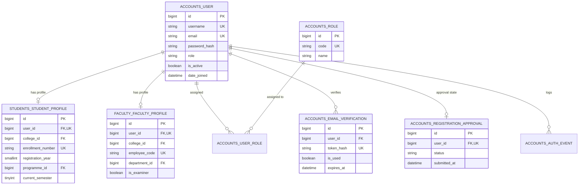
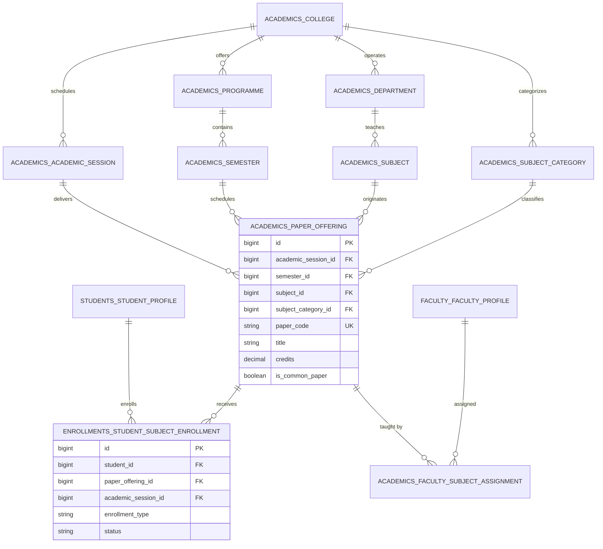
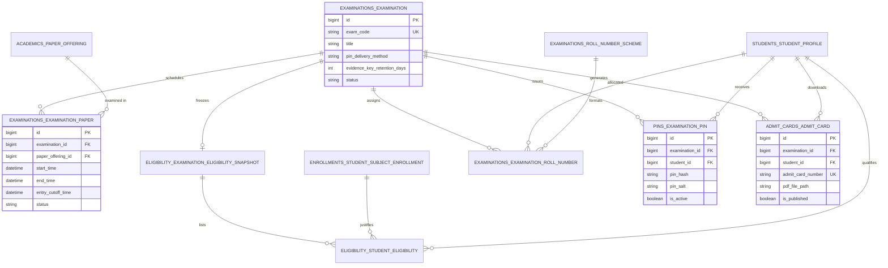
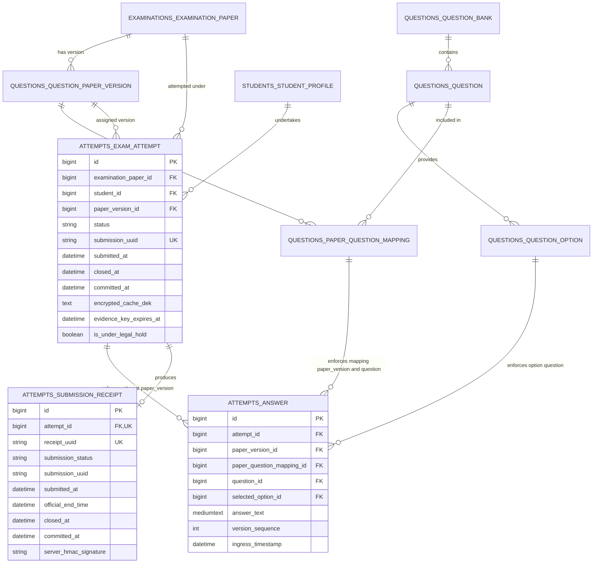
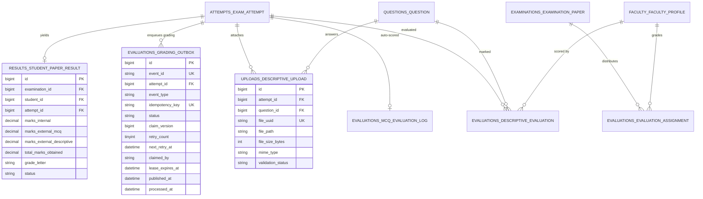
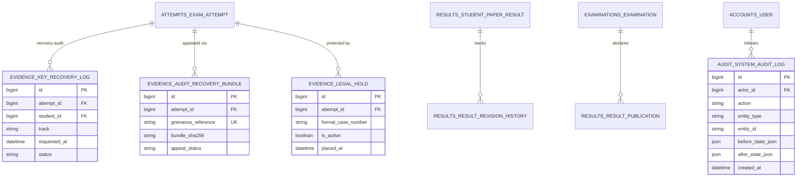
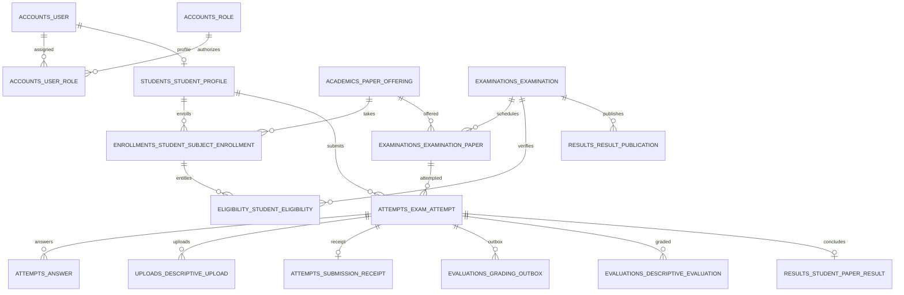

# Database Architecture Specification (Chunk 02 Approved Baseline — 52 Relational Tables)

**Project:** College Online Examination System  
**Deploying Institution:** Pandit Deendayal Upadhyaya Adarsha Mahavidyalaya (PDUAM), Amjonga, Goalpara, Assam
**Academic Context:** Gauhati University FYUGP / NEP 2020 Context (College Level)  
**Database Engine:** MySQL 8.0+ (InnoDB Storage Engine)  
**ORM Target:** Django 5.x / Django REST Framework  
**Character Set & Collation:** `utf8mb4` / `utf8mb4_0900_ai_ci`  
**Status:** Approved Baseline: 52 Relational Tables (Chunk 02 Approved); Single-College Deployment (PDUAM Amjonga); Proposed Table 53 is SUPERSEDED — NOT REQUIRED FOR SINGLE-COLLEGE DEPLOYMENT

---

## 1. System Overview & Engine Specifications

### 1.1 Architectural Role of the Database
The database layer functions as the authoritative single source of truth for all academic records, student enrollments, examination governance, question banks, concurrency-serialized live examination attempts, cryptographic metadata, faculty grading, and immutable audit logs. It is designed to satisfy the rigorous security, integrity, and privacy requirements established in `design.md` and `docs/architecture.md`.

### 1.2 Storage Engine & Technical Conventions
1. **Engine:** MySQL 8.0+ using the **InnoDB** storage engine exclusively to guarantee ACID transaction compliance, row-level locking (`SELECT ... FOR UPDATE`), and foreign key referential integrity.
2. **Character Set & Collation:** `utf8mb4` character set with `utf8mb4_0900_ai_ci` collation across all tables to support international unicode characters, student names with regional diacritics, and rich question text.
3. **Primary Keys (Django `BigAutoField` Compatibility):**
   - Every relational table utilizes a **signed 64-bit integer surrogate primary key** (`id BIGINT NOT NULL AUTO_INCREMENT PRIMARY KEY`), matching Django's standard `BigAutoField` on MySQL.
   - Using standard signed `BIGINT` provides a keyspace of $9.22 \times 10^{18}$ positive values, which is practically inexhaustible while eliminating custom ORM field hacks, schema divergence, and migration incompatibilities.
   - All corresponding foreign keys explicitly use matching signed `BIGINT NOT NULL` (or `BIGINT NULL` for nullable relations).
4. **Naming Conventions:**
   - Table names follow Django app-prefixed lowercase snake_case convention: `<app>_<model>` (e.g., `accounts_user`, `examinations_examination`, `attempts_exam_attempt`, `evaluations_grading_outbox`).
   - Column names use lowercase snake_case (e.g., `paper_offering_id`, `is_active`, `submitted_at`).
   - Foreign key columns explicitly end with `_id` and reference target table primary keys.
5. **SQL Mode:** Enforces MySQL strict SQL mode (`STRICT_TRANS_TABLES,NO_ENGINE_SUBSTITUTION,ERROR_FOR_DIVISION_BY_ZERO`).
6. **Timezones:** All timestamps are stored in UTC (`DATETIME(6)`) with microsecond precision, ensuring consistent synchronization with reverse-proxy arrival timestamps ($T_{\text{ingress}}$).
7. **Referential Integrity & Deletion Semantics:**
   - `ON DELETE RESTRICT` / `PROTECT`: Applied to all academic structures, student profiles, examination records, submitted attempts, and evaluation scores to prevent accidental cascading deletion of historical academic records.
   - `ON DELETE CASCADE`: Restricted exclusively to strictly owned sub-entities that have no independent lifecycle (e.g., options belonging to a question, mappings belonging to a paper version).
   - `ON DELETE SET NULL`: Used only for optional audit references (e.g., `reviewed_by_id`).
8. **Deadlock Management & Concurrency Philosophy:**
   - Transactional design enforces a global lock acquisition hierarchy to minimize lock contention. However, the architecture recognizes that no relational database can eliminate all deadlocks under concurrent workloads (due to lock conversions, gap locks, and next-key locks in InnoDB).
   - The application layer implements mandatory deadlock detection (catching MySQL error 1213 `ER_LOCK_DEADLOCK` and error 1205 `ER_LOCK_WAIT_TIMEOUT`) with automatic transaction rollback and bounded retry with randomized exponential backoff.

---

## 2. Comprehensive Domain Data Dictionary

The authoritative schema baseline is partitioned into nine cohesive domain modules comprising **52 relational tables**, serving exclusively the single-college deployment for **Pandit Deendayal Upadhyaya Adarsha Mahavidyalaya (PDUAM), Amjonga, Goalpara, Assam**. The previously proposed Option B 53-table expansion (adding proposed Table 53 to Domain A) is **SUPERSEDED — NOT REQUIRED FOR SINGLE-COLLEGE DEPLOYMENT**.

```
+---------------------------------------------------------------------------------------------------+
|                                  COLLEGE ONLINE EXAMINATION SYSTEM                                |
+---------------------------------------------------------------------------------------------------+
| Domain A: Identity & Access Control         | accounts_*, students_*, faculty_*       (8 Tables)  |
| Domain B: Academic Structure & FYUGP        | academics_*, enrollments_*              (13 Tables) |
| Domain C: Examination Setup & Eligibility   | examinations_*, eligibility_*, admit_* (10 Tables) |
| Domain D: Questions & Assessment            | questions_*                             (5 Tables)  |
| Domain E: Attempts, Answers & Concurrency   | attempts_*                              (3 Tables)  |
| Domain F: Encrypted Evidence Recovery       | evidence_*                              (3 Tables)  |
| Domain G: Descriptive Uploads & Storage     | uploads_*                               (1 Table)   |
| Domain H: Evaluation & Results Publishing   | evaluations_*, results_*                (7 Tables)  |
| Domain I: System Audit & Task Operations    | audit_*, operations_*                   (2 Tables)  |
+---------------------------------------------------------------------------------------------------+
| Total Normalized Relational Entities: 52 Relational Tables (Chunk 02 Approved Baseline)           |
+---------------------------------------------------------------------------------------------------+
```

---

### DOMAIN A: Identity & Access Control

#### Table 1: `accounts_user`
* **Purpose:** Central user authentication account extending Django `AbstractBaseUser`.
* **PK:** `id` (BIGINT, AUTO_INCREMENT)
* **Fields:**
  | Column Name | SQL Type | Nullable | Default | Constraints & Description |
  | :--- | :--- | :---: | :---: | :--- |
  | `id` | BIGINT | No | AUTO | Primary Key (Django `BigAutoField`) |
  | `username` | VARCHAR(150) | No | None | Unique username / registration handle (`UNIQUE`) |
  | `email` | VARCHAR(254) | No | None | Normalized email address (`UNIQUE`, indexed) |
  | `password_hash` | VARCHAR(255) | No | None | Salted PBKDF2-SHA256 or Argon2 password hash |
  | `first_name` | VARCHAR(150) | No | '' | First name |
  | `last_name` | VARCHAR(150) | No | '' | Last name |
  | `role` | VARCHAR(20) | No | 'STUDENT' | Enum: `STUDENT`, `FACULTY`, `ADMIN`, `SUPERADMIN` |
  | `is_active` | BOOLEAN | No | FALSE | Account active flag (FALSE until email verified & approved) |
  | `is_staff` | BOOLEAN | No | FALSE | Django staff access flag |
  | `is_superuser` | BOOLEAN | No | FALSE | Django superuser flag |
  | `date_joined` | DATETIME(6) | No | CURRENT_TIMESTAMP(6) | Registration timestamp |
  | `last_login` | DATETIME(6) | Yes | NULL | Last successful authentication timestamp |
* **Indexes & Constraints:**
  - `UNIQUE (username)`
  - `UNIQUE (email)`
  - `INDEX idx_user_role_active (role, is_active)`
* **Sensitive Classification:** Password hash, email, personal name.

#### Table 2: `accounts_role`
* **Purpose:** Granular role definitions supporting institutional role-based access control.
* **PK:** `id` (BIGINT, AUTO_INCREMENT)
* **Fields:**
  | Column Name | SQL Type | Nullable | Default | Constraints & Description |
  | :--- | :--- | :---: | :---: | :--- |
  | `id` | BIGINT | No | AUTO | Primary Key |
  | `code` | VARCHAR(50) | No | None | Unique role identifier e.g. `COLLEGE_SUPERADMIN`, `EXAM_OFFICER`, `HEAD_EXAMINER` (`UNIQUE`) |
  | `name` | VARCHAR(100) | No | None | Human readable role title |
  | `description` | TEXT | Yes | NULL | Role scope and privileges |
  | `created_at` | DATETIME(6) | No | CURRENT_TIMESTAMP(6) | Creation timestamp |

#### Table 3: `accounts_user_role`
* **Purpose:** Many-to-many relationship assigning granular administrative/faculty roles to users.
* **PK:** `id` (BIGINT, AUTO_INCREMENT)
* **Fields:**
  | Column Name | SQL Type | Nullable | Default | Constraints & Description |
  | :--- | :--- | :---: | :---: | :--- |
  | `id` | BIGINT | No | AUTO | Primary Key |
  | `user_id` | BIGINT | No | None | FK -> `accounts_user.id` (`ON DELETE CASCADE`) |
  | `role_id` | BIGINT | No | None | FK -> `accounts_role.id` (`ON DELETE RESTRICT`) |
  | `assigned_by_id` | BIGINT | Yes | NULL | FK -> `accounts_user.id` (`ON DELETE SET NULL`) |
  | `assigned_at` | DATETIME(6) | No | CURRENT_TIMESTAMP(6) | Role assignment timestamp |
* **Indexes & Constraints:**
  - `UNIQUE (user_id, role_id)`

#### Table 4: `accounts_email_verification`
* **Purpose:** Secure verification token storage for student self-registration email validation.
* **PK:** `id` (BIGINT, AUTO_INCREMENT)
* **Fields:**
  | Column Name | SQL Type | Nullable | Default | Constraints & Description |
  | :--- | :--- | :---: | :---: | :--- |
  | `id` | BIGINT | No | AUTO | Primary Key |
  | `user_id` | BIGINT | No | None | FK -> `accounts_user.id` (`ON DELETE CASCADE`) |
  | `token_hash` | VARCHAR(64) | No | None | SHA-256 hash of random 32-byte cryptographic token (`UNIQUE`) |
  | `created_at` | DATETIME(6) | No | CURRENT_TIMESTAMP(6) | Token issuance timestamp |
  | `expires_at` | DATETIME(6) | No | None | Expiration cutoff (default: `created_at + 24 hours`) |
  | `verified_at` | DATETIME(6) | Yes | NULL | Timestamp when verified |
  | `is_used` | BOOLEAN | No | FALSE | Token consumption status |
* **Indexes & Constraints:**
  - `INDEX idx_email_token_hash (token_hash)`
  - `INDEX idx_email_user_lookup (user_id, is_used)`

#### Table 5: `accounts_registration_approval`
* **Purpose:** Administrative approval tracking for student self-registered accounts.
* **PK:** `id` (BIGINT, AUTO_INCREMENT)
* **Fields:**
  | Column Name | SQL Type | Nullable | Default | Constraints & Description |
  | :--- | :--- | :---: | :---: | :--- |
  | `id` | BIGINT | No | AUTO | Primary Key |
  | `user_id` | BIGINT | No | None | FK -> `accounts_user.id` (`ON DELETE CASCADE`, `UNIQUE`) |
  | `status` | VARCHAR(20) | No | 'PENDING' | Enum: `PENDING`, `APPROVED`, `REJECTED` |
  | `submitted_at` | DATETIME(6) | No | CURRENT_TIMESTAMP(6) | Submission timestamp |
  | `reviewed_by_id` | BIGINT | Yes | NULL | FK -> `accounts_user.id` (`ON DELETE SET NULL`) |
  | `reviewed_at` | DATETIME(6) | Yes | NULL | Timestamp of review |
  | `rejection_reason` | TEXT | Yes | NULL | Reason text if rejected |
* **Indexes & Constraints:**
  - `INDEX idx_reg_approval_status (status, submitted_at)`

#### Table 6: `students_student_profile`
* **Purpose:** Academic student profile linked to `accounts_user`.
* **PK:** `id` (BIGINT, AUTO_INCREMENT)
* **Fields:**
  | Column Name | SQL Type | Nullable | Default | Constraints & Description |
  | :--- | :--- | :---: | :---: | :--- |
  | `id` | BIGINT | No | AUTO | Primary Key |
  | `user_id` | BIGINT | No | None | FK -> `accounts_user.id` (`ON DELETE RESTRICT`, `UNIQUE`) |
  | `college_id` | BIGINT | No | None | FK -> `academics_college.id` (`ON DELETE RESTRICT`) |
  | `enrollment_number` | VARCHAR(50) | No | None | College institutional admission number (`UNIQUE`) |
  | `registration_year` | SMALLINT UNSIGNED | No | None | Year of college admission |
  | `programme_id` | BIGINT | No | None | FK -> `academics_programme.id` (`ON DELETE RESTRICT`) |
  | `current_semester` | TINYINT UNSIGNED | No | 1 | Integer (1 to 8). Discrepancy F10: Django PositiveSmallIntegerField maps to SMALLINT UNSIGNED on MySQL; retained as specified [OPEN — OWNER SCHEMA DECISION REQUIRED] |
  | `phone_number` | VARCHAR(20) | Yes | NULL | Mobile contact number |
  | `date_of_birth` | DATE | Yes | NULL | Student birthdate |
  | `gender` | VARCHAR(20) | Yes | NULL | Gender classification |
  | `guardian_name` | VARCHAR(150) | Yes | NULL | Parent/guardian full name |
  | `created_at` | DATETIME(6) | No | CURRENT_TIMESTAMP(6) | Creation timestamp |
  | `updated_at` | DATETIME(6) | No | CURRENT_TIMESTAMP(6) | Modification timestamp |
* **Indexes & Constraints:**
  - `UNIQUE (enrollment_number)`
  - `INDEX idx_student_programme (programme_id, current_semester)`

#### Table 7: `faculty_faculty_profile`
* **Purpose:** Academic faculty profile linked to `accounts_user`.
* **PK:** `id` (BIGINT, AUTO_INCREMENT)
* **Fields:**
  | Column Name | SQL Type | Nullable | Default | Constraints & Description |
  | :--- | :--- | :---: | :---: | :--- |
  | `id` | BIGINT | No | AUTO | Primary Key |
  | `user_id` | BIGINT | No | None | FK -> `accounts_user.id` (`ON DELETE RESTRICT`, `UNIQUE`) |
  | `college_id` | BIGINT | No | None | FK -> `academics_college.id` (`ON DELETE RESTRICT`) |
  | `employee_code` | VARCHAR(50) | No | None | Faculty institutional ID (`UNIQUE`) |
  | `department_id` | BIGINT | No | None | FK -> `academics_department.id` (`ON DELETE RESTRICT`) |
  | `designation` | VARCHAR(100) | No | 'Assistant Professor' | Academic designation |
  | `phone_number` | VARCHAR(20) | Yes | NULL | Contact number |
  | `is_examiner` | BOOLEAN | No | TRUE | Flag enabling grading assignment |
  | `created_at` | DATETIME(6) | No | CURRENT_TIMESTAMP(6) | Creation timestamp |
  | `updated_at` | DATETIME(6) | No | CURRENT_TIMESTAMP(6) | Modification timestamp |
* **Indexes & Constraints:**
  - `UNIQUE (employee_code)`
  - `INDEX idx_faculty_dept (department_id)`

#### Table 8: `accounts_auth_event`
* **Purpose:** Comprehensive security log of authentication events and progressive lockout tracking.
* **PK:** `id` (BIGINT, AUTO_INCREMENT)
* **Fields:**
  | Column Name | SQL Type | Nullable | Default | Constraints & Description |
  | :--- | :--- | :---: | :---: | :--- |
  | `id` | BIGINT | No | AUTO | Primary Key |
  | `user_id` | BIGINT | Yes | NULL | FK -> `accounts_user.id` (`ON DELETE SET NULL`) |
  | `identifier_entered`| VARCHAR(254) | No | '' | Username or email entered |
  | `event_type` | VARCHAR(30) | No | None | Enum: `LOGIN_SUCCESS`, `LOGIN_FAILED`, `LOGOUT`, `PASSWORD_RESET`, `LOCKOUT`, `PIN_VERIFY_SUCCESS`, `PIN_VERIFY_FAILED` |
  | `ip_address` | VARCHAR(45) | No | None | IPv4 or IPv6 client address |
  | `user_agent` | VARCHAR(255) | Yes | NULL | Client browser user agent |
  | `created_at` | DATETIME(6) | No | CURRENT_TIMESTAMP(6) | Event occurrence timestamp |
* **Indexes & Constraints:**
  - `INDEX idx_auth_event_lookup (user_id, event_type, created_at)`
  - `INDEX idx_auth_ip_event (ip_address, event_type, created_at)`

#### Table 53 (Proposed — SUPERSEDED): `accounts_administrative_membership`
* **Status:** **SUPERSEDED — NOT REQUIRED FOR SINGLE-COLLEGE DEPLOYMENT**.
* **Historical Context & Supersession Rationale:** Originally proposed under Option B to map administrators across multiple autonomous institutions. Following the project owner's confirmed requirement that the system serves exclusively one institution (**Pandit Deendayal Upadhyaya Adarsha Mahavidyalaya, Amjonga, Goalpara, Assam** per `design.md:31-33, 101` and `handover.txt:62, 87`), multi-college administrative tenancy is retired. Table 53 was never implemented in Django models or database migrations and is permanently eliminated from the active design. The schema baseline remains strictly at 52 relational tables.
* **PK:** `id` (BIGINT, AUTO_INCREMENT) [Not Implemented — Preserved for Audit Provenance]
* **Fields:**
  | Column Name | SQL Type | Nullable | Default | Constraints & Description |
  | :--- | :--- | :---: | :---: | :--- |
  | `id` | BIGINT | No | AUTO | Primary Key (Django `BigAutoField`) |
  | `user_id` | BIGINT | No | None | FK -> `accounts_user.id` (`ON DELETE RESTRICT`) |
  | `college_id` | BIGINT | No | None | FK -> `academics_college.id` (`ON DELETE RESTRICT`) |
  | `role_id` | BIGINT | No | None | FK -> `accounts_role.id` (`ON DELETE RESTRICT`). Mandatory institutional role |
  | `status` | VARCHAR(20) | No | 'ACTIVE' | Enum: `ACTIVE`, `SUSPENDED`, `REVOKED` |
  | `is_active` | BOOLEAN | No | TRUE | Denormalized active flag for covering-index lookup queries |
  | `assigned_by_id` | BIGINT | No | None | FK -> `accounts_user.id` (`ON DELETE RESTRICT`). Superadmin granting membership |
  | `assigned_at` | DATETIME(6) | No | CURRENT_TIMESTAMP(6) | Membership assignment timestamp |
  | `revoked_by_id` | BIGINT | Yes | NULL | FK -> `accounts_user.id` (`ON DELETE SET NULL`). Superadmin revoking membership |
  | `revoked_at` | DATETIME(6) | Yes | NULL | Timestamp of revocation |
  | `revocation_reason`| TEXT | Yes | NULL | Mandatory explanatory justification upon revocation |
  | `notes` | VARCHAR(255) | Yes | NULL | Administrative assignment notes |
* **Indexes & Constraints:**
  - `CONSTRAINT uk_admin_mem_user_college UNIQUE (user_id, college_id)`: Enforces single current-state record per administrator-college pair.
  - `CONSTRAINT chk_admin_mem_status CHECK (status IN ('ACTIVE', 'SUSPENDED', 'REVOKED'))`: Validates lifecycle state transitions.
  - `CONSTRAINT chk_admin_mem_active_status CHECK ((is_active = TRUE AND status = 'ACTIVE') OR (is_active = FALSE AND status IN ('SUSPENDED', 'REVOKED')))`: Enforces consistency between `is_active` and `status`.
  - `INDEX idx_admin_mem_lookup (user_id, is_active, college_id, role_id)`: Covering index for high-throughput institutional authorization checks.
  - `INDEX idx_admin_mem_college_status (college_id, status)`: Scoped institutional directory filtering.
  - `INDEX idx_admin_mem_role (role_id)`: Role dependency lookup.
* **Superseded Governance Rules:**
  1. Historical Option B multi-tenancy rules are superseded. All administrators govern PDUAM Amjonga directly under single-college RBAC.
  2. Table 53 is not implemented in Django models or database migrations; the active schema baseline remains strictly 52 tables.

---
### DOMAIN B: Academic Structure & FYUGP

#### Table 9: `academics_college`
* **Purpose:** Authoritative institutional entity for **Pandit Deendayal Upadhyaya Adarsha Mahavidyalaya (PDUAM), Amjonga, Goalpara, Assam** (Table 9, Domain B). Retained as the singleton institutional configuration record for the deploying college. All academic structures (`AcademicSession`, `Programme`, `Department`, `SubjectCategory`, `InstitutionalConfig`) and user profiles (`StudentProfile`, `FacultyProfile`) maintain foreign-key referential integrity to this record.
* **Institutional Identification & PK Governance:** Identification of the sole authorized institution is resolved via trusted server-side configuration (e.g. `INSTITUTION_CODE = 'PDUAM-AMJONGA'`) or controlled database initialization, never through hardcoded primary-key assumptions (assuming `College.pk == 1` is strictly prohibited). The application fails closed if the configured record is missing or if multiple active records exist.
* **Institutional Immutability & Migration Impact:** Creation of additional college records via API is blocked; deletion is prohibited. Retaining Table 9 and its foreign keys preserves 100% of the existing database architecture, Django models, and migrations across all apps. Zero-migration impact is conditional upon retaining Table 9 and its existing schema without structural alterations.
* **PK:** `id` (BIGINT, AUTO_INCREMENT)
* **Fields:**
  | Column Name | SQL Type | Nullable | Default | Constraints & Description |
  | :--- | :--- | :---: | :---: | :--- |
  | `id` | BIGINT | No | AUTO | Primary Key |
  | `name` | VARCHAR(255) | No | None | Full college title |
  | `code` | VARCHAR(20) | No | None | College institutional code e.g. `PDUAM-AMJONGA` (`UNIQUE`) |
  | `address` | TEXT | Yes | NULL | Postal address |
  | `contact_email` | VARCHAR(254) | No | None | Official administration email |
  | `contact_phone` | VARCHAR(20) | Yes | NULL | Official phone |
  | `is_active` | BOOLEAN | No | TRUE | Active status |
  | `created_at` | DATETIME(6) | No | CURRENT_TIMESTAMP(6) | Creation timestamp |

#### Table 10: `academics_academic_session`
* **Purpose:** Academic sessions (e.g., 2026-2027).
* **PK:** `id` (BIGINT, AUTO_INCREMENT)
* **Fields:**
  | Column Name | SQL Type | Nullable | Default | Constraints & Description |
  | :--- | :--- | :---: | :---: | :--- |
  | `id` | BIGINT | No | AUTO | Primary Key |
  | `college_id` | BIGINT | No | None | FK -> `academics_college.id` (`ON DELETE RESTRICT`) |
  | `name` | VARCHAR(50) | No | None | Session title e.g. "2026-2027" |
  | `start_date` | DATE | No | None | Academic session start |
  | `end_date` | DATE | No | None | Academic session end |
  | `is_current` | BOOLEAN | No | FALSE | Indicates current active academic year |
  | `created_at` | DATETIME(6) | No | CURRENT_TIMESTAMP(6) | Creation timestamp |
* **Indexes & Constraints:**
  - `UNIQUE (college_id, name)`

#### Table 11: `academics_programme`
* **Purpose:** Academic degree programmes under FYUGP.
* **PK:** `id` (BIGINT, AUTO_INCREMENT)
* **Fields:**
  | Column Name | SQL Type | Nullable | Default | Constraints & Description |
  | :--- | :--- | :---: | :---: | :--- |
  | `id` | BIGINT | No | AUTO | Primary Key |
  | `college_id` | BIGINT | No | None | FK -> `academics_college.id` (`ON DELETE RESTRICT`) |
  | `name` | VARCHAR(150) | No | None | Programme title e.g. "Bachelor of Arts (FYUGP)" |
  | `code` | VARCHAR(20) | No | None | Short code e.g. `BA-FYUGP` |
  | `duration_semesters`| TINYINT UNSIGNED | No | 8 | Standard duration (default: 8 semesters). Discrepancy F10: Django PositiveSmallIntegerField maps to SMALLINT UNSIGNED on MySQL; retained as specified [OPEN — OWNER SCHEMA DECISION REQUIRED] |
  | `degree_type` | VARCHAR(50) | No | 'UNDERGRADUATE'| UG, PG, DIPLOMA |
  | `is_active` | BOOLEAN | No | TRUE | Active status |
  | `created_at` | DATETIME(6) | No | CURRENT_TIMESTAMP(6) | Creation timestamp |
* **Indexes & Constraints:**
  - `UNIQUE (college_id, code)`

#### Table 12: `academics_department`
* **Purpose:** Academic departments offering subjects.
* **PK:** `id` (BIGINT, AUTO_INCREMENT)
* **Fields:**
  | Column Name | SQL Type | Nullable | Default | Constraints & Description |
  | :--- | :--- | :---: | :---: | :--- |
  | `id` | BIGINT | No | AUTO | Primary Key |
  | `college_id` | BIGINT | No | None | FK -> `academics_college.id` (`ON DELETE RESTRICT`) |
  | `name` | VARCHAR(150) | No | None | e.g. "Department of Political Science" |
  | `code` | VARCHAR(20) | No | None | e.g. `POL` |
  | `created_at` | DATETIME(6) | No | CURRENT_TIMESTAMP(6) | Creation timestamp |
* **Indexes & Constraints:**
  - `UNIQUE (college_id, code)`

#### Table 13: `academics_semester`
* **Purpose:** Configurable semester terms linked to programmes.
* **PK:** `id` (BIGINT, AUTO_INCREMENT)
* **Fields:**
  | Column Name | SQL Type | Nullable | Default | Constraints & Description |
  | :--- | :--- | :---: | :---: | :--- |
  | `id` | BIGINT | No | AUTO | Primary Key |
  | `programme_id` | BIGINT | No | None | FK -> `academics_programme.id` (`ON DELETE RESTRICT`) |
  | `semester_number` | TINYINT UNSIGNED | No | None | Integer between 1 and 8. Discrepancy F10: Django PositiveSmallIntegerField maps to SMALLINT UNSIGNED on MySQL; retained as specified [OPEN — OWNER SCHEMA DECISION REQUIRED] |
  | `name` | VARCHAR(50) | No | None | e.g. "Semester 1", "Semester 6" |
  | `is_active` | BOOLEAN | No | TRUE | Active status |
* **Indexes & Constraints:**
  - `UNIQUE (programme_id, semester_number)`

#### Table 14: `academics_subject_category`
* **Purpose:** Dynamic database-driven FYUGP subject categorization (NEP 2020 categories).
* **PK:** `id` (BIGINT, AUTO_INCREMENT)
* **Fields:**
  | Column Name | SQL Type | Nullable | Default | Constraints & Description |
  | :--- | :--- | :---: | :---: | :--- |
  | `id` | BIGINT | No | AUTO | Primary Key |
  | `college_id` | BIGINT | No | None | FK -> `academics_college.id` (`ON DELETE RESTRICT`) |
  | `code` | VARCHAR(20) | No | None | e.g. `MAJOR`, `MINOR`, `MDC`, `AEC`, `SEC`, `VAC` |
  | `name` | VARCHAR(100) | No | None | e.g. "Multidisciplinary Course", "Value Addition Course" |
  | `description` | TEXT | Yes | NULL | Category description and regulation rules |
  | `min_credits` | DECIMAL(4,1) | No | 2.0 | Minimum credits |
  | `max_credits` | DECIMAL(4,1) | No | 4.0 | Maximum credits |
  | `is_active` | BOOLEAN | No | TRUE | Active status |
* **Indexes & Constraints:**
  - `UNIQUE (college_id, code)`

#### Table 15: `academics_subject`
* **Purpose:** Broad academic disciplines under a department.
* **PK:** `id` (BIGINT, AUTO_INCREMENT)
* **Fields:**
  | Column Name | SQL Type | Nullable | Default | Constraints & Description |
  | :--- | :--- | :---: | :---: | :--- |
  | `id` | BIGINT | No | AUTO | Primary Key |
  | `department_id` | BIGINT | No | None | FK -> `academics_department.id` (`ON DELETE RESTRICT`) |
  | `name` | VARCHAR(150) | No | None | e.g. "Political Science", "Mathematics" |
  | `code` | VARCHAR(20) | No | None | e.g. `POLSCI`, `MATH` |
  | `description` | TEXT | Yes | NULL | Subject overview |
  | `is_active` | BOOLEAN | No | TRUE | Active status |
  | `created_at` | DATETIME(6) | No | CURRENT_TIMESTAMP(6) | Creation timestamp |
* **Indexes & Constraints:**
  - `UNIQUE (department_id, code)`

#### Table 16: `academics_paper_offering`
* **Purpose:** Concrete academic paper offered in a specific semester and academic session.
* **PK:** `id` (BIGINT, AUTO_INCREMENT)
* **Fields:**
  | Column Name | SQL Type | Nullable | Default | Constraints & Description |
  | :--- | :--- | :---: | :---: | :--- |
  | `id` | BIGINT | No | AUTO | Primary Key |
  | `academic_session_id`| BIGINT | No | None | FK -> `academics_academic_session.id` (`ON DELETE RESTRICT`) |
  | `semester_id` | BIGINT | No | None | FK -> `academics_semester.id` (`ON DELETE RESTRICT`) |
  | `subject_id` | BIGINT | No | None | FK -> `academics_subject.id` (`ON DELETE RESTRICT`) |
  | `subject_category_id`| BIGINT | No | None | FK -> `academics_subject_category.id` (`ON DELETE RESTRICT`) |
  | `paper_code` | VARCHAR(30) | No | None | e.g. `POL1014`, `VAC1012` |
  | `title` | VARCHAR(255) | No | None | e.g. "Foundations of Political Theory" |
  | `credits` | DECIMAL(4,1) | No | 4.0 | Paper academic credit weight |
  | `is_common_paper` | BOOLEAN | No | FALSE | Flag allowing cross-programme enrollment |
  | `max_marks_internal`| DECIMAL(5,2) | No | 20.00 | Internal continuous evaluation marks |
  | `max_marks_external`| DECIMAL(5,2) | No | 80.00 | External examination marks |
  | `pass_marks_external`| DECIMAL(5,2) | No | 28.00 | Minimum external marks required to pass |
  | `is_active` | BOOLEAN | No | TRUE | Active offering flag |
  | `created_at` | DATETIME(6) | No | CURRENT_TIMESTAMP(6) | Creation timestamp |
* **Indexes & Constraints:**
  - `UNIQUE (academic_session_id, paper_code)`
  - `INDEX idx_paper_session_sem (academic_session_id, semester_id)`
  - `INDEX idx_paper_category (subject_category_id)`

#### Table 17: `academics_paper_programme_mapping`
* **Purpose:** Maps common papers (e.g. Environmental Studies VAC) to multiple eligible programmes.
* **PK:** `id` (BIGINT, AUTO_INCREMENT)
* **Fields:**
  | Column Name | SQL Type | Nullable | Default | Constraints & Description |
  | :--- | :--- | :---: | :---: | :--- |
  | `id` | BIGINT | No | AUTO | Primary Key |
  | `paper_offering_id` | BIGINT | No | None | FK -> `academics_paper_offering.id` (`ON DELETE CASCADE`) |
  | `programme_id` | BIGINT | No | None | FK -> `academics_programme.id` (`ON DELETE RESTRICT`) |
* **Indexes & Constraints:**
  - `UNIQUE (paper_offering_id, programme_id)`

#### Table 18: `enrollments_student_academic_record`
* **Purpose:** High-level student programme enrollment ledger preserving admission status.
* **PK:** `id` (BIGINT, AUTO_INCREMENT)
* **Fields:**
  | Column Name | SQL Type | Nullable | Default | Constraints & Description |
  | :--- | :--- | :---: | :---: | :--- |
  | `id` | BIGINT | No | AUTO | Primary Key |
  | `student_id` | BIGINT | No | None | FK -> `students_student_profile.id` (`ON DELETE RESTRICT`) |
  | `programme_id` | BIGINT | No | None | FK -> `academics_programme.id` (`ON DELETE RESTRICT`) |
  | `academic_session_id`| BIGINT | No | None | FK -> `academics_academic_session.id` (`ON DELETE RESTRICT`) |
  | `admission_date` | DATE | No | None | Date of admission to programme |
  | `status` | VARCHAR(20) | No | 'ACTIVE' | Enum: `ACTIVE`, `SUSPENDED`, `ALUMNI`, `DROPOUT` |
  | `created_at` | DATETIME(6) | No | CURRENT_TIMESTAMP(6) | Creation timestamp |
* **Indexes & Constraints:**
  - `UNIQUE (student_id, programme_id, academic_session_id)`

#### Table 19: `enrollments_student_subject_enrollment`
* **Purpose:** Authoritative individual subject/paper registration ledger. **Sole prerequisite for exam eligibility**.
* **PK:** `id` (BIGINT, AUTO_INCREMENT)
* **Fields:**
  | Column Name | SQL Type | Nullable | Default | Constraints & Description |
  | :--- | :--- | :---: | :---: | :--- |
  | `id` | BIGINT | No | AUTO | Primary Key |
  | `student_id` | BIGINT | No | None | FK -> `students_student_profile.id` (`ON DELETE RESTRICT`) |
  | `paper_offering_id` | BIGINT | No | None | FK -> `academics_paper_offering.id` (`ON DELETE RESTRICT`) |
  | `academic_session_id`| BIGINT | No | None | FK -> `academics_academic_session.id` (`ON DELETE RESTRICT`) |
  | `semester_id` | BIGINT | No | None | FK -> `academics_semester.id` (`ON DELETE RESTRICT`) |
  | `enrollment_type` | VARCHAR(20) | No | 'REGULAR' | Enum: `REGULAR`, `BACKLOG`, `REPEAT` |
  | `status` | VARCHAR(20) | No | 'SUBMITTED'| Enum: `DRAFT`, `SUBMITTED`, `APPROVED`, `REJECTED` |
  | `approved_by_id` | BIGINT | Yes | NULL | FK -> `accounts_user.id` (`ON DELETE SET NULL`) |
  | `approved_at` | DATETIME(6) | Yes | NULL | Timestamp of approval |
  | `rejection_reason` | TEXT | Yes | NULL | Reason if rejected |
  | `created_at` | DATETIME(6) | No | CURRENT_TIMESTAMP(6) | Enrollment timestamp |
  | `updated_at` | DATETIME(6) | No | CURRENT_TIMESTAMP(6) | Modification timestamp |
* **Indexes & Constraints:**
  - `UNIQUE (student_id, paper_offering_id, academic_session_id)`
  - `INDEX idx_enrollment_eligibility (paper_offering_id, status)`
  - `INDEX idx_student_session_enroll (student_id, academic_session_id, status)`

#### Table 20: `academics_faculty_subject_assignment`
* **Purpose:** Faculty teaching and examination assignments for paper offerings.
* **PK:** `id` (BIGINT, AUTO_INCREMENT)
* **Fields:**
  | Column Name | SQL Type | Nullable | Default | Constraints & Description |
  | :--- | :--- | :---: | :---: | :--- |
  | `id` | BIGINT | No | AUTO | Primary Key |
  | `faculty_id` | BIGINT | No | None | FK -> `faculty_faculty_profile.id` (`ON DELETE RESTRICT`) |
  | `paper_offering_id` | BIGINT | No | None | FK -> `academics_paper_offering.id` (`ON DELETE RESTRICT`) |
  | `role` | VARCHAR(30) | No | 'TEACHER' | Enum: `TEACHER`, `INTERNAL_EXAMINER`, `EXTERNAL_EXAMINER`, `MODERATOR` |
  | `assigned_at` | DATETIME(6) | No | CURRENT_TIMESTAMP(6) | Assignment timestamp |
* **Indexes & Constraints:**
  - `UNIQUE (faculty_id, paper_offering_id, role)`

#### Table 21: `academics_institutional_config`
* **Purpose:** Key-value configuration store for institutional parameters and activation gates.
* **PK:** `id` (BIGINT, AUTO_INCREMENT)
* **Fields:**
  | Column Name | SQL Type | Nullable | Default | Constraints & Description |
  | :--- | :--- | :---: | :---: | :--- |
  | `id` | BIGINT | No | AUTO | Primary Key |
  | `college_id` | BIGINT | No | None | FK -> `academics_college.id` (`ON DELETE RESTRICT`) |
  | `config_key` | VARCHAR(100) | No | None | Unique key identifier (`UNIQUE` within college) |
  | `config_value` | TEXT | No | None | Serialized configuration value |
  | `data_type` | VARCHAR(20) | No | 'STRING' | Enum: `STRING`, `INTEGER`, `BOOLEAN`, `JSON` |
  | `description` | TEXT | Yes | NULL | Setting explanation |
  | `is_sensitive` | BOOLEAN | No | FALSE | Hide in public API responses |
  | `updated_by_id` | BIGINT | Yes | NULL | FK -> `accounts_user.id` (`ON DELETE SET NULL`) |
  | `updated_at` | DATETIME(6) | No | CURRENT_TIMESTAMP(6) | Last modified timestamp |
* **Indexes & Constraints:**
  - `UNIQUE (college_id, config_key)`

---
### DOMAIN C: Examination Setup & Eligibility

#### Table 22: `examinations_roll_number_scheme`
* **Purpose:** Configurable template engine for generating sequential examination roll numbers.
* **PK:** `id` (BIGINT, AUTO_INCREMENT)
* **Fields:**
  | Column Name | SQL Type | Nullable | Default | Constraints & Description |
  | :--- | :--- | :---: | :---: | :--- |
  | `id` | BIGINT | No | AUTO | Primary Key |
  | `college_id` | BIGINT | No | None | FK -> `academics_college.id` (`ON DELETE RESTRICT`) |
  | `name` | VARCHAR(100) | No | None | Scheme title |
  | `pattern` | VARCHAR(255) | No | None | Template pattern e.g. `{PROG}/{YEAR}/{SEQ:04d}` |
  | `scope` | VARCHAR(50) | No | 'PER_EXAM' | Enum: `PER_EXAM`, `PER_SESSION_PROGRAMME`, `PER_COLLEGE_ANNUAL` |
  | `sequence_start` | INT UNSIGNED | No | 1 | Initial sequence number |
  | `current_sequence` | INT UNSIGNED | No | 1 | Active atomic counter (locked under transaction) |
  | `created_at` | DATETIME(6) | No | CURRENT_TIMESTAMP(6) | Creation timestamp |
  | `updated_at` | DATETIME(6) | No | CURRENT_TIMESTAMP(6) | Modification timestamp |

#### Table 23: `examinations_examination`
* **Purpose:** Master examination cycle entity controlling lifecycle phases and configuration gates.
* **PK:** `id` (BIGINT, AUTO_INCREMENT)
* **Fields:**
  | Column Name | SQL Type | Nullable | Default | Constraints & Description |
  | :--- | :--- | :---: | :---: | :--- |
  | `id` | BIGINT | No | AUTO | Primary Key |
  | `college_id` | BIGINT | No | None | FK -> `academics_college.id` (`ON DELETE RESTRICT`) |
  | `academic_session_id`| BIGINT | No | None | FK -> `academics_academic_session.id` (`ON DELETE RESTRICT`) |
  | `programme_id` | BIGINT | No | None | FK -> `academics_programme.id` (`ON DELETE RESTRICT`) |
  | `semester_id` | BIGINT | No | None | FK -> `academics_semester.id` (`ON DELETE RESTRICT`) |
  | `title` | VARCHAR(255) | No | None | e.g. "BA FYUGP Semester 1 End-Term Examination 2026" |
  | `exam_code` | VARCHAR(50) | No | None | Unique examination code (`UNIQUE`) |
  | `exam_type` | VARCHAR(20) | No | 'REGULAR' | Enum: `REGULAR`, `BACKLOG`, `SPECIAL` |
  | `start_date` | DATE | No | None | Scheduled start date |
  | `end_date` | DATE | No | None | Scheduled end date |
  | `roll_number_scheme_id`| BIGINT | Yes | NULL | FK -> `examinations_roll_number_scheme.id` (`ON DELETE RESTRICT`) |
  | `pin_delivery_method`| VARCHAR(40) | No | 'UNCONFIGURED'| Enum: `UNCONFIGURED`, `ADMIT_CARD`, `SMS_EMAIL_PORTAL`, `INVIGILATOR_DISTRIBUTION` |
  | `evidence_key_retention_days`| INT UNSIGNED | No | 30 | Immutable snapshot of retention policy days |
  | `status` | VARCHAR(30) | No | 'DRAFT' | Enum: `DRAFT`, `ELIGIBILITY_GENERATED`, `ELIGIBILITY_LOCKED`, `ROLL_NUMBERS_ALLOCATED`, `ADMIT_CARDS_ISSUED`, `IN_PROGRESS`, `EVALUATION_PHASE`, `RESULTS_PUBLISHED`, `COMPLETED`, `ARCHIVED` |
  | `created_by_id` | BIGINT | Yes | NULL | FK -> `accounts_user.id` (`ON DELETE SET NULL`) |
  | `created_at` | DATETIME(6) | No | CURRENT_TIMESTAMP(6) | Creation timestamp |
  | `updated_at` | DATETIME(6) | No | CURRENT_TIMESTAMP(6) | Modification timestamp |
* **Indexes & Constraints:**
  - `UNIQUE (exam_code)`
  - `INDEX idx_exam_session_status (academic_session_id, status)`

#### Table 24: `examinations_examination_paper`
* **Purpose:** Individual paper schedule and delivery settings within an examination cycle.
* **PK:** `id` (BIGINT, AUTO_INCREMENT)
* **Fields:**
  | Column Name | SQL Type | Nullable | Default | Constraints & Description |
  | :--- | :--- | :---: | :---: | :--- |
  | `id` | BIGINT | No | AUTO | Primary Key |
  | `examination_id` | BIGINT | No | None | FK -> `examinations_examination.id` (`ON DELETE RESTRICT`) |
  | `paper_offering_id` | BIGINT | No | None | FK -> `academics_paper_offering.id` (`ON DELETE RESTRICT`) |
  | `exam_date` | DATE | No | None | Scheduled calendar date of paper |
  | `start_time` | DATETIME(6) | No | None | Official paper opening instant ($T_{\text{start}}$) |
  | `end_time` | DATETIME(6) | No | None | Official server-authoritative deadline ($T_{\text{end}}$) |
  | `entry_cutoff_time` | DATETIME(6) | No | None | New attempt cutoff ($T_{\text{start}} + 15\text{m}$ or $30\text{m}$) |
  | `early_access_buffer_minutes`| TINYINT UNSIGNED | No | 15 | Waiting room / instructions hall access buffer |
  | `duration_minutes` | SMALLINT UNSIGNED| No | 180 | Duration in minutes (e.g. 180 = 3 hours) |
  | `format` | VARCHAR(20) | No | 'HYBRID' | Enum: `MCQ`, `DESCRIPTIVE`, `HYBRID` |
  | `total_marks` | DECIMAL(5,2) | No | 80.00 | Total external marks |
  | `pass_marks` | DECIMAL(5,2) | No | 28.00 | Minimum external pass marks |
  | `is_published` | BOOLEAN | No | FALSE | Public schedule visibility flag |
  | `status` | VARCHAR(20) | No | 'SCHEDULED'| Enum: `SCHEDULED`, `WAITING_ROOM`, `LIVE`, `CLOSED`, `EVALUATING`, `FINALIZED` |
  | `created_at` | DATETIME(6) | No | CURRENT_TIMESTAMP(6) | Creation timestamp |
  | `updated_at` | DATETIME(6) | No | CURRENT_TIMESTAMP(6) | Modification timestamp |
* **Indexes & Constraints:**
  - `UNIQUE (examination_id, paper_offering_id)`
  - `INDEX idx_exampaper_dates (start_time, end_time, status)`

#### Table 25: `eligibility_examination_eligibility_snapshot`
* **Purpose:** Header for immutable snapshot compilation of eligible candidates.
* **PK:** `id` (BIGINT, AUTO_INCREMENT)
* **Fields:**
  | Column Name | SQL Type | Nullable | Default | Constraints & Description |
  | :--- | :--- | :---: | :---: | :--- |
  | `id` | BIGINT | No | AUTO | Primary Key |
  | `examination_id` | BIGINT | No | None | FK -> `examinations_examination.id` (`ON DELETE RESTRICT`, `UNIQUE`) |
  | `compiled_by_id` | BIGINT | Yes | NULL | FK -> `accounts_user.id` (`ON DELETE SET NULL`) |
  | `compiled_at` | DATETIME(6) | No | CURRENT_TIMESTAMP(6) | Snapshot compilation instant |
  | `total_eligible_students`| INT UNSIGNED | No | 0 | Total verified eligible student count |
  | `is_locked` | BOOLEAN | No | FALSE | Immutable lock flag |
  | `locked_at` | DATETIME(6) | Yes | NULL | Locking timestamp |
  | `locked_by_id` | BIGINT | Yes | NULL | FK -> `accounts_user.id` (`ON DELETE SET NULL`) |

#### Table 26: `eligibility_student_eligibility`
* **Purpose:** Granular eligibility record linking student to paper, derived strictly from approved enrollment.
* **PK:** `id` (BIGINT, AUTO_INCREMENT)
* **Fields:**
  | Column Name | SQL Type | Nullable | Default | Constraints & Description |
  | :--- | :--- | :---: | :---: | :--- |
  | `id` | BIGINT | No | AUTO | Primary Key |
  | `snapshot_id` | BIGINT | No | None | FK -> `eligibility_examination_eligibility_snapshot.id` (`ON DELETE RESTRICT`) |
  | `examination_id` | BIGINT | No | None | FK -> `examinations_examination.id` (`ON DELETE RESTRICT`) |
  | `student_id` | BIGINT | No | None | FK -> `students_student_profile.id` (`ON DELETE RESTRICT`) |
  | `paper_offering_id` | BIGINT | No | None | FK -> `academics_paper_offering.id` (`ON DELETE RESTRICT`) |
  | `enrollment_id` | BIGINT | No | None | FK -> `enrollments_student_subject_enrollment.id` (`ON DELETE RESTRICT`) |
  | `attendance_percentage`| DECIMAL(5,2) | Yes | NULL | Verified attendance |
  | `is_eligible` | BOOLEAN | No | TRUE | Authoritative eligibility flag |
  | `override_status` | VARCHAR(30) | No | 'NONE' | Enum: `NONE`, `ADMIN_OVERRIDE_APPROVED`, `ADMIN_OVERRIDE_REJECTED` |
  | `override_reason` | TEXT | Yes | NULL | Administrative justification |
  | `override_by_id` | BIGINT | Yes | NULL | FK -> `accounts_user.id` (`ON DELETE SET NULL`) |
  | `override_at` | DATETIME(6) | Yes | NULL | Override timestamp |
  | `created_at` | DATETIME(6) | No | CURRENT_TIMESTAMP(6) | Creation timestamp |
* **Indexes & Constraints:**
  - `UNIQUE (examination_id, student_id, paper_offering_id)`
  - `INDEX idx_student_exam_lookup (student_id, examination_id, is_eligible)`

#### Table 27: `examinations_examination_roll_number`
* **Purpose:** Unique allocated examination roll number per candidate per examination cycle.
* **PK:** `id` (BIGINT, AUTO_INCREMENT)
* **Fields:**
  | Column Name | SQL Type | Nullable | Default | Constraints & Description |
  | :--- | :--- | :---: | :---: | :--- |
  | `id` | BIGINT | No | AUTO | Primary Key |
  | `examination_id` | BIGINT | No | None | FK -> `examinations_examination.id` (`ON DELETE RESTRICT`) |
  | `student_id` | BIGINT | No | None | FK -> `students_student_profile.id` (`ON DELETE RESTRICT`) |
  | `roll_number_scheme_id`| BIGINT | No | None | FK -> `examinations_roll_number_scheme.id` (`ON DELETE RESTRICT`) |
  | `roll_number` | VARCHAR(50) | No | None | Formatted string e.g. `GU/2026/BA/0042` |
  | `sequence_number` | INT UNSIGNED | No | None | Raw sequential integer |
  | `is_manual_override`| BOOLEAN | No | FALSE | Flag indicating admin correction |
  | `override_reason` | TEXT | Yes | NULL | Justification for correction |
  | `allocated_by_id` | BIGINT | Yes | NULL | FK -> `accounts_user.id` (`ON DELETE SET NULL`) |
  | `allocated_at` | DATETIME(6) | No | CURRENT_TIMESTAMP(6) | Allocation timestamp |
* **Indexes & Constraints:**
  - `UNIQUE (examination_id, student_id)`
  - `UNIQUE (examination_id, roll_number)`
  - `INDEX idx_roll_lookup (roll_number)`

#### Table 28: `pins_examination_pin`
* **Purpose:** Salted, hashed examination PIN credential for dual-tier examination authorization.
* **PK:** `id` (BIGINT, AUTO_INCREMENT)
* **Fields:**
  | Column Name | SQL Type | Nullable | Default | Constraints & Description |
  | :--- | :--- | :---: | :---: | :--- |
  | `id` | BIGINT | No | AUTO | Primary Key |
  | `examination_id` | BIGINT | No | None | FK -> `examinations_examination.id` (`ON DELETE RESTRICT`) |
  | `student_id` | BIGINT | No | None | FK -> `students_student_profile.id` (`ON DELETE RESTRICT`) |
  | `pin_hash` | VARCHAR(255) | No | None | PBKDF2-SHA256 salted PIN hash |
  | `pin_salt` | VARCHAR(64) | No | None | Random 32-byte cryptographic hex salt |
  | `generated_at` | DATETIME(6) | No | CURRENT_TIMESTAMP(6) | Generation timestamp |
  | `is_active` | BOOLEAN | No | TRUE | Active status |
  | `failed_attempts_count`| TINYINT UNSIGNED | No | 0 | Failed verification counter |
  | `locked_until` | DATETIME(6) | Yes | NULL | Progressive lockout cutoff |
  | `last_verified_at` | DATETIME(6) | Yes | NULL | Last successful verification timestamp |
  | `reissued_by_id` | BIGINT | Yes | NULL | FK -> `accounts_user.id` (`ON DELETE SET NULL`) |
  | `reissued_at` | DATETIME(6) | Yes | NULL | Reissuance timestamp |
  | `reissue_reason` | TEXT | Yes | NULL | Administrative justification |
* **Indexes & Constraints:**
  - `UNIQUE (examination_id, student_id)`
* **Sensitive Classification:** PIN hash, salt. Plaintext PIN is NEVER stored.

#### Table 29: `admit_cards_admit_card`
* **Purpose:** Generated admit card metadata, private PDF storage paths, and verification tokens.
* **PK:** `id` (BIGINT, AUTO_INCREMENT)
* **Fields:**
  | Column Name | SQL Type | Nullable | Default | Constraints & Description |
  | :--- | :--- | :---: | :---: | :--- |
  | `id` | BIGINT | No | AUTO | Primary Key |
  | `examination_id` | BIGINT | No | None | FK -> `examinations_examination.id` (`ON DELETE RESTRICT`) |
  | `student_id` | BIGINT | No | None | FK -> `students_student_profile.id` (`ON DELETE RESTRICT`) |
  | `roll_number_id` | BIGINT | No | None | FK -> `examinations_examination_roll_number.id` (`ON DELETE RESTRICT`) |
  | `admit_card_number` | VARCHAR(64) | No | None | Unique alphanumeric identifier (`UNIQUE`) |
  | `pdf_file_path` | VARCHAR(500) | No | None | Relative path within private media root |
  | `file_sha256` | VARCHAR(64) | No | None | Cryptographic integrity hash of generated PDF |
  | `qr_code_payload` | TEXT | No | None | Digitally verifiable verification payload |
  | `download_count` | INT UNSIGNED | No | 0 | Candidate download tracking |
  | `last_downloaded_at`| DATETIME(6) | Yes | NULL | Last download timestamp |
  | `is_published` | BOOLEAN | No | FALSE | Student portal visibility flag |
  | `generated_at` | DATETIME(6) | No | CURRENT_TIMESTAMP(6) | Compilation timestamp |
* **Indexes & Constraints:**
  - `UNIQUE (examination_id, student_id)`
  - `UNIQUE (admit_card_number)`

#### Table 30: `admit_cards_email_queue`
* **Purpose:** Asynchronous email dispatch queue for admit card PDFs with error retry tracking.
* **PK:** `id` (BIGINT, AUTO_INCREMENT)
* **Fields:**
  | Column Name | SQL Type | Nullable | Default | Constraints & Description |
  | :--- | :--- | :---: | :---: | :--- |
  | `id` | BIGINT | No | AUTO | Primary Key |
  | `admit_card_id` | BIGINT | No | None | FK -> `admit_cards_admit_card.id` (`ON DELETE CASCADE`) |
  | `recipient_email` | VARCHAR(254) | No | None | Destination email address |
  | `status` | VARCHAR(20) | No | 'PENDING' | Enum: `PENDING`, `SENDING`, `SENT`, `FAILED` |
  | `attempts_count` | TINYINT UNSIGNED | No | 0 | Retry counter |
  | `last_attempt_at` | DATETIME(6) | Yes | NULL | Last dispatch attempt |
  | `error_message` | TEXT | Yes | NULL | SMTP error trace |
  | `created_at` | DATETIME(6) | No | CURRENT_TIMESTAMP(6) | Enqueue timestamp |
* **Indexes & Constraints:**
  - `INDEX idx_email_queue_status (status, attempts_count)`

#### Table 31: `pins_examination_access_session`
* **Purpose:** Ephemeral examination session tokens issued upon successful PIN verification.
* **PK:** `id` (BIGINT, AUTO_INCREMENT)
* **Fields:**
  | Column Name | SQL Type | Nullable | Default | Constraints & Description |
  | :--- | :--- | :---: | :---: | :--- |
  | `id` | BIGINT | No | AUTO | Primary Key |
  | `examination_paper_id`| BIGINT | No | None | FK -> `examinations_examination_paper.id` (`ON DELETE CASCADE`) |
  | `student_id` | BIGINT | No | None | FK -> `students_student_profile.id` (`ON DELETE CASCADE`) |
  | `session_token_hash`| VARCHAR(64) | No | None | SHA-256 hash of ephemeral session token (`UNIQUE`) |
  | `issued_at` | DATETIME(6) | No | CURRENT_TIMESTAMP(6) | Issuance timestamp |
  | `expires_at` | DATETIME(6) | No | None | Expiry timestamp |
  | `ip_address` | VARCHAR(45) | No | None | Ingress IP address |
  | `user_agent` | VARCHAR(255) | Yes | NULL | Browser user agent |
  | `is_revoked` | BOOLEAN | No | FALSE | Revocation flag |
* **Indexes & Constraints:**
  - `INDEX idx_exam_session_lookup (session_token_hash, is_revoked, expires_at)`

---
### DOMAIN D: Questions & Assessment

#### Table 32: `questions_question_bank`
* **Purpose:** Question repositories categorized by subject and academic paper.
* **PK:** `id` (BIGINT, AUTO_INCREMENT)
* **Fields:**
  | Column Name | SQL Type | Nullable | Default | Constraints & Description |
  | :--- | :--- | :---: | :---: | :--- |
  | `id` | BIGINT | No | AUTO | Primary Key |
  | `college_id` | BIGINT | No | None | FK -> `academics_college.id` (`ON DELETE RESTRICT`) |
  | `subject_id` | BIGINT | No | None | FK -> `academics_subject.id` (`ON DELETE RESTRICT`) |
  | `paper_offering_id` | BIGINT | Yes | NULL | FK -> `academics_paper_offering.id` (`ON DELETE SET NULL`) |
  | `title` | VARCHAR(255) | No | None | Bank title |
  | `description` | TEXT | Yes | NULL | Description |
  | `created_by_id` | BIGINT | Yes | NULL | FK -> `accounts_user.id` (`ON DELETE SET NULL`) |
  | `created_at` | DATETIME(6) | No | CURRENT_TIMESTAMP(6) | Creation timestamp |

#### Table 33: `questions_question`
* **Purpose:** Individual question entity supporting MCQ and descriptive formats.
* **PK:** `id` (BIGINT, AUTO_INCREMENT)
* **Fields:**
  | Column Name | SQL Type | Nullable | Default | Constraints & Description |
  | :--- | :--- | :---: | :---: | :--- |
  | `id` | BIGINT | No | AUTO | Primary Key |
  | `question_bank_id` | BIGINT | No | None | FK -> `questions_question_bank.id` (`ON DELETE RESTRICT`) |
  | `question_text` | MEDIUMTEXT | No | None | Rich text question prompt |
  | `question_type` | VARCHAR(30) | No | 'MCQ' | Enum: `MCQ`, `DESCRIPTIVE_TEXT`, `DESCRIPTIVE_UPLOAD`, `DESCRIPTIVE_HYBRID` |
  | `default_marks` | DECIMAL(5,2) | No | 1.00 | Mark value |
  | `negative_marks` | DECIMAL(5,2) | No | 0.00 | Negative mark deduction |
  | `difficulty_level` | VARCHAR(20) | No | 'MEDIUM' | Enum: `EASY`, `MEDIUM`, `HARD` |
  | `model_answer` | MEDIUMTEXT | Yes | NULL | Evaluator model answer |
  | `rubric_description`| TEXT | Yes | NULL | Grading guidelines |
  | `is_active` | BOOLEAN | No | TRUE | Active status |
  | `created_at` | DATETIME(6) | No | CURRENT_TIMESTAMP(6) | Creation timestamp |
  | `updated_at` | DATETIME(6) | No | CURRENT_TIMESTAMP(6) | Modification timestamp |
* **Indexes & Constraints:**
  - `INDEX idx_question_bank_type (question_bank_id, question_type)`

#### Table 34: `questions_question_option`
* **Purpose:** Discrete multiple-choice answer options for MCQ questions.
* **PK:** `id` (BIGINT, AUTO_INCREMENT)
* **Fields:**
  | Column Name | SQL Type | Nullable | Default | Constraints & Description |
  | :--- | :--- | :---: | :---: | :--- |
  | `id` | BIGINT | No | AUTO | Primary Key |
  | `question_id` | BIGINT | No | None | FK -> `questions_question.id` (`ON DELETE CASCADE`) |
  | `option_text` | TEXT | No | None | Option text prompt |
  | `option_identifier` | VARCHAR(10) | No | None | e.g. 'A', 'B', 'C', 'D' |
  | `is_correct` | BOOLEAN | No | FALSE | Ground-truth correctness flag |
  | `display_order` | TINYINT UNSIGNED | No | 1 | Presentation sort order |
* **Indexes & Constraints:**
  - `UNIQUE (question_id, option_identifier)`
  - `UNIQUE KEY uk_option_id_qid (id, question_id)`: Enables composite foreign key reference from `attempts_answer`
  - `INDEX idx_option_correct (question_id, is_correct)`

#### Table 35: `questions_question_paper_version`
* **Purpose:** Assembled question paper version/set (e.g. Set A, Set B) for an examination paper.
* **PK:** `id` (BIGINT, AUTO_INCREMENT)
* **Fields:**
  | Column Name | SQL Type | Nullable | Default | Constraints & Description |
  | :--- | :--- | :---: | :---: | :--- |
  | `id` | BIGINT | No | AUTO | Primary Key |
  | `examination_paper_id`| BIGINT | No | None | FK -> `examinations_examination_paper.id` (`ON DELETE RESTRICT`) |
  | `version_code` | VARCHAR(20) | No | 'SET_A' | e.g. `SET_A`, `SET_B` |
  | `total_marks` | DECIMAL(5,2) | No | 80.00 | Total question paper marks |
  | `instructions` | TEXT | Yes | NULL | General instructions |
  | `is_active` | BOOLEAN | No | TRUE | Active status |
  | `created_at` | DATETIME(6) | No | CURRENT_TIMESTAMP(6) | Creation timestamp |
* **Indexes & Constraints:**
  - `UNIQUE (examination_paper_id, version_code)`

#### Table 36: `questions_paper_question_mapping`
* **Purpose:** Maps specific questions into a paper version with question numbering, sectioning, and marks.
* **PK:** `id` (BIGINT, AUTO_INCREMENT)
* **Fields:**
  | Column Name | SQL Type | Nullable | Default | Constraints & Description |
  | :--- | :--- | :---: | :---: | :--- |
  | `id` | BIGINT | No | AUTO | Primary Key |
  | `paper_version_id` | BIGINT | No | None | FK -> `questions_question_paper_version.id` (`ON DELETE CASCADE`) |
  | `question_id` | BIGINT | No | None | FK -> `questions_question.id` (`ON DELETE RESTRICT`) |
  | `question_number` | SMALLINT UNSIGNED| No | None | Display number (1, 2, 3...) |
  | `section_name` | VARCHAR(50) | No | 'Section A' | e.g. `Section A (MCQ)`, `Section B (Long Answer)` |
  | `marks` | DECIMAL(5,2) | No | 1.00 | Allocated marks for this question |
  | `negative_marks` | DECIMAL(5,2) | No | 0.00 | Negative deduction for this question |
  | `is_mandatory` | BOOLEAN | No | TRUE | Mandatory answering requirement |
  | `display_order` | SMALLINT UNSIGNED| No | 1 | Sort order |
* **Indexes & Constraints:**
  - `UNIQUE (paper_version_id, question_number)`
  - `UNIQUE (paper_version_id, question_id)`
  - `UNIQUE KEY uk_mapping_id_pvid (id, paper_version_id)`: Enables composite foreign key reference from `attempts_answer` to enforce question-paper version membership.
  - `UNIQUE KEY uk_mapping_id_qid (id, question_id)`: Enables composite foreign key reference from `attempts_answer` to enforce question membership.

---
### DOMAIN E: Examination Attempts, Answers & Concurrency

#### Table 37: `attempts_exam_attempt`
* **Purpose:** **Core concurrency serialization point**. Represents student's active or finalized exam attempt.
* **PK:** `id` (BIGINT, AUTO_INCREMENT)
* **Fields:**
  | Column Name | SQL Type | Nullable | Default | Constraints & Description |
  | :--- | :--- | :---: | :---: | :--- |
  | `id` | BIGINT | No | AUTO | Primary Key (Django `BigAutoField`) |
  | `examination_paper_id`| BIGINT | No | None | FK -> `examinations_examination_paper.id` (`ON DELETE RESTRICT`) |
  | `student_id` | BIGINT | No | None | FK -> `students_student_profile.id` (`ON DELETE RESTRICT`) |
  | `paper_version_id` | BIGINT | No | None | FK -> `questions_question_paper_version.id` (`ON DELETE RESTRICT`). **Immutable once attempt begins.** |
  | `status` | VARCHAR(30) | No | 'IN_PROGRESS'| Enum: `IN_PROGRESS`, `SUBMITTED`, `AUTO_CLOSED_DEADLINE`, `ABANDONED`, `DISQUALIFIED` |
  | `submission_uuid` | VARCHAR(64) | Yes | NULL | Client-generated UUID4 for idempotent manual submissions (`UNIQUE`) |
  | `started_at` | DATETIME(6) | No | CURRENT_TIMESTAMP(6) | Ingress timestamp of attempt start |
  | `submitted_at` | DATETIME(6) | Yes | NULL | Authoritative $T_{\text{ingress}}$ of manual submission (NULL for auto-closure) |
  | `closed_at` | DATETIME(6) | Yes | NULL | Deadline cutoff instant for auto-closed attempts (`official_end_time`) |
  | `committed_at` | DATETIME(6) | Yes | NULL | Application server transaction recorded timestamp |
  | `total_score_mcq` | DECIMAL(5,2) | Yes | NULL | Automated MCQ score sum |
  | `total_score_descriptive`| DECIMAL(5,2) | Yes | NULL | Faculty evaluated descriptive score sum |
  | `final_score` | DECIMAL(5,2) | Yes | NULL | Combined total score |
  | `is_mcq_evaluated` | BOOLEAN | No | FALSE | MCQ evaluation completion flag |
  | `encrypted_cache_dek`| TEXT | Yes | NULL | Server-wrapped DEK (AES-KeyWrap ciphertext; zeroed on purge) |
  | `evidence_key_expires_at`| DATETIME(6) | Yes | NULL | Immutably computed retention expiry |
  | `evidence_key_purged_at`| DATETIME(6) | Yes | NULL | Scheduled key purge timestamp |
  | `is_under_legal_hold`| BOOLEAN | No | FALSE | Active legal hold suspension flag |
  | `created_at` | DATETIME(6) | No | CURRENT_TIMESTAMP(6) | Creation timestamp |
  | `updated_at` | DATETIME(6) | No | CURRENT_TIMESTAMP(6) | Modification timestamp |
* **Indexes & Constraints:**
  - `UNIQUE (examination_paper_id, student_id)`
  - `UNIQUE (submission_uuid)`
  - `UNIQUE KEY uk_attempt_id_pvid (id, paper_version_id)`: Enables composite foreign key reference from `attempts_answer` to enforce attempt paper version ownership.
  - `INDEX idx_attempt_concurrency (status, examination_paper_id)`
  - `INDEX idx_evidence_retention (evidence_key_expires_at, is_under_legal_hold, evidence_key_purged_at)`
* **Immutability Invariant:** `paper_version_id` is assigned at attempt initialization and is strictly immutable thereafter. Modifying `paper_version_id` is prevented by application state invariants and referentially blocked by foreign key constraints from `attempts_answer`.
* **Sensitive Classification:** `encrypted_cache_dek`. Plaintext DEK is never stored.

#### Table 38: `attempts_answer`
* **Purpose:** Persisted student answers with strictly enforced question-paper, question, and option membership integrity.
* **PK:** `id` (BIGINT, AUTO_INCREMENT)
* **Fields:**
  | Column Name | SQL Type | Nullable | Default | Constraints & Description |
  | :--- | :--- | :---: | :---: | :--- |
  | `id` | BIGINT | No | AUTO | Primary Key |
  | `attempt_id` | BIGINT | No | None | FK -> `attempts_exam_attempt.id` (`ON DELETE RESTRICT`) |
  | `paper_version_id` | BIGINT | No | None | FK -> `questions_question_paper_version.id` (`ON DELETE RESTRICT`). Denormalized to enable composite FK verification. |
  | `paper_question_mapping_id`| BIGINT | No | None | FK -> `questions_paper_question_mapping.id` (`ON DELETE RESTRICT`) |
  | `question_id` | BIGINT | No | None | FK -> `questions_question.id` (`ON DELETE RESTRICT`). Denormalized to enable composite FK verification. |
  | `selected_option_id`| BIGINT | Yes | NULL | FK -> `questions_question_option.id` (`ON DELETE RESTRICT`). Nullable for descriptive or unanswered. |
  | `answer_text` | MEDIUMTEXT | Yes | NULL | Typed descriptive draft/answer text. Nullable for MCQ or upload-only answers. |
  | `version_sequence` | INT UNSIGNED | No | 1 | Monotonic sequence counter (`WHERE seq < incoming_seq`) |
  | `ingress_timestamp`| DATETIME(6) | No | CURRENT_TIMESTAMP(6) | Reverse-proxy $T_{\text{ingress}}$ of this update |
  | `is_evaluated` | BOOLEAN | No | FALSE | Evaluation completion flag |
  | `awarded_marks` | DECIMAL(5,2) | Yes | NULL | Final awarded mark |
  | `evaluator_remarks`| TEXT | Yes | NULL | Descriptive feedback |
  | `created_at` | DATETIME(6) | No | CURRENT_TIMESTAMP(6) | First save timestamp |
  | `updated_at` | DATETIME(6) | No | CURRENT_TIMESTAMP(6) | Last update timestamp |
* **Indexes & Constraints:**
  - `UNIQUE KEY uk_attempt_mapping (attempt_id, paper_question_mapping_id)`: Exactly one answer per mapped question per attempt.
  - `CONSTRAINT fk_ans_attempt_paper FOREIGN KEY (attempt_id, paper_version_id) REFERENCES attempts_exam_attempt(id, paper_version_id) ON DELETE RESTRICT`: **Enforces attempt ownership and binds the answer strictly to the attempt's assigned paper version.**
  - `CONSTRAINT fk_ans_map_paper FOREIGN KEY (paper_question_mapping_id, paper_version_id) REFERENCES questions_paper_question_mapping(id, paper_version_id) ON DELETE RESTRICT`: **Enforces question-paper membership integrity: the mapped question MUST belong to the attempt's assigned paper version.**
  - `CONSTRAINT fk_ans_map_q FOREIGN KEY (paper_question_mapping_id, question_id) REFERENCES questions_paper_question_mapping(id, question_id) ON DELETE RESTRICT`: **Enforces that `question_id` matches the exact question mapped to `paper_question_mapping_id`**.
  - `CONSTRAINT fk_ans_opt_q FOREIGN KEY (selected_option_id, question_id) REFERENCES questions_question_option(id, question_id) ON DELETE RESTRICT`: **Enforces that `selected_option_id` belongs to the exact `question_id` being answered (when non-null)**.
  - `CONSTRAINT chk_answer_payload_exclusivity CHECK (selected_option_id IS NULL OR answer_text IS NULL)`: **Enforces mutual exclusivity between MCQ option selection and descriptive typed text at the storage engine level.**
  - `INDEX idx_answer_attempt_ver (attempt_id, version_sequence)`
  - `INDEX idx_answer_paper_ver (paper_version_id)`
  - `INDEX idx_answer_eval (attempt_id, is_evaluated)`

#### Table 39: `attempts_submission_receipt`
* **Purpose:** Cryptographically signed, immutable digital receipt issued upon examination completion with rigorous status-dependent timestamps.
* **PK:** `id` (BIGINT, AUTO_INCREMENT)
* **Fields:**
  | Column Name | SQL Type | Nullable | Default | Constraints & Description |
  | :--- | :--- | :---: | :---: | :--- |
  | `id` | BIGINT | No | AUTO | Primary Key |
  | `attempt_id` | BIGINT | No | None | FK -> `attempts_exam_attempt.id` (`ON DELETE RESTRICT`, `UNIQUE`) |
  | `receipt_uuid` | VARCHAR(64) | No | None | Unique receipt identifier (`UNIQUE`) |
  | `student_id` | BIGINT | No | None | FK -> `students_student_profile.id` (`ON DELETE RESTRICT`) |
  | `examination_paper_id`| BIGINT | No | None | FK -> `examinations_examination_paper.id` (`ON DELETE RESTRICT`) |
  | `submission_status`| VARCHAR(30) | No | None | Enum: `SUBMITTED`, `AUTO_CLOSED_DEADLINE` |
  | `submission_uuid` | VARCHAR(64) | Yes | NULL | Client submission UUID; present ONLY if `SUBMITTED`, NULL if `AUTO_CLOSED_DEADLINE` |
  | `submitted_at` | DATETIME(6) | Yes | NULL | Authoritative perimeter ingress timestamp $T_{\text{ingress}}$; present ONLY if `SUBMITTED`, NULL if `AUTO_CLOSED_DEADLINE` |
  | `official_end_time`| DATETIME(6) | No | None | Authoritative examination deadline snapshot (`paper.end_time`) |
  | `closed_at` | DATETIME(6) | Yes | NULL | Deadline cutoff instant; populated ONLY for `AUTO_CLOSED_DEADLINE` as `official_end_time` |
  | `committed_at` | DATETIME(6) | No | None | Application server transaction recorded timestamp when finalization executed |
  | `last_sequence_number`| INT UNSIGNED | No | 1 | Last synchronized answer sequence number |
  | `total_answers_count`| SMALLINT UNSIGNED| No | 0 | Total saved question answers count |
  | `receipt_payload_json`| JSON | No | None | Canonical JSON snapshot of submission metadata |
  | `server_hmac_signature`| VARCHAR(64) | No | None | HMAC-SHA256 digest generated with server secret key |
  | `issued_at` | DATETIME(6) | No | CURRENT_TIMESTAMP(6) | Receipt generation instant |
* **Indexes & Constraints:**
  - `UNIQUE (receipt_uuid)`
  - `INDEX idx_receipt_student (student_id, examination_paper_id)`
  - `CONSTRAINT chk_receipt_status_timestamps CHECK ((submission_status = 'SUBMITTED' AND submitted_at IS NOT NULL AND submission_uuid IS NOT NULL AND closed_at IS NULL) OR (submission_status = 'AUTO_CLOSED_DEADLINE' AND submitted_at IS NULL AND submission_uuid IS NULL AND closed_at IS NOT NULL))`: **Prevents fabricating manual submission timestamps or UUIDs for deadline auto-closures**.

---
### DOMAIN F: Encrypted Evidence Recovery

#### Table 40: `evidence_key_recovery_log`
* **Purpose:** Audit ledger recording all Data Encryption Key release requests (Track A & Track B).
* **PK:** `id` (BIGINT, AUTO_INCREMENT)
* **Fields:**
  | Column Name | SQL Type | Nullable | Default | Constraints & Description |
  | :--- | :--- | :---: | :---: | :--- |
  | `id` | BIGINT | No | AUTO | Primary Key |
  | `attempt_id` | BIGINT | No | None | FK -> `attempts_exam_attempt.id` (`ON DELETE RESTRICT`) |
  | `student_id` | BIGINT | No | None | FK -> `students_student_profile.id` (`ON DELETE RESTRICT`) |
  | `track` | VARCHAR(30) | No | None | Enum: `TRACK_A_LIVE`, `TRACK_B_POST_DEADLINE` |
  | `requested_at` | DATETIME(6) | No | CURRENT_TIMESTAMP(6) | Request timestamp |
  | `ip_address` | VARCHAR(45) | No | None | Ingress client IP |
  | `user_agent` | VARCHAR(255) | Yes | NULL | Browser user agent |
  | `status` | VARCHAR(20) | No | None | Enum: `RELEASED`, `DENIED` |
  | `denial_reason` | VARCHAR(100) | Yes | NULL | Reason code if denied |
* **Indexes & Constraints:**
  - `INDEX idx_evidence_key_req (attempt_id, track, requested_at)`

#### Table 41: `evidence_audit_recovery_bundle`
* **Purpose:** Stores formal student grievance appeal submissions accompanied by diagnostic recovery bundles.
* **PK:** `id` (BIGINT, AUTO_INCREMENT)
* **Fields:**
  | Column Name | SQL Type | Nullable | Default | Constraints & Description |
  | :--- | :--- | :---: | :---: | :--- |
  | `id` | BIGINT | No | AUTO | Primary Key |
  | `attempt_id` | BIGINT | No | None | FK -> `attempts_exam_attempt.id` (`ON DELETE RESTRICT`) |
  | `student_id` | BIGINT | No | None | FK -> `students_student_profile.id` (`ON DELETE RESTRICT`) |
  | `grievance_reference`| VARCHAR(64) | No | None | Formal grievance case number (`UNIQUE`) |
  | `bundle_sha256` | VARCHAR(64) | No | None | Client-provided SHA-256 integrity hash of JSON export |
  | `bundle_payload_json`| MEDIUMTEXT | No | None | Complete exported diagnostic bundle payload |
  | `uploaded_at` | DATETIME(6) | No | CURRENT_TIMESTAMP(6) | Appeal submission timestamp |
  | `appeal_status` | VARCHAR(30) | No | 'SUBMITTED'| Enum: `SUBMITTED`, `UNDER_REVIEW`, `RESOLVED_ACCEPTED`, `RESOLVED_REJECTED` |
  | `review_notes` | TEXT | Yes | NULL | Examination committee findings |
  | `reviewed_by_id` | BIGINT | Yes | NULL | FK -> `accounts_user.id` (`ON DELETE SET NULL`) |
  | `reviewed_at` | DATETIME(6) | Yes | NULL | Committee resolution timestamp |
* **Indexes & Constraints:**
  - `UNIQUE (grievance_reference)`
  - `INDEX idx_bundle_attempt (attempt_id)`

#### Table 42: `evidence_legal_hold`
* **Purpose:** Legal hold declarations suspending scheduled evidence key deletion for disputed attempts.
* **PK:** `id` (BIGINT, AUTO_INCREMENT)
* **Fields:**
  | Column Name | SQL Type | Nullable | Default | Constraints & Description |
  | :--- | :--- | :---: | :---: | :--- |
  | `id` | BIGINT | No | AUTO | Primary Key |
  | `attempt_id` | BIGINT | No | None | FK -> `attempts_exam_attempt.id` (`ON DELETE RESTRICT`) |
  | `formal_case_number`| VARCHAR(100) | No | None | Official court or grievance registry number |
  | `reason` | TEXT | No | None | Written legal/administrative justification |
  | `placed_by_id` | BIGINT | No | None | FK -> `accounts_user.id` (`ON DELETE RESTRICT`) |
  | `placed_at` | DATETIME(6) | No | CURRENT_TIMESTAMP(6) | Placement timestamp |
  | `is_active` | BOOLEAN | No | TRUE | Active suspension flag |
  | `released_at` | DATETIME(6) | Yes | NULL | Resolution release timestamp |
  | `released_by_id` | BIGINT | Yes | NULL | FK -> `accounts_user.id` (`ON DELETE SET NULL`) |
  | `release_reason` | TEXT | Yes | NULL | Justification for releasing hold |
* **Indexes & Constraints:**
  - `INDEX idx_legal_hold_active (attempt_id, is_active)`

---

### DOMAIN G: Descriptive Uploads & Storage

#### Table 43: `uploads_descriptive_upload`
* **Purpose:** Metadata and private filesystem references for handwritten answer sheets.
* **PK:** `id` (BIGINT, AUTO_INCREMENT)
* **Fields:**
  | Column Name | SQL Type | Nullable | Default | Constraints & Description |
  | :--- | :--- | :---: | :---: | :--- |
  | `id` | BIGINT | No | AUTO | Primary Key |
  | `attempt_id` | BIGINT | No | None | FK -> `attempts_exam_attempt.id` (`ON DELETE RESTRICT`) |
  | `question_id` | BIGINT | No | None | FK -> `questions_question.id` (`ON DELETE RESTRICT`) |
  | `file_uuid` | VARCHAR(64) | No | None | Random sanitized UUID filename e.g. `9f8e7d6c.pdf` (`UNIQUE`) |
  | `original_file_name`| VARCHAR(255) | No | None | Sanitized client filename for metadata |
  | `file_path` | VARCHAR(500) | No | None | Path in private media storage outside webroot |
  | `file_size_bytes` | INT UNSIGNED | No | None | File size in bytes (max 5 MB default) |
  | `mime_type` | VARCHAR(100) | No | None | Verified MIME type e.g. `application/pdf`, `image/jpeg` |
  | `sha256_hash` | VARCHAR(64) | No | None | Cryptographic file hash |
  | `validation_status`| VARCHAR(20) | No | 'VALIDATED' | Enum: `PENDING`, `VALIDATED`, `INFECTED`, `REJECTED` |
  | `clamav_scan_result`| VARCHAR(50) | No | 'CLEAN' | Antivirus daemon scan result |
  | `uploaded_at` | DATETIME(6) | No | CURRENT_TIMESTAMP(6) | Upload ingress timestamp |
  | `is_deleted` | BOOLEAN | No | FALSE | Soft delete flag |
  | `deleted_at` | DATETIME(6) | Yes | NULL | Soft deletion timestamp |
* **Indexes & Constraints:**
  - `UNIQUE (file_uuid)`
  - `INDEX idx_upload_attempt_q (attempt_id, question_id, is_deleted)`
* **Design Rule:** Raw file binaries are **never stored in MySQL blobs**. They reside in private filesystem storage outside public HTTP webroot with authenticated streaming endpoints.

---
### DOMAIN H: Evaluation & Results Publishing

#### Table 44: `evaluations_evaluation_assignment`
* **Purpose:** Workload distribution mapping faculty evaluators to examination paper batches.
* **PK:** `id` (BIGINT, AUTO_INCREMENT)
* **Fields:**
  | Column Name | SQL Type | Nullable | Default | Constraints & Description |
  | :--- | :--- | :---: | :---: | :--- |
  | `id` | BIGINT | No | AUTO | Primary Key |
  | `examination_paper_id`| BIGINT | No | None | FK -> `examinations_examination_paper.id` (`ON DELETE RESTRICT`) |
  | `faculty_id` | BIGINT | No | None | FK -> `faculty_faculty_profile.id` (`ON DELETE RESTRICT`) |
  | `role` | VARCHAR(30) | No | 'FIRST_EVALUATOR'| Enum: `FIRST_EVALUATOR`, `SECOND_EVALUATOR`, `HEAD_EXAMINER` |
  | `assigned_at` | DATETIME(6) | No | CURRENT_TIMESTAMP(6) | Assignment timestamp |
  | `status` | VARCHAR(20) | No | 'ASSIGNED' | Enum: `ASSIGNED`, `IN_PROGRESS`, `COMPLETED` |
* **Indexes & Constraints:**
  - `UNIQUE (examination_paper_id, faculty_id, role)`

#### Table 45: `evaluations_descriptive_evaluation`
* **Purpose:** Individual question scores and marks awarded by faculty evaluators.
* **PK:** `id` (BIGINT, AUTO_INCREMENT)
* **Fields:**
  | Column Name | SQL Type | Nullable | Default | Constraints & Description |
  | :--- | :--- | :---: | :---: | :--- |
  | `id` | BIGINT | No | AUTO | Primary Key |
  | `attempt_id` | BIGINT | No | None | FK -> `attempts_exam_attempt.id` (`ON DELETE RESTRICT`) |
  | `question_id` | BIGINT | No | None | FK -> `questions_question.id` (`ON DELETE RESTRICT`) |
  | `evaluator_id` | BIGINT | No | None | FK -> `faculty_faculty_profile.id` (`ON DELETE RESTRICT`) |
  | `marks_awarded` | DECIMAL(5,2) | No | None | Evaluated mark score |
  | `evaluation_stage` | VARCHAR(20) | No | 'INITIAL' | Enum: `INITIAL`, `MODERATED`, `RE_EVALUATION` |
  | `remarks` | TEXT | Yes | NULL | Evaluator comments |
  | `evaluated_at` | DATETIME(6) | No | CURRENT_TIMESTAMP(6) | Evaluation timestamp |
* **Indexes & Constraints:**
  - `UNIQUE (attempt_id, question_id, evaluation_stage)`
  - `INDEX idx_eval_lookup (attempt_id, evaluator_id)`

#### Table 46: `evaluations_mcq_evaluation_log`
* **Purpose:** Execution audit record of automated MCQ grading jobs.
* **PK:** `id` (BIGINT, AUTO_INCREMENT)
* **Fields:**
  | Column Name | SQL Type | Nullable | Default | Constraints & Description |
  | :--- | :--- | :---: | :---: | :--- |
  | `id` | BIGINT | No | AUTO | Primary Key |
  | `attempt_id` | BIGINT | No | None | FK -> `attempts_exam_attempt.id` (`ON DELETE RESTRICT`, `UNIQUE`) |
  | `evaluated_at` | DATETIME(6) | No | CURRENT_TIMESTAMP(6) | Processing instant |
  | `total_mcq_questions`| SMALLINT UNSIGNED| No | 0 | Total MCQ items in attempt |
  | `correct_count` | SMALLINT UNSIGNED| No | 0 | Correctly answered count |
  | `incorrect_count` | SMALLINT UNSIGNED| No | 0 | Incorrectly answered count |
  | `unanswered_count` | SMALLINT UNSIGNED| No | 0 | Skipped items count |
  | `total_mcq_marks` | DECIMAL(5,2) | No | 0.00 | Total marks computed |
  | `is_successful` | BOOLEAN | No | TRUE | Job execution success flag |
  | `error_message` | TEXT | Yes | NULL | Error diagnostics if failed |

#### Table 47: `evaluations_grading_outbox`
* **Purpose:** **Transactional Outbox Table with Claim Fencing**. Decouples attempt finalization from Celery message broker publication and asynchronous grading worker execution, guaranteeing at-least-once durable dispatch intent surviving process, network, and broker failures without risk of stale dispatchers overwriting terminal evaluation states.
* **PK:** `id` (BIGINT, AUTO_INCREMENT)
* **Fields:**
  | Column Name | SQL Type | Nullable | Default | Constraints & Description |
  | :--- | :--- | :---: | :---: | :--- |
  | `id` | BIGINT | No | AUTO | Primary Key |
  | `event_id` | VARCHAR(64) | No | None | Unique outbox event UUID4 (`UNIQUE`) |
  | `attempt_id` | BIGINT | No | None | FK -> `attempts_exam_attempt.id` (`ON DELETE RESTRICT`) |
  | `event_type` | VARCHAR(50) | No | 'EVALUATE_MCQ_ATTEMPT'| Event classification code |
  | `payload_json` | JSON | No | None | Serialized attempt metadata, paper version, and student ID |
  | `idempotency_key` | VARCHAR(128) | No | None | Deterministic key `attempt_{attempt_id}_mcq_grading` (`UNIQUE`) |
  | `status` | VARCHAR(20) | No | 'PENDING' | Enum: `PENDING`, `CLAIMED`, `PUBLISHED`, `PROCESSING`, `COMPLETED`, `RETRY_PENDING`, `FAILED`, `DEAD_LETTER` |
  | `claim_version` | BIGINT | No | 0 | Monotonically increasing claim-generation fencing token |
  | `retry_count` | TINYINT | No | 0 | Number of dispatch/execution attempts |
  | `max_retries` | TINYINT | No | 5 | Maximum retry attempts before transitioning to `DEAD_LETTER` |
  | `next_retry_at` | DATETIME(6) | Yes | NULL | Timestamp for exponential backoff retry |
  | `claimed_by` | VARCHAR(100) | Yes | NULL | Hostname / Worker ID of dispatcher claiming event |
  | `claimed_at` | DATETIME(6) | Yes | NULL | Timestamp when claimed by dispatcher |
  | `lease_expires_at` | DATETIME(6) | Yes | NULL | Dispatcher lease expiry timestamp (`claimed_at + 60s`) for crash recovery |
  | `published_at` | DATETIME(6) | Yes | NULL | Timestamp when Celery broker successfully confirmed message enqueue |
  | `last_error` | TEXT | Yes | NULL | Stack trace / error message from failed dispatch or execution |
  | `created_at` | DATETIME(6) | No | CURRENT_TIMESTAMP(6) | Creation timestamp (inserted inside finalization transaction) |
  | `processed_at` | DATETIME(6) | Yes | NULL | Completion timestamp when Celery worker committed grades |
* **Indexes & Constraints:**
  - `UNIQUE (event_id)`
  - `UNIQUE (idempotency_key)`
  - `INDEX idx_outbox_claim (status, next_retry_at, lease_expires_at, created_at)`
  - `INDEX idx_outbox_attempt (attempt_id)`

#### Table 48: `results_student_paper_result`
* **Purpose:** Immutable compiled result record combining internal continuous assessment and external scores.
* **PK:** `id` (BIGINT, AUTO_INCREMENT)
* **Fields:**
  | Column Name | SQL Type | Nullable | Default | Constraints & Description |
  | :--- | :--- | :---: | :---: | :--- |
  | `id` | BIGINT | No | AUTO | Primary Key |
  | `examination_id` | BIGINT | No | None | FK -> `examinations_examination.id` (`ON DELETE RESTRICT`) |
  | `examination_paper_id`| BIGINT | No | None | FK -> `examinations_examination_paper.id` (`ON DELETE RESTRICT`) |
  | `student_id` | BIGINT | No | None | FK -> `students_student_profile.id` (`ON DELETE RESTRICT`) |
  | `attempt_id` | BIGINT | Yes | NULL | FK -> `attempts_exam_attempt.id` (`ON DELETE RESTRICT`) |
  | `roll_number_id` | BIGINT | No | None | FK -> `examinations_examination_roll_number.id` (`ON DELETE RESTRICT`) |
  | `marks_internal` | DECIMAL(5,2) | No | 0.00 | Internal college evaluation score |
  | `marks_external_mcq`| DECIMAL(5,2) | No | 0.00 | External MCQ auto-evaluated score |
  | `marks_external_descriptive`| DECIMAL(5,2)| No| 0.00 | External faculty-evaluated descriptive score |
  | `total_marks_external`| DECIMAL(5,2) | No | 0.00 | External total (`mcq + descriptive`) |
  | `total_marks_obtained`| DECIMAL(5,2) | No | 0.00 | Grand total (`internal + external`) |
  | `max_marks` | DECIMAL(5,2) | No | 100.00 | Maximum possible marks |
  | `percentage` | DECIMAL(5,2) | No | 0.00 | Calculated percentage |
  | `grade_letter` | VARCHAR(10) | No | 'F' | Letter grade (e.g. `O`, `A+`, `A`, `B+`, `B`, `C`, `P`, `F`) |
  | `grade_point` | DECIMAL(4,2) | No | 0.00 | Numerical grade point (0.00 to 10.00) |
  | `is_pass` | BOOLEAN | No | FALSE | Passing status |
  | `status` | VARCHAR(20) | No | 'COMPILED' | Enum: `DRAFT`, `COMPILED`, `MODERATED`, `APPROVED`, `PUBLISHED`, `WITHHELD` |
  | `compiled_at` | DATETIME(6) | No | CURRENT_TIMESTAMP(6) | Compilation timestamp |
  | `approved_by_id` | BIGINT | Yes | NULL | FK -> `accounts_user.id` (`ON DELETE SET NULL`) |
  | `approved_at` | DATETIME(6) | Yes | NULL | Approval timestamp |
* **Indexes & Constraints:**
  - `UNIQUE (examination_paper_id, student_id)`
  - `INDEX idx_result_exam_student (examination_id, student_id)`
  - `INDEX idx_result_status (status)`

#### Table 49: `results_result_publication`
* **Purpose:** Formal result gazette publication header approving release to student dashboards.
* **PK:** `id` (BIGINT, AUTO_INCREMENT)
* **Fields:**
  | Column Name | SQL Type | Nullable | Default | Constraints & Description |
  | :--- | :--- | :---: | :---: | :--- |
  | `id` | BIGINT | No | AUTO | Primary Key |
  | `examination_id` | BIGINT | No | None | FK -> `examinations_examination.id` (`ON DELETE RESTRICT`) |
  | `programme_id` | BIGINT | No | None | FK -> `academics_programme.id` (`ON DELETE RESTRICT`) |
  | `semester_id` | BIGINT | No | None | FK -> `academics_semester.id` (`ON DELETE RESTRICT`) |
  | `publication_date` | DATE | No | None | Official declared publication date |
  | `notification_reference`| VARCHAR(100) | No | None | Gazette notification order number (`UNIQUE`) |
  | `publication_status`| VARCHAR(20) | No | 'DRAFT' | Enum: `DRAFT`, `APPROVED`, `PUBLISHED`, `WITHHELD` |
  | `remarks` | TEXT | Yes | NULL | Declaration notes |
  | `published_by_id` | BIGINT | Yes | NULL | FK -> `accounts_user.id` (`ON DELETE SET NULL`) |
  | `published_at` | DATETIME(6) | Yes | NULL | Official release timestamp |
* **Indexes & Constraints:**
  - `UNIQUE (examination_id, programme_id, semester_id)`
  - `UNIQUE (notification_reference)`

#### Table 50: `results_result_revision_history`
* **Purpose:** Immutable audit trail for re-evaluation, grievance corrections, and mark revisions.
* **PK:** `id` (BIGINT, AUTO_INCREMENT)
* **Fields:**
  | Column Name | SQL Type | Nullable | Default | Constraints & Description |
  | :--- | :--- | :---: | :---: | :--- |
  | `id` | BIGINT | No | AUTO | Primary Key |
  | `result_id` | BIGINT | No | None | FK -> `results_student_paper_result.id` (`ON DELETE RESTRICT`) |
  | `previous_marks_obtained`| DECIMAL(5,2)| No | None | Original marks |
  | `new_marks_obtained`| DECIMAL(5,2) | No | None | Revised marks |
  | `previous_grade` | VARCHAR(10) | No | None | Original letter grade |
  | `new_grade` | VARCHAR(10) | No | None | Revised letter grade |
  | `reason_for_revision`| TEXT | No | None | Official committee resolution text |
  | `authorized_by_id` | BIGINT | No | None | FK -> `accounts_user.id` (`ON DELETE RESTRICT`) |
  | `revised_at` | DATETIME(6) | No | CURRENT_TIMESTAMP(6) | Revision timestamp |
* **Indexes & Constraints:**
  - `INDEX idx_revision_result (result_id, revised_at)`

---

### DOMAIN I: System Audit & Task Operations

#### Table 51: `audit_system_audit_log`
* **Purpose:** Centralized, append-only security and administrative audit trail.
* **PK:** `id` (BIGINT, AUTO_INCREMENT)
* **Fields:**
  | Column Name | SQL Type | Nullable | Default | Constraints & Description |
  | :--- | :--- | :---: | :---: | :--- |
  | `id` | BIGINT | No | AUTO | Primary Key |
  | `actor_id` | BIGINT | Yes | NULL | FK -> `accounts_user.id` (`ON DELETE SET NULL`) |
  | `actor_role` | VARCHAR(50) | No | 'ANONYMOUS' | Role of actor at execution time |
  | `action` | VARCHAR(100) | No | None | Unique action code e.g. `ELIGIBILITY_OVERRIDE`, `RETENTION_POLICY_CONFIGURED` |
  | `entity_type` | VARCHAR(100) | No | None | Target model e.g. `ExamAttempt`, `Result` |
  | `entity_id` | VARCHAR(64) | No | None | Target instance PK |
  | `before_state_json`| JSON | Yes | NULL | Serialized state before modification |
  | `after_state_json` | JSON | Yes | NULL | Serialized state after modification |
  | `ip_address` | VARCHAR(45) | No | None | Client IP address |
  | `user_agent` | VARCHAR(255) | Yes | NULL | Client user agent |
  | `created_at` | DATETIME(6) | No | CURRENT_TIMESTAMP(6) | Append-only event timestamp |
* **Indexes & Constraints:**
  - `INDEX idx_audit_actor (actor_id, created_at)`
  - `INDEX idx_audit_target (entity_type, entity_id)`
  - `INDEX idx_audit_action (action, created_at)`
* **Design Rule:** Append-only table. No `UPDATE` or `DELETE` permissions are granted to application database users.
* **Policy A Audit Prerequisite (RECOMMENDED — OWNER SELECTION PENDING):** Proposed to serve as the mandatory transactional audit sink for administrative membership events (grant, suspension, revocation). Table 51 is designed in Domain I (Chunk 14) and remains explicitly unimplemented in application models and database migrations (along with Table 53). Under proposed Policy A, successful membership mutations and their Table 51 audit entries commit atomically in the same transaction. Relational audit logging provides database-tier auditability and tamper resistance against application-tier compromise; database-level DBA modifications remain bounded by database engine controls, and relational audit logging does not by itself constitute cryptographic non-repudiation.

#### Table 52: `operations_background_task_log`
* **Purpose:** Celery worker task execution tracking, failure recovery, and dead-letter supervision.
* **PK:** `id` (BIGINT, AUTO_INCREMENT)
* **Fields:**
  | Column Name | SQL Type | Nullable | Default | Constraints & Description |
  | :--- | :--- | :---: | :---: | :--- |
  | `id` | BIGINT | No | AUTO | Primary Key |
  | `task_name` | VARCHAR(150) | No | None | e.g. `evaluate_mcq_attempt`, `purge_expired_evidence_keys` |
  | `task_uuid` | VARCHAR(64) | No | None | Celery task UUID (`UNIQUE`) |
  | `status` | VARCHAR(20) | No | 'PENDING' | Enum: `PENDING`, `STARTED`, `SUCCESS`, `FAILURE`, `RETRY` |
  | `retries_count` | TINYINT | No | 0 | Retry counter |
  | `runtime_seconds` | DECIMAL(8,3) | Yes | NULL | Task execution duration |
  | `error_details` | MEDIUMTEXT | Yes | NULL | Stack trace if failed |
  | `created_at` | DATETIME(6) | No | CURRENT_TIMESTAMP(6) | Task creation timestamp |
  | `completed_at` | DATETIME(6) | Yes | NULL | Task termination timestamp |
* **Indexes & Constraints:**
  - `UNIQUE (task_uuid)`
  - `INDEX idx_task_name_status (task_name, status, created_at)`

---
## 3. Database Normalization & 3NF Assessment

### 3.1 Normalization Verification
1. **First Normal Form (1NF):**
   - All tables possess a unique signed primary key (`id BIGINT AUTO_INCREMENT`).
   - Every column contains atomic values (no repeating groups, comma-separated lists, or nested unnormalized arrays for relational attributes).
2. **Second Normal Form (2NF):**
   - All entities use single-column surrogate primary keys.
   - All non-key attributes are fully functionally dependent on the entire primary key, eliminating partial functional dependencies.
3. **Third Normal Form (3NF):**
   - Transitive dependencies are removed across core academic entities. Student profiles link to programmes, programmes link to colleges, eliminating redundant institutional names.

### 3.2 Explicitly Justified Denormalizations
To balance pure theoretical relational normalization with real-world database engine constraints, historical immutability, and sub-millisecond live examination query performance, six specific denormalizations are introduced with formal architectural justification:

1. **`attempts_answer.paper_version_id` (Composite Foreign Key Trade-Off for Question-Paper Version Membership):**
   - *Normalization Status:* Denormalized transitive dependency. `paper_version_id` is functionally determined both by `attempt_id` (via `attempts_exam_attempt.paper_version_id`) and by `paper_question_mapping_id` (via `questions_paper_question_mapping.paper_version_id`).
   - *Architectural Justification:* MySQL InnoDB requires all referenced columns in a foreign key constraint to exist directly on the referencing table. Storing `paper_version_id` directly on `attempts_answer` enables two essential composite foreign keys:
     - `FOREIGN KEY (attempt_id, paper_version_id) REFERENCES attempts_exam_attempt(id, paper_version_id)`
     - `FOREIGN KEY (paper_question_mapping_id, paper_version_id) REFERENCES questions_paper_question_mapping(id, paper_version_id)`
   - *Engine-Level Guarantee:* This denormalization mechanically forces `paper_question_mapping_id` to belong to the exact `paper_version_id` assigned to the candidate's attempt. It is mathematically impossible in MySQL InnoDB for an answer to reference a question mapping from a different paper version.
2. **`attempts_answer.question_id` (Composite Foreign Key Trade-Off for Option Membership):**
   - *Normalization Status:* Denormalized. `question_id` is functionally determined by `paper_question_mapping_id` (since each mapping row uniquely points to a specific `question_id`).
   - *Architectural Justification:* Storing `question_id` alongside `paper_question_mapping_id` on `attempts_answer` enables two critical composite foreign keys:
     - `FOREIGN KEY (paper_question_mapping_id, question_id) REFERENCES questions_paper_question_mapping(id, question_id)`
     - `FOREIGN KEY (selected_option_id, question_id) REFERENCES questions_question_option(id, question_id)`
   - *Engine-Level Guarantee:* Physically prevents cross-question option corruption (e.g. submitting Option B of Question 5 as the answer to Question 10) at the MySQL storage engine level.
3. **`attempts_submission_receipt.receipt_payload_json`:**
   - *Normalization Status:* Denormalized JSON snapshot.
   - *Architectural Justification:* Provides an immutable, self-contained snapshot of student submission state accompanied by a cryptographic HMAC. Normalizing this would require querying across 10 tables years later; if questions or options are subsequently edited in the question bank, historical legal proof of what the candidate submitted would be corrupted.
4. **`results_student_paper_result` (`marks_internal`, `marks_external_mcq`, `total_marks_obtained`):**
   - *Normalization Status:* Denormalized aggregate marks.
   - *Architectural Justification:* Final approved grades must remain permanently frozen once published. Deriving scores on-the-fly via real-time sums across thousands of individual answer rows introduces vulnerability to retroactive edits and severe performance degradation on student grade sheet generation.
5. **`eligibility_student_eligibility` (`attendance_percentage` snapshot):**
   - *Normalization Status:* Denormalized attendance snapshot.
   - *Architectural Justification:* Freezes candidate attendance and enrollment eligibility at the moment examination admit cards are locked, isolating examination eligibility from post-hoc changes in college attendance registers.
6. **`examinations_examination.evidence_key_retention_days`:**
   - *Normalization Status:* Denormalized configuration snapshot.
   - *Architectural Justification:* Captures an immutable snapshot of the institutional retention policy at examination scheduling time, ensuring that future college policy modifications never retroactively alter the retention lifecycle of past examination attempts.

---
## 4. Critical Transaction Design & Concurrency Controls

### 4.1 Deadlock Detection, Rollback & Bounded Retry Architecture
A structured lock hierarchy minimizes lock contention across concurrent workflows. However, in MySQL InnoDB, concurrent transactions can still experience deadlocks due to lock escalations, gap locks, next-key locks on unique secondary indexes, and foreign key verification locks.

The application and database layers enforce a **comprehensive deadlock handling protocol**:
1. **Lock Hierarchy Compliance:** All application views acquire locks strictly in descending order of domain entity hierarchy:
   1. `examinations_examination` or `examinations_roll_number_scheme`
   2. `attempts_exam_attempt`
   3. `attempts_answer` / dependent line items
2. **Short-Lived Transactions:** Transactions perform in-memory validation prior to acquiring database row locks. No network I/O, email dispatch, or hashing occurs while holding row locks.
3. **Deadlock Exception Handling:** The application database wrapper catches:
   - MySQL Error 1213 (`ER_LOCK_DEADLOCK` / SQLSTATE `40001`)
   - MySQL Error 1205 (`ER_LOCK_WAIT_TIMEOUT`)
4. **Automatic Rollback & Bounded Retries:**
   - Upon encountering Error 1213 or 1205, the transaction immediately issues a complete `ROLLBACK`.
   - The operation executes up to **3 automated retries** with exponential backoff and randomized jitter:
     $$T_{\text{wait}} = 2^{\text{retry}} \times 50\text{ms} \pm \text{rand}(10\text{ms}, 30\text{ms})$$
5. **Context Preservation Across Retries:**
   - Retries preserve the original validated request parameters: reverse-proxy arrival timestamp ($T_{\text{ingress}}$), client monotonic sequence counter, and submission UUID.
   - **Deadline Invariant:** A retry cannot resurrect an attempt if the official deadline has passed, nor can it bypass state checks. If a retry encounters `status == 'AUTO_CLOSED_DEADLINE'`, it aborts and returns HTTP 410.

---

### 4.2 Core Transaction Specifications (13 Workflows)

#### Transaction 1: Student Registration & Approval
* **Trigger:** Administrative approval of self-registered student account.
* **Isolation Level:** `READ COMMITTED`
* **Locking Order:**
  1. `SELECT * FROM accounts_registration_approval WHERE user_id = :user_id FOR UPDATE`
  2. `SELECT * FROM accounts_user WHERE id = :user_id FOR UPDATE`
* **Operations:**
  - Verify approval `status == 'PENDING'`.
  - Update `accounts_registration_approval` set `status = 'APPROVED'`, `reviewed_by_id = :admin_id`, `reviewed_at = NOW()`.
  - Update `accounts_user` set `is_active = TRUE`.
  - Emit `audit_system_audit_log` entry.
  - Commit transaction.

#### Transaction 2: Subject Enrollment Approval
* **Trigger:** Academic advisor approves student subject selection.
* **Isolation Level:** `READ COMMITTED`
* **Locking Order:**
  1. `SELECT * FROM enrollments_student_subject_enrollment WHERE id = :enrollment_id FOR UPDATE`
* **Operations:**
  - Verify current status is `SUBMITTED`.
  - Update `status = 'APPROVED'`, `approved_by_id = :admin_id`, `approved_at = NOW()`.
  - Commit transaction.

#### Transaction 3: Eligibility Snapshot Generation
* **Trigger:** Examination coordinator compiles eligible candidate list.
* **Isolation Level:** `REPEATABLE READ`
* **Operations:**
  - Lock examination: `SELECT * FROM examinations_examination WHERE id = :exam_id FOR UPDATE`.
  - Verify exam status is `DRAFT`.
  - Insert `eligibility_examination_eligibility_snapshot` record.
  - Execute set-based insert into `eligibility_student_eligibility`:
    ```sql
    INSERT INTO eligibility_student_eligibility 
      (snapshot_id, examination_id, student_id, paper_offering_id, enrollment_id, is_eligible)
    SELECT 
      :snapshot_id, :exam_id, e.student_id, e.paper_offering_id, e.id, TRUE
    FROM enrollments_student_subject_enrollment e
    JOIN examinations_examination_paper ep ON ep.paper_offering_id = e.paper_offering_id
    WHERE ep.examination_id = :exam_id 
      AND e.status = 'APPROVED'
      AND e.academic_session_id = :session_id;
    ```
  - Update examination status to `ELIGIBILITY_GENERATED`.
  - Commit transaction.

#### Transaction 4: Sequential Roll-Number Allocation
* **Trigger:** Administrator transitions examination to `ROLL_NUMBERS_ALLOCATED`.
* **Isolation Level:** `READ COMMITTED`
* **Locking Order:**
  1. `SELECT * FROM examinations_roll_number_scheme WHERE id = :scheme_id FOR UPDATE`
* **Operations:**
  - Fetch eligible candidates sorted deterministically by `(student.registration_year, student.enrollment_number, student.id)`.
  - For each candidate:
    - Generate formatted roll number using `scheme.pattern` and `scheme.current_sequence`.
    - Insert into `examinations_examination_roll_number`.
    - Increment `current_sequence`.
  - Update `examinations_roll_number_scheme` with latest sequence counter.
  - Commit transaction. Guarantees zero duplicate roll numbers and sequential gapless numbering.

#### Transaction 5: Examination Attempt Creation & PIN Verification
* **Trigger:** Student enters live exam interface with Examination PIN.
* **Isolation Level:** `READ COMMITTED`
* **Operations:**
  - Verify server time is within `[paper.start_time, paper.entry_cutoff_time]`.
  - Query `pins_examination_pin` for student and examination.
  - Verify PIN hash using salted password hasher. If failed, increment `failed_attempts_count` (lockout if $\ge 5$).
  - If verified, execute atomic attempt initialization:
    ```sql
    INSERT INTO attempts_exam_attempt 
      (examination_paper_id, student_id, paper_version_id, status, started_at, encrypted_cache_dek)
    VALUES 
      (:paper_id, :student_id, :version_id, 'IN_PROGRESS', :T_ingress, :wrapped_dek)
    ON DUPLICATE KEY UPDATE 
      updated_at = NOW(); -- Idempotent if re-entering
    ```
  - Issue ephemeral session token into `pins_examination_access_session`.
  - Commit transaction.

#### Transaction 6: Autosave with Membership Integrity & Monotonic Sequence Enforcement
* **Trigger:** Student inputs or updates an answer in browser (`PATCH /api/attempts/{id}/answers/`).
* **Isolation Level:** `READ COMMITTED`
* **Locking Order:**
  1. `SELECT * FROM attempts_exam_attempt WHERE id = :attempt_id FOR UPDATE`
* **Operations:**
  - **Verify Dual Conditions:**
    - Verify ingress timestamp: $T_{\text{ingress}} \le \text{official\_end\_time}$.
    - Verify attempt status: `status == 'IN_PROGRESS'`.
  - **Two-Tier Answer Payload Validation:**
    - **Tier 1 (MySQL Storage Engine):** `chk_answer_payload_exclusivity` enforces that `selected_option_id` and `answer_text` cannot both be non-null. Unanswered drafts (`NULL, NULL`), MCQ selections (`opt, NULL`), and descriptive drafts (`NULL, text`) are accepted.
    - **Tier 2 (Django Application Layer under Row Lock):**
      - Inspect `question.question_type`:
        - If `question_type == 'MCQ'`: rejects payloads with `answer_text` (HTTP 422). If `selected_option_id` is supplied, validates option belongs to question (referentially enforced by `fk_ans_opt_q`).
        - If `question_type == 'DESCRIPTIVE'`: rejects payloads with `selected_option_id` (HTTP 422). Accepts `answer_text` (typed answer). File uploads are managed via `uploads_descriptive_upload`.
  - **Execute Atomic Upsert with Full Membership Integrity:**
    ```sql
    INSERT INTO attempts_answer 
      (attempt_id, paper_version_id, paper_question_mapping_id, question_id, 
       selected_option_id, answer_text, version_sequence, ingress_timestamp)
    VALUES 
      (:attempt_id, :attempt_paper_version_id, :mapping_id, :qid, 
       :opt_id, :text, :seq, :T_ingress)
    ON DUPLICATE KEY UPDATE
      selected_option_id = IF(version_sequence < VALUES(version_sequence), VALUES(selected_option_id), selected_option_id),
      answer_text = IF(version_sequence < VALUES(version_sequence), VALUES(answer_text), answer_text),
      ingress_timestamp = IF(version_sequence < VALUES(version_sequence), VALUES(ingress_timestamp), ingress_timestamp),
      version_sequence = IF(version_sequence < VALUES(version_sequence), VALUES(version_sequence), version_sequence);
    ```
  - **Hardware Engine Invariants Verified:**
    - `fk_ans_attempt_paper`: Verifies `(:attempt_id, :attempt_paper_version_id)` matches `attempts_exam_attempt(id, paper_version_id)`.
    - `fk_ans_map_paper`: Verifies `(:mapping_id, :attempt_paper_version_id)` matches `questions_paper_question_mapping(id, paper_version_id)`. **An answer for a question mapping from a different paper version is physically rejected by MySQL.**
    - `fk_ans_map_q`: Verifies `(:mapping_id, :qid)` matches `questions_paper_question_mapping(id, question_id)`.
    - `fk_ans_opt_q`: Verifies `(:opt_id, :qid)` matches `questions_question_option(id, question_id)`.
  - Commit transaction and release row lock.
  - Return HTTP 200 `{ status: "SAVED", sequence: :seq }`.
  - If attempt already finalized: rollback and return HTTP 410 (`WRITE_REJECTED_FINALIZATION_COMPLETED`).

#### Transaction 7: Manual Submission with Idempotency & Outbox Event Insertion (Operation 1: Finalization)
* **Trigger:** Student clicks "Submit Examination" (`POST /api/attempts/{id}/submit/`).
* **Isolation Level:** `READ COMMITTED`
* **Locking Order:**
  1. `SELECT * FROM attempts_exam_attempt WHERE id = :attempt_id FOR UPDATE`
* **Operations:**
  - Check `submission_uuid`:
    - If `status == 'SUBMITTED'` and `submission_uuid == :incoming_uuid`: release lock, return cached receipt (HTTP 200 OK, idempotent retry).
    - If `status == 'SUBMITTED'` and `submission_uuid != :incoming_uuid`: release lock, return HTTP 409 (`ATTEMPT_ALREADY_FINALIZED`).
  - Verify $T_{\text{ingress}} \le \text{official\_end\_time}$ and `status == 'IN_PROGRESS'`.
  - Transition attempt:
    ```sql
    UPDATE attempts_exam_attempt 
    SET status = 'SUBMITTED',
        submission_uuid = :incoming_uuid,
        submitted_at = :T_ingress,
        committed_at = NOW(6),
        evidence_key_expires_at = DATE_ADD(NOW(6), INTERVAL :retention_days DAY)
    WHERE id = :attempt_id;
    ```
  - Insert signed `attempts_submission_receipt` (`submitted_at = :T_ingress`, `submission_uuid = :incoming_uuid`, `closed_at = NULL`).
  - **Durable Grading Outbox Insertion (Atomic with Finalization):**
    ```sql
    INSERT INTO evaluations_grading_outbox 
      (event_id, attempt_id, event_type, payload_json, idempotency_key, status, created_at)
    VALUES 
      (:uuid4, :attempt_id, 'EVALUATE_MCQ_ATTEMPT', :payload_json, 
       CONCAT('attempt_', :attempt_id, '_mcq_grading'), 'PENDING', NOW(6));
    ```
  - Commit transaction and release row lock.
  - **Notice:** Celery message publication is **NOT** executed inside this transaction.
  - Return HTTP 200 with signed receipt.

#### Transaction 8: Deadline Supervisor Finalization & Outbox Insertion (Operation 1: Finalization)
* **Trigger:** Celery beat worker checks expired examination papers.
* **Isolation Level:** `READ COMMITTED`
* **Wait Boundary:** Strictly executes only when $\text{server\_time} \ge \text{official\_end\_time} + \Delta_{\text{drain}}$ (15s).
* **Locking Order:**
  1. `SELECT * FROM attempts_exam_attempt WHERE id = :attempt_id FOR UPDATE`
* **Operations:**
  - If `status == 'IN_PROGRESS'`:
    ```sql
    UPDATE attempts_exam_attempt 
    SET status = 'AUTO_CLOSED_DEADLINE',
        closed_at = :official_end_time,
        committed_at = NOW(6),
        evidence_key_expires_at = DATE_ADD(NOW(6), INTERVAL :retention_days DAY)
    WHERE id = :attempt_id;
    ```
    - Insert `attempts_submission_receipt` (`submitted_at = NULL`, `submission_uuid = NULL`, `official_end_time = :official_end_time`, `closed_at = :official_end_time`).
    - **Durable Grading Outbox Insertion (Atomic with Closure):**
      ```sql
      INSERT INTO evaluations_grading_outbox 
        (event_id, attempt_id, event_type, payload_json, idempotency_key, status, created_at)
      VALUES 
        (:uuid4, :attempt_id, 'EVALUATE_MCQ_ATTEMPT', :payload_json, 
         CONCAT('attempt_', :attempt_id, '_mcq_grading'), 'PENDING', NOW(6));
      ```
    - Commit transaction and release row lock.
    - **Notice:** Celery message publication is **NOT** executed inside this transaction.
  - If already `SUBMITTED` or `AUTO_CLOSED_DEADLINE`: rollback / release lock (idempotent no-op).

#### Transaction 9A: Outbox Dispatcher Claiming & Celery Broker Publication (Operation 2: Outbox Dispatcher)
* **Trigger:** Dedicated background dispatcher process running on polling schedule (every 1 second) or triggered by post-commit signal.
* **Isolation Level:** `READ COMMITTED`
* **Locking Order:**
  1. `SELECT id, event_id, attempt_id, claim_version FROM evaluations_grading_outbox WHERE (status IN ('PENDING', 'RETRY_PENDING') AND (next_retry_at IS NULL OR next_retry_at <= NOW(6))) OR (status = 'CLAIMED' AND lease_expires_at <= NOW(6)) ORDER BY created_at ASC LIMIT 50 FOR UPDATE SKIP LOCKED`
* **Operations (Step-by-Step with Claim Fencing):**
  1. **Claim Outbox Batch & Increment Fencing Token:** For each acquired row, update status to `CLAIMED`, record dispatcher identity, grant a 60-second lease, and increment `claim_version`:
     ```sql
     UPDATE evaluations_grading_outbox 
     SET status = 'CLAIMED',
         claimed_by = :dispatcher_node_id,
         claimed_at = NOW(6),
         lease_expires_at = DATE_ADD(NOW(6), INTERVAL 60 SECOND),
         claim_version = claim_version + 1
     WHERE id = :outbox_id 
       AND (status IN ('PENDING', 'RETRY_PENDING') OR (status = 'CLAIMED' AND lease_expires_at <= NOW(6)));
     ```
     - Dispatcher retains the newly assigned `claim_version = :new_claim_version`.
  2. **Commit Claim Transaction:** The claim transaction commits immediately, releasing row locks on the outbox table.
  3. **Publish to Celery Broker (Outside DB Transaction):**
     - Dispatcher pushes message to Celery queue (`queue='grading_queue'`) with payload `{ "event_id": :event_id, "attempt_id": :attempt_id, "claim_version": :new_claim_version }`.
  4. **Record Publication Outcome via Guarded SQL (New Short DB Transaction):**
     - **On Broker Enqueue Success:**
       ```sql
       UPDATE evaluations_grading_outbox 
       SET status = 'PUBLISHED',
           published_at = NOW(6)
       WHERE id = :outbox_id
         AND status = 'CLAIMED'
         AND claimed_by = :dispatcher_node_id
         AND claim_version = :new_claim_version;
       ```
       - **Inspect Affected-Row Count:**
         - If `affected_rows == 1`: Transition to `PUBLISHED` succeeded cleanly.
         - If `affected_rows == 0`: The row is no longer in state `CLAIMED` owned by this dispatcher generation. Dispatcher queries current state:
           ```sql
           SELECT status, claim_version, claimed_by FROM evaluations_grading_outbox WHERE id = :outbox_id;
           ```
           - If `status == 'COMPLETED'`: The worker already finished grading! Publication acknowledgement is obsolete; exit cleanly without modifying DB.
           - If `claim_version > :new_claim_version` or `claimed_by != :dispatcher_node_id`: Superseded by newer claim; yield ownership and exit cleanly.
           - Never execute an unconditional update forcing the event back to `PUBLISHED`.
     - **On Broker Enqueue Failure (Network drop, Redis down):**
       ```sql
       UPDATE evaluations_grading_outbox 
       SET status = IF(retry_count + 1 >= max_retries, 'DEAD_LETTER', 'RETRY_PENDING'),
           retry_count = retry_count + 1,
           next_retry_at = DATE_ADD(NOW(6), INTERVAL LEAST(300, POW(2, retry_count) * 5) SECOND),
           last_error = :exception_traceback
       WHERE id = :outbox_id
         AND status = 'CLAIMED'
         AND claimed_by = :dispatcher_node_id
         AND claim_version = :new_claim_version;
       ```
       - **Inspect Affected-Row Count:**
         - If `affected_rows == 1`: Retry or dead-letter state recorded cleanly.
         - If `affected_rows == 0`: Check current state. If `status == 'COMPLETED'`, grading succeeded despite socket error; exit cleanly without altering state.
  - **Guarantees:** Monotonically increasing `claim_version` prevents zombie dispatchers from overwriting active claims or terminal grading states.

#### Transaction 9B: Celery Grading Worker Idempotent MCQ Evaluation (Operation 3: Celery Grading Worker)
* **Trigger:** Celery worker dequeues task `{ "event_id": :event_id, "attempt_id": :attempt_id, "claim_version": :claim_version }` from `grading_queue`.
* **Isolation Level:** `READ COMMITTED`
* **Locking Order (Global Lock Hierarchy):**
  1. `SELECT * FROM attempts_exam_attempt WHERE id = :attempt_id FOR UPDATE`
  2. `SELECT id, status, claim_version FROM evaluations_grading_outbox WHERE event_id = :event_id FOR UPDATE`
* **Operations (Step-by-Step):**
  1. **Attempt Validation & Idempotency Check:**
     - Verify attempt status is finalized (`SUBMITTED` or `AUTO_CLOSED_DEADLINE`). If not finalized, log warning and reject.
     - Evaluate attempt and outbox state:
       - **Case 1 (Duplicate Delivery on Completed Task):** If `attempts_exam_attempt.is_mcq_evaluated == TRUE` AND `outbox.status == 'COMPLETED'`: MCQ grading was already committed and outbox finalized. Skip calculation, commit transaction, and acknowledge message.
       - **Case 2 (Attempt Scored but Outbox Incomplete):** If `attempts_exam_attempt.is_mcq_evaluated == TRUE` AND `outbox.status != 'COMPLETED'`: Attempt scores are durable. Update outbox to `COMPLETED`:
         ```sql
         UPDATE evaluations_grading_outbox 
         SET status = 'COMPLETED', processed_at = NOW(6) 
         WHERE id = :outbox_id;
         ```
         Commit transaction and acknowledge message.
       - **Case 3 (Fresh Evaluation):** If `attempts_exam_attempt.is_mcq_evaluated == FALSE`:
         - Query student answers, paper mappings, and question options.
         - Compute MCQ awarded marks (`+marks` for correct, `-negative_marks` for incorrect, `0.00` for blank).
         - Update each `attempts_answer` row with `awarded_marks = :score, is_evaluated = TRUE`.
         - Update `attempts_exam_attempt` set `total_score_mcq = :total_mcq, is_mcq_evaluated = TRUE`.
         - Insert audit row into `evaluations_mcq_evaluation_log`.
         - Transition outbox event to `COMPLETED`:
           ```sql
           UPDATE evaluations_grading_outbox 
           SET status = 'COMPLETED',
               processed_at = NOW(6)
           WHERE id = :outbox_id 
             AND status IN ('PUBLISHED', 'CLAIMED', 'PROCESSING', 'RETRY_PENDING', 'DEAD_LETTER');
           ```
           - **Terminal State Invariant:** Transition to `COMPLETED` is permitted from any non-terminal state (including `CLAIMED` if worker beat dispatcher acknowledgement, or `DEAD_LETTER` if retry threshold was reached during worker execution). This guarantees that successfully committed grades are never lost or left in dead-letter limbo.
  2. **Commit Database Transaction:** Commits score updates and outbox completion atomically.
  3. **Acknowledge Celery Message:** Send Celery `basic_ack` to Redis broker.
  - **Deadlock Risk Minimization & Handling:** Lock hierarchy standardizes acquiring `attempts_exam_attempt` before `evaluations_grading_outbox`. Because the dispatcher (Tx 9A) operates strictly on `evaluations_grading_outbox` without acquiring row locks on `attempts_exam_attempt`, lock order inversion between dispatcher and grading worker transactions is minimized. Furthermore, both workers and dispatchers catch transient MySQL errors 1213 (`ER_LOCK_DEADLOCK`) and 1205 (`ER_LOCK_WAIT_TIMEOUT`), executing automatic transaction rollback and bounded retry with randomized exponential backoff.

#### Transaction 10: Faculty Descriptive Grading
* **Trigger:** Faculty evaluator submits score for descriptive question.
* **Isolation Level:** `READ COMMITTED`
* **Locking Order:**
  1. `SELECT * FROM attempts_answer WHERE attempt_id = :attempt_id AND question_id = :qid FOR UPDATE`
* **Operations:**
  - Verify evaluator assignment in `evaluations_evaluation_assignment`.
  - Upsert mark into `evaluations_descriptive_evaluation`.
  - Update `attempts_answer` set `awarded_marks = :marks`, `is_evaluated = TRUE`, `evaluator_remarks = :remarks`.
  - Recalculate total descriptive score and update `attempts_exam_attempt.total_score_descriptive`.
  - Commit transaction.

#### Transaction 11: Result Approval & Publication
* **Trigger:** Examination committee publishes approved results.
* **Isolation Level:** `READ COMMITTED`
* **Locking Order:**
  1. `SELECT * FROM results_result_publication WHERE examination_id = :exam_id FOR UPDATE`
* **Operations:**
  - Update `results_student_paper_result` set `status = 'PUBLISHED'` for all approved records.
  - Update `results_result_publication` set `publication_status = 'PUBLISHED'`, `published_at = NOW()`.
  - Commit transaction.

#### Transaction 12: Scheduled Evidence-Key Purging
* **Trigger:** Daily Celery task `purge_expired_evidence_keys` (02:00 AM).
* **Isolation Level:** `READ COMMITTED`
* **Operations:**
  - Find expired attempts:
    ```sql
    SELECT id, student_id, examination_paper_id 
    FROM attempts_exam_attempt 
    WHERE evidence_key_expires_at < NOW() 
      AND encrypted_cache_dek IS NOT NULL 
      AND is_under_legal_hold = FALSE 
    LIMIT 100 FOR UPDATE;
    ```
  - For each attempt:
    - Set `encrypted_cache_dek = NULL`, `evidence_key_purged_at = NOW()`.
    - Emit `audit_system_audit_log` with action `EVIDENCE_KEY_PURGED`.
  - Commit transaction.

#### Transaction 13: Legal-Hold Activation & Release
* **Trigger:** Administrative hold placed on disputed candidate attempt.
* **Isolation Level:** `READ COMMITTED`
* **Locking Order:**
  1. `SELECT * FROM attempts_exam_attempt WHERE id = :attempt_id FOR UPDATE`
* **Operations:**
  - Update `attempts_exam_attempt` set `is_under_legal_hold = TRUE`.
  - Insert record into `evidence_legal_hold` with case number and justification.
  - Emit `audit_system_audit_log` with action `LEGAL_HOLD_ACTIVATED`.
  - Commit transaction.

---

### 4.3 Transactional Outbox Concurrency, Fencing & Crash Recovery Analysis

The Transactional Outbox pattern guarantees **at-least-once durable dispatch intent** while strictly maintaining that **`COMPLETED` is terminal and immutable**.

#### 4.3.1 Outbox Claim Fencing & Guarded Concurrency State Machine

To prevent stale outbox dispatchers or delayed network responses from overwriting terminal grading states, the outbox engine implements a **monotonically increasing claim-generation fencing token (`claim_version`)** alongside guarded conditional transitions:

```
+---------------------------------------------------------------------------------------------------+
|                                OUTBOX CONCURRENCY STATE TRANSITIONS                               |
+---------------------------------------------------------------------------------------------------+
| Current State   | Permitted Transition | Acting Actor   | Guard Predicate (WHERE clause)          |
+-----------------+----------------------+----------------+-----------------------------------------+
| PENDING         | -> CLAIMED           | Dispatcher Tx  | status IN ('PENDING', 'RETRY_PENDING')  |
| CLAIMED         | -> PUBLISHED         | Dispatcher Tx  | status='CLAIMED' AND ver=:v AND by=:id  |
| CLAIMED         | -> RETRY_PENDING     | Dispatcher Tx  | status='CLAIMED' AND ver=:v AND by=:id  |
| CLAIMED         | -> DEAD_LETTER       | Dispatcher Tx  | status='CLAIMED' AND ver=:v AND by=:id  |
| CLAIMED         | -> RETRY_PENDING     | Reconciliation | status='CLAIMED' AND lease_expired      |
| PUBLISHED       | -> RETRY_PENDING     | Reconciliation | status='PUBLISHED' AND attempt_not_eval |
| Non-Terminal *  | -> COMPLETED         | Grading Worker | status IN (PUBLISHED, CLAIMED, RETRY, DL)|
| COMPLETED       | IMMUTABLE TERMINAL   | ALL ACTORS     | NO TRANSITION PERMITTED                 |
+-----------------+----------------------+----------------+-----------------------------------------+
* Non-Terminal: Any status prior to grading completion. Once COMPLETED, no dispatcher can alter state.
```

#### 4.3.2 Ten Critical Outbox Concurrency Race Scenarios & Fencing Verification Matrix

> [!NOTE]
> **Static Architecture Analysis vs. Execution Status:** The following concurrency matrix documents the exact relational state transitions, SQL predicates, and expected affected-row counts derived through formal static analysis of MySQL 8.0 InnoDB ACID guarantees. Live concurrency test execution in a running MySQL instance has **NOT** been performed and is gated until Chunk 03 implementation.

| # | Race Scenario & Interleaving | Guarded SQL Predicate & Affected Rows | Final State | Invariant Preserved |
| :-: | :--- | :--- | :---: | :--- |
| **1** | **Worker completes before dispatcher publication ack**<br>1. Disp claims (`ver=1`).<br>2. Disp pushes to Redis.<br>3. Worker executes, grades attempt, commits outbox `COMPLETED`.<br>4. Disp runs guarded update. | `UPDATE ... SET status='PUBLISHED' WHERE id=:id AND status='CLAIMED' AND claim_version=1;`<br>**Affected Rows:** `0`. Disp detects `status=='COMPLETED'`, exits cleanly. | `COMPLETED` | Terminal `COMPLETED` state is never overwritten by delayed dispatcher publication update. |
| **2** | **Worker completes before dispatcher failure handler executes**<br>1. Disp pushes to Redis; socket timeout on client.<br>2. Worker receives task, grades, commits outbox `COMPLETED`.<br>3. Disp failure handler runs. | `UPDATE ... SET status='RETRY_PENDING' WHERE id=:id AND status='CLAIMED' AND claim_version=1;`<br>**Affected Rows:** `0`. Disp detects `status=='COMPLETED'`, cancels retry. | `COMPLETED` | Completed grading is never corrupted into `RETRY_PENDING` or `DEAD_LETTER` due to false broker timeouts. |
| **3** | **Dispatcher A lease expires and Dispatcher B reclaims**<br>1. Disp A stalls during pause.<br>2. Disp B detects expired lease.<br>3. Disp B reclaims, sets `ver=claim_version+1`. | `UPDATE ... SET status='CLAIMED', claim_version=claim_version+1 WHERE id=:id AND status='CLAIMED' AND lease_expires_at<=NOW();`<br>**Affected Rows:** `1` (for Disp B). | `CLAIMED` (by B, `ver=2`) | Stale claim is safely reclaimed with incremented fencing token; Disp A token (1) is invalidated. |
| **4** | **Dispatcher A receives delayed broker ack after B claims**<br>1. Event reclaimed by Disp B (`ver=2`).<br>2. Stale Disp A wakes up, receives delayed ACK, attempts publication update. | `UPDATE ... SET status='PUBLISHED' WHERE id=:id AND status='CLAIMED' AND claimed_by='disp-A' AND claim_version=1;`<br>**Affected Rows:** `0` (fails on `claim_version`). Disp A yields. | `CLAIMED` (by B, `ver=2`) | Stale dispatcher cannot overwrite claim ownership or reset timestamps of a newer dispatcher. |
| **5** | **Dispatcher A receives delayed broker error after B claims**<br>1. Event reclaimed by Disp B (`ver=2`).<br>2. Stale Disp A receives broker error, attempts failure handler update. | `UPDATE ... SET status='RETRY_PENDING' WHERE id=:id AND status='CLAIMED' AND claimed_by='disp-A' AND claim_version=1;`<br>**Affected Rows:** `0` (fails on `claim_version`). Disp A yields. | `CLAIMED` (by B, `ver=2`) | Zombie dispatcher's delayed errors cannot abort or trigger retry backoff on an active claim owned by another node. |
| **6** | **Worker completes while reconciliation examines expired claim**<br>1. Event in `CLAIMED` with expired lease.<br>2. Worker grades and sets outbox `COMPLETED`.<br>3. Supervisor runs lease cleanup. | `UPDATE ... SET status='RETRY_PENDING' WHERE id=:id AND status='CLAIMED' AND lease_expires_at<=NOW();`<br>**Affected Rows:** `0` (status is `COMPLETED`, not `CLAIMED`). | `COMPLETED` | Reconciliation supervisor can never reset a completed event to `RETRY_PENDING`. |
| **7** | **Duplicate Celery tasks execute concurrently**<br>1. Redis delivers duplicate tasks to Worker 1 and Worker 2.<br>2. W1 acquires attempt row lock; W2 blocks.<br>3. W1 grades, sets `is_mcq_evaluated=TRUE`, commits.<br>4. W2 unblocks, reads `is_mcq_evaluated==TRUE`. | **Worker 1:** Updates attempt + outbox (`affected_rows=1`).<br>**Worker 2:** Detects `is_mcq_evaluated==TRUE`, skips grading (`affected_rows=0`), sends Celery ACK. | `COMPLETED` | Strict idempotency under duplicate delivery; zero duplicate score calculation or mark alteration. |
| **8** | **Worker completes while retry threshold is reached**<br>1. Event reaches `retry_count=4`.<br>2. Disp crashes; supervisor sets `DEAD_LETTER`.<br>3. Active worker finishes grading and commits outbox. | `UPDATE ... SET status='COMPLETED' WHERE id=:id AND status IN ('PUBLISHED','CLAIMED','PROCESSING','RETRY_PENDING','DEAD_LETTER');`<br>**Affected Rows:** `1`. Worker commits. | `COMPLETED` | Legitimately completed grading rescues outbox from `DEAD_LETTER`, preventing false administrative alarms. |
| **9** | **Worker completes after event enters DEAD_LETTER**<br>1. Delayed Celery task dequeued after admin dead-lettering.<br>2. Worker checks attempt lock: `is_mcq_evaluated==FALSE`.<br>3. Worker grades and commits `COMPLETED`. | `UPDATE ... SET status='COMPLETED' WHERE id=:id AND status IN ('PUBLISHED','CLAIMED','PROCESSING','RETRY_PENDING','DEAD_LETTER');`<br>**Affected Rows:** `1`. Worker commits. | `COMPLETED` | Successfully calculated grades are preserved and recorded as `COMPLETED` rather than orphaned in dead-letter limbo. |
| **10** | **Dispatcher crashes after broker publication before recording status**<br>1. Task enqueued in Redis.<br>2. Disp dies before updating status to `PUBLISHED`.<br>3. Worker or supervisor intervenes. | **Case A (Worker executes):** Worker commits `COMPLETED` from `status='CLAIMED'` (`affected_rows=1`).<br>**Case B (Queue delayed):** Supervisor resets expired claim (`affected_rows=1`). | `COMPLETED` | No event is stranded indefinitely in `CLAIMED` status; idempotent worker execution ensures correctness. |

#### 4.3.3 General Outbox Crash & System Recovery Matrix (16 Scenarios)

The system handles all 16 general crash and infrastructure failure scenarios without data loss or inconsistent state:

| # | Failure Scenario | Failure Timing & System State | Recovery Mechanism & Invariant Preserved |
| :-: | :--- | :--- | :--- |
| **1** | **Crash before finalization commit** | Web worker or supervisor crashes during manual submission or auto-close transaction before MySQL `COMMIT`. | MySQL detects client disconnect and rolls back attempt status, receipt, and outbox event cleanly. Attempt remains `IN_PROGRESS`. Client retries with identical UUID; zero orphaned state. |
| **2** | **Crash immediately after finalization commit** | Worker crashes after MySQL transaction commits but before responding to client or notifying dispatcher. | Attempt is durably `SUBMITTED`/`AUTO_CLOSED_DEADLINE`, receipt exists, and outbox event is persisted (`status = 'PENDING'`). Outbox dispatcher discovers event on next poll. Client retry receives cached receipt (HTTP 200). |
| **3** | **Dispatcher crash before event claim** | Dispatcher crashes while querying pending events. | Zero rows were locked or modified. Outbox event remains `status = 'PENDING'`. Another dispatcher instance or restarted dispatcher claims the event on next polling interval. |
| **4** | **Dispatcher crash after claim but before publication** | Dispatcher marks event `CLAIMED` (`lease_expires_at = NOW() + 60s`), commits claim, but crashes before sending message to Celery Redis broker. | Reconciliation supervisor queries `evaluations_grading_outbox WHERE status = 'CLAIMED' AND lease_expires_at <= NOW()`. Resets status to `RETRY_PENDING`, increments `retry_count`, and sets `next_retry_at = NOW()`. Event is re-claimed with new `claim_version`. |
| **5** | **Broker accepts message but ack is lost** | Dispatcher publishes task to Redis, Redis accepts it, but network drop prevents Redis confirmation reaching dispatcher. | Dispatcher catches timeout, treats as transient failure, increments `retry_count`, and sets status to `RETRY_PENDING` via guarded SQL. Dispatcher subsequently re-publishes. Duplicate Celery message is processed idempotently by worker. |
| **6** | **Dispatcher crash after publication but before status update** | Message successfully enqueued in Redis, but dispatcher crashes before updating outbox status to `PUBLISHED`. | Event remains `CLAIMED` in MySQL. Celery worker dequeues task, locks attempt, executes grading, and updates outbox to `COMPLETED`. When supervisor inspects lease, event is already `COMPLETED` (no action needed). |
| **7** | **Duplicate publication** | Event is published twice due to network retries or dispatcher lease expiry race. | Both Celery messages contain identical `event_id` and `attempt_id`. First worker grades and sets `is_mcq_evaluated = TRUE`. Second worker acquires attempt lock, detects `is_mcq_evaluated == TRUE`, skips grading, and sends Celery `basic_ack`. Zero score alteration. |
| **8** | **Worker crash before grading** | Celery worker dequeues task from Redis, but crashes before opening MySQL transaction or acquiring attempt lock. | Celery tasks use `acks_late=True`. Because worker crashed before sending ACK, Redis broker detects lost worker and redelivers message to another active Celery worker. |
| **9** | **Worker crash during grading** | Worker crashes (OOM, SIGKILL, network drop) mid-calculation during MCQ evaluation. | MySQL rolls back active uncommitted transaction automatically, releasing row locks. `attempts_exam_attempt.is_mcq_evaluated` remains `FALSE`. Because no Celery ACK was sent, Celery redelivers task to surviving worker. |
| **10** | **Worker crash after grading commit but before broker ack** | Worker commits score updates, marks outbox `COMPLETED`, but crashes before transmitting `basic_ack` to Redis. | Broker redelivers task. New worker acquires row lock on `attempts_exam_attempt`, detects `is_mcq_evaluated = TRUE` and outbox `status = 'COMPLETED'`, skips calculation, immediately sends `basic_ack`, and terminates cleanly. |
| **11** | **Redis/Celery broker outage** | Redis broker is completely offline when dispatcher attempts to publish. | Dispatcher catches broker connection error, increments `retry_count`, sets `status = 'RETRY_PENDING'`, and computes exponential backoff $T_{\text{next}} = \text{NOW}() + \min(300, 2^{\text{retry}} \times 5)\text{s}$. Outbox events accumulate safely in MySQL and drain automatically once Redis recovers. |
| **12** | **MySQL outage** | MySQL primary instance experiences network partition or failover. | Both dispatchers and Celery workers fail closed without data loss. Dispatchers back off; Celery workers reject and requeue unacknowledged tasks (`reject_on_worker_lost=True`). Once MySQL primary recovers, dispatchers resume polling and workers resume execution. |
| **13** | **Multiple concurrent dispatchers** | Multiple dispatcher processes execute across clustered application servers. | MySQL 8.0 `SELECT ... FOR UPDATE SKIP LOCKED` on `evaluations_grading_outbox` partitions pending events across dispatchers with zero lock contention, zero waiting, and zero duplicate claims. |
| **14** | **Multiple workers processing same event** | Two Celery workers simultaneously dequeue tasks for the same attempt. | Concurrency is serialized strictly by the database row lock `SELECT * FROM attempts_exam_attempt WHERE id = :attempt_id FOR UPDATE`. Worker 1 acquires lock and grades; Worker 2 blocks, then upon acquiring lock sees `is_mcq_evaluated = TRUE` and exits cleanly. |
| **15** | **Stale claimed or published events** | Dispatcher died permanently or message was lost in Redis due to unpersisted memory restart. | Reconciliation supervisor runs every 5 minutes: resets expired `CLAIMED` events (`lease_expires_at <= NOW()`), and checks `PUBLISHED` events older than 15 minutes where `attempts_exam_attempt.is_mcq_evaluated = FALSE`, resetting them to `RETRY_PENDING` for re-dispatch. |
| **16** | **Permanently failing grading events** | Corrupted data or software bug causes grading worker to throw unhandled exceptions repeatedly. | Outbox retry counter increments up to `max_retries` (default 5). Upon exceeding threshold, event transitions to `DEAD_LETTER`, writes traceback to `last_error`, logs high-severity audit event in `audit_system_audit_log`, and leaves attempt inspectable for manual administrator intervention. |

---
## 5. Security, Cryptography & Retention Architecture

```
+---------------------------------------------------------------------------------------------------+
|                                 DATABASE SECURITY ARCHITECTURE                                    |
+---------------------------------------------------------------------------------------------------+
| 1. Authentication Passwords  | Hashed with PBKDF2-SHA256 / Argon2 (Salted, zero plaintext)        |
| 2. Examination PINs          | Salted PBKDF2 hashes; separate 32-byte cryptographically random salt|
| 3. Data Encryption Keys (DEK)| Server-wrapped ciphertext (AES-KeyWrap / KMS); zero plaintext in DB|
| 4. Descriptive Upload Files  | UUID filenames stored on private filesystem outside webroot        |
| 5. Submission Receipts       | Signed with HMAC-SHA256 server secret; immutable verification      |
| 6. Audit Trail               | Append-only table (`audit_system_audit_log`); no UPDATE/DELETE      |
| 7. Least-Privilege DB User   | App user granted SELECT, INSERT, UPDATE; DDL/DROP strictly revoked |
+---------------------------------------------------------------------------------------------------+
```

### 5.1 Realistic Examination PIN Security & Entropy Limitations
A standard 6-digit numeric examination PIN possesses exactly $10^6$ possible values.
The Shannon entropy is calculated as:
$$\text{Entropy} = \log_2(10^6) \approx 19.93\text{ bits}$$
Even when hashed using salted PBKDF2-SHA256 or Argon2id, $10^6$ candidate values can be evaluated within minutes on modern GPU hardware if a raw database dump is compromised.

**The architecture explicitly rejects the false claim that hashing alone makes short PINs immune to offline recovery.** Salted hashing with 32-byte per-credential salts prevents precomputed rainbow tables, but it cannot compensate for the low intrinsic entropy ($\log_2(10^6) \approx 19.93$ bits) of short numeric credentials against targeted offline attacks. Instead, the architecture enforces a **defense-in-depth security model**:
1. **Cryptographically Secure Random Generation:** PINs are generated using Python's `secrets` module (backed by `/dev/urandom`), ensuring maximum uniform entropy.
2. **Configurable PIN Format & Entropy:** Institutional administrators can configure PIN format via `academics_institutional_config` (e.g. 6-digit numeric, 8-character alphanumeric, or base58 strings) to meet institutional risk appetites.
3. **Per-Credential Random Salts:** Every PIN credential record in `pins_examination_pin` possesses a unique, random 32-byte cryptographic salt (`pin_salt`), completely defeating precomputed rainbow tables and multi-target attacks.
4. **Tunable Work Factor:** The hashing scheme utilizes PBKDF2-SHA256 with a minimum of 100,000 iterations (or Argon2id with memory cost 64MB), substantially raising the hardware cost of offline dictionary scans.
5. **Strict Online Rate Limiting & Lockout:** The online verification API enforces progressive lockouts: 5 consecutive failed attempts trigger an immediate 15-minute lockout recorded in `pins_examination_pin.locked_until`, defeating online brute-force attacks.
6. **Temporal Entry Window Restrictions:** PIN verification is accepted strictly during the narrow entry window:
   $$T_{\text{now}} \in [T_{\text{start}} - \Delta_{\text{buffer}}, T_{\text{entry\_cutoff}}]$$
   After $T_{\text{entry\_cutoff}}$, new attempts are rejected regardless of PIN validity.
7. **Session Binding & Single-Attempt Invalidation:** Successful PIN verification issues a cryptographically random session token bound to the student and paper. Once the attempt is finalized (`SUBMITTED` or `AUTO_CLOSED_DEADLINE`), subsequent PIN verifications are rejected.
8. **Unconfigured Delivery Gate:** The PIN delivery method is initialized as `UNCONFIGURED`. Examination publication is strictly blocked until college leadership confirms the distribution policy.

---

### 5.2 Cryptographic Protection of Offline Evidence
1. **Zero Plaintext Secrets:** Plaintext passwords, Examination PINs, and client Data Encryption Keys (DEKs) are never stored in MySQL.
2. **Envelope Encryption for DEKs:** The `attempts_exam_attempt.encrypted_cache_dek` field stores a key wrapped using AES-256-KeyWrap (RFC 3394) under a server-managed Master Key Encryption Key (KEK) held in environment variables or hardware security modules (AWS KMS / Vault).

### 5.3 Descriptive File Upload Isolation
1. **Filesystem vs. Database Separation:** Binary image and PDF files are stored on private disk storage located completely outside the web server root.
2. **Random UUID Filenames:** Uploaded files are immediately renamed to random UUID4 identifiers (`uploads_descriptive_upload.file_uuid`), preventing path traversal, file overwrites, and direct URL guessing.
3. **Malware Quarantine:** Files with `validation_status == 'INFECTED'` are quarantined and never served to evaluators.

### 5.4 Evidence Retention State Machine Enforcement
1. **Hard Production Activation Gate:** Examination activation is blocked unless `EXAM_EVIDENCE_KEY_RETENTION_PERIOD` is configured.
2. **Immutable Expiry Timestamp:** `attempts_exam_attempt.evidence_key_expires_at` is set at attempt finalization and cannot be updated retroactively.
3. **Request-Time Hard Check:** Any attempt to recover a DEK past `evidence_key_expires_at` is rejected at the API layer with HTTP 410, even before the daily purge batch executes.
4. **Legal Hold Immunity:** `attempts_exam_attempt.is_under_legal_hold == TRUE` completely exempts the record from scheduled deletion.

---
## 6. Mermaid Entity Relationship Diagrams

### 6.1 Domain ERD 1: Identity & Access Control



### 6.2 Domain ERD 2: Academic Structure & FYUGP



### 6.3 Domain ERD 3: Examination Setup & Eligibility



### 6.4 Domain ERD 4: Questions & Examination Attempts (Membership Integrity)



### 6.5 Domain ERD 5: Descriptive Uploads & Evaluation (Outbox Dispatch)



### 6.6 Domain ERD 6: Evidence Recovery, Security & Audit



### 6.7 Integrated System Relationship Overview



---

## 7. Institutional Configuration & Schema Extension Points

To guarantee that the schema accommodates varied college and university regulations without invasive schema alterations, five explicit extension mechanisms are embedded:

1. **Configurable Roll-Number Pattern Scheme:**
   - Handled via `examinations_roll_number_scheme.pattern`. Parameters `{COLLEGE_CODE}`, `{YEAR}`, `{PROG_CODE}`, `{DEPT_CODE}`, `{SEMESTER}`, and `{SEQUENCE:04d}` are evaluated dynamically at runtime.
2. **Dynamic Subject Categorization:**
   - Handled via `academics_subject_category`. Categories (`MAJOR`, `MINOR`, `MDC`, `AEC`, `SEC`, `VAC`) are database rows rather than hardcoded enums, allowing institutional administrators to add or adjust NEP subject classifications without database migrations.
3. **Flexible Grading Scale & Letter Points:**
   - Handled via institutional configuration store `academics_institutional_config`. Letter grades (`O`, `A+`, `A`, `B+`, `B`, `C`, `P`, `F`), percentage bands, and 10-point grade formula calculations are resolved against configurable JSON rule tables.
4. **Configurable Descriptive Upload Quotas:**
   - File size thresholds (provisional default: 5 MB), upload count limits (provisional default: 3 files), and allowed extension whitelists are stored in `academics_institutional_config` and customizable per paper offering.
5. **Configurable Evidence Retention & PIN Delivery Gates:**
   - Hard production activation gates strictly prevent examination scheduling while `pin_delivery_method` or `evidence_key_retention_days` remain in `UNCONFIGURED` state.

---

> **STOP:** Database architecture documentation is complete. No Django models, migrations, or database tables have been generated. Awaiting independent GitHub audit and user review before proceeding.
