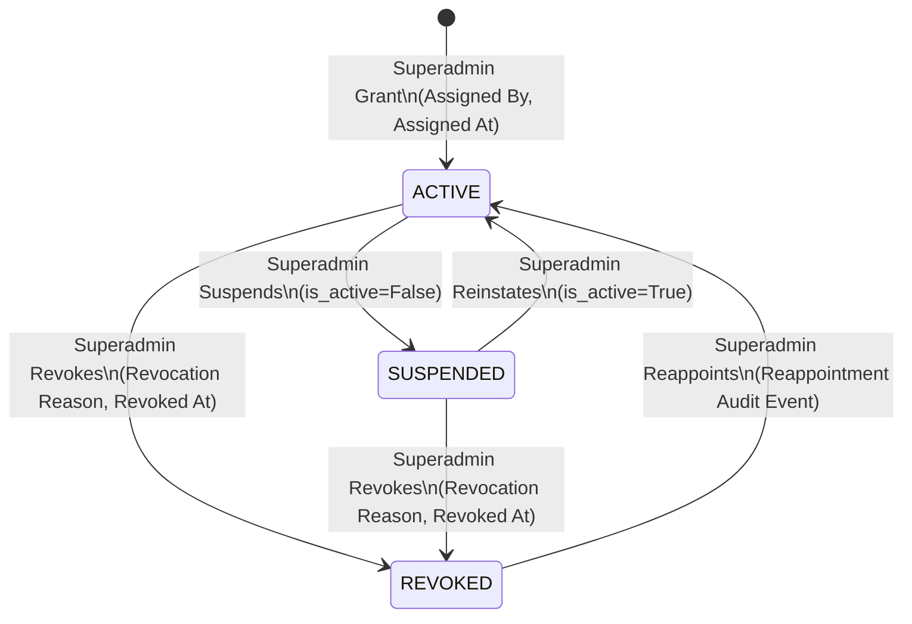
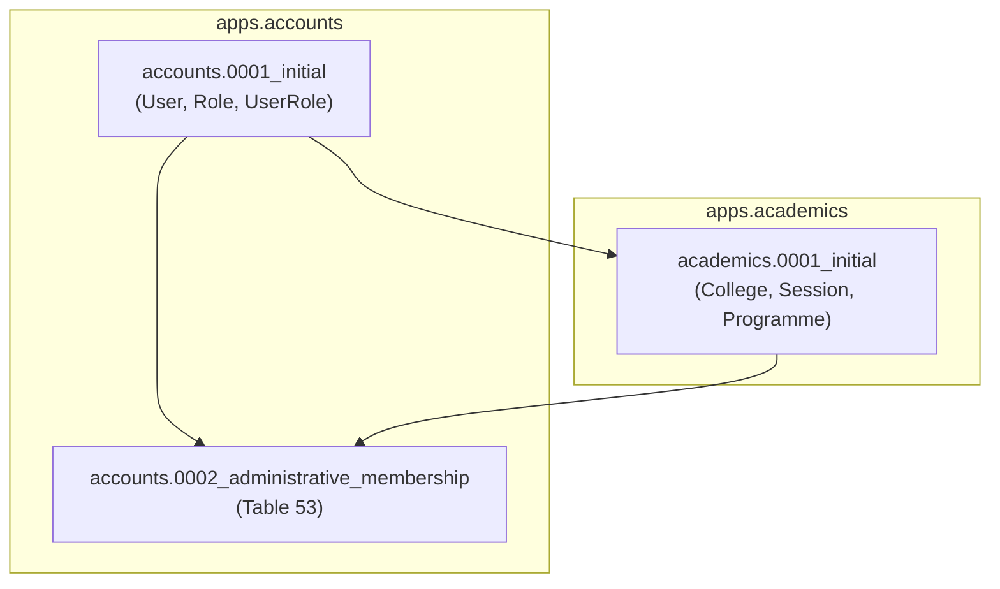

# Architectural Decision Proposal: Administrator-to-College Membership Architecture
## Round 2 Revision — Security, Two-Dimensional RBAC, Lifecycle and Migration Design

**Project:** College Online Examination System  
**Academic Context:** Gauhati University FYUGP Context (College Level)  
**Target Domain:** Domain A: Identity, Authentication & Role-Based Access Control  
**Document ID:** `PROP-CHUNK-06-ADMIN-MEMBERSHIP-002`  
**Status:** **PROPOSAL ROUND 2 — REVISED — PENDING INDEPENDENT ARCHITECTURE AUDIT AND PROJECT-OWNER APPROVAL**  
**Author:** Antigravity Engineering Team  
**Date:** 2026-11-04  
**Last Independently Audited Commit:** `764b289aee9fb9d442139a4c87d8c060bc0a1c43`  
**Impacted Stage:** Chunk 06 (Student and Faculty Management) / Chunk 04 RBAC Integration  

---

## 1. Executive Summary & Round 2 Revision Notes

### 1.1 Context and Background
In the approved 52-table relational database architecture ([`docs/database-architecture.md`](file:///home/zero/Documents/college/docs/database-architecture.md)), institutional scoping exists exclusively for student and faculty accounts via dedicated profile entities:
- Table 6: [`StudentProfile`](file:///home/zero/Documents/college/backend/apps/students/models.py) has a foreign key to `academics_college` (`college_id`).
- Table 7: [`FacultyProfile`](file:///home/zero/Documents/college/backend/apps/faculty/models.py) has a foreign key to `academics_college` (`college_id`).
- Table 1: [`User`](file:///home/zero/Documents/college/backend/apps/accounts/models.py#L44-L107) defines primary role `role = 'ADMIN'`, but contains **no college foreign key**.
- Table 3: [`UserRole`](file:///home/zero/Documents/college/backend/apps/accounts/models.py#L129-L167) assigns granular roles globally across the deployment, with **no college foreign key**.

During the Chunk 06 Round 4 technical audit, ephemeral caller-injected Python attributes (`actor.college_id`, `actor.college`) were eliminated as security vulnerabilities. A strict **fail-closed** boundary was established in [`backend/apps/accounts/authorization.py`](file:///home/zero/Documents/college/backend/apps/accounts/authorization.py): ordinary administrators fail closed (`return set()`), blocking all college-scoped mutations and queries. Superadministrators (`role == 'SUPERADMIN'` or `is_superuser == True`) retain verified system-wide authority.

The first architectural decision proposal (`PROP-CHUNK-06-ADMIN-MEMBERSHIP-001`) evaluated three options and recommended **Option B** (introducing Table 53: `accounts_administrative_membership`). The independent audit reviewed the proposal and returned:
**VERDICT: DESIGN REVISION REQUIRED (5 Findings: P2-A through P2-E).**

### 1.2 Round 2 Audit Findings Resolution Matrix

| Finding | Severity | Defect Identified in Round 1 | Round 2 Resolution & Revised Document Section |
| :---: | :---: | :--- | :--- |
| **P2-A** | **HIGH** | Authorization resolved only college membership (Dimension 1); operation checks relied on global roles, allowing privilege escalation across institutions. | Designed a **Two-Dimensional Institutional Authorization System** (`authorize_institutional_operation`), mandatory per-college `role_id`, and a comprehensive operation-level authorization matrix. *(Sections 8, 9)* |
| **P2-B** | **HIGH** | Lock hierarchy was contradictory (Section 9.1 stated User $\rightarrow$ College, then declared College $\rightarrow$ User $\rightarrow$ Membership). | Established one authoritative, non-contradictory lock hierarchy: **Level 1 College $\rightarrow$ Level 2 User $\rightarrow$ Level 3 AdministrativeMembership** with deterministic ascending PK ordering. Documented exact 7-operation transaction sequences and race analyses. *(Sections 12, 13)* |
| **P2-C** | **MEDIUM** | Single unique constraint `(user_id, college_id)` conflicted with multiple appointment history; `user_id CASCADE` and `assigned_by SET NULL` compromised auditability. | Formally selected **Approach 1 (Single mutable current-state row)** with explicit state transitions. Disclosed Table 8 audit limitations and documented that formal audit retention belongs to Table 51 (`audit_system_audit_log`). Changed `user_id` deletion policy to `ON DELETE RESTRICT`. *(Sections 10, 11)* |
| **P2-D** | **MEDIUM** | SQL schema had CHECK constraints while Django model relied solely on Python `clean()`, which is bypassed by `save()`/`update()`; redundant `is_active`. | Synchronized SQL and Django ORM `Meta.constraints` with identical `models.CheckConstraint` and `models.UniqueConstraint` declarations. Justified `is_active` as an index-covering boolean with strict DB CHECK equivalence. *(Sections 5, 6, 7)* |
| **P2-E** | **MEDIUM** | Overstated claims regarding "zero-downtime", "instantaneous revocation", "zero data loss rollback", and omitted cross-app migration dependencies. | Replaced absolute claims with precise engineering analyses: 5-stage phased rollout, DAG migration analysis (`accounts` $\rightarrow$ `academics` $\rightarrow$ `accounts`), realistic rollback procedures, and exact transaction/caching revocation semantics. *(Sections 14, 15, 16)* |

> [!IMPORTANT]
> **Governance Boundary:** This document is an **architecture proposal revision only**. Implementation authorization is **NOT GRANTED**. No Django models, migrations, serializers, or services have been modified. Protected architecture documents ([`design.md`](file:///home/zero/Documents/college/design.md), [`handover.txt`](file:///home/zero/Documents/college/handover.txt), [`docs/architecture.md`](file:///home/zero/Documents/college/docs/architecture.md), [`docs/database-architecture.md`](file:///home/zero/Documents/college/docs/database-architecture.md)) remain 100% untouched.

---

## 2. Problem Statement: Existing Schema Limitation

### 2.1 The Asymmetry in Institutional Scoping
In the approved 52-table schema ([`docs/database-architecture.md`](file:///home/zero/Documents/college/docs/database-architecture.md)), institutional scoping is defined across Domain A (Identity) and Domain B (Academics):

```
+--------------------------------------------------------------------------------------------------+
| Table                              | User Linkage           | College Linkage   | Institutional  |
+------------------------------------+------------------------+-------------------+----------------+
| Table 1: accounts_user             | Primary Entity (id)    | NONE              | Global role    |
| Table 2: accounts_role             | N/A                    | NONE              | Global code    |
| Table 3: accounts_user_role        | FK -> accounts_user    | NONE              | Global role    |
| Table 6: students_student_profile  | OneToOne accounts_user | FK -> College     | STUDENT only   |
| Table 7: faculty_faculty_profile   | OneToOne accounts_user | FK -> College     | FACULTY only   |
| Table 9: academics_college         | Primary Entity (id)    | Self              | Institution    |
+--------------------------------------------------------------------------------------------------+
```

### 2.2 Operational Deadlock Analysis
1. **Absence of Institutional FK:** Table 1 (`accounts_user`) defines `role = 'ADMIN'`, but does not store an associated college. Table 3 (`accounts_user_role`) allows assigning roles such as `COLLEGE_SUPERADMIN` or `EXAM_OFFICER`, but does so globally without institutional scoping.
2. **Elimination of Runtime Injections:** Finding R4-A demonstrated that caller-injected runtime Python attributes (`admin.college_id = 1`) are non-persistent, forgeable, and violate database referential integrity.
3. **Current Fail-Closed State:** In [`backend/apps/accounts/authorization.py`](file:///home/zero/Documents/college/backend/apps/accounts/authorization.py), `get_actor_authorized_college_ids()` returns an empty set (`set()`) for all ordinary administrators. Consequently, ordinary administrators are currently prevented from executing any college-scoped administrative operations (e.g., student registration review, faculty provisioning, subject assignment).

---

## 3. Corrected Architectural Options Evaluation

### 3.1 Option A: User-to-College Direct Relationship (`accounts_user.college_id`)
* **Concept:** Add a nullable foreign key `college_id BIGINT NULL REFERENCES academics_college(id) ON DELETE RESTRICT` to Table 1 (`accounts_user`).
* **Evaluation:**
  - *Advantages:* Zero-join resolution (`request.user.college_id`); minimal query latency.
  - *Deficiencies:*
    1. *Rigid 1:1 Cardinality:* Gauhati University affiliated colleges frequently share administrative personnel (e.g., regional university examination observers, roving nodal officers, cluster college administrators). Option A mechanically prohibits multi-college administration without creating duplicate user accounts (two separate emails and logins), violating single-identity principles.
    2. *Schema Redundancy & Data Inconsistency:* Both `StudentProfile` (Table 6) and `FacultyProfile` (Table 7) already maintain authoritative `college_id` foreign keys. If `accounts_user.college_id` is added, it creates duplicate sources of truth. If a student's `accounts_user.college_id` differs from `student_profile.college_id`, an irreconcilable data conflict arises. If left `NULL` for students and faculty, Table 1 permanently stores a sparse, role-polluted column.
    3. *High Migration & Table Lock Risk:* Table 1 (`accounts_user`) is the central, highest-traffic table in the system, referenced by 14 foreign keys across 9 domains. Executing an `ALTER TABLE` on production MySQL requires metadata locks and risks table locking.
    4. *Lack of Lifecycle & Audit Metadata:* Cannot track appointment dates, granting superadministrators, or revocation justifications.
    5. *Ambiguity with Superadministrator:* Superadministrators have system-wide access across all colleges. On Table 1, a Superadmin would have `college_id = NULL`. An unassigned ordinary admin would also have `college_id = NULL`, requiring brittle conditional logic.

### 3.2 Option B (Recommended): Dedicated Administrative Membership Mapping Table
* **Concept:** Introduce Table 53 (`accounts_administrative_membership`) as an explicit relational junction entity between `accounts_user` and `academics_college`, augmented with mandatory institutional role assignment, tenure tracking, and audit metadata.
* **Evaluation:**
  - *Advantages:*
    1. *Flexible M:N Institutional Support:* Full support for institutional administrators managing a single college, multi-campus institutions, regional university clusters, or roving examination observers.
    2. *Clean Separation of Concerns:* `accounts_user` remains the pure authentication identity; `accounts_administrative_membership` encapsulates institutional appointment and governance.
    3. *Immediate Activation & Revocation Lifecycle:* Administrative access can be granted, suspended, or revoked (`status = 'REVOKED'`, `is_active = FALSE`) without deactivating the underlying user account or deleting records.
    4. *Granular Per-College Role Specialization:* An administrator can hold distinct responsibilities per institution (e.g., `COLLEGE_SUPERADMIN` at College A, but read-only `EXAM_OFFICER` at College B) via `role_id`.
    5. *Zero Schema Disruption to Existing Tables:* Requires zero modifications to Table 1 (`accounts_user`), Table 2, Table 3, or Table 9. No existing table locks or migrations on production authentication tables.
    6. *Engine-Level Foreign Key Protection:* `ON DELETE RESTRICT` on both `college_id` and `user_id` referentially prevents accidental deletion while active administrative appointments exist.
  - *Disclosed Trade-offs & Mitigations:*
    1. *Schema Expansion (52 to 53 Tables):* Increases the relational table count from 52 to 53. Justified by domain architecture requirements, mirroring Table 17 (`PaperProgrammeMapping`) and Table 20 (`FacultySubjectAssignment`).
    2. *Single Additional Query:* Resolving college scope requires one indexed lookup. Mitigated by indexed covering scans and request-lifecycle caching.

### 3.3 Option C: Reuse Existing Institutional Relationships (REJECTED)
* **Concept:** Force administrators to hold a `FacultyProfile` (Table 7) linked to their college, or store administrator user IDs inside `academics_institutional_config` (Table 21).
* **Rejection Rationale:**
  - *Conflation of Distinct Operational Domains:* Non-teaching administrative staff (Registrars, Academic Deans, Examination Cell In-Charges, Office Superintendents) would require fabricating dummy academic departments, artificial faculty designations, and fictitious employee codes.
  - *Privilege Escalation & Academic Governance Risk:* A college administrator possessing a dummy `FacultyProfile` would become eligible for paper evaluation and grading under Table 20 (`academics_faculty_subject_assignment`), creating severe conflict-of-interest and academic integrity violations.
  - *JSON Anti-Pattern:* Storing user IDs in `academics_institutional_config` lacks foreign keys, row locks, indexing, and invites race conditions.
  - *Verdict:* Strictly **REJECTED**.

---

## 4. Recommended Architecture Overview (Option B)

The proposed architecture adopts **Option B** enhanced with a **Two-Dimensional Institutional Authorization System** (resolving Finding P2-A).

Administrative authority requires satisfying two distinct dimensions simultaneously:
$$\text{Authorized Operation} \iff \text{Dimension 1 (Institution Scope)} \land \text{Dimension 2 (Role Permission)}$$

1. **Dimension 1 (Institution):** The acting user must hold an authoritative, active `AdministrativeMembership` record for the target `academics_college` (`is_active = TRUE`, `status = 'ACTIVE'`).
2. **Dimension 2 (Operation):** The specific granular role assigned to the user within that institution (`membership.role`) must possess the explicit capability to execute the requested administrative operation.

---

## 5. Corrected Table 53 SQL Schema Definition (Resolving P2-D)

```sql
-- Table 53: Administrative College Membership Mapping (Domain A)
CREATE TABLE accounts_administrative_membership (
    id BIGINT NOT NULL AUTO_INCREMENT,
    user_id BIGINT NOT NULL,
    college_id BIGINT NOT NULL,
    role_id BIGINT NOT NULL,
    status VARCHAR(20) NOT NULL DEFAULT 'ACTIVE',
    is_active BOOLEAN NOT NULL DEFAULT TRUE,
    assigned_by_id BIGINT NOT NULL,
    assigned_at DATETIME(6) NOT NULL DEFAULT CURRENT_TIMESTAMP(6),
    revoked_by_id BIGINT NULL DEFAULT NULL,
    revoked_at DATETIME(6) NULL DEFAULT NULL,
    revocation_reason TEXT NULL DEFAULT NULL,
    notes VARCHAR(255) NULL DEFAULT NULL,
    
    PRIMARY KEY (id),
    CONSTRAINT uk_admin_mem_user_college UNIQUE (user_id, college_id),
    CONSTRAINT fk_admin_mem_user FOREIGN KEY (user_id) 
        REFERENCES accounts_user(id) ON DELETE RESTRICT,
    CONSTRAINT fk_admin_mem_college FOREIGN KEY (college_id) 
        REFERENCES academics_college(id) ON DELETE RESTRICT,
    CONSTRAINT fk_admin_mem_role FOREIGN KEY (role_id) 
        REFERENCES accounts_role(id) ON DELETE RESTRICT,
    CONSTRAINT fk_admin_mem_assigned_by FOREIGN KEY (assigned_by_id) 
        REFERENCES accounts_user(id) ON DELETE RESTRICT,
    CONSTRAINT fk_admin_mem_revoked_by FOREIGN KEY (revoked_by_id) 
        REFERENCES accounts_user(id) ON DELETE SET NULL,
    CONSTRAINT chk_admin_mem_status CHECK (
        status IN ('ACTIVE', 'SUSPENDED', 'REVOKED')
    ),
    CONSTRAINT chk_admin_mem_active_status CHECK (
        (is_active = TRUE AND status = 'ACTIVE') OR 
        (is_active = FALSE AND status IN ('SUSPENDED', 'REVOKED'))
    )
) ENGINE=InnoDB DEFAULT CHARSET=utf8mb4 COLLATE=utf8mb4_0900_ai_ci;

-- Optimized performance indexes
CREATE INDEX idx_admin_mem_lookup ON accounts_administrative_membership (user_id, is_active, college_id, role_id);
CREATE INDEX idx_admin_mem_college_status ON accounts_administrative_membership (college_id, status);
CREATE INDEX idx_admin_mem_role ON accounts_administrative_membership (role_id);
```

---

## 6. Matching Django ORM Model Specification (Resolving P2-D)

```python
# Proposed: backend/apps/accounts/models.py (Illustrative Specification — Unimplemented)

from django.db import models
from django.db.models import Q
from django.core.exceptions import ValidationError
from django.utils import timezone


class AdministrativeMembershipStatus(models.TextChoices):
    ACTIVE = 'ACTIVE', 'Active'
    SUSPENDED = 'SUSPENDED', 'Suspended'
    REVOKED = 'REVOKED', 'Revoked'


class AdministrativeMembership(models.Model):
    """
    Administrative College Membership Mapping (Table 53: accounts_administrative_membership).
    Assigns institutional administrative authority to an accounts_user for an academics_college
    with an explicit, mandatory institutional role (Finding P2-A).
    """
    id = models.BigAutoField(primary_key=True)
    user = models.ForeignKey(
        'accounts.User',
        on_delete=models.RESTRICT,
        related_name='administrative_memberships',
        db_column='user_id',
    )
    college = models.ForeignKey(
        'academics.College',
        on_delete=models.RESTRICT,
        related_name='administrative_memberships',
        db_column='college_id',
    )
    role = models.ForeignKey(
        'accounts.Role',
        on_delete=models.RESTRICT,
        related_name='college_administrative_memberships',
        db_column='role_id',
        help_text="Mandatory granular institutional role within this college (Finding P2-A).",
    )
    status = models.CharField(
        max_length=20,
        choices=AdministrativeMembershipStatus.choices,
        default=AdministrativeMembershipStatus.ACTIVE,
    )
    is_active = models.BooleanField(
        default=True,
        db_index=True,
        help_text="Denormalized flag for fast covering-index authorization queries.",
    )
    assigned_by = models.ForeignKey(
        'accounts.User',
        on_delete=models.RESTRICT,
        related_name='granted_administrative_memberships',
        db_column='assigned_by_id',
    )
    assigned_at = models.DateTimeField(default=timezone.now)
    revoked_by = models.ForeignKey(
        'accounts.User',
        on_delete=models.SET_NULL,
        null=True,
        blank=True,
        related_name='revoked_administrative_memberships',
        db_column='revoked_by_id',
    )
    revoked_at = models.DateTimeField(null=True, blank=True)
    revocation_reason = models.TextField(null=True, blank=True)
    notes = models.CharField(max_length=255, null=True, blank=True)

    class Meta:
        db_table = 'accounts_administrative_membership'
        verbose_name = 'Administrative Membership'
        verbose_name_plural = 'Administrative Memberships'
        constraints = [
            models.UniqueConstraint(
                fields=['user', 'college'],
                name='uk_admin_mem_user_college',
            ),
            models.CheckConstraint(
                check=Q(status__in=['ACTIVE', 'SUSPENDED', 'REVOKED']),
                name='chk_admin_mem_status',
            ),
            models.CheckConstraint(
                check=(
                    Q(is_active=True, status='ACTIVE') |
                    Q(is_active=False, status__in=['SUSPENDED', 'REVOKED'])
                ),
                name='chk_admin_mem_active_status',
            ),
        ]
        indexes = [
            models.Index(
                fields=['user', 'is_active', 'college', 'role'],
                name='idx_admin_mem_lookup',
            ),
            models.Index(
                fields=['college', 'status'],
                name='idx_admin_mem_college_status',
            ),
            models.Index(
                fields=['role'],
                name='idx_admin_mem_role',
            ),
        ]

    def clean(self):
        super().clean()
        errors = {}

        # 1. Primary role enforcement: only primary ADMIN users may hold memberships
        if self.user_id:
            from apps.accounts.models import RoleChoices
            if self.user.role != RoleChoices.ADMIN:
                errors['user'] = (
                    f"Administrative membership can only be granted to users with primary role "
                    f"'{RoleChoices.ADMIN}'. User primary role is '{self.user.role}'."
                )

        # 2. Prevent self-grant and self-revocation
        if self.assigned_by_id and self.assigned_by_id == self.user_id:
            errors['assigned_by'] = "Administrators cannot grant administrative memberships to themselves."
        if self.revoked_by_id and self.revoked_by_id == self.user_id:
            errors['revoked_by'] = "Administrators cannot revoke their own administrative memberships."

        # 3. Status and is_active coherence
        if self.status == AdministrativeMembershipStatus.ACTIVE and not self.is_active:
            errors['is_active'] = "Active status requires is_active=True."
        if self.status != AdministrativeMembershipStatus.ACTIVE and self.is_active:
            errors['is_active'] = f"Status '{self.status}' requires is_active=False."

        # 4. Revocation timestamp coherence
        if self.status == AdministrativeMembershipStatus.REVOKED and not self.revoked_at:
            self.revoked_at = timezone.now()

        if errors:
            raise ValidationError(errors)
```

---

## 7. Constraint Classification & Redundant Field Justification (Resolving P2-D)

### 7.1 Multi-Tier Constraint Enforcement Architecture

| Invariant | Enforcement Tier | Mechanism | Failure Mode |
| :--- | :--- | :--- | :--- |
| **Referential Integrity** | Database Foreign Key | `fk_admin_mem_user`, `fk_admin_mem_college`, `fk_admin_mem_role` | `IntegrityError` (`ON DELETE RESTRICT`) |
| **Single Active Membership** | Database Unique Constraint | `uk_admin_mem_user_college (user_id, college_id)` | `IntegrityError` (Duplicate Key) |
| **Allowed Status Values** | Database Check Constraint | `chk_admin_mem_status (status IN (...))` | `IntegrityError` (Check Violation) |
| **Status / Active Coherence** | Database Check Constraint | `chk_admin_mem_active_status ((is_active=T AND status='ACTIVE') OR ...)` | `IntegrityError` (Check Violation) |
| **Primary Role Eligibility** | Transactional Service Validation & Model `clean()` | Service rechecks `user.role == RoleChoices.ADMIN` under User lock | `ValidationError` (HTTP 400) |
| **No Self-Grant / Self-Revoke** | Transactional Service Validation & Model `clean()` | Service verifies `actor.pk != target_user.pk` | `PermissionDenied` (HTTP 403) |
| **Mandatory Role Assignment** | Database `NOT NULL` Column | `role_id BIGINT NOT NULL` | `IntegrityError` (Column cannot be null) |
| **Operation-Level Authority** | Centralized Authorization Service | `authorize_institutional_operation(actor, college_id, operation)` | `PermissionDenied` (HTTP 403) |

### 7.2 Justification for Retaining Denormalized `is_active`
The boolean column `is_active` denormalizes `status == 'ACTIVE'`. This field is intentionally retained for:
1. **Covering Index Optimization:** In MySQL InnoDB, a composite index `(user_id, is_active, college_id, role_id)` allows high-frequency authorization queries to execute as pure index-covering scans, filtering on a 1-byte integer boolean rather than performing multi-byte string comparisons on `status`.
2. **Database-Level Coherence:** Constraint `chk_admin_mem_active_status` enforces strict mathematical equivalence at the database engine level, eliminating any risk of status drift between `is_active` and `status`.

---

## 8. Two-Dimensional Institutional Authorization System (Resolving P2-A)

### 8.1 Centralized Authorization Contract
The centralized authorization interface replaces single-dimension college lookups with a two-dimensional verification contract:

```python
# Proposed Interface: backend/apps/accounts/authorization.py (Illustrative Specification)

def authorize_institutional_operation(
    actor,
    college_id: Union[int, College],
    operation: str,
) -> InstitutionalAuthorizationContext:
    """
    Two-Dimensional Institutional Authorization Interface (Finding P2-A).
    
    Dimension 1: Institution Scope (Is actor authorized for target college?)
    Dimension 2: Operation Capability (Does actor's institutional role permit this operation?)
    
    Contract:
    1. Authentication Requirement: actor must be authenticated.
    2. Active Account Requirement: actor.is_active must be True.
    3. Primary Role Gate: actor.role must be ADMIN or SUPERADMIN. STUDENT and FACULTY fail closed.
    4. Target Resolution: college_id must be valid and non-null.
    5. Superadministrator Handling: SUPERADMIN or is_superuser grants system-wide authority.
    6. Membership Lookup: Query active AdministrativeMembership for (actor, target_college).
    7. Institutional Role Resolution: Extract membership.role.code.
    8. Capability Verification: Check operation in INSTITUTIONAL_ROLE_PERMISSIONS[role_code].
    9. Default-Deny: Unknown operations or unmapped permissions raise PermissionDenied.
    10. Return: InstitutionalAuthorizationContext with verified college and role metadata.
    """
```

### 8.2 Role Model Decision
In Round 1, `role_id` was proposed as optional. Under Finding P2-A, this created ambiguity regarding whether `NULL` implied unrestricted administrative privileges.

**Authoritative Decision:** **`role_id` is MANDATORY (`NOT NULL`) for all administrative memberships.**
- Every administrator assigned to a college must hold an explicit, approved institutional role (e.g., `COLLEGE_SUPERADMIN` or `EXAM_OFFICER`).
- `NULL role_id` is rejected at both the database level (`NOT NULL`) and the application level.
- This eliminates ambiguous "default admin" privileges and enforces strict least privilege across all institutions.

---

## 9. Comprehensive Operation-Level Authorization Matrix (Resolving P2-A)

The matrix defines permitted operations using only approved roles (`SUPERADMIN`, `COLLEGE_SUPERADMIN`, `EXAM_OFFICER`):

| Operation Identifier | Domain / Target Functionality | System `SUPERADMIN` | Assigned `COLLEGE_SUPERADMIN` | Assigned `EXAM_OFFICER` | Unassigned / Cross-College Admin | Student / Faculty |
| :--- | :--- | :---: | :---: | :---: | :---: | :---: |
| `student.registration.review` | Approve/Reject Student Registration | **ALLOW** | **ALLOW** | **DENY** | **DENY** | **DENY** |
| `student.profile.manage` | Update Profile, Semester Bounds | **ALLOW** | **ALLOW** | **DENY** | **DENY** | **DENY** |
| `faculty.account.provision` | Provision Faculty User Account | **ALLOW** | **ALLOW** | **DENY** | **DENY** | **DENY** |
| `faculty.profile.manage` | Update Designation, Department | **ALLOW** | **ALLOW** | **DENY** | **DENY** | **DENY** |
| `enrollment.record.manage` | Create/Update Academic Records | **ALLOW** | **ALLOW** | **ALLOW** | **DENY** | **DENY** |
| `academic.faculty_assignment.manage`| Assign Faculty to Paper Offerings | **ALLOW** | **ALLOW** | **ALLOW** | **DENY** | **DENY** |
| `academic.programme.manage` | Create/Update Academic Programmes | **ALLOW** | **ALLOW** | **DENY** | **DENY** | **DENY** |
| `academic.session.manage` | Create Sessions, Switch Current | **ALLOW** | **ALLOW** | **DENY** | **DENY** | **DENY** |
| `academic.structure.manage` | Departments, Subjects, Offerings | **ALLOW** | **ALLOW** | **DENY** | **DENY** | **DENY** |
| `academic.config.manage` | Sensitive Institutional Config | **ALLOW** | **ALLOW** | **DENY** | **DENY** | **DENY** |
| `admin.membership.manage` | Grant, Suspend, Revoke Memberships | **ALLOW** | **DENY** | **DENY** | **DENY** | **DENY** |

### 9.1 Existing RBAC Integration
- **`IsAdminUserRole` / `IsCollegeSuperAdmin`:** Updated to evaluate institutional context from the request route (`view.kwargs['college_id']` or resolved target entity) via `authorize_institutional_operation`.
- **`check_institutional_admin_authority()` / `check_college_operation_authority()`:** Centralized into `authorize_institutional_operation(actor, college_id, operation)`.
- **`User.has_role()`:** Preserved exclusively for global, non-institutional roles. Per-college permissions derive strictly from `AdministrativeMembership.role`.

---

## 10. Membership Lifecycle State Machine (Resolving P2-C)



### 10.1 Allowed and Forbidden State Transitions

| Current State | Target State | Permitted? | Authorization Required | Operational Action |
| :---: | :---: | :---: | :--- | :--- |
| `None` | `ACTIVE` | **YES** | System `SUPERADMIN` | Initial membership creation; sets `assigned_by`, `assigned_at`. |
| `ACTIVE` | `SUSPENDED` | **YES** | System `SUPERADMIN` | Temporary access suspension; sets `is_active=FALSE`. |
| `SUSPENDED` | `ACTIVE` | **YES** | System `SUPERADMIN` | Reinstatement; sets `is_active=TRUE`. |
| `ACTIVE` | `REVOKED` | **YES** | System `SUPERADMIN` | Permanent termination; sets `is_active=FALSE`, `revoked_by`, `revoked_at`, `revocation_reason`. |
| `SUSPENDED` | `REVOKED` | **YES** | System `SUPERADMIN` | Revocation of suspended member. |
| `REVOKED` | `ACTIVE` | **YES** | System `SUPERADMIN` | Reappointment; updates `assigned_by`, `assigned_at`, clears revocation metadata. |
| `ACTIVE` | `ACTIVE` | **NO** | N/A | Redundant transition; rejected. |
| Any | Any | **NO** | Self / Non-Superadmin | Self-grant and self-revocation are strictly forbidden. |

---

## 11. Historical Retention & Audit Infrastructure Limitations (Resolving P2-C)

### 11.1 Lifecycle Model Selection: Approach 1
The proposal adopts **Approach 1 (Single mutable current-state record per User and College)**:
- Maintains exactly one row per `(user_id, college_id)` enforced by `uk_admin_mem_user_college`.
- Avoids complex multi-row active-record indexing and overlapping tenure intervals.
- Minimizes schema complexity while fully meeting operational requirements.

### 11.2 Disclosed Audit Infrastructure Limitations
1. **Table 8 (`accounts_auth_event`) Limitation:** Table 8 is strictly scoped to authentication events (`LOGIN_SUCCESS`, `LOGIN_FAILED`, `LOGOUT`, etc.). It contains no event types or schema structures to log administrative membership mutations.
2. **Table 51 (`audit_system_audit_log`) Deferral:** The authoritative audit trail for administrative mutations is Table 51 (`audit_system_audit_log` in Domain I). However, Domain I is deferred to Chunk 15 / 16.
3. **Chunk 06 Interim Audit Mechanism:** Until Chunk 15 is authorized and implemented, membership mutations will emit structured security logs to Python logging (`logger = logging.getLogger('college.accounts.audit')`). Creating an intermediate audit table in Chunk 06 is **not authorized** and would require separate project-owner schema approval.

### 11.3 Foreign-Key Deletion Protection Policy
- **`user_id ON DELETE RESTRICT`:** The foreign key from `AdministrativeMembership` to `User` is configured as `RESTRICT` (reversing Round 1's `CASCADE`). A user account with an active or historical administrative membership cannot be deleted, referentially preserving administrative appointment records.
- **`assigned_by_id ON DELETE RESTRICT`:** Prevents deleting superadministrator accounts who granted active memberships.
- **`revoked_by_id ON DELETE SET NULL`:** Nullable reference with audit log backup.

---

## 12. Authoritative Transaction Lock Hierarchy (Resolving P2-B)

To eliminate the contradictory lock ordering identified in Finding P2-B, all membership mutation services conform strictly to one authoritative Three-Level Lock Hierarchy:

$$\text{Level 1: College Coordination Lock} \longrightarrow \text{Level 2: Target User Lock} \longrightarrow \text{Level 3: AdministrativeMembership Lock}$$

### 12.1 Lock Acquisition Rules
1. **Deterministic Ascending Order:** When multiple entities at the same level are locked, acquire locks in strictly ascending primary-key order (`order_by('pk')`).
2. **Single-Table Discipline:** Execute single-table `select_for_update()` queries exclusively. Never use `select_related()` inside locking queries on MySQL 8 InnoDB.
3. **No Lock Inversion:** Lower-level locks (e.g., Level 3 Membership) must never be acquired before higher-level locks (Level 1 College, Level 2 User).

---

## 13. Transaction Sequences & Concurrency Race Analysis (Resolving P2-B)

### 13.1 Membership Mutation Transaction Sequences

| Operation | Level 1: College Lock | Level 2: User Lock | Level 3: Membership Lock | Recheck & Validation | Mutation & Commit |
| :--- | :--- | :--- | :--- | :--- | :--- |
| **Grant Membership** | `lock_colleges(college_id)` | `User.objects.select_for_update().get(pk=uid)` | Query existing membership under lock | Verify actor is Superadmin; verify `target.role == ADMIN`; check uniqueness | Create `AdministrativeMembership`; commit |
| **Update Role** | `lock_colleges(college_id)` | `User.objects.select_for_update().get(pk=uid)` | `AdministrativeMembership.objects.select_for_update().get(...)` | Verify membership is `ACTIVE`; verify proposed role exists | Update `role_id`; commit |
| **Suspend Membership**| `lock_colleges(college_id)` | `User.objects.select_for_update().get(pk=uid)` | `AdministrativeMembership.objects.select_for_update().get(...)` | Verify membership is `ACTIVE` | Set `is_active=FALSE`, `status='SUSPENDED'`; commit |
| **Reactivate Member** | `lock_colleges(college_id)` | `User.objects.select_for_update().get(pk=uid)` | `AdministrativeMembership.objects.select_for_update().get(...)` | Verify membership is `SUSPENDED` | Set `is_active=TRUE`, `status='ACTIVE'`; commit |
| **Revoke Membership** | `lock_colleges(college_id)` | `User.objects.select_for_update().get(pk=uid)` | `AdministrativeMembership.objects.select_for_update().get(...)` | Verify membership is not already `REVOKED` | Set `is_active=FALSE`, `status='REVOKED'`, `revoked_at`, `reason`; commit |
| **Reappoint Member** | `lock_colleges(college_id)` | `User.objects.select_for_update().get(pk=uid)` | `AdministrativeMembership.objects.select_for_update().get(...)` | Verify membership is `REVOKED`; verify `target.role == ADMIN` | Update `role_id`, `assigned_by`, `assigned_at`, `is_active=TRUE`, `status='ACTIVE'`; commit |
| **Demote User Role** | `lock_colleges(*admin_college_ids)` | `User.objects.select_for_update().get(pk=uid)` | Lock all active memberships for user | If demoting from `ADMIN`, require revoking all active memberships | Revoke memberships, update `user.role`; commit |

### 13.2 Concurrency Race Scenarios & Resolutions
1. **Concurrent Grant Race:** Two superadministrators attempt to grant membership to the same user at the same college simultaneously. Serialized at Level 1 College lock; the second transaction encounters the existing record or triggers unique constraint `uk_admin_mem_user_college`.
2. **Revocation vs. Administrative Write:** Superadmin revokes an administrator's membership while that administrator is executing an institutional mutation (e.g., student approval). Both operations acquire Level 1 College lock. If revocation commits first, the administrator's transaction revalidates membership under lock and aborts with `PermissionDenied`. If the write commits first, revocation immediately blocks subsequent requests.
3. **Concurrent Multi-College Updates:** An administrator holds memberships in College 1 and College 2. Both memberships are updated concurrently. Both transactions lock colleges in ascending PK order (`lock_colleges(min_id, max_id)`), preventing deadlock.

---

## 14. Real-World Revocation Semantics & Caching (Resolving P2-E)

### 14.1 Technical Distinction Across Revocation Scopes
Finding P2-E noted that Round 1 conflated four distinct operational scopes regarding revocation:

1. **New Request Authorization:** Preventing new HTTP requests from being authorized after revocation. Achieved immediately on the next database query because `authorize_institutional_operation` queries committed database state.
2. **In-Flight Transaction Completion:** Preventing an operation already past controller authorization from committing after revocation. Achieved by rechecking `authorize_institutional_operation` inside the service-layer `@transaction.atomic` block under entity row locks.
3. **Session Invalidation:** Terminating the administrator's active browser session. Requires explicit Django session flush or cache token revocation; updating database membership alone does not invalidate a Django session cookie.
4. **Request-Local Cache Scope:** Clearing `request._authorized_context_cache` affects only the current thread and process. It does not communicate across worker processes. Cross-process consistency is provided exclusively by the database.

---

## 15. Migration Dependency Graph & DAG Analysis (Resolving P2-E)

### 15.1 Directed Acyclic Graph (DAG) Analysis
Table 53 resides in `apps.accounts`, but references Table 9 (`academics_college`) in `apps.academics`.



- `accounts.0001_initial` defines `User`, `Role`, `UserRole`.
- `academics.0001_initial` depends on `AUTH_USER_MODEL` (`accounts.0001_initial`).
- Proposed `accounts.0002_administrative_membership` depends on both `accounts.0001_initial` and `academics.0001_initial`.
- **DAG Integrity:** The graph is strictly acyclic. No circular dependencies exist.

---

## 16. Phased Deployment & Rollback Strategy (Resolving P2-E)

### 16.1 Staged Rollout Strategy
1. **Stage 1 — Schema Introduction:** Apply migration `accounts.0002_administrative_membership` during an off-peak maintenance window. Note that `CREATE TABLE` acquires a brief metadata lock (MDL) on referenced tables (`accounts_user`, `academics_college`, `accounts_role`). Active long-running transactions must be drained before execution.
2. **Stage 2 — Dual-Compatible Code Deployment:** Deploy backend services supporting `AdministrativeMembership`. Institutional authorization remains fail-closed for administrators without assigned memberships.
3. **Stage 3 — Administrative Membership Provisioning:** Superadministrators grant explicit institutional memberships and roles through an audited bootstrap procedure. No automatic heuristics or email-domain inferences are used.
4. **Stage 4 — Authorization Gate Activation:** Switch `authorize_institutional_operation` to actively permit ordinary administrators based on verified active memberships.
5. **Stage 5 — Staging & Production Verification:** Verify institutional boundaries, operation-level permissions, and revocation semantics.

### 16.2 Real-World Rollback Plan
- **Level 1 (Operational Rollback):** Disable membership-based administrative access by toggling an application flag, immediately reverting ordinary administrators to fail-closed status without schema modifications.
- **Level 2 (Data Preservation Rollback):** Export all `accounts_administrative_membership` records to a secure SQL/JSON dump before attempting schema reversal.
- **Level 3 (Schema Reversal):** Execute `python manage.py migrate accounts 0001_initial`. This drops Table 53. This is destructive to membership records and is only executed after Level 2 data preservation.

---

## 17. Post-Approval Implementation Plan

Upon formal project-owner approval, implementation will proceed through Chunk 06 Round 6:
1. Define `AdministrativeMembership` model in `backend/apps/accounts/models.py`.
2. Generate migration `0002_administrative_membership.py`.
3. Implement `authorize_institutional_operation` in `backend/apps/accounts/authorization.py`.
4. Update service functions across `apps.academics`, `apps.students`, `apps.faculty`, and `apps.enrollments` to replace generic checks with operation-level checks.
5. Execute regression test suite.

---

## 18. Post-Approval Automated Test Specification

The following 16 automated test cases will be implemented to verify the architecture:

1. `test_admin_authorized_for_assigned_operation`: Proves admin with `COLLEGE_SUPERADMIN` at College A can approve student registrations.
2. `test_admin_denied_for_unauthorized_operation`: Proves admin with `EXAM_OFFICER` at College A is denied when attempting registration approvals.
3. `test_admin_denied_cross_college_operation`: Proves admin of College A is denied all operations on College B.
4. `test_admin_multi_college_distinct_roles`: Proves admin holding `COLLEGE_SUPERADMIN` at College A and `EXAM_OFFICER` at College B possesses distinct permissions per institution.
5. `test_revoked_membership_denies_immediately`: Proves revoked membership immediately raises `PermissionDenied`.
6. `test_suspended_membership_denies_immediately`: Proves suspended membership immediately raises `PermissionDenied`.
7. `test_student_cannot_hold_membership`: Proves model validation rejects student user.
8. `test_faculty_cannot_hold_membership`: Proves model validation rejects faculty user.
9. `test_superadmin_retains_system_wide_access`: Proves Superadmin accesses all valid operations across colleges without explicit membership.
10. `test_self_grant_forbidden`: Proves administrator cannot grant membership to self.
11. `test_self_revoke_forbidden`: Proves administrator cannot revoke own membership.
12. `test_unique_constraint_enforced`: Proves duplicate active memberships raise database `IntegrityError`.
13. `test_check_constraint_status_active_enforced`: Proves invalid status/is_active combinations raise database `IntegrityError`.
14. `test_college_deletion_restricted`: Proves `College.delete()` is blocked by `ON DELETE RESTRICT`.
15. `test_user_deletion_restricted`: Proves `User.delete()` is blocked by `ON DELETE RESTRICT`.
16. `test_lock_order_college_first_deadlock_free`: Proves concurrent membership mutations execute in deterministic College-first order without deadlock.

---

## 19. Known Unresolved Risks & Testing Deficiencies

1. **MySQL 8 InnoDB Multi-Connection Concurrency Integration:**  
   **NOT EXECUTED.** Lock hierarchies and constraint validations are engineered for MySQL InnoDB, but live multi-process concurrency testing remains pending infrastructure availability.
2. **Live Redis Throttling Verification:**  
   **DEFERRED (10 Tests Cleanly Skipped).**
3. **Production Reverse Proxy / TLS Verification:**  
   **PENDING (Target: Chunk 16).**

---

## 20. Explicit Project-Owner Approval Checklist

Before any code implementation begins, the project owner must review and explicitly decide:

- [ ] **1. Architecture Selection:** Formally approve **Option B (Dedicated Administrative Membership Mapping Table)** with **Two-Dimensional Institutional Authorization**.
- [ ] **2. Schema Baseline Expansion:** Formally approve expanding the relational database architecture from **52 tables to 53 tables** to accommodate Table 53 (`accounts_administrative_membership`).
- [ ] **3. Mandatory Institutional Role:** Approve making `role_id` mandatory (`NOT NULL`) on Table 53.
- [ ] **4. Lifecycle Model:** Approve **Approach 1 (Single mutable current-state record)** with deletion protection (`ON DELETE RESTRICT`).
- [ ] **5. Authorization Matrix:** Approve the Operation-Level Authorization Matrix defined in Section 9.
- [ ] **6. Chunk 06 Round 6 Implementation:** Authorize the engineering team to implement Table 53, generate migration `0002_administrative_membership`, and wire `authorize_institutional_operation`.

---

## 21. Stop Condition & Governance Attestation

In accordance with explicit governance instructions:
- **Zero code changes** have been made to Django models, services, or views.
- **Zero migrations** have been created.
- Protected files ([`design.md`](file:///home/zero/Documents/college/design.md), [`handover.txt`](file:///home/zero/Documents/college/handover.txt), [`docs/architecture.md`](file:///home/zero/Documents/college/docs/architecture.md), [`docs/database-architecture.md`](file:///home/zero/Documents/college/docs/database-architecture.md), [`docs/development-progress.md`](file:///home/zero/Documents/college/docs/development-progress.md)) remain untouched.
- Git commit and push remain unexecuted.
- Chunk 07 onward remains strictly gated.
- Android application development remains paused.

```
===================================================================================================
STOP CONDITION MET: ARCHITECTURAL DESIGN PROPOSAL ROUND 2 REVISED.
AWAITING INDEPENDENT ARCHITECTURE AUDIT AND FORMAL PROJECT-OWNER APPROVAL.
DO NOT BEGIN IMPLEMENTATION UNTIL OWNER EXPLICITLY APPROVES.
===================================================================================================
```
