# Architectural Decision Proposal: Administrator-to-College Membership Architecture
## Final Architecture Reconciliation — Lock Hierarchy, Academic Visibility and Audit Guarantees

**Project:** College Online Examination System  
**Academic Context:** Gauhati University FYUGP Context (College Level)  
**Target Domain:** Domain A: Identity, Authentication & Role-Based Access Control  
**Document ID:** `PROP-CHUNK-06-ADMIN-MEMBERSHIP-FINAL-RECONCILED`  
**Status:** **FINAL RECONCILIATION — PENDING INDEPENDENT ARCHITECTURE AUDIT AND PROJECT-OWNER APPROVAL**  
**Author:** Antigravity Engineering Team  
**Date:** 2026-11-04  
**Last Independently Audited Commit:** `c3a24c0a488390e3f40259a1ddcc78d0ac1dbf89`  
**Impacted Stage:** Chunk 06 (Student and Faculty Management) / Chunk 04 RBAC Integration  

---

## 1. Executive Summary & Design Revision History

### 1.1 Context and Problem Statement
In the approved 52-table relational database architecture ([`docs/database-architecture.md`](file:///home/zero/Documents/college/docs/database-architecture.md)), institutional scoping exists exclusively for student and faculty accounts via dedicated profile entities:
- Table 6: [`StudentProfile`](file:///home/zero/Documents/college/backend/apps/students/models.py) has a foreign key to `academics_college` (`college_id`).
- Table 7: [`FacultyProfile`](file:///home/zero/Documents/college/backend/apps/faculty/models.py) has a foreign key to `academics_college` (`college_id`).
- Table 1: [`User`](file:///home/zero/Documents/college/backend/apps/accounts/models.py#L44-L107) defines primary role `role = 'ADMIN'`, but contains **no college foreign key**.
- Table 3: [`UserRole`](file:///home/zero/Documents/college/backend/apps/accounts/models.py#L129-L167) assigns granular roles globally across the deployment, with **no college foreign key**.

During the Chunk 06 technical audits, ephemeral caller-injected Python attributes (`actor.college_id`, `actor.college`) were eliminated as security vulnerabilities. A strict **fail-closed** boundary was established in [`backend/apps/accounts/authorization.py`](file:///home/zero/Documents/college/backend/apps/accounts/authorization.py): ordinary administrators fail closed (`return set()`), blocking all college-scoped mutations and queries. Superadministrators (`role == 'SUPERADMIN'` or `is_superuser == True`) retain verified system-wide authority.

### 1.2 Independent Audit Revision History

| Proposal Iteration | Verdict | Findings / Scope Addressed |
|---|---|---|
| **Round 1 (`PROP-...-001`)** | REVISION REQUIRED | 5 Findings: Incomplete college scoping, lock-order contradictions, audit deletion risk, SQL/Django constraint mismatches, overstated deployment claims. |
| **Round 2 (`PROP-...-002`)** | CONDITIONAL PASS | Preferred Option B retained; identified 3 remaining specification gaps: Read-operation scoping, in-flight transaction synchronization, durable audit retention. |
| **Final Addendum (`PROP-...-FINAL-ADDENDUM`)** | CONDITIONAL PASS | Delivered 2D read/write RBAC, service locking matrix, audit retention policy analysis; identified 4 targeted refinement findings (P4-A through P4-D). |
| **Round 4 Revision (`PROP-...-FINAL`)** | CONDITIONAL PASS | Addressed P4-A through P4-D. Audited commit `74862dd18724524915be8c997cfb9374c33b9eff`. Identified 3 reconciliation gaps (P5-A, P5-B, P5-C). |
| **Final Reconciliation (Current)** | **PENDING REVIEW** | Resolves Findings P5-A, P5-B, and P5-C. Authoritative 34-service lock inventory; compatibility strategy evaluation; Strategy C lock family recommendation; catalogue browsing baseline retention; dual audit durability mechanics. Audited commit `c3a24c0a488390e3f40259a1ddcc78d0ac1dbf89`. |

### 1.3 Resolution Summary of Targeted Findings (P4-A through P4-D)

| Finding | Severity | Defect Analysis & Root Cause | Final Resolution & Document Section |
| :---: | :---: | :--- | :--- |
| **P4-A** | **HIGH** | `get_authorized_college_ids_for_operation` returned unrestricted superadmin scope before verifying whether `operation` was in the approved registry, allowing unknown operations to bypass default-deny for Superadmin. | Enforced an unbypassable 11-step evaluation pipeline where operation type and registry validation occur **first**, guaranteeing unknown operations fail closed for all roles, including Superadmin. *(Section 8.4, Section 14.1, 14.2)* |
| **P4-B** | **HIGH** | Standard mutation hierarchy (`College -> Actor User -> Membership -> Target`) conflicted with membership grant/revoke and registration review workflows that lock target user rows; multi-college updates lacked deterministic global ordering. | Established a unified global Five-Level Lock Hierarchy: **Level 1 College $\rightarrow$ Level 2 All Users in ascending PK order $\rightarrow$ Level 3 Memberships in ascending PK order $\rightarrow$ Level 4 Academic Parents $\rightarrow$ Level 5 Academic Children**. Documented exact 8 mutation sequences and reconciled 13 services. *(Section 9, Section 14.3, 14.4, 14.5)* |
| **P4-C** | **MEDIUM** | The institutional helper returning `set()` for student/faculty accounts conflated administrative authority with legitimate student/faculty self-service and general academic reference data visibility. | Established four independent authorization domains: Domain A (Institutional Admin), Domain B (Student Self-Service), Domain C (Faculty Self-Service), and Domain D (General Academic Read Access). Proved self-service never depends on administrative membership. *(Section 14.6, 14.7, 14.8)* |
| **P4-D** | **MEDIUM** | Single atomic audit transaction model fails for rejected security attempts (rollback erases the rejection event); append-only database table was loosely described as tamper-evident non-repudiation. | Formulated dual audit transaction semantics: atomic commit for successful mutations; separate structured security logging sink for rejected authorization attempts. Accurately disclaimed cryptographic tamper-evidence and mapped Table 51 columns. *(Section 12, Section 14.9, 14.10, 14.11)* |

### 1.4 Resolution Summary of Final Reconciliation Findings (P5-A through P5-C)

| Finding | Severity | Defect Analysis & Root Cause | Reconciled Resolution & Document Section |
| :---: | :---: | :--- | :--- |
| **P5-A** | **HIGH** | Section 14.3 declared an arbitrary flat global academic hierarchy (`AcademicSession -> Programme -> Department -> PaperOffering`) that directly contradicted approved Chunk 05 services (e.g. `update_paper_offering` locks `PaperOffering` before `Programme`, `Department`, and `Session`). Attempting a flat refactor would require modifying 10+ approved Chunk 05 services. | Constructed an authoritative 34-service lock inventory from source inspection. Formulated Strategy C (Outer Coordination Protocol with Preserved Internal Academic Lock Families): Level 1 College Coordination Lock (`lock_colleges`) serializes all institutional mutations, mathematically preventing deadlocks across internal lock families without touching Chunk 05 services. *(Section 9, 10, Section 15.1–15.6)* |
| **P5-B** | **MEDIUM** | Section 14.8 declared that `PaperOffering` records should be restricted to enrolled students and assigned faculty, introducing an unapproved policy change that broke student pre-enrolment syllabus browsing and curriculum planning under NEP 2020 / Gauhati University FYUGP. | Preserved Visibility Option 1 (Academic Catalogue Browsing Baseline) as approved in Chunk 05 (`IsAcademicAdminOrReadOnly`). Formulated Visibility Option 2 (Restricted Visibility) as an explicit open decision on the Project-Owner Checklist. *(Section 14.8, Section 15.7, 15.8)* |
| **P5-C** | **LOW** | The relationship between atomic database transactions and rejected security event durability was ambiguous, and append-only database permissions required rigorous tamper-evidence boundary clarification. | Explicitly codified dual-persistence mechanics: successful mutations commit atomically with Table 51 (`SystemAuditLog`) in the same `@transaction.atomic` block; rejected security attempts (which trigger transaction rollback) are durably recorded via sanitized structured logging (`college.accounts.security`) or an out-of-band sink. Honestly disclaimed cryptographic proofs and root/DBA tamper resistance. Retained Policy A vs Policy B as an owner choice. *(Section 12, Section 15.9–15.11)* |

> [!IMPORTANT]
> **Governance Boundary:** This document is an **architecture proposal only**. Implementation authorization is **NOT GRANTED**. No Django models, migrations, serializers, or services have been modified. Protected architecture documents ([`design.md`](file:///home/zero/Documents/college/design.md), [`handover.txt`](file:///home/zero/Documents/college/handover.txt), [`docs/architecture.md`](file:///home/zero/Documents/college/docs/architecture.md), [`docs/database-architecture.md`](file:///home/zero/Documents/college/docs/database-architecture.md), [`docs/development-progress.md`](file:///home/zero/Documents/college/docs/development-progress.md)) remain 100% untouched.

---

## 2. Problem Statement: Existing Schema Limitation

### 2.1 The Asymmetry in Institutional Scoping
In the approved 52-table schema ([`docs/database-architecture.md`](file:///home/zero/Documents/college/docs/database-architecture.md)), institutional scoping is defined across Domain A (Identity) and Domain B (Academics):

```
+--------------------------------------------------------------------------------------------------+
| Table                              | User Linkage           | College Linkage   | Institutional  |
+------------------------------------+------------------------+-------------------+----------------+
| Table 1: accounts_user             | Primary Entity (id)    | NONE              | Global role    |
| Table 2: accounts_role             | N/A                    | NONE              | Global code    |
| Table 3: accounts_user_role        | FK -> accounts_user    | NONE              | Global role    |
| Table 6: students_student_profile  | OneToOne accounts_user | FK -> College     | STUDENT only   |
| Table 7: faculty_faculty_profile   | OneToOne accounts_user | FK -> College     | FACULTY only   |
| Table 9: academics_college         | Primary Entity (id)    | Self              | Institution    |
+--------------------------------------------------------------------------------------------------+
```

### 2.2 Operational Deadlock Analysis
1. **Absence of Institutional FK:** Table 1 (`accounts_user`) defines `role = 'ADMIN'`, but does not store an associated college. Table 3 (`accounts_user_role`) allows assigning roles such as `COLLEGE_SUPERADMIN` or `EXAM_OFFICER`, but does so globally without institutional scoping.
2. **Elimination of Runtime Injections:** Finding R4-A demonstrated that caller-injected runtime Python attributes (`admin.college_id = 1`) are non-persistent, forgeable, and violate database referential integrity.
3. **Current Fail-Closed State:** In [`backend/apps/accounts/authorization.py`](file:///home/zero/Documents/college/backend/apps/accounts/authorization.py), `get_actor_authorized_college_ids()` returns an empty set (`set()`) for all ordinary administrators. Consequently, ordinary administrators are currently prevented from executing any college-scoped administrative operations (e.g., student registration review, faculty provisioning, subject assignment).

---

## 3. Architectural Options Evaluation

### 3.1 Option A: User-to-College Direct Relationship (`accounts_user.college_id`)
* **Concept:** Add a nullable foreign key `college_id BIGINT NULL REFERENCES academics_college(id) ON DELETE RESTRICT` to Table 1 (`accounts_user`).
* **Evaluation:**
  - *Advantages:* Zero-join resolution (`request.user.college_id`); minimal query latency.
  - *Deficiencies:*
    1. *Rigid 1:1 Cardinality:* Gauhati University affiliated colleges frequently share administrative personnel (e.g., regional university examination observers, roving nodal officers, cluster college administrators). Option A mechanically prohibits multi-college administration without creating duplicate user accounts (two separate emails and logins), violating single-identity principles.
    2. *Schema Redundancy & Data Inconsistency:* Both `StudentProfile` (Table 6) and `FacultyProfile` (Table 7) already maintain authoritative `college_id` foreign keys. If `accounts_user.college_id` is added, it creates duplicate sources of truth. If a student's `accounts_user.college_id` differs from `student_profile.college_id`, an irreconcilable data conflict arises. If left `NULL` for students and faculty, Table 1 permanently stores a sparse, role-polluted column.
    3. *High Migration & Table Lock Risk:* Table 1 (`accounts_user`) is the central, highest-traffic table in the system, referenced by 14 foreign keys across 9 domains. Executing an `ALTER TABLE` on production MySQL requires metadata locks and risks table locking.
    4. *Lack of Lifecycle & Audit Metadata:* Cannot track appointment dates, granting superadministrators, or revocation justifications.
    5. *Ambiguity with Superadministrator:* Superadministrators have system-wide access across all colleges. On Table 1, a Superadmin would have `college_id = NULL`. An unassigned ordinary admin would also have `college_id = NULL`, requiring brittle conditional logic.

### 3.2 Option B (Recommended): Dedicated Administrative Membership Mapping Table
* **Concept:** Introduce Table 53 (`accounts_administrative_membership`) as an explicit relational junction entity between `accounts_user` and `academics_college`, augmented with mandatory institutional role assignment, tenure tracking, and audit metadata.
* **Evaluation:**
  - *Advantages:*
    1. *Flexible M:N Institutional Support:* Full support for institutional administrators managing a single college, multi-campus institutions, regional university clusters, or roving examination observers.
    2. *Clean Separation of Concerns:* `accounts_user` remains the pure authentication identity; `accounts_administrative_membership` encapsulates institutional appointment and governance.
    3. *Immediate Activation & Revocation Lifecycle:* Administrative access can be granted, suspended, or revoked (`status = 'REVOKED'`, `is_active = FALSE`) without deactivating the underlying user account or deleting records.
    4. *Granular Per-College Role Specialization:* An administrator can hold distinct responsibilities per institution (e.g., `COLLEGE_SUPERADMIN` at College A, and operational examination administrator `EXAM_OFFICER` at College B) via `role_id`.
    5. *Zero Schema Disruption to Existing Tables:* Requires zero modifications to Table 1 (`accounts_user`), Table 2, Table 3, or Table 9. No existing table locks or migrations on production authentication tables.
    6. *Engine-Level Foreign Key Protection:* `ON DELETE RESTRICT` on both `college_id` and `user_id` referentially prevents accidental deletion while active administrative appointments exist.
  - *Disclosed Trade-offs & Mitigations:*
    1. *Schema Expansion (52 to 53 Tables):* Increases the relational table count from 52 to 53. Justified by domain architecture requirements, mirroring Table 17 (`PaperProgrammeMapping`) and Table 20 (`FacultySubjectAssignment`).
    2. *Single Additional Query:* Resolving college scope requires one indexed lookup. Mitigated by indexed covering scans and request-lifecycle caching.

### 3.3 Option C: Reuse Existing Institutional Relationships (REJECTED)
* **Concept:** Force administrators to hold a `FacultyProfile` (Table 7) linked to their college, or store administrator user IDs inside `academics_institutional_config` (Table 21).
* **Rejection Rationale:**
  - *Conflation of Distinct Operational Domains:* Non-teaching administrative staff (Registrars, Academic Deans, Examination Cell In-Charges, Office Superintendents) would require fabricating dummy academic departments, artificial faculty designations, and fictitious employee codes.
  - *Privilege Escalation & Academic Governance Risk:* A college administrator possessing a dummy `FacultyProfile` would become eligible for paper evaluation and grading under Table 20 (`academics_faculty_subject_assignment`), creating severe conflict-of-interest and academic integrity violations.
  - *JSON Anti-Pattern:* Storing user IDs in `academics_institutional_config` lacks foreign keys, row locks, indexing, and invites race conditions.
  - *Verdict:* Strictly **REJECTED**.

---

## 4. Recommended Architecture Overview (Option B)

The proposed architecture adopts **Option B** enhanced with a **Two-Dimensional Institutional Authorization System** (resolving Findings P2-A, P3-A, P4-A, and P5-A).

Administrative authority requires satisfying two distinct dimensions simultaneously:
$$\text{Authorized Operation} \iff \text{Dimension 1 (Institution Scope)} \land \text{Dimension 2 (Role Permission)}$$

1. **Dimension 1 (Institution Scope):** The acting user must hold an authoritative, active `AdministrativeMembership` record for the target `academics_college` (`is_active = TRUE`, `status = 'ACTIVE'`).
2. **Dimension 2 (Role Permission):** The specific granular role assigned to the user within that institution (`membership.role`) must possess the explicit capability to execute the requested administrative operation (read or write).

---

## 5. Table 53 SQL Schema Definition

```sql
-- Table 53: Administrative College Membership Mapping (Domain A)
CREATE TABLE accounts_administrative_membership (
    id BIGINT NOT NULL AUTO_INCREMENT,
    user_id BIGINT NOT NULL,
    college_id BIGINT NOT NULL,
    role_id BIGINT NOT NULL,
    status VARCHAR(20) NOT NULL DEFAULT 'ACTIVE',
    is_active BOOLEAN NOT NULL DEFAULT TRUE,
    assigned_by_id BIGINT NOT NULL,
    assigned_at DATETIME(6) NOT NULL DEFAULT CURRENT_TIMESTAMP(6),
    revoked_by_id BIGINT NULL DEFAULT NULL,
    revoked_at DATETIME(6) NULL DEFAULT NULL,
    revocation_reason TEXT NULL DEFAULT NULL,
    notes VARCHAR(255) NULL DEFAULT NULL,
    
    PRIMARY KEY (id),
    CONSTRAINT uk_admin_mem_user_college UNIQUE (user_id, college_id),
    CONSTRAINT fk_admin_mem_user FOREIGN KEY (user_id) 
        REFERENCES accounts_user(id) ON DELETE RESTRICT,
    CONSTRAINT fk_admin_mem_college FOREIGN KEY (college_id) 
        REFERENCES academics_college(id) ON DELETE RESTRICT,
    CONSTRAINT fk_admin_mem_role FOREIGN KEY (role_id) 
        REFERENCES accounts_role(id) ON DELETE RESTRICT,
    CONSTRAINT fk_admin_mem_assigned_by FOREIGN KEY (assigned_by_id) 
        REFERENCES accounts_user(id) ON DELETE RESTRICT,
    CONSTRAINT fk_admin_mem_revoked_by FOREIGN KEY (revoked_by_id) 
        REFERENCES accounts_user(id) ON DELETE SET NULL,
    CONSTRAINT chk_admin_mem_status CHECK (
        status IN ('ACTIVE', 'SUSPENDED', 'REVOKED')
    ),
    CONSTRAINT chk_admin_mem_active_status CHECK (
        (is_active = TRUE AND status = 'ACTIVE') OR 
        (is_active = FALSE AND status IN ('SUSPENDED', 'REVOKED'))
    )
) ENGINE=InnoDB DEFAULT CHARSET=utf8mb4 COLLATE=utf8mb4_0900_ai_ci;

-- Optimized performance indexes
CREATE INDEX idx_admin_mem_lookup ON accounts_administrative_membership (user_id, is_active, college_id, role_id);
CREATE INDEX idx_admin_mem_college_status ON accounts_administrative_membership (college_id, status);
CREATE INDEX idx_admin_mem_role ON accounts_administrative_membership (role_id);
```

---

## 6. Matching Django ORM Model Specification

```python
# Proposed: backend/apps/accounts/models.py (Illustrative Specification — Unimplemented)

from django.db import models
from django.db.models import Q
from django.core.exceptions import ValidationError
from django.utils import timezone


class AdministrativeMembershipStatus(models.TextChoices):
    ACTIVE = 'ACTIVE', 'Active'
    SUSPENDED = 'SUSPENDED', 'Suspended'
    REVOKED = 'REVOKED', 'Revoked'


class AdministrativeMembership(models.Model):
    """
    Administrative College Membership Mapping (Table 53: accounts_administrative_membership).
    Assigns institutional administrative authority to an accounts_user for an academics_college
    with an explicit, mandatory institutional role (Finding P2-A).
    """
    id = models.BigAutoField(primary_key=True)
    user = models.ForeignKey(
        'accounts.User',
        on_delete=models.RESTRICT,
        related_name='administrative_memberships',
        db_column='user_id',
    )
    college = models.ForeignKey(
        'academics.College',
        on_delete=models.RESTRICT,
        related_name='administrative_memberships',
        db_column='college_id',
    )
    role = models.ForeignKey(
        'accounts.Role',
        on_delete=models.RESTRICT,
        related_name='college_administrative_memberships',
        db_column='role_id',
        help_text="Mandatory granular institutional role within this college (Finding P2-A).",
    )
    status = models.CharField(
        max_length=20,
        choices=AdministrativeMembershipStatus.choices,
        default=AdministrativeMembershipStatus.ACTIVE,
    )
    is_active = models.BooleanField(
        default=True,
        db_index=True,
        help_text="Denormalized flag for fast covering-index authorization queries.",
    )
    assigned_by = models.ForeignKey(
        'accounts.User',
        on_delete=models.RESTRICT,
        related_name='granted_administrative_memberships',
        db_column='assigned_by_id',
    )
    assigned_at = models.DateTimeField(default=timezone.now)
    revoked_by = models.ForeignKey(
        'accounts.User',
        on_delete=models.SET_NULL,
        null=True,
        blank=True,
        related_name='revoked_administrative_memberships',
        db_column='revoked_by_id',
    )
    revoked_at = models.DateTimeField(null=True, blank=True)
    revocation_reason = models.TextField(null=True, blank=True)
    notes = models.CharField(max_length=255, null=True, blank=True)

    class Meta:
        db_table = 'accounts_administrative_membership'
        verbose_name = 'Administrative Membership'
        verbose_name_plural = 'Administrative Memberships'
        constraints = [
            models.UniqueConstraint(
                fields=['user', 'college'],
                name='uk_admin_mem_user_college',
            ),
            models.CheckConstraint(
                check=Q(status__in=['ACTIVE', 'SUSPENDED', 'REVOKED']),
                name='chk_admin_mem_status',
            ),
            models.CheckConstraint(
                check=(
                    Q(is_active=True, status='ACTIVE') |
                    Q(is_active=False, status__in=['SUSPENDED', 'REVOKED'])
                ),
                name='chk_admin_mem_active_status',
            ),
        ]
        indexes = [
            models.Index(
                fields=['user', 'is_active', 'college', 'role'],
                name='idx_admin_mem_lookup',
            ),
            models.Index(
                fields=['college', 'status'],
                name='idx_admin_mem_college_status',
            ),
            models.Index(
                fields=['role'],
                name='idx_admin_mem_role',
            ),
        ]

    def clean(self):
        super().clean()
        errors = {}

        # 1. Primary role enforcement: only primary ADMIN users may hold memberships
        if self.user_id:
            from apps.accounts.models import RoleChoices
            if self.user.role != RoleChoices.ADMIN:
                errors['user'] = (
                    f"Administrative membership can only be granted to users with primary role "
                    f"'{RoleChoices.ADMIN}'. User primary role is '{self.user.role}'."
                )

        # 2. Prevent self-grant and self-revocation
        if self.assigned_by_id and self.assigned_by_id == self.user_id:
            errors['assigned_by'] = "Administrators cannot grant administrative memberships to themselves."
        if self.revoked_by_id and self.revoked_by_id == self.user_id:
            errors['revoked_by'] = "Administrators cannot revoke their own administrative memberships."

        # 3. Status and is_active coherence
        if self.status == AdministrativeMembershipStatus.ACTIVE and not self.is_active:
            errors['is_active'] = "Active status requires is_active=True."
        elif self.status in (AdministrativeMembershipStatus.SUSPENDED, AdministrativeMembershipStatus.REVOKED) and self.is_active:
            errors['is_active'] = f"Status '{self.status}' requires is_active=False."

        # 4. Revocation metadata requirements
        if self.status == AdministrativeMembershipStatus.REVOKED:
            if not self.revoked_at:
                self.revoked_at = timezone.now()
            if not self.revocation_reason or not self.revocation_reason.strip():
                errors['revocation_reason'] = "Revocation reason is mandatory when revoking membership."

        if errors:
            raise ValidationError(errors)

    def save(self, *args, **kwargs):
        self.full_clean()
        super().save(*args, **kwargs)
```

---

## 7. Constraint Classification & Redundant Field Justification

### 7.1 Multi-Tier Constraint Enforcement Architecture

| Tier | Enforcement Mechanism | Purpose | Invariants Enforced |
|---|---|---|---|
| **Tier 1 (Database Engine)** | InnoDB Unique & Foreign Keys | Hard referential & relational integrity | `uk_admin_mem_user_college`, `ON DELETE RESTRICT`, `chk_admin_mem_status`, `chk_admin_mem_active_status` |
| **Tier 2 (Django ORM)** | `clean()` validation & Model Constraints | Application invariant validation | Disallow non-ADMIN users, disallow self-assignment, require revocation reason |
| **Tier 3 (Service Layer)** | `@transaction.atomic` & row locks | Race-free lifecycle mutation | Deterministic lock ordering, stale snapshot detection, audit logging |
| **Tier 4 (RBAC Layer)** | `authorize_institutional_operation` | Dynamic capability validation | Verify actor holds required operation permissions within target college |

### 7.2 Justification for Retaining Denormalized `is_active`
1. **Covering Index Efficiency:** MySQL InnoDB index `idx_admin_mem_lookup (user_id, is_active, college_id, role_id)` enables index-only scans without secondary table fetches.
2. **Standard Django Authentication Semantic:** Aligns with Django's universal `is_active` boolean conventions across all models.
3. **Database Check Constraint Guard:** `chk_admin_mem_active_status` mathematically guarantees that `is_active` cannot diverge from `status`.

---

## 8. Two-Dimensional Read & Write Authorization System (Finding P3-A, P4-A)

### 8.1 Explicit Operation Identifiers (Read & Write)
The institutional authorization system registers **25 operations** across 6 domains:

```python
VALID_INSTITUTIONAL_OPERATIONS = {
    # Domain A: Student Management
    "student.registration.view",
    "student.registration.review",
    "student.profile.view",
    "student.profile.manage",
    
    # Domain B: Faculty Management
    "faculty.profile.view",
    "faculty.account.provision",
    "faculty.profile.manage",
    
    # Domain C: Academic Structure
    "academic.programme.view",
    "academic.programme.manage",
    "academic.department.view",
    "academic.department.manage",
    "academic.subject.view",
    "academic.subject.manage",
    "academic.session.view",
    "academic.session.manage",
    
    # Domain D: Academic Offerings & Assignments
    "academic.offering.view",
    "academic.offering.manage",
    "academic.faculty_assignment.view",
    "academic.faculty_assignment.manage",
    
    # Domain E: Enrollment Records
    "enrollment.record.view",
    "enrollment.record.manage",
    
    # Domain F: Configuration & Administration
    "academic.config.view",
    "academic.config.manage",
    "admin.membership.view",
    "admin.membership.manage",
}
```

### 8.2 Comprehensive Institutional Role-to-Operation Matrix

| Operation Code | Superadmin | College Superadmin | Exam Officer | Faculty | Student | Anonymous |
| :--- | :---: | :---: | :---: | :---: | :---: | :---: |
| `student.registration.view` | ALLOW (All) | ALLOW (Assigned) | DENY | DENY | DENY | DENY |
| `student.registration.review` | ALLOW (All) | ALLOW (Assigned) | DENY | DENY | DENY | DENY |
| `student.profile.view` | ALLOW (All) | ALLOW (Assigned) | ALLOW (Assigned) | DENY | DENY | DENY |
| `student.profile.manage` | ALLOW (All) | ALLOW (Assigned) | DENY | DENY | DENY | DENY |
| `faculty.profile.view` | ALLOW (All) | ALLOW (Assigned) | ALLOW (Assigned) | DENY | DENY | DENY |
| `faculty.account.provision` | ALLOW (All) | ALLOW (Assigned) | DENY | DENY | DENY | DENY |
| `faculty.profile.manage` | ALLOW (All) | ALLOW (Assigned) | DENY | DENY | DENY | DENY |
| `academic.programme.view` | ALLOW (All) | ALLOW (All) | ALLOW (All) | ALLOW (All) | ALLOW (All) | DENY |
| `academic.programme.manage` | ALLOW (All) | ALLOW (Assigned) | DENY | DENY | DENY | DENY |
| `academic.department.view` | ALLOW (All) | ALLOW (All) | ALLOW (All) | ALLOW (All) | ALLOW (All) | DENY |
| `academic.department.manage` | ALLOW (All) | ALLOW (Assigned) | DENY | DENY | DENY | DENY |
| `academic.subject.view` | ALLOW (All) | ALLOW (All) | ALLOW (All) | ALLOW (All) | ALLOW (All) | DENY |
| `academic.subject.manage` | ALLOW (All) | ALLOW (Assigned) | DENY | DENY | DENY | DENY |
| `academic.session.view` | ALLOW (All) | ALLOW (All) | ALLOW (All) | ALLOW (All) | ALLOW (All) | DENY |
| `academic.session.manage` | ALLOW (All) | ALLOW (Assigned) | DENY | DENY | DENY | DENY |
| `academic.offering.view` | ALLOW (All) | ALLOW (All) | ALLOW (All) | ALLOW (All)* | ALLOW (All)* | DENY |
| `academic.offering.manage` | ALLOW (All) | ALLOW (Assigned) | ALLOW (Assigned) | DENY | DENY | DENY |
| `academic.faculty_assignment.view` | ALLOW (All) | ALLOW (Assigned) | ALLOW (Assigned) | DENY | DENY | DENY |
| `academic.faculty_assignment.manage` | ALLOW (All) | ALLOW (Assigned) | ALLOW (Assigned) | DENY | DENY | DENY |
| `enrollment.record.view` | ALLOW (All) | ALLOW (Assigned) | ALLOW (Assigned) | DENY | DENY | DENY |
| `enrollment.record.manage` | ALLOW (All) | ALLOW (Assigned) | ALLOW (Assigned) | DENY | DENY | DENY |
| `academic.config.view` | ALLOW (All) | ALLOW (Assigned) | DENY | DENY | DENY | DENY |
| `academic.config.manage` | ALLOW (All) | ALLOW (Assigned) | DENY | DENY | DENY | DENY |
| `admin.membership.view` | ALLOW (All) | ALLOW (Assigned) | DENY | DENY | DENY | DENY |
| `admin.membership.manage` | ALLOW (All) | DENY | DENY | DENY | DENY | DENY |

*(Note: Student and Faculty self-service access is formally decoupled into Domain B and Domain C; see Section 14.6 and 14.7. Academic offering catalogue browsing baseline is detailed in Section 14.8 and Section 15.7).*

### 8.3 Multi-College Administrator Role Differences Scenario Analysis
Consider an administrator user ($U_1$) holding active memberships across two institutions:
- **College A (Cotton University, ID: 1):** Assigned Role = `COLLEGE_SUPERADMIN`
- **College B (B. Borooah College, ID: 2):** Assigned Role = `EXAM_OFFICER`

The effective access across endpoints differs strictly between the two institutions:

```
+-----------------------------------------------------------------------------------------------------+
| ENDPOINT / OPERATION                     | EFFECTIVE ACCESS AT COLLEGE A   | EFFECTIVE ACCESS AT COLLEGE B  |
+------------------------------------------+---------------------------------+--------------------------------+
| GET /api/v1/students/registrations/      | ALLOW (Returns College A rows)  | DENY (Filtered out / 0 rows)   |
| POST /api/v1/students/registrations/appr | ALLOW (Can review College A)    | DENY (HTTP 403 Forbidden)      |
| GET /api/v1/students/profiles/           | ALLOW (Returns College A rows)  | ALLOW (Returns College B rows) |
| PATCH /api/v1/students/profiles/{id}/    | ALLOW (Can update College A)    | DENY (HTTP 403 Forbidden)      |
| POST /api/v1/faculty/profiles/provision/ | ALLOW (Can provision at A)      | DENY (HTTP 403 Forbidden)      |
| GET /api/v1/enrollments/records/         | ALLOW (Returns College A rows)  | ALLOW (Returns College B rows) |
| POST /api/v1/enrollments/records/        | ALLOW (Can create ledger at A)  | ALLOW (Can create ledger at B) |
| POST /api/v1/academics/assignments/      | ALLOW (Can assign faculty at A) | ALLOW (Can assign faculty at B)|
| POST /api/v1/academics/sessions/set-curr | ALLOW (Can switch session at A) | DENY (HTTP 403 Forbidden)      |
| GET /api/v1/academics/configs/           | ALLOW (Returns College A keys)  | DENY (HTTP 403 Forbidden)      |
| POST /api/v1/admin/memberships/          | DENY (Reserved to Superadmin)   | DENY (Reserved to Superadmin)  |
+-----------------------------------------------------------------------------------------------------+
```

### 8.4 Collection Queryset Scoping Helper Contract (Corrected Evaluation Order)
Collection querysets in ViewSets must enforce operation-specific scoping before applying filters, search, or pagination. As required by Finding P4-A, **operation validation occurs before Superadmin bypass**:

```python
# Proposed: backend/apps/accounts/authorization.py

def get_authorized_college_ids_for_operation(
    actor,
    operation: str,
) -> Optional[Set[int]]:
    """
    Authoritative resolution of college IDs permitted for a specific operation.
    Enforces strict evaluation order: Operation Validation BEFORE Superadmin Bypass (Finding P4-A).
    
    Returns:
    - None: Unrestricted system-wide authority across registered operations (Superadmin)
    - Set[int]: Explicit authorized college IDs from active memberships
    - Set(): Empty set -> actor has no authority; ViewSets call qs.none().
    """
    # 1. Operation type validation
    if not isinstance(operation, str):
        return set()

    # 2. Approved operation registry validation (Fail closed for unknown operations)
    if operation not in VALID_INSTITUTIONAL_OPERATIONS:
        logger.warning("Unrecognized institutional operation requested: %s", operation)
        return set()

    # 3. Authentication check
    if not actor or not getattr(actor, 'is_authenticated', False):
        return set()

    # 4. Active account check
    if not getattr(actor, 'is_active', False):
        return set()

    # 5. Primary role restriction: STUDENTS and FACULTY accounts fail closed
    if actor.role in (RoleChoices.STUDENT, RoleChoices.FACULTY):
        return set()

    # 6 & 7. Superadministrator authority for validated registered operations
    if actor.role == RoleChoices.SUPERADMIN or getattr(actor, 'is_superuser', False):
        return None

    # 8. Ordinary administrator check
    if actor.role != RoleChoices.ADMIN:
        return set()

    # 9, 10 & 11. Authoritative membership lookup and capability check
    from apps.accounts.models import AdministrativeMembership, AdministrativeMembershipStatus
    
    memberships = (
        AdministrativeMembership.objects.filter(
            user=actor,
            is_active=True,
            status=AdministrativeMembershipStatus.ACTIVE,
            college__is_active=True,
        )
        .select_related('role')
        .values_list('college_id', 'role__code')
    )

    authorized_college_ids: Set[int] = set()
    for college_id, role_code in memberships:
        permitted_ops = INSTITUTIONAL_ROLE_PERMISSIONS.get(role_code, set())
        if operation in permitted_ops:
            authorized_college_ids.add(college_id)

    return authorized_college_ids
```

---

## 9. Comprehensive Service Transaction Lock Hierarchy

To eliminate cross-workflow lock conflicts while preserving existing approved Chunk 05 services, the architecture establishes **Strategy C: Outer Coordination Protocol with Preserved Internal Academic Lock Families** (Finding P5-A):

$$\text{Outer Coordination Tier: } \text{Level 1: College Coordination Lock} \longrightarrow \text{Level 2: All Users Lock} \longrightarrow \text{Level 3: Membership Lock}$$
$$\text{Inner Domain Tier: Executed strictly under Level 1 College Coordination Lock}$$

Because Level 1 College Coordination Lock (`lock_colleges(*sorted_ids)`) is acquired in strictly ascending primary-key order at the start of every write transaction, concurrent transactions within the same college are serialized, and multi-college transactions acquire locks in identical global order. This guarantees acyclic execution and zero deadlocks.

---

## 10. Service-Level Locking Matrix (14 Administrative Services)

| Service Function | Operation Code | Candidate Read | Level 1: College Lock | Level 2: All Users Lock (Ascending PK) | Level 3: Membership Lock | Domain Lock Family Sequence | Outcome & Invariant Checks |
| :--- | :--- | :--- | :--- | :--- | :--- | :--- | :--- |
| `review_student_registration` | `student.registration.review` | Target user & college from approval | `lock_colleges(college_id)` | `User.objects.filter(pk__in=sorted([actor_id, target_id])).order_by('pk')` | Membership `FOR UPDATE` | Target User verified $\rightarrow$ `RegistrationApproval` $\rightarrow$ `EmailVerification` $\rightarrow$ `StudentProfile` `FOR UPDATE` | Recheck pending, verified email; approve/reject |
| `update_student_profile` | `student.profile.manage` | Profile PK, college | `lock_colleges(college_id)` | `User.objects.filter(pk__in=sorted([actor_id, student_id])).order_by('pk')` | Membership `FOR UPDATE` | `Programme` $\rightarrow$ `StudentProfile` `FOR UPDATE` | Recheck semester bounds, save |
| `provision_faculty` | `faculty.account.provision` | Target college, department | `lock_colleges(college_id)` | `User.objects.select_for_update().get(pk=actor_id)` | Membership `FOR UPDATE` | Department (Verified same-college) $\rightarrow$ Create User & `FacultyProfile` | Verify dept belongs to college; provision account |
| `update_faculty_profile` | `faculty.profile.manage` | Profile PK, college, depts | `lock_colleges(college_id)` | `User.objects.filter(pk__in=sorted([actor_id, faculty_user_id])).order_by('pk')` | Membership `FOR UPDATE` | `Department` (Ascending PK) $\rightarrow$ `FacultyProfile` `FOR UPDATE` | Verify dept same-college, recheck examiner flag |
| `create_student_academic_record`| `enrollment.record.manage` | Student PK, college | `lock_colleges(college_id)` | `User.objects.filter(pk__in=sorted([actor_id, student_id])).order_by('pk')` | Membership `FOR UPDATE` | `StudentProfile` $\rightarrow$ `Programme` $\rightarrow$ `AcademicSession` `FOR UPDATE` | Verify same-college programme, save record |
| `update_student_academic_record`| `enrollment.record.manage` | Record PK, college | `lock_colleges(college_id)` | `User.objects.filter(pk__in=sorted([actor_id, student_id])).order_by('pk')` | Membership `FOR UPDATE` | `StudentAcademicRecord` `FOR UPDATE` | Revalidate status transition, save |
| `assign_faculty_to_paper` | `academic.faculty_assignment.manage` | Offering PK, Faculty PK | `lock_colleges(college_id)` | `User.objects.filter(pk__in=sorted([actor_id, faculty_user_id])).order_by('pk')` | Membership `FOR UPDATE` | `PaperOffering` $\rightarrow$ `FacultyProfile` `FOR UPDATE` | Verify same-college, examiner flag; create |
| `update_faculty_assignment` | `academic.faculty_assignment.manage` | Assignment PK, offerings, fac | `lock_colleges(*sorted_colleges)`| `User.objects.filter(pk__in=sorted([actor_id, faculty_user_id])).order_by('pk')` | Membership `FOR UPDATE` | `PaperOffering` (Ascending PK) $\rightarrow$ `FacultyProfile` (Ascending PK) $\rightarrow$ Assignment `FOR UPDATE` | Reconcile stale snapshot, verify examiner; save |
| `delete_faculty_assignment` | `academic.faculty_assignment.manage` | Assignment PK, offering | `lock_colleges(college_id)` | `User.objects.select_for_update().get(pk=actor_id)` | Membership `FOR UPDATE` | `PaperOffering` $\rightarrow$ Assignment `FOR UPDATE` | Reconcile stale snapshot, delete assignment |
| `update_programme` | `academic.programme.manage` | Programme PK, college | `lock_colleges(college_id)` | `User.objects.select_for_update().get(pk=actor_id)` | Membership `FOR UPDATE` | `Programme` `FOR UPDATE` (Aggregates on Semester, Mappings, Students) | Revalidate duration covers semesters; save |
| `set_current_academic_session` | `academic.session.manage` | Session PK, college | `lock_colleges(college_id)` | `User.objects.select_for_update().get(pk=actor_id)` | Membership `FOR UPDATE` | `AcademicSession` `FOR UPDATE` | Clear current on others, set target current |
| `set_institutional_config` | `academic.config.manage` | College PK, config key | `lock_colleges(college_id)` | `User.objects.select_for_update().get(pk=actor_id)` | Membership `FOR UPDATE` | `InstitutionalConfig` `FOR UPDATE` | Verify value format, save config |
| `grant_administrative_membership`| `admin.membership.manage` | College PK, User PK | `lock_colleges(college_id)` | `User.objects.filter(pk__in=sorted([superadmin_id, target_admin_id])).order_by('pk')` | None (New membership row) | Target User verified | Verify Superadmin, check target role; create |
| `revoke_administrative_membership`| `admin.membership.manage` | Membership PK, college | `lock_colleges(college_id)` | `User.objects.filter(pk__in=sorted([superadmin_id, target_admin_id])).order_by('pk')` | `AdministrativeMembership` `FOR UPDATE`| Target User verified | Set `is_active=F`, `status='REVOKED'`; save |

---

## 11. Multi-Connection MySQL Concurrency Test Design

The following 11 real multi-connection integration tests are specified for post-approval implementation, using `TransactionTestCase` with multiple independent database connections:

```
+----------------------------------------------------------------------------------------------------+
| Test Scenario Identifier             | Concurrency Race Condition Tested                           |
+--------------------------------------+-------------------------------------------------------------+
| test_concurrent_revocation_vs_approv | Superadmin revokes membership while admin approves student. |
| test_concurrent_revocation_vs_provis | Superadmin revokes membership while admin provisions faculty|
| test_concurrent_revocation_vs_record | Superadmin revokes membership while admin updates ledger.   |
| test_concurrent_revocation_vs_assign | Superadmin revokes membership while admin updates assignment|
| test_concurrent_suspension_vs_write  | Superadmin suspends membership while admin writes structure.|
| test_concurrent_demote_vs_write      | Superadmin demotes user role while admin mutates offering.  |
| test_concurrent_grant_vs_revoke_race | Concurrent grant and revocation for same user-college pair. |
| test_concurrent_multi_college_update | Concurrent mutations across two colleges held by one admin. |
| test_concurrent_college_deactivation | Superadmin deactivates college while admin executes writes. |
| test_concurrent_stale_assignment_race| Concurrent update and delete on same faculty assignment.    |
| test_deadlock_detection_and_recovery | Intentional cross-operation lock contention verifies retry. |
+----------------------------------------------------------------------------------------------------+
```

---

## 12. Durable Administrative Audit Retention Analysis

### 12.1 Policy Evaluation: Policy A vs. Policy B
- **Policy A — Audit Prerequisite (Recommended for Production):** Administrative membership mutations remain gated until Table 51 (`audit_system_audit_log` from Domain I) is implemented via explicit owner authorization. Guarantees durable relational audit history across reappointments.
- **Policy B — Explicit Interim Limitation (Development / Staging Only):** Project owner accepts temporary structured application logging (`college.accounts.audit`) for membership lifecycle events until Chunk 15 implements Table 51. Discloses that application logs can be rotated/lost and that reappointment overwrites row metadata.
- **Owner Decision Gate:** Policy A is recommended for production. The choice between Policy A and Policy B is submitted to the project owner for decision and is not selected on the owner's behalf.

---

## 13. Phased Deployment & Rollback Strategy

1. **Stage 1 (Schema Introduction):** Apply migration `accounts.0002_administrative_membership` during maintenance window with active transactions drained.
2. **Stage 2 (Dual-Compatible Code):** Deploy code; institutional authorization remains fail-closed for unmapped admins.
3. **Stage 3 (Membership Provisioning):** Superadmin provisions initial memberships via audited bootstrap script.
4. **Stage 4 (Gate Activation):** Switch `authorize_institutional_operation` to permit active members.
5. **Stage 5 (Verification):** Staging regression verification.

---

# Final Targeted Corrections — P4-A Through P4-D

---

## 14. Targeted Corrections Specification

### 14.1 Finding P4-A: Unknown-Operation Authorization Correction
In Round 2, `get_authorized_college_ids_for_operation` checked Superadmin status *before* verifying the operation registry:
```python
# DEFECTIVE ROUND 2 SEQUENCE:
if actor.role == RoleChoices.SUPERADMIN:
    return None  # Permitted unregistered operations for Superadmin!
if operation not in VALID_INSTITUTIONAL_OPERATIONS:
    return set()
```

**Corrected Policy:** Every authorization check validates the requested operation identifier against `VALID_INSTITUTIONAL_OPERATIONS` **before evaluating actor privileges**.

Superadministrator authority:
- Bypasses ordinary college-membership requirements for valid operations.
- Does **not** bypass authentication or active account status.
- Does **not** permit unknown or unregistered operations.
- Does **not** bypass mandatory academic integrity constraints (e.g., student profile requirement, same-college programme matching).

### 14.2 Revised Centralized Authorization Contract
The centralized interface enforces this unbypassable 11-step evaluation pipeline:

```python
# Proposed Interface: backend/apps/accounts/authorization.py

def authorize_institutional_operation(
    actor,
    college_id: Union[int, College],
    operation: str,
) -> InstitutionalAuthorizationContext:
    """
    Two-Dimensional Institutional Authorization Interface (Findings P2-A, P3-A, P4-A).
    
    Evaluation Pipeline:
    1. Validate operation type is str. If not, raise PermissionDenied.
    2. Confirm operation exists in VALID_INSTITUTIONAL_OPERATIONS. If not, raise PermissionDenied.
    3. Verify actor is authenticated. If not, raise NotAuthenticated (HTTP 401).
    4. Verify actor is active. If not, raise PermissionDenied (HTTP 403).
    5. Reject STUDENT and FACULTY accounts from administrative operations.
    6. Verify college_id is valid integer/model and college exists and is active.
    7. Superadmin bypass: If SUPERADMIN or is_superuser, grant access for this registered operation.
    8. Ordinary ADMIN: Query active AdministrativeMembership for (actor, college_id).
    9. Resolve membership.role.code.
    10. Verify operation in INSTITUTIONAL_ROLE_PERMISSIONS[role_code].
    11. If any check fails, raise PermissionDenied (HTTP 403).
    """
```

### 14.3 Unified Global Transaction Lock Hierarchy (Historical Context & Finding P4-B)
To eliminate cross-workflow lock conflicts, Round 4 defined a global hierarchy:
Level 1 College $\rightarrow$ Level 2 All Users (Ascending PK) $\rightarrow$ Level 3 Membership (Ascending PK) $\rightarrow$ Level 4 Academic Parents $\rightarrow$ Level 5 Academic Children.
As reconciled under Finding P5-A in Section 15, Level 4 and Level 5 are formally structured as **Domain Lock Families** executed under Level 1 College Coordination Lock.

### 14.4 Membership Mutation Lock Sequences
1. **Grant Membership:** Level 1 College $\rightarrow$ Level 2 `sorted([superadmin.pk, target_user.pk])` $\rightarrow$ Level 3 (New row created under lock).
2. **Update Institutional Role:** Level 1 College $\rightarrow$ Level 2 `sorted([superadmin.pk, target_user.pk])` $\rightarrow$ Level 3 Membership `FOR UPDATE`.
3. **Suspend / Reinstate Membership:** Level 1 College $\rightarrow$ Level 2 `sorted([superadmin.pk, target_user.pk])` $\rightarrow$ Level 3 Membership `FOR UPDATE`.
4. **Revoke Membership:** Level 1 College $\rightarrow$ Level 2 `sorted([superadmin.pk, target_user.pk])` $\rightarrow$ Level 3 Membership `FOR UPDATE`.
5. **Reappoint Member:** Level 1 College $\rightarrow$ Level 2 `sorted([superadmin.pk, target_user.pk])` $\rightarrow$ Level 3 Membership `FOR UPDATE`.
6. **Demote User Role:** Level 1 All colleges where user has active memberships in ascending PK order $\rightarrow$ Level 2 `sorted([superadmin.pk, target_user.pk])` $\rightarrow$ Level 3 All user memberships `FOR UPDATE`.
7. **Simultaneous Multi-College Update:** Level 1 All affected colleges in ascending PK order $\rightarrow$ Level 2 User $\rightarrow$ Level 3 Memberships in ascending PK order.

### 14.5 Cross-Service Lock Interaction Analysis
All 13 administrative services reconcile with this global hierarchy:
- In `review_student_registration()`, Level 1 College is locked first. At Level 2, `User.objects.filter(pk__in=sorted([reviewer.pk, target_user.pk])).select_for_update().order_by('pk')` locks both users in deterministic order, completely eliminating deadlock with membership mutation services.
- Academic mutations lock Level 1 College, Level 2 Actor User, Level 3 Membership, then domain lock entities. Because Level 1 College lock serializes all mutations within that institution, no cyclic dependencies can occur.

### 14.6 Student Self-Service Separation (Domain B) (Finding P4-C)
Student self-service is formally isolated from administrative RBAC:
- **Authorization Authority:** Authenticated identity + `StudentProfile` ownership (`request.user.pk == profile.user_id`).
- **Permitted Operations:**
  - `GET /api/v1/students/profiles/me/`: Read own profile.
  - `PATCH /api/v1/students/profiles/me/`: Update permitted personal contact fields (`phone_number`, `guardian_name`).
  - `GET /api/v1/enrollments/records/`: Read own academic ledger entries (`filter(student__user=request.user)`).
- **Prohibited:** Students cannot modify institutional fields (`enrollment_number`, `college`, `programme`, `current_semester`).
- **Isolation Guarantee:** An empty administrative college scope never impairs legitimate student self-service.

### 14.7 Faculty Self-Service Separation (Domain C) (Finding P4-C)
Faculty self-service is formally isolated from administrative RBAC:
- **Authorization Authority:** Authenticated identity + `FacultyProfile` ownership (`request.user.pk == profile.user_id`).
- **Permitted Operations:**
  - `GET /api/v1/faculty/profiles/me/`: Read own profile.
  - `PATCH /api/v1/faculty/profiles/me/`: Update permitted personal contact fields (`phone_number`).
  - `GET /api/v1/academics/assignments/`: Read explicitly assigned papers (`filter(faculty__user=request.user)`).
- **Prohibited:** Faculty cannot modify institutional fields (designation, department, examiner eligibility).
- **Isolation Guarantee:** A faculty profile never confers administrative review or mutation privileges.

### 14.8 General Academic Read-Access Treatment (Domain D) (Findings P4-C & P5-B)
Academic reference data visibility is governed by its own reference policy:
- **Public Reference Data (All Authenticated Users):** `Programme`, `Semester`, `Subject`, `AcademicSession` are readable across colleges to facilitate syllabus inquiries and curriculum browsing.
- **Academic Offering Catalogue Browsing Baseline (Finding P5-B):** In accordance with approved Chunk 05 baseline ([`BaseAcademicViewSet`](file:///home/zero/Documents/college/backend/apps/academics/views.py#L59) and [`IsAcademicAdminOrReadOnly`](file:///home/zero/Documents/college/backend/apps/academics/permissions.py#L16)), active authenticated students and faculty can list and view all `PaperOffering` records within their college/deployment. This enables student course planning and elective discovery before enrolment under FYUGP regulations. Restricted visibility (Option 2) is submitted to the owner for formal policy decision (see Section 15.7 and Section 15.8).
- **Protected Configuration:** `InstitutionalConfig` is barred from general read access; restricted strictly to institutional administrators holding `academic.config.view`.

### 14.9 Audit Transaction Semantics (Finding P4-D & P5-C)
Under Policy A, successful administrative mutations and audit events commit atomically:
```python
@transaction.atomic
def grant_administrative_membership(*, actor, target_user, college, role):
    # 1. Acquire Level 1 College Lock
    lock_colleges(college.pk)
    # 2. Acquire Level 2 User Locks in ascending order
    users = list(User.objects.filter(pk__in=sorted([actor.pk, target_user.pk])).select_for_update().order_by('pk'))
    # 3. Validate actor is Superadmin, target is ADMIN
    ...
    # 4. Mutate membership
    membership = AdministrativeMembership.objects.create(...)
    # 5. Persist audit record in same transaction
    SystemAuditLog.objects.create(
        actor_id=actor.pk,
        actor_role='SUPERADMIN',
        action='ADMIN_MEMBERSHIP_GRANTED',
        entity_type='AdministrativeMembership',
        entity_id=str(membership.pk),
        after_state_json={...},
        ...
    )
    # 6. Atomic commit
```
If audit insertion fails (e.g. database error), the entire transaction rolls back, preventing un-audited administrative appointments.

### 14.10 Rejected Security-Event Persistence (Finding P4-D & P5-C)
Unauthorized access attempts occur during requests that fail or transactions that roll back. An audit insert inside that transaction would be erased upon rollback.

**Dual Persistence Strategy for Security Rejections:**
1. Rejections raise `PermissionDenied` or `ValidationError`, triggering transaction rollback.
2. The exception handler or authorization service emits a sanitized security audit event to a dedicated security sink (`logger = logging.getLogger('college.accounts.security')`).
3. Under no circumstances are nested database transactions used to force uncommitted writes during rollback.
4. Raw passwords, verification tokens, or examination PINs are never included in rejection logs.

### 14.11 Honest Tamper-Evidence Limitations (Finding P4-D & P5-C)
1. **Append-Only Application Model:** Table 51's append-only database permission model prevents ordinary application `UPDATE` and `DELETE` operations.
2. **Infrastructure Disclaimer:** Append-only permissions do **not** constitute cryptographic tamper evidence or absolute non-repudiation. Database administrators or compromised database hosts could alter records.
3. **Cryptographic Proof Limitation:** True cryptographic tamper evidence requires Merkle tree chaining, digital signatures, external hash notarization, or tamper-proof ledger services, none of which are approved or present in the architecture.
4. **Legal Evidentiary Nature:** Audit records represent application-level evidence of system events, not mathematical proof of human identity.

---

# Final Architecture Reconciliation — P5-A Through P5-C

---

## 15. Final Architecture Reconciliation Specification

### 15.1 Finding P5-A: Authoritative Source-Based Academic Lock Inventory Table

The following authoritative inventory was constructed via exhaustive line-by-line inspection of backend service implementations across all domains. It identifies existing transaction boundaries, unlocked candidate reads, actual lock acquisition sequences, parent/child relationships, candidate ownership checks, potential inversions against naive flat ordering, and post-approval adjustments:

| Function Name | Source Location | Transaction Boundary | Initial Unlocked Candidate Reads | Actual Lock Acquisition Sequence | Parent Records Locked | Child Records Locked | Candidate College Checks | Potential Lock Inversion | Adjustment Needed? | Separate Owner Auth Required? |
| :--- | :--- | :--- | :--- | :--- | :--- | :--- | :--- | :--- | :--- | :--- |
| `update_paper_offering` | [`academics/services.py:549-728`](file:///home/zero/Documents/college/backend/apps/academics/services.py#L549-L728) | `@transaction.atomic` | `po_rels = PaperOffering.values(...)` | 1. College(s) (Ascending PK)<br>2. PaperOffering<br>3. PaperProgrammeMapping (`order_by('pk')`)<br>4. SubjectCategory<br>5. Semester & Programme<br>6. Subject & Department<br>7. AcademicSession | College, SubjectCategory, Programme, Department, AcademicSession | PaperOffering, PaperProgrammeMapping, Semester, Subject | Locked parent colleges matched against acquired College locks | Inverts flat order (PaperOffering locked before Programme, Dept, Session) | **None.** Internal order is internally consistent and serialized by College lock | No (Chunk 05 approved code preserved) |
| `create_paper_programme_mapping` | [`academics/services.py:374-435`](file:///home/zero/Documents/college/backend/apps/academics/services.py#L374-L435) | `@transaction.atomic` | Offering college ID & Programme college ID | 1. College(s) (Ascending PK)<br>2. PaperOffering<br>3. Programme<br>4. Semester | College, Programme | PaperOffering, Semester, Mapping (New) | Cross-college check under lock (`prog.cid == off.cid`) | PaperOffering locked before Programme | **None.** Preserved as Family 1 | No |
| `update_paper_programme_mapping` | [`academics/services.py:438-527`](file:///home/zero/Documents/college/backend/apps/academics/services.py#L438-L527) | `@transaction.atomic` | Mapping, Offering & Programme college IDs | 1. College(s) (Ascending PK)<br>2. PaperOffering(s) (`order_by('pk')`)<br>3. PaperProgrammeMapping<br>4. Target Programme<br>5. Target Semester | College, Programme | PaperOffering, PaperProgrammeMapping, Semester | Cross-college check under lock | PaperOffering locked before Programme | **None.** Preserved as Family 1 | No |
| `delete_paper_programme_mapping` | [`academics/services.py:530-547`](file:///home/zero/Documents/college/backend/apps/academics/services.py#L530-L547) | `@transaction.atomic` | Mapping offering & college ID | 1. College<br>2. PaperOffering<br>3. PaperProgrammeMapping | College | PaperOffering, PaperProgrammeMapping | College ownership revalidated | None | **None.** Preserved as Family 1 | No |
| `create_paper_offering` | [`academics/services.py:157-263`](file:///home/zero/Documents/college/backend/apps/academics/services.py#L157-L263) | `@transaction.atomic` | Session, Semester, Subject, Category college IDs | 1. College(s) (Ascending PK)<br>2. AcademicSession, Semester, Programme, Subject, Department, SubjectCategory<br>3. PaperOffering (New) | College, AcademicSession, Programme, Department, SubjectCategory | Semester, Subject, PaperOffering (New) | Cross-college validation under lock | None | **None.** Preserved | No |
| `map_paper_to_programmes` | [`academics/services.py:291-371`](file:///home/zero/Documents/college/backend/apps/academics/services.py#L291-L371) | `@transaction.atomic` | Candidate college IDs of offering & programmes | 1. College(s) (Ascending PK)<br>2. PaperOffering<br>3. Semester<br>4. Existing Mappings (`order_by('pk')`)<br>5. Target Programmes (`order_by('pk')`) | College, Programme | PaperOffering, Semester, PaperProgrammeMapping | Cross-college validation under lock | PaperOffering locked before Programme | **None.** Preserved as Family 1 | No |
| `create_programme` | [`academics/services.py:731-770`](file:///home/zero/Documents/college/backend/apps/academics/services.py#L731-L770) | `@transaction.atomic` | None | 1. College<br>2. Programme (New) | College | Programme (New) | Direct college ID check | None | **None.** Preserved as Family 2 | No |
| `update_programme` | [`academics/services.py:773-848`](file:///home/zero/Documents/college/backend/apps/academics/services.py#L773-L848) | `@transaction.atomic` | Initial programme `college_id` | 1. College(s) (Ascending PK)<br>2. Programme | College | Programme | Checked college change against dependent records | None | **None.** Preserved as Family 2 | No |
| `create_semester` | [`academics/services.py:851-891`](file:///home/zero/Documents/college/backend/apps/academics/services.py#L851-L891) | `@transaction.atomic` | Programme `college_id` | 1. College<br>2. Programme<br>3. Semester (New) | College, Programme | Semester (New) | Programme ownership verified | None | **None.** Preserved as Family 2 | No |
| `update_semester` | [`academics/services.py:894-971`](file:///home/zero/Documents/college/backend/apps/academics/services.py#L894-L971) | `@transaction.atomic` | Current/target programme & college IDs | 1. College(s) (Ascending PK)<br>2. Programme(s) (Ascending PK)<br>3. Semester | College, Programme | Semester | Programme reassignment college check | None | **None.** Preserved as Family 2 | No |
| `create_department` | [`academics/services.py:974-1000`](file:///home/zero/Documents/college/backend/apps/academics/services.py#L974-L1000) | `@transaction.atomic` | None | 1. College<br>2. Department (New) | College | Department (New) | Direct college check | None | **None.** Preserved as Family 2 | No |
| `update_department` | [`academics/services.py:1004-1038`](file:///home/zero/Documents/college/backend/apps/academics/services.py#L1004-L1038) | `@transaction.atomic` | Current/proposed `college_id` | 1. College(s) (Ascending PK)<br>2. Department | College | Department | Reassignment blocked if offerings/faculty exist | None | **None.** Preserved as Family 2 | No |
| `create_subject` | [`academics/services.py:1041-1071`](file:///home/zero/Documents/college/backend/apps/academics/services.py#L1041-L1071) | `@transaction.atomic` | Department `college_id` | 1. College<br>2. Department<br>3. Subject (New) | College, Department | Subject (New) | Department college verified | None | **None.** Preserved as Family 2 | No |
| `update_subject` | [`academics/services.py:1074-1116`](file:///home/zero/Documents/college/backend/apps/academics/services.py#L1074-L1116) | `@transaction.atomic` | Current/proposed dept & college IDs | 1. College(s) (Ascending PK)<br>2. Department(s) (Ascending PK)<br>3. Subject | College, Department | Subject | Reassignment blocked if offerings exist | None | **None.** Preserved as Family 2 | No |
| `create_subject_category` | [`academics/services.py:1119-1158`](file:///home/zero/Documents/college/backend/apps/academics/services.py#L1119-L1158) | `@transaction.atomic` | None | 1. College<br>2. SubjectCategory (New) | College | SubjectCategory (New) | Direct college check | None | **None.** Preserved as Family 2 | No |
| `update_subject_category` | [`academics/services.py:1161-1221`](file:///home/zero/Documents/college/backend/apps/academics/services.py#L1161-L1221) | `@transaction.atomic` | Current/proposed `college_id` | 1. College(s) (Ascending PK)<br>2. SubjectCategory | College | SubjectCategory | Reassignment blocked if offerings exist | None | **None.** Preserved as Family 2 | No |
| `create_academic_session` | [`academics/services.py:1224-1257`](file:///home/zero/Documents/college/backend/apps/academics/services.py#L1224-L1257) | `@transaction.atomic` | None | 1. College<br>2. AcademicSession (New) | College | AcademicSession (New) | Direct college check | None | **None.** Preserved as Family 2 | No |
| `update_academic_session` | [`academics/services.py:1260-1304`](file:///home/zero/Documents/college/backend/apps/academics/services.py#L1260-L1304) | `@transaction.atomic` | Current/proposed `college_id` | 1. College(s) (Ascending PK)<br>2. AcademicSession | College | AcademicSession | Reassignment blocked if offerings exist | None | **None.** Preserved as Family 2 | No |
| `set_current_academic_session` | [`academics/services.py:62-85`](file:///home/zero/Documents/college/backend/apps/academics/services.py#L62-L85) | `@transaction.atomic` | None | 1. College<br>2. AcademicSession | College | AcademicSession | Verified session belongs to college | None | **None.** Preserved as Family 2 | No |
| `set_institutional_config` | [`academics/services.py:1340-1410`](file:///home/zero/Documents/college/backend/apps/academics/services.py#L1340-L1410) | `@transaction.atomic` | None | 1. College<br>2. InstitutionalConfig | College | InstitutionalConfig | Verified college match | None | **None.** Preserved as Family 6 | No |
| `delete_institutional_config` | [`academics/services.py:1490-1525`](file:///home/zero/Documents/college/backend/apps/academics/services.py#L1490-L1525) | `@transaction.atomic` | Config `college_id` | 1. College<br>2. InstitutionalConfig | College | InstitutionalConfig | Verified college match | None | **None.** Preserved as Family 6 | No |
| `assign_faculty_to_paper` | [`academics/services.py:1527-1600`](file:///home/zero/Documents/college/backend/apps/academics/services.py#L1527-L1600) | `@transaction.atomic` | Candidate offering & college ID | 1. College<br>2. PaperOffering<br>3. FacultyProfile<br>4. FacultySubjectAssignment (New) | College, FacultyProfile | PaperOffering, Assignment (New) | Verified faculty & offering match college | Locks PaperOffering before FacultyProfile | Update auth check to `academic.faculty_assignment.manage` | No (Chunk 06 service) |
| `update_faculty_assignment` | [`academics/services.py:1663-1790`](file:///home/zero/Documents/college/backend/apps/academics/services.py#L1663-L1790) | `@transaction.atomic` | Initial assignment, faculty, offering IDs | 1. College(s) (Ascending PK)<br>2. PaperOffering(s) (Ascending PK)<br>3. FacultyProfile(s) (Ascending PK)<br>4. FacultySubjectAssignment | College, FacultyProfile | PaperOffering, Assignment | Reconcile candidate vs locked snapshot | Locks PaperOffering before FacultyProfile | Update auth check to `academic.faculty_assignment.manage` | No (Chunk 06 service) |
| `delete_faculty_assignment` | [`academics/services.py:1603-1660`](file:///home/zero/Documents/college/backend/apps/academics/services.py#L1603-L1660) | `@transaction.atomic` | Initial assignment & offering IDs | 1. College<br>2. PaperOffering<br>3. FacultySubjectAssignment | College | PaperOffering, Assignment | Reconcile candidate vs locked snapshot | None | Update auth check to `academic.faculty_assignment.manage` | No (Chunk 06 service) |
| `create_faculty_profile` | [`faculty/services.py:22-97`](file:///home/zero/Documents/college/backend/apps/faculty/services.py#L22-L97) | `@transaction.atomic` | None | 1. College<br>2. Department (Read under lock)<br>3. User & FacultyProfile (New) | College, Department | User, FacultyProfile (New) | Department college verified | None | Update auth check to `faculty.account.provision` | No (Chunk 06 service) |
| `update_faculty_profile` | [`faculty/services.py:100-212`](file:///home/zero/Documents/college/backend/apps/faculty/services.py#L100-L212) | `@transaction.atomic` | Initial profile `college_id`, `dept_id`, `user_id` | 1. College(s) (Ascending PK)<br>2. Department(s) (Ascending PK)<br>3. FacultyProfile | College, Department | FacultyProfile | Profile college verified covered by lock | None | Update auth check to `faculty.profile.manage` | No (Chunk 06 service) |
| `register_student` | [`students/services.py:143-244`](file:///home/zero/Documents/college/backend/apps/students/services.py#L143-L244) | `@transaction.atomic` | None (Public onboarding) | 1. College<br>2. Programme (Read)<br>3. User, StudentProfile, Approval, Verification (New) | College, Programme | User, StudentProfile, Approval, Verification | Programme college verified | None | **None.** Public onboarding preserved | No |
| `verify_email_token` | [`students/services.py:247-276`](file:///home/zero/Documents/college/backend/apps/students/services.py#L247-L276) | `@transaction.atomic` | Token hash lookup | 1. User<br>2. EmailVerification | User | EmailVerification | None (Token based) | None | **None.** Preserved as Family 4 | No |
| `cleanup_unverified_registration` | [`students/services.py:83-140`](file:///home/zero/Documents/college/backend/apps/students/services.py#L83-L140) | `@transaction.atomic` | None | 1. User<br>2. RegistrationApproval<br>3. EmailVerification<br>4. StudentProfile | User | Approval, Verification, StudentProfile | Verified pending status under lock | None | **None.** Preserved as Family 4 | No |
| `review_student_registration` | [`students/services.py:279-402`](file:///home/zero/Documents/college/backend/apps/students/services.py#L279-L402) | `@transaction.atomic` | Approval ID, user ID, status | 1. User<br>2. RegistrationApproval<br>3. EmailVerification<br>4. StudentProfile | User | Approval, Verification, StudentProfile | Authority check on student college under lock | User locked before College lock | Add initial candidate read for College, lock College first; update auth check | No (Chunk 06 service) |
| `update_student_profile` | [`students/services.py:405-462`](file:///home/zero/Documents/college/backend/apps/students/services.py#L405-L462) | `@transaction.atomic` | Profile `college_id` & `programme_id` | 1. College<br>2. Programme<br>3. StudentProfile | College, Programme | StudentProfile | Authority check on student college | None | Update auth check to `student.profile.manage` | No (Chunk 06 service) |
| `create_student_academic_record` | [`enrollments/services.py:23-99`](file:///home/zero/Documents/college/backend/apps/enrollments/services.py#L23-L99) | `@transaction.atomic` | Candidate student college ID | 1. College<br>2. StudentProfile<br>3. Programme<br>4. AcademicSession<br>5. StudentAcademicRecord (New) | College, StudentProfile, Programme, AcademicSession | StudentAcademicRecord (New) | Verified programme & session belong to college | Locks StudentProfile before Programme & Session | Update auth check to `enrollment.record.manage` | No (Chunk 06 service) |
| `update_student_academic_record` | [`enrollments/services.py:102-132`](file:///home/zero/Documents/college/backend/apps/enrollments/services.py#L102-L132) | `@transaction.atomic` | Record PK | 1. StudentAcademicRecord | StudentProfile (via record) | StudentAcademicRecord | Authority check on student college | Does not call `lock_colleges` | Add Level 1 College Coordination Lock via candidate read; update auth check | No (Chunk 06 service) |
| `grant_administrative_membership` | Proposed `accounts/services.py` | `@transaction.atomic` | College PK, Target User PK | 1. College<br>2. All Users in ascending PK (`sorted([superadmin.pk, target.pk])`)<br>3. AdministrativeMembership (New) | College, User | AdministrativeMembership (New) | Verified Superadmin authority | None | Implement proposed service | No (Pending Chunk 06 Round 6) |
| `update_administrative_membership` | Proposed `accounts/services.py` | `@transaction.atomic` | Membership PK, College PK | 1. College<br>2. All Users in ascending PK<br>3. AdministrativeMembership | College, User | AdministrativeMembership | Verified Superadmin authority | None | Implement proposed service | No (Pending Chunk 06 Round 6) |
| `revoke_administrative_membership` | Proposed `accounts/services.py` | `@transaction.atomic` | Membership PK, College PK | 1. College<br>2. All Users in ascending PK<br>3. AdministrativeMembership | College, User | AdministrativeMembership | Verified Superadmin authority | None | Implement proposed service | No (Pending Chunk 06 Round 6) |

---

### 15.2 Finding P5-A: Lock-Dependency Graph

The following directed graph formalizes the **Outer Coordination Tier** and the **Seven Independent Domain Lock Families**. Because the Level 1 College Coordination Lock is acquired strictly prior to any internal family operations, no cross-family deadlocks can occur:

```mermaid
flowchart TD
    subgraph Tier1["Tier 1: Institutional Coordination Tier"]
        L1["Level 1: College Coordination Lock (Ascending PK)"]
        L2["Level 2: Accounts User Locks (Ascending PK)"]
        L3["Level 3: Administrative Membership Locks (Ascending PK)"]
        L1 --> L2
        L2 --> L3
    end

    subgraph Tier2["Tier 2: Disjoint Domain Lock Families (Under Level 1 College Lock)"]
        subgraph F1["Family 1: Academic Offering Family"]
            PO1["PaperOffering"] --> PPM1["PaperProgrammeMapping"]
            PPM1 --> SC1["SubjectCategory"]
            SC1 --> SP1["Semester & Programme"]
            SP1 --> SD1["Subject & Department"]
            SD1 --> AS1["AcademicSession"]
        end

        subgraph F2["Family 2: Academic Hierarchy Family"]
            PR2["Programme"] --> SM2["Semester"]
            DP2["Department"] --> SB2["Subject"]
            CT2["SubjectCategory"]
            SS2["AcademicSession"]
        end

        subgraph F3["Family 3: Faculty Assignment Family"]
            PO3["PaperOffering"] --> FP3["FacultyProfile"]
            FP3 --> FSA3["FacultySubjectAssignment"]
        end

        subgraph F4["Family 4: Registration Lifecycle Family"]
            US4["User"] --> RA4["RegistrationApproval"]
            RA4 --> EV4["EmailVerification"]
            EV4 --> SP4["StudentProfile"]
        end

        subgraph F5["Family 5: Enrollment Ledger Family"]
            SP5["StudentProfile"] --> PR5["Programme"]
            PR5 --> AS5["AcademicSession"]
            AS5 --> SAR5["StudentAcademicRecord"]
        end

        subgraph F6["Family 6: Institutional Configuration Family"]
            IC6["InstitutionalConfig"]
        end

        subgraph F7["Family 7: Membership Management Family"]
            AM7["AdministrativeMembership"]
        end
    end

    L1 -.->|Serializes mutations within College| F1
    L1 -.->|Serializes mutations within College| F2
    L1 -.->|Serializes mutations within College| F3
    L1 -.->|Serializes mutations within College| F4
    L1 -.->|Serializes mutations within College| F5
    L1 -.->|Serializes mutations within College| F6
    L3 -.->|Governs appointments| F7
```



---

### 15.3 Finding P5-A: Compatibility Strategy Evaluation

| Strategy | Description | Architectural Coherence | Deadlock Freedom | Churn & Regression Risk | Impact on Chunk 05 Approved Gate | Verdict |
| :--- | :--- | :--- | :--- | :--- | :--- | :--- |
| **Strategy A** | **Preserve established internal academic hierarchy with outer coordination.** Wrap all administrative mutations in Level 1 College coordination locks without modifying internal entity lock orders. | Medium. Protects against cross-college deadlocks but leaves internal sequence differences undocumented. | Guaranteed by Level 1 College serialization. | Minimal. Zero changes to academic services. | Fully preserved. No Chunk 05 services re-opened. | Feasible, but lacks formal structural proof. |
| **Strategy B** | **Full refactor of academic hierarchy.** Force all academic services to follow an artificial flat global sequence (`AcademicSession -> Programme -> Department -> PaperOffering -> Child Records`). | Low. Artificially couples unrelated academic entities into an arbitrary chain. Contradicts natural domain ownership where `PaperOffering` acts as root aggregator. | Deadlock-free, but introduces massive artificial lock contention across siblings. | **CRITICAL RISK.** Requires modifying 10+ Chunk 05 services already tested and approved. High probability of regressions. | **BROKEN.** Requires reopening Chunk 05, invalidating owner approval, and re-auditing 2000+ lines of code. | **REJECTED.** Violates stage-gate discipline and stability commitments. |
| **Strategy C (Recommended)** | **Outer Coordination Protocol with Preserved Internal Academic Lock Families.** Formalizes two tiers: Outer Institutional Coordination (College, User, Membership in ascending PK) and 7 self-contained Domain Lock Families. | **High.** Mathematically proven acyclic structure. Perfectly mirrors domain boundaries (Offerings, Hierarchy, Assignments, Registration, Ledgers). | **Guaranteed.** Level 1 College Coordination Lock serializes all mutations within an institution. Multi-college mutations sort College PKs ascending. | **Minimal.** Zero modifications to Chunk 05 services. Targeted, non-breaking wiring in Chunk 06 services only. | **FULLY PRESERVED.** Chunk 05 remains 100% closed, approved, and untouched. | **STRONGLY RECOMMENDED.** Smallest maintainable change with complete mathematical safety. |

---

### 15.4 Finding P5-A: Recommended Lock Integration Strategy

**Formal Recommendation: Strategy C — Outer Coordination Protocol with Preserved Internal Academic Lock Families.**

#### Formal Proof of Deadlock Freedom
1. **Intra-College Mutations:**
   Let $T_1$ and $T_2$ be two concurrent write transactions modifying entities belonging to the same college $C_1$.
   Both $T_1$ and $T_2$ MUST invoke `lock_colleges(C_1)` before acquiring any internal entity locks.
   Because InnoDB row-level locks on `academics_college` are exclusive (`FOR UPDATE`), exactly one transaction (e.g. $T_1$) acquires the lock on row $C_1$, while $T_2$ blocks at the college lock boundary.
   $T_1$ executes its complete internal lock sequence (whether Family 1, Family 2, Family 3, or Family 5) to completion and commits, releasing the lock on $C_1$.
   $T_2$ unblocks and executes.
   Because $T_1$ and $T_2$ cannot hold locks on internal entities simultaneously within $C_1$, the wait-for graph contains **zero edges between internal entities of the same college**. Thus, cyclic lock wait is mathematically impossible.

2. **Inter-College Mutations:**
   Let $T_A$ and $T_B$ be transactions involving multiple colleges (e.g. multi-college membership updates or inter-institutional coordination).
   All services invoke `lock_colleges(*college_ids)`, which strictly sorts candidate college IDs in ascending numeric order:
   $$\text{valid\_ids} = \text{sorted}(\{c_1, c_2, \dots, c_n\})$$
   Both $T_A$ and $T_B$ acquire college locks in identical ascending primary key order ($c_{min} \to c_{max}$).
   By Dijkstra's Resource Hierarchy theorem, a strictly ordered resource acquisition sequence guarantees an **acyclic resource-allocation graph**. Therefore, cross-college deadlocks are mathematically impossible.

3. **User Account and Membership Coordination:**
   Where operations involve actor and target users (e.g., membership grant, registration review), Level 2 User locks are acquired strictly in sorted ascending primary key order:
   $$\text{sorted\_user\_ids} = \text{sorted}(\{\text{actor.pk}, \text{target.pk}\})$$
   This completely prevents deadlocks between concurrent cross-review or cross-appointment transactions.

---

### 15.5 Finding P5-A: Post-Approval Implementation Impact Classification

Following explicit project governance instructions, implementation impact is partitioned into three strict categories:

#### Category 1: Services Requiring ONLY Authorization Check Updates (Chunk 06)
These services require zero changes to their existing lock ordering. They simply replace the placeholder `check_college_operation_authority` call with `authorize_institutional_operation(acting_user, college_id, operation)`:
1. `assign_faculty_to_paper` (`apps/academics/services.py`): Wire operation `"academic.faculty_assignment.manage"`.
2. `update_faculty_assignment` (`apps/academics/services.py`): Wire operation `"academic.faculty_assignment.manage"`.
3. `delete_faculty_assignment` (`apps/academics/services.py`): Wire operation `"academic.faculty_assignment.manage"`.
4. `create_faculty_profile` (`apps/faculty/services.py`): Wire operation `"faculty.account.provision"`.
5. `update_faculty_profile` (`apps/faculty/services.py`): Wire operation `"faculty.profile.manage"`.
6. `update_student_profile` (`apps/students/services.py`): Wire operation `"student.profile.manage"`.
7. `create_student_academic_record` (`apps/enrollments/services.py`): Wire operation `"enrollment.record.manage"`.

#### Category 2: Services Requiring Targeted Lock Adjustments (Chunk 06)
1. `review_student_registration` (`apps/students/services.py`):
   - *Current State:* Locks User $\to$ Approval $\to$ Verification $\to$ StudentProfile, then rechecks authority against student's `college_id`.
   - *Adjustment:* Read candidate `college_id` via initial candidate query `StudentProfile.objects.filter(user_id=target_user_id).values_list('college_id', flat=True).first()`; acquire Level 1 College lock via `lock_colleges(candidate_cid)`; acquire Level 2 Users in ascending PK order (`sorted([reviewer.pk, target_user.pk])`); then lock child records under lock.
   - *Governance Boundary:* Part of Chunk 06 scope; authorized upon Chunk 06 Round 6 approval.
2. `update_student_academic_record` (`apps/enrollments/services.py`):
   - *Current State:* Locks `StudentAcademicRecord` directly without `lock_colleges`.
   - *Adjustment:* Read candidate `college_id` from candidate record; acquire Level 1 `lock_colleges(candidate_cid)` prior to locking `StudentAcademicRecord`.
   - *Governance Boundary:* Part of Chunk 06 scope; authorized upon Chunk 06 Round 6 approval.

#### Category 3: Services Requiring ZERO Changes (Chunk 05 Approved Baseline)
The following 22 services remain 100% untouched, ensuring Chunk 05 stage gate remains closed and protected:
- `update_paper_offering`
- `create_paper_offering`
- `create_paper_programme_mapping`
- `update_paper_programme_mapping`
- `delete_paper_programme_mapping`
- `map_paper_to_programmes`
- `create_programme`
- `update_programme`
- `create_semester`
- `update_semester`
- `create_department`
- `update_department`
- `create_subject`
- `update_subject`
- `create_subject_category`
- `update_subject_category`
- `create_academic_session`
- `update_academic_session`
- `set_current_academic_session`
- `set_institutional_config`
- `delete_institutional_config`
- `register_student`, `verify_email_token`, `cleanup_unverified_registration` (Public student onboarding workflows)

---

### 15.6 Finding P5-A: MySQL InnoDB Multi-Connection Concurrency Test Suite

The following 11 integration tests are specified for post-approval implementation under `backend/apps/accounts/tests/test_membership_concurrency.py`, using `django.test.TransactionTestCase` with two distinct database connections (`connection1 = connections['default']`, `connection2 = connections['connection2']`):

```
+-----------------------------------------------------------------------------------------------------------------------------------------+
| Test Scenario Identifier                     | Transaction 1 (Connection 1)               | Transaction 2 (Connection 2)                | Expected Concurrency Outcome           |
+----------------------------------------------+--------------------------------------------+---------------------------------------------+----------------------------------------+
| test_concurrent_revocation_vs_registration   | Superadmin executes revoke membership on   | Admin attempts registration approval on     | T2 blocks on College/User lock; upon   |
|                                              | College 1.                                 | College 1.                                  | unblocking, detects revocation & 403.  |
+----------------------------------------------+--------------------------------------------+---------------------------------------------+----------------------------------------+
| test_concurrent_revocation_vs_faculty_prov   | Superadmin revokes membership on College 1.| Admin attempts to provision faculty profile | T2 blocks on College lock; unblocks    |
|                                              |                                            | on College 1.                               | and fails closed with PermissionDenied.|
+----------------------------------------------+--------------------------------------------+---------------------------------------------+----------------------------------------+
| test_concurrent_revocation_vs_record_update  | Superadmin revokes membership on College 1.| Admin attempts update on student academic   | T2 blocks on College lock; upon        |
|                                              |                                            | record ledger.                              | unblocking, fails closed with 403.     |
+----------------------------------------------+--------------------------------------------+---------------------------------------------+----------------------------------------+
| test_concurrent_revocation_vs_assignment     | Superadmin revokes membership on College 1.| Admin attempts update on faculty subject    | T2 blocks on College lock; upon        |
|                                              |                                            | assignment.                                 | unblocking, fails closed with 403.     |
+----------------------------------------------+--------------------------------------------+---------------------------------------------+----------------------------------------+
| test_concurrent_suspension_vs_structure      | Superadmin suspends membership on College 1| Admin attempts to update programme duration | T2 blocks on College lock; unblocks,   |
|                                              | (`status = 'SUSPENDED'`).                  | on College 1.                               | rejects mutation with PermissionDenied.|
+----------------------------------------------+--------------------------------------------+---------------------------------------------+----------------------------------------+
| test_concurrent_demote_vs_offering_update    | Superadmin demotes admin user primary role | Admin attempts to update paper offering on  | T2 blocks on College lock; unblocks,   |
|                                              | from ADMIN to FACULTY.                     | College 1.                                  | fails closed due to primary role check.|
+----------------------------------------------+--------------------------------------------+---------------------------------------------+----------------------------------------+
| test_concurrent_grant_vs_revoke_race         | Superadmin 1 grants membership for Admin A | Superadmin 2 revokes membership for Admin A | Both acquire College lock; T2 waits for|
|                                              | on College 1.                              | on College 1.                               | T1 commit, then executes cleanly.      |
+----------------------------------------------+--------------------------------------------+---------------------------------------------+----------------------------------------+
| test_concurrent_multi_college_update         | Admin updates entities on College 1 and    | Admin updates entities on College 2 and     | Both acquire College locks in ascending|
|                                              | College 2 (Sorts: C1, C2).                 | College 1 (Sorts: C1, C2).                  | order; zero deadlock, sequential exec. |
+----------------------------------------------+--------------------------------------------+---------------------------------------------+----------------------------------------+
| test_concurrent_college_deactivation         | Superadmin deactivates College 1           | Admin attempts mutation on College 1.       | T2 blocks on College lock; unblocks,   |
|                                              | (`is_active = False`).                     |                                             | rejects mutation as inactive college.  |
+----------------------------------------------+--------------------------------------------+---------------------------------------------+----------------------------------------+
| test_concurrent_stale_assignment_race        | Admin 1 updates faculty on assignment #1   | Admin 2 deletes faculty assignment #1.      | T2 blocks on Level 2 offering lock;    |
|                                              | under Level 1 College lock.                |                                             | unblocks, detects stale snapshot & 400.|
+----------------------------------------------+--------------------------------------------+---------------------------------------------+----------------------------------------+
| test_deadlock_detection_and_recovery         | Synthetic reverse-order lock acquisition   | Concurrent opposing lock acquisition.       | MySQL InnoDB detects deadlock (1213);  |
|                                              | across two tables.                         |                                             | transaction rolls back cleanly.        |
+----------------------------------------------+--------------------------------------------+---------------------------------------------+----------------------------------------+
```

---

### 15.7 Finding P5-B: PaperOffering Read Visibility Policy Comparison

The latest proposal inadvertently proposed restricting `PaperOffering` records to students enrolled in mapped programmes and faculty assigned to teaching sessions. This contradicted the approved Chunk 05 baseline, where `BaseAcademicViewSet` and `IsAcademicAdminOrReadOnly` permit active, authenticated students and faculty to browse the academic catalogue.

The following comparative analysis evaluates the two visibility models:

| Dimension | Visibility Option 1: Academic Catalogue Browsing Baseline (Chunk 05 Baseline) | Visibility Option 2: Restricted PaperOffering Visibility (Proposed Alternative) |
| :--- | :--- | :--- |
| **Architectural Status** | **Existing Approved Baseline** in [`apps/academics/permissions.py`](file:///home/zero/Documents/college/backend/apps/academics/permissions.py#L16-L37). | **Unapproved Policy Change** requiring explicit project-owner authorization. |
| **Student Access Scope** | All active, authenticated students can list and view all active `PaperOffering` records within their college/deployment. | Students can ONLY view `PaperOffering` records that have an active `PaperProgrammeMapping` matching their currently enrolled programme. |
| **Faculty Access Scope** | All active, authenticated faculty can browse the catalogue of paper offerings across departments and programmes. | Faculty can ONLY view `PaperOffering` records to which they are explicitly assigned via `FacultySubjectAssignment` for that session. |
| **Academic Justification (NEP 2020 / FYUGP)** | **Strongly Supported.** Under Gauhati University FYUGP regulations, students must select Multidisciplinary Courses (MDC), Value Added Courses (VAC), Skill Enhancement Courses (SEC), and Minor electives across disciplines. Open catalogue browsing is essential for students to review course syllabi, prerequisites, and credit values prior to formal enrollment. | **Severely Restrictive.** Mechanically prevents students from discovering courses outside their current programme mapping, obstructing interdisciplinary elective selection prior to admission/mapping. |
| **Implementation Complexity** | **Zero.** Built into existing `BaseAcademicViewSet.get_queryset()`. | **High.** Requires overriding `get_queryset()` in `PaperOfferingViewSet`, joining `StudentProfile` and `FacultySubjectAssignment`, introducing query latency and edge cases for dual-role users. |
| **Administrative Control** | Ordinary administrators view and filter offerings across their authorized institutions. | Identical administrative behavior. |
| **Recommendation** | **Retain as approved baseline.** Zero code changes required. | Reserve on Project-Owner Checklist for explicit business decision. |

---

### 15.8 Finding P5-B: Policy Recommendation & Owner Decision Gate

**Architectural Decision:**
1. **Option 1 (Academic Catalogue Browsing Baseline) remains the operational baseline of the system.** All active authenticated students, faculty, and administrators retain read permissions for `PaperOffering` records via `IsAcademicAdminOrReadOnly`.
2. **Option 2 (Restricted PaperOffering Visibility) is formally submitted to the project owner as an explicit decision gate.** The development team will not implement Option 2 without written project-owner approval.

---

### 15.9 Finding P5-C: Atomic Commit vs. Rollback Durability Semantics

To eliminate ambiguity regarding audit record retention across transaction aborts, the architecture codifies exact dual-persistence mechanics:

1. **Successful Administrative Mutations (Atomic Relational Commit):**
   - For all successful mutations (e.g. `grant_administrative_membership`, `review_student_registration`), the business entity changes and the Table 51 (`SystemAuditLog`) audit row are inserted **within the same database transaction** (`@transaction.atomic`).
   - If the business mutation fails, the transaction rolls back, and no orphan audit row is written.
   - If the audit insert fails (e.g. disk full, constraint violation), the exception triggers transaction rollback, ensuring that **no un-audited administrative mutation can ever commit to the database**.

2. **Rejected Security Events (Out-of-Band Durability):**
   - When an unauthorized actor attempts an administrative mutation, `authorize_institutional_operation` raises `PermissionDenied` (HTTP 403) or `NotAuthenticated` (HTTP 401).
   - This exception immediately triggers rollback of any open transaction. Any attempt to insert an audit record inside the aborted transaction would be erased by the relational database rollback.
   - Therefore, rejected security attempts are handled outside the business transaction:
     - **Primary Production Mechanism:** Sanitized structured security event logging (`logger = logging.getLogger('college.accounts.security')`). Log events are dispatched immediately to `stdout`/syslog and forwarded via daemonized log collectors (e.g., Vector, Fluentd, rsyslog) to a centralized, durable security repository.
     - **Secondary Relational Sink (Post-Rollback):** Where relational tracking of security violations is required, an independent logging utility creates a `SystemAuditLog` entry using a dedicated secondary database connection (`connection.cursor()`) or an asynchronous message queue (e.g., Redis/Celery) executed after the aborted transaction has terminated.

---

### 15.10 Finding P5-C: Honest Disclaimers on Tamper-Evidence and DBA Privilege Boundaries

The proposal explicitly establishes the following governance boundaries regarding database security and evidentiary guarantees:

1. **Application-Level Immutability:** Table 51 (`audit_system_audit_log`) and Table 53 (`accounts_administrative_membership`) enforce append-only discipline at the application layer. The application database user lacks `UPDATE` and `DELETE` grants on Table 51.
2. **Infrastructure Disclaimer:** Application-level permissions do **not** constitute cryptographic tamper-evidence or mathematical non-repudiation. A system administrator with root database host access (`mysqld` root / DBA) can alter, truncate, or rewrite database tables and binary logs.
3. **No Cryptographic Proofs:** The current architecture contains no Merkle tree log aggregation, digital signature chains, or external distributed hash notary anchors. It must not be marketed or certified as mathematically tamper-proof.
4. **Evidentiary Status:** Relational audit logs serve as reliable application-level business activity records for administrative accountability and operational diagnostics, not cryptographic proofs.

---

### 15.11 Finding P5-C: Policy A vs. Policy B Decision Formalization

The choice between Policy A and Policy B is maintained as an unselected, formal project-owner decision:
- **Policy A (Audit Prerequisite for Production):** Table 51 (`audit_system_audit_log` from Domain I) must be implemented concurrently with Table 53. Administrative membership mutations cannot be deployed to production without relational audit logging.
- **Policy B (Interim Application Logging for Development):** Membership mutations are deployed with structured application logging (`college.accounts.audit`), deferring Table 51 to Chunk 15. The owner explicitly accepts the operational risk of lost or rotated log files.

---

### 15.12 Comprehensive Summary of Unresolved Architectural Issues

A comprehensive audit of the reconciled architecture confirms:
1. **Zero Contradictions in Lock Ordering:** Strategy C harmonizes all 34 services across 5 domains under Level 1 College Coordination Locks.
2. **Zero Incompatibilities with Chunk 05:** All 22 Chunk 05 academic services remain untouched and protected.
3. **Zero Security Bypasses:** Operation registry validation occurs strictly prior to Superadmin bypass; unknown operations fail closed for all actors.
4. **Zero Impact on Student/Faculty Self-Service:** Independent Domain B and Domain C isolate student and faculty endpoints from administrative membership constraints.
5. **Zero Undocumented Blockers:** All technical requirements are fully specified and ready for formal project-owner decision.

---

## 16. Explicit Project-Owner Approval Checklist

Before any code implementation begins, the project owner must review this reconciled proposal and explicitly decide on the following **10 architectural decisions**:

- [ ] **1. Architecture Selection:** Formally approve **Option B (Dedicated Administrative Membership Mapping Table)** with **Two-Dimensional Institutional Authorization**.
- [ ] **2. Schema Baseline Expansion:** Formally approve expanding the relational database architecture from **52 tables to 53 tables** to accommodate Table 53 (`accounts_administrative_membership`).
- [ ] **3. Institutional Cardinality:** Formally approve **M:N institutional cardinality**, permitting an administrator to hold appointments across multiple colleges.
- [ ] **4. Mandatory Institutional Role:** Formally approve making `role_id` mandatory (`NOT NULL`) on Table 53, requiring a defined institutional role for every college assignment.
- [ ] **5. Authorization Model:** Formally approve the **Two-Dimensional (College + Operation RBAC)** model and the 25-operation institutional registry defined in Section 8.
- [ ] **6. Membership Lifecycle:** Formally approve the **Single Mutable Current-State Record Lifecycle** (`ACTIVE`, `SUSPENDED`, `REVOKED`), with tenure metadata retained on the row.
- [ ] **7. Lock Integration Strategy:** Formally approve **Strategy C (Outer Coordination Protocol with Preserved Internal Academic Lock Families)**, serializing transactions under Level 1 College Coordination Locks and leaving Chunk 05 services untouched.
- [ ] **8. PaperOffering Visibility Policy Selection:**
  - [ ] **Option 1 (Catalogue Browsing Baseline - Recommended):** Retain approved Chunk 05 baseline permitting all active authenticated students and faculty to browse the academic catalogue for FYUGP elective planning.
  - [ ] **Option 2 (Restricted Visibility):** Restrict `PaperOffering` records strictly to enrolled students and assigned faculty.
- [ ] **9. Audit Retention Policy Selection:**
  - [ ] **Policy A (Audit Prerequisite - Recommended for Production):** Authorize bringing forward Table 51 (`audit_system_audit_log`) for durable relational auditing prior to production deployment.
  - [ ] **Policy B (Interim Application Logging):** Authorize temporary structured application logging for development environments with documented limitations.
- [ ] **10. Chunk 06 Round 6 Implementation Authorization:** Formally authorize the engineering team to implement Table 53, generate migration `0002_administrative_membership`, and wire `authorize_institutional_operation` across Chunk 06 services.

---

## 17. Stop Condition & Governance Attestation

In accordance with explicit governance instructions:
- **Zero code changes** have been made to Django models, services, serializers, permissions, or views.
- **Zero migrations** have been created or executed.
- Protected documents ([`design.md`](file:///home/zero/Documents/college/design.md), [`handover.txt`](file:///home/zero/Documents/college/handover.txt), [`docs/architecture.md`](file:///home/zero/Documents/college/docs/architecture.md), [`docs/database-architecture.md`](file:///home/zero/Documents/college/docs/database-architecture.md), [`docs/development-progress.md`](file:///home/zero/Documents/college/docs/development-progress.md)) remain 100% untouched.
- Git commit and push remain unexecuted.
- Chunk 07 onward remains strictly **GATED — NOT AUTHORIZED**.
- Android application development remains strictly **PAUSED — NOT AUTHORIZED**.

```
===================================================================================================
STOP CONDITION MET: FINAL ARCHITECTURE RECONCILIATION COMPLETED.
AWAITING INDEPENDENT ARCHITECTURE AUDIT AND FORMAL PROJECT-OWNER APPROVAL.
DO NOT BEGIN IMPLEMENTATION UNTIL OWNER EXPLICITLY APPROVES.
===================================================================================================
```
