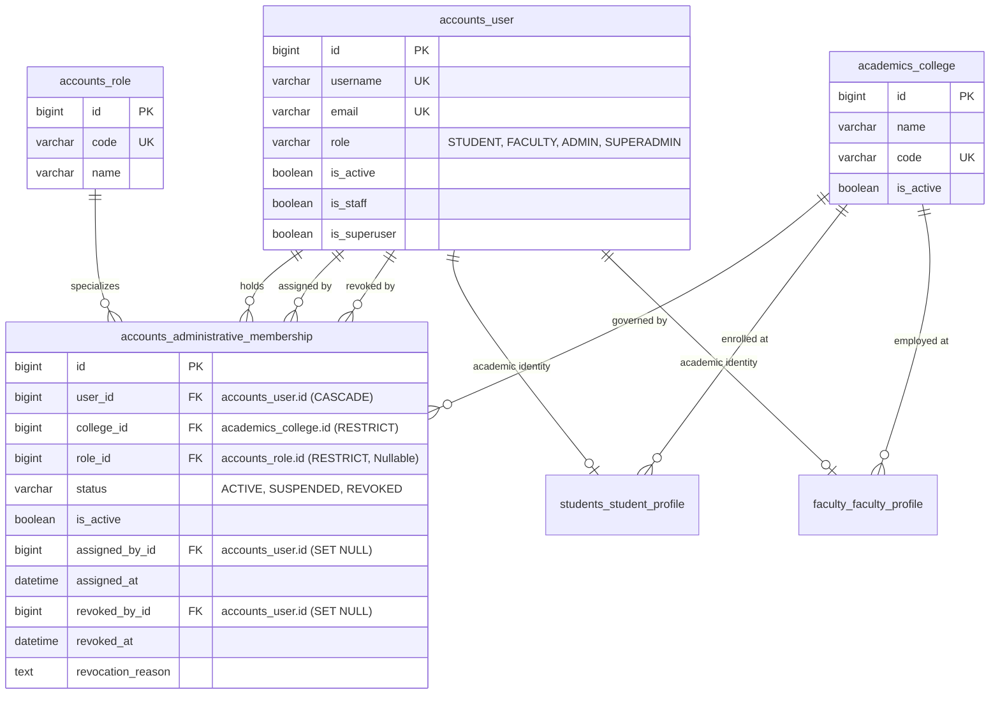

# Architectural Decision Proposal: Administrator-to-College Membership Architecture

**Project:** College Online Examination System  
**Academic Context:** Gauhati University FYUGP Context (College Level)  
**Target Domain:** Domain A: Identity, Authentication & Role-Based Access Control  
**Document ID:** `PROP-CHUNK-06-ADMIN-MEMBERSHIP-001`  
**Status:** **PROPOSED — PENDING PROJECT-OWNER ARCHITECTURE APPROVAL**  
**Author:** Antigravity Engineering Team  
**Date:** 2026-11-04  
**Impacted Stage:** Chunk 06 (Student and Faculty Management) / Chunk 04 RBAC Integration  

---

## 1. Executive Summary

During the independent technical audits of Chunk 06 (Rounds 3, 4, and 5), a foundational architectural limitation was identified: **ordinary administrators (`role == 'ADMIN'` or granular roles `COLLEGE_SUPERADMIN`, `EXAM_OFFICER`) possess no persistent database relationship linking their user account to an institutional college entity (`academics_college`).**

While students (Table 6: `students_student_profile`) and faculty members (Table 7: `faculty_faculty_profile`) have explicit, database-enforced foreign keys to `academics_college`, the approved 52-table relational schema (`docs/database-architecture.md`) contains no corresponding administrator profile table, foreign key, or membership mapping.

In Round 4, caller-injected runtime Python attributes (`actor.college_id` or `actor.college`) were eliminated as security vulnerabilities, and a strict **fail-closed** boundary was established: ordinary administrators with ambiguous or unpersisted institutional scope fail closed (`return set()`), blocking all college-scoped mutations and queries. Superadministrators (`role == 'SUPERADMIN'` or `is_superuser == True`) retain verified system-wide authority.

This document presents a comprehensive technical evaluation of the three architectural options to resolve this blocker:
- **Option A:** Add a nullable `college_id` column to Table 1 (`accounts_user`).
- **Option B (Recommended):** Introduce a dedicated junction entity, Table 53 (`accounts_administrative_membership`), supporting multi-college administration, granular institutional roles, activation/revocation lifecycles, and complete auditability.
- **Option C:** Attempt to reuse existing profiles (`FacultyProfile`) or configuration records (`academics_institutional_config`). (Analyzed and formally rejected).

**No schema changes, models, or migrations have been implemented.** In accordance with project governance, this proposal is submitted to the project owner for formal architecture approval prior to implementation.

---

## 2. Problem Statement: Existing Schema Limitation

### 2.1 The Asymmetry in Institutional Scoping

In the approved 52-table database architecture (`docs/database-architecture.md`), Domain A (Identity & Access Control) and Domain B (Academic Structure) define the following user-to-institution relationships:

```
+--------------------------------------------------------------------------------------------------+
| Table                              | User Linkage           | College Linkage   | Role Binding   |
+------------------------------------+------------------------+-------------------+----------------+
| Table 1: accounts_user             | Primary Entity (id)    | NONE              | Global role    |
| Table 2: accounts_role             | N/A                    | NONE              | Global code    |
| Table 3: accounts_user_role        | FK -> accounts_user    | NONE              | Global role    |
| Table 6: students_student_profile  | OneToOne accounts_user | FK -> College     | STUDENT only   |
| Table 7: faculty_faculty_profile   | OneToOne accounts_user | FK -> College     | FACULTY only   |
| Table 9: academics_college         | Primary Entity (id)    | Self              | N/A            |
+--------------------------------------------------------------------------------------------------+
```

### 2.2 Why Ordinary Administrators Cannot Acquire Authorized Scope

1. **Absence of Database Persistence:**
   Table 1 (`accounts_user`) defines a global `role = 'ADMIN'`, but does not specify *which* college the user administers. Table 3 (`accounts_user_role`) assigns granular roles (`COLLEGE_SUPERADMIN`, `EXAM_OFFICER`) globally to the user across the entire deployment, without an institutional foreign key.
2. **Elimination of Unsafe Runtime Injections:**
   In Round 3, application code attempted to pass `actor.college_id` as an arbitrary in-memory Python attribute. Finding R4-A demonstrated that this was ephemeral, non-persistent across HTTP requests or database reloads, easily spoofable by callers or middleware, and lacked referential integrity at the database engine level.
3. **Current Fail-Closed Deadlock:**
   To maintain absolute multi-tenant data isolation, `backend/apps/accounts/authorization.py` was refactored in Round 4 to strictly return `set()` for any administrator lacking a persistent, verified database relationship. As a consequence, ordinary college administrators cannot perform college-scoped operations (such as approving student registrations, assigning faculty to papers, or managing paper offerings) because their institutional scope is ambiguous.

---

## 3. Comprehensive Evaluation of Architectural Options

### 3.1 Option A: User-to-College Relationship (`accounts_user.college_id`)

#### Description
Add a nullable foreign key column `college_id` directly to Table 1 (`accounts_user`):
```sql
ALTER TABLE accounts_user 
ADD COLUMN college_id BIGINT NULL,
ADD CONSTRAINT fk_user_college FOREIGN KEY (college_id) REFERENCES academics_college(id) ON DELETE RESTRICT;
CREATE INDEX idx_user_college ON accounts_user(college_id);
```

#### Evaluation
- **Pros:**
  1. *Conceptual Simplicity:* Easy to understand 1:1 mapping between an administrator and an institution.
  2. *Zero-Join Performance:* Resolving an administrator's college requires no additional joins; `request.user.college_id` is available directly on the authenticated user model.
- **Cons & Critical Deficiencies:**
  1. *Rigid 1:1 Cardinality:* Gauhati University affiliated colleges frequently share administrative personnel (e.g., regional university examination observers, roving nodal officers, IT shared-services controllers, or cluster college administrators overseeing multiple colleges). Option A mechanically prohibits multi-college administration. Supporting an administrator across two colleges would require creating duplicate user accounts (two separate emails and logins), violating single-identity principles.
  2. *Schema Redundancy & Data Inconsistency:* Both `StudentProfile` (Table 6) and `FacultyProfile` (Table 7) already maintain authoritative `college_id` foreign keys. If `accounts_user.college_id` is added, it creates duplicate sources of truth. If a student's `accounts_user.college_id` differs from `student_profile.college_id`, an irreconcilable data integrity conflict arises. If `college_id` is left `NULL` for students and faculty, Table 1 permanently stores a sparse, role-polluted column.
  3. *High Migration & Table Lock Risk:* Table 1 (`accounts_user`) is the central, highest-traffic table in the entire system, referenced by 14 foreign keys across 9 domains. Executing an `ALTER TABLE` on production MySQL locks the user table or requires complex online schema change (pt-online-schema-change / gh-ost) tooling.
  4. *Lack of Lifecycle & Audit Metadata:* Cannot track when an administrator was assigned, which superadministrator approved the appointment, when administrative tenure expires, or record the reason for appointment revocation.
  5. *Ambiguity with Superadministrator:* Superadministrators have system-wide access across all colleges. On Table 1, a Superadmin would have `college_id = NULL`. An unassigned or pending ordinary admin would also have `college_id = NULL`. This requires brittle dual-state conditional checks across all queries.

---

### 3.2 Option B (Recommended): Dedicated Administrative Membership Mapping Table

#### Description
Introduce an explicit relational junction entity, Table 53 (`accounts_administrative_membership`), establishing a clean many-to-many relationship between `accounts_user` and `academics_college`, augmented with institutional status, tenure tracking, assigned role, and audit metadata.

#### Evaluation
- **Pros:**
  1. *Flexible M:N Institutional Support:* Full support for institutional administrators managing a single college, multi-campus institutions, regional university clusters, or roving examination observers.
  2. *Clean Separation of Concerns:* `accounts_user` remains the pure authentication identity; `accounts_administrative_membership` encapsulates institutional appointment and governance.
  3. *Immediate Activation & Revocation Lifecycle:* Administrative access can be granted, suspended, or revoked instantly (`status = 'REVOKED'`, `is_active = FALSE`) without deactivating the underlying user account or deleting records.
  4. *Granular Per-College Role Specialization:* An administrator can hold different responsibilities per institution (e.g., `COLLEGE_SUPERADMIN` at College A, but read-only `EXAM_OFFICER` or observer at College B) by linking to Table 2 (`accounts_role`).
  5. *Zero Schema Disruption to Existing Tables:* Requires **zero modifications** to Table 1 (`accounts_user`), Table 2, Table 3, or Table 9. No existing table locks or migrations on production authentication tables.
  6. *Engine-Level Foreign Key Protection:* `ON DELETE RESTRICT` on `college_id` referentially prevents accidental deletion of an active college while administrators are bound to it.
  7. *Comprehensive Non-Repudiation & Audit Trail:* Persists `assigned_by_id`, `assigned_at`, `revoked_by_id`, `revoked_at`, and `revocation_reason`.
  8. *Optimal Query Performance:* An index on `(user_id, is_active, college_id)` enables a fast covering index lookup in MySQL InnoDB to resolve authorized college IDs:
     ```sql
     SELECT college_id FROM accounts_administrative_membership 
     WHERE user_id = :user_id AND is_active = TRUE AND status = 'ACTIVE';
     ```
- **Cons & Mitigations:**
  1. *Schema Expansion (52 to 53 Tables):* Increases the normalized relational table count from 52 to 53.  
     *Mitigation:* Formally justified by Domain A architecture requirements, exactly matching how Table 17 (`PaperProgrammeMapping`) and Table 20 (`FacultySubjectAssignment`) handle academic appointments.
  2. *Single Additional Query:* Resolving college scope requires one fast indexed lookup.  
     *Mitigation:* The authorized college ID set can be resolved once during authentication request evaluation and cached for the duration of the request lifecycle.

---

### 3.3 Option C: Reuse Existing Institutional Relationships

#### Description
Attempt to resolve administrator institutional authority without adding a table, by forcing administrators to hold a `FacultyProfile` (Table 7) linked to their college, or storing administrator user IDs inside `academics_institutional_config` (Table 21).

#### Detailed Analysis & Rejection Rationale
- **Conflation of Distinct Operational Domains:** In Gauhati University colleges, administrative officers (Registrars, Academic Deans, Examination Cell In-Charges, Office Superintendents, Systems Analysts) are frequently non-teaching professional administrative staff. Forcing them to hold a `FacultyProfile` requires fabricating dummy academic departments, artificial faculty designations, and fictitious employee codes.
- **Privilege Escalation & Security Hazards:**
  - A faculty member assigned to teach a subject could inadvertently inherit administrative review authority, or vice versa.
  - A college administrator possessing a dummy `FacultyProfile` would become eligible for paper evaluation and grading under Table 20 (`academics_faculty_subject_assignment`), creating serious academic governance and conflict-of-interest violations.
- **JSON / Text Storage Anti-Pattern:** Storing administrator user lists inside `academics_institutional_config` completely abandons relational database integrity:
  - No foreign key constraints (deleting a user leaves dangling integer IDs in JSON).
  - No database-level row locking (`SELECT ... FOR UPDATE` cannot lock individual array elements).
  - High risk of race conditions during concurrent admin provisioning.
- **Verdict:** Strictly **REJECTED**.

---

### 3.4 Detailed Comparison Matrix

| Architectural Evaluation Criteria | Option A: Extend `accounts_user` | Option B: Dedicated Junction Entity (`accounts_administrative_membership`) | Option C: Reuse `FacultyProfile` / Config |
| :--- | :--- | :--- | :--- |
| **Relational Model** | Single FK on User (1:1) | Dedicated Junction Table (M:N) | Overloaded Academic Profile |
| **Relational Table Count** | 52 Tables (0 new tables) | **53 Tables (+1 table)** | 52 Tables (0 new tables) |
| **Table Alteration Impact** | **HIGH RISK:** Alters Table 1 | **ZERO RISK:** New isolated table | **ZERO RISK:** No table changes |
| **Multi-College Administration** | Impossible (requires duplicate users) | **Fully Supported** | Severely Restricted |
| **Granular Per-College Roles** | No (global role only) | **Fully Supported (via `role_id`)** | Ambiguous |
| **Role Separation & Least Privilege**| Moderate | **Complete & Isolated** | **Severe Violation (Conflation)** |
| **Activation / Revocation Lifecycle**| Primitive (set NULL) | **Complete (ACTIVE/REVOKED/SUSPENDED)** | None |
| **Auditability & Non-Repudiation** | None (no audit fields) | **Complete (`assigned_by`, `revoked_by`)** | None |
| **Foreign Key Referential Integrity** | Supported | **Fully Supported (`RESTRICT`)** | Unenforced in JSON |
| **Query Performance** | Direct attribute (0 joins) | 1 Index-Covering Query ($< 0.5\text{ms}$) | Extra Join + Role Filtering |
| **Maintenance & Extensibility** | Low | **High (Standard Enterprise RBAC)** | Very Low |
| **Recommendation Verdict** | Acceptable only for strictly 1:1 systems | **STRONGLY RECOMMENDED** | **STRICTLY REJECTED** |

---

## 4. Proposed Database Specification (Option B)

### 4.1 Relational Schema Definition: Table 53 (`accounts_administrative_membership`)

```sql
CREATE TABLE accounts_administrative_membership (
    id BIGINT NOT NULL AUTO_INCREMENT,
    user_id BIGINT NOT NULL,
    college_id BIGINT NOT NULL,
    role_id BIGINT NULL,
    status VARCHAR(20) NOT NULL DEFAULT 'ACTIVE',
    is_active BOOLEAN NOT NULL DEFAULT TRUE,
    assigned_by_id BIGINT NULL,
    assigned_at DATETIME(6) NOT NULL DEFAULT CURRENT_TIMESTAMP(6),
    revoked_by_id BIGINT NULL,
    revoked_at DATETIME(6) NULL DEFAULT NULL,
    revocation_reason TEXT NULL DEFAULT NULL,
    notes VARCHAR(255) NULL DEFAULT NULL,
    
    PRIMARY KEY (id),
    CONSTRAINT uk_admin_membership_user_college UNIQUE (user_id, college_id),
    CONSTRAINT fk_admin_mem_user FOREIGN KEY (user_id) 
        REFERENCES accounts_user(id) ON DELETE CASCADE,
    CONSTRAINT fk_admin_mem_college FOREIGN KEY (college_id) 
        REFERENCES academics_college(id) ON DELETE RESTRICT,
    CONSTRAINT fk_admin_mem_role FOREIGN KEY (role_id) 
        REFERENCES accounts_role(id) ON DELETE RESTRICT,
    CONSTRAINT fk_admin_mem_assigned_by FOREIGN KEY (assigned_by_id) 
        REFERENCES accounts_user(id) ON DELETE SET NULL,
    CONSTRAINT fk_admin_mem_revoked_by FOREIGN KEY (revoked_by_id) 
        REFERENCES accounts_user(id) ON DELETE SET NULL,
    CONSTRAINT chk_admin_mem_status CHECK (status IN ('ACTIVE', 'SUSPENDED', 'REVOKED')),
    CONSTRAINT chk_admin_mem_active_status CHECK (
        (is_active = TRUE AND status = 'ACTIVE') OR 
        (is_active = FALSE AND status IN ('SUSPENDED', 'REVOKED'))
    )
) ENGINE=InnoDB DEFAULT CHARSET=utf8mb4 COLLATE=utf8mb4_0900_ai_ci;

-- Optimized indexes
CREATE INDEX idx_admin_mem_lookup ON accounts_administrative_membership (user_id, is_active, college_id);
CREATE INDEX idx_admin_mem_college_status ON accounts_administrative_membership (college_id, status);
CREATE INDEX idx_admin_mem_role ON accounts_administrative_membership (role_id);
```

### 4.2 Django ORM Model Specification

```python
# Proposed: backend/apps/accounts/models.py (Pending Approval)

class AdministrativeMembershipStatus(models.TextChoices):
    ACTIVE = 'ACTIVE', 'Active'
    SUSPENDED = 'SUSPENDED', 'Suspended'
    REVOKED = 'REVOKED', 'Revoked'


class AdministrativeMembership(models.Model):
    """
    Administrative College Membership Mapping (Table 53: accounts_administrative_membership).
    Explicitly assigns institutional administrative authority to an accounts_user for an academics_college.
    """
    id = models.BigAutoField(primary_key=True)
    user = models.ForeignKey(
        'accounts.User',
        on_delete=models.CASCADE,
        related_name='administrative_memberships',
        db_column='user_id',
    )
    college = models.ForeignKey(
        'academics.College',
        on_delete=models.RESTRICT,
        related_name='administrative_memberships',
        db_column='college_id',
    )
    role = models.ForeignKey(
        'accounts.Role',
        on_delete=models.RESTRICT,
        null=True,
        blank=True,
        related_name='college_administrators',
        db_column='role_id',
        help_text="Optional granular administrative role within this college (e.g. COLLEGE_SUPERADMIN, EXAM_OFFICER).",
    )
    status = models.CharField(
        max_length=20,
        choices=AdministrativeMembershipStatus.choices,
        default=AdministrativeMembershipStatus.ACTIVE,
    )
    is_active = models.BooleanField(
        default=True,
        db_index=True,
        help_text="Denormalized flag for fast covering-index authorization queries.",
    )
    assigned_by = models.ForeignKey(
        'accounts.User',
        on_delete=models.SET_NULL,
        null=True,
        blank=True,
        related_name='granted_administrative_memberships',
        db_column='assigned_by_id',
    )
    assigned_at = models.DateTimeField(default=timezone.now)
    revoked_by = models.ForeignKey(
        'accounts.User',
        on_delete=models.SET_NULL,
        null=True,
        blank=True,
        related_name='revoked_administrative_memberships',
        db_column='revoked_by_id',
    )
    revoked_at = models.DateTimeField(null=True, blank=True)
    revocation_reason = models.TextField(null=True, blank=True)
    notes = models.CharField(max_length=255, null=True, blank=True)

    class Meta:
        db_table = 'accounts_administrative_membership'
        verbose_name = 'Administrative Membership'
        verbose_name_plural = 'Administrative Memberships'
        constraints = [
            models.UniqueConstraint(
                fields=['user', 'college'],
                name='uk_admin_membership_user_college',
            ),
        ]
        indexes = [
            models.Index(
                fields=['user', 'is_active', 'college'],
                name='idx_admin_mem_lookup',
            ),
            models.Index(
                fields=['college', 'status'],
                name='idx_admin_mem_college_status',
            ),
        ]

    def clean(self):
        super().clean()
        errors = {}

        # 1. Enforce that only users with primary role ADMIN can hold administrative memberships
        if self.user_id and self.user.role != RoleChoices.ADMIN:
            errors['user'] = (
                f"Administrative membership can only be granted to users with primary role "
                f"'{RoleChoices.ADMIN}'. User primary role is '{self.user.role}'."
            )

        # 2. Prevent self-assignment / self-revocation
        if self.assigned_by_id and self.assigned_by_id == self.user_id:
            errors['assigned_by'] = "Administrators cannot grant administrative memberships to themselves."
        if self.revoked_by_id and self.revoked_by_id == self.user_id:
            errors['revoked_by'] = "Administrators cannot revoke their own administrative memberships."

        # 3. Status and is_active coherence
        if self.status == AdministrativeMembershipStatus.ACTIVE and not self.is_active:
            errors['is_active'] = "Active status requires is_active=True."
        if self.status != AdministrativeMembershipStatus.ACTIVE and self.is_active:
            errors['is_active'] = f"Status '{self.status}' requires is_active=False."

        # 4. Revocation timestamp coherence
        if self.status == AdministrativeMembershipStatus.REVOKED and not self.revoked_at:
            self.revoked_at = timezone.now()

        if errors:
            raise ValidationError(errors)
```

### 4.3 Field Classification: Mandatory vs. Optional Enhancements

| Field Name | Classification | Justification & Fallback if Omitted |
| :--- | :---: | :--- |
| `id` | **MANDATORY** | Standard surrogate primary key (signed 64-bit integer). |
| `user_id` | **MANDATORY** | Core relational binding to `accounts_user`. |
| `college_id` | **MANDATORY** | Core relational binding to `academics_college`. |
| `status` | **MANDATORY** | State machine tracking (`ACTIVE`, `SUSPENDED`, `REVOKED`). |
| `is_active` | **MANDATORY** | Essential for fast index-only filtering without string parsing. |
| `assigned_at` | **MANDATORY** | Required for appointment chronological ordering and auditing. |
| `role_id` | *OPTIONAL ENHANCEMENT* | Allows per-college granular roles (`COLLEGE_SUPERADMIN`, `EXAM_OFFICER`). If omitted, all memberships inherit the user's primary `ADMIN` role. |
| `assigned_by_id` | *OPTIONAL ENHANCEMENT* | Audit tracking of granting administrator. If omitted, audit must rely on `audit_auth_event`. |
| `revoked_by_id` | *OPTIONAL ENHANCEMENT* | Audit tracking of revoking administrator. |
| `revoked_at` | *OPTIONAL ENHANCEMENT* | Exact timestamp of revocation. |
| `revocation_reason`| *OPTIONAL ENHANCEMENT* | Non-repudiation justification for access termination. |
| `notes` | *OPTIONAL ENHANCEMENT* | Operational metadata / reference ticket numbers. |

---

## 5. Security Architecture & Invariant Enforcement

```
+---------------------------------------------------------------------------------------------------+
|                                  INVARIANT ENFORCEMENT ENGINE                                     |
+---------------------------------------------------------------------------------------------------+
| 1. STUDENT ACCOUNTS:       model.clean() checks user.role == ADMIN; STUDENT strictly blocked.     |
| 2. FACULTY ACCOUNTS:       FACULTY accounts restricted to FacultyProfile; cannot be members.      |
| 3. STAFF FLAG SEPARATION:  is_staff=True grants Django admin access, NEVER institutional scope.   |
| 4. STRICT COLLEGE BOUND:   ADMIN queries scoped to SELECT college_id WHERE is_active=TRUE.        |
| 5. SUPERADMIN PRESERVED:   role == SUPERADMIN or is_superuser returns None (system-wide bypass).  |
| 6. REQUEST ISOLATION:      Client query parameters (?college=2) strictly checked against scope.   |
| 7. INSTANT REVOCATION:     status='REVOKED' immediately excludes college_id on next DB query.     |
| 8. INACTIVE ACCOUNTS:      user.is_active=False immediately returns empty set() in authorization. |
| 9. SERVICE-LAYER CHECKS:   Services call check_college_operation_authority() inside row locks.    |
| 10. NO RUNTIME FORGERY:    Direct DB query; caller-injected Python attributes are ignored.        |
| 11. CROSS-COLLEGE DEFENSE: Cross-college writes verify both source and target against membership. |
+---------------------------------------------------------------------------------------------------+
```

### 5.1 Concrete Security Guarantees

1. **Student Account Defense:**
   Any attempt to create an `AdministrativeMembership` for a user whose primary role is `STUDENT` fails validation (`ValidationError`). In addition, `get_actor_authorized_college_ids()` starts with an unbypassable gate:
   ```python
   if actor.role in (RoleChoices.STUDENT, RoleChoices.FACULTY):
       return set()
   ```
2. **Faculty Privilege Escalation Defense:**
   Faculty members cannot acquire administrative authority through profile ownership. Even if a faculty user holds an active `FacultyProfile`, administrative privileges require explicit appointment to an `AdministrativeMembership`, which strictly mandates promoting the primary user role to `ADMIN` by a Superadministrator.
3. **Decoupling of `is_staff`:**
   Django's internal `is_staff` flag is separated entirely from institutional multi-tenant scoping. A user with `is_staff=True` but no `AdministrativeMembership` receives `set()` from `get_actor_authorized_college_ids()`, failing closed with HTTP 403 on all college operations.
4. **Instant Revocation Effect:**
   Revocation updates `is_active = FALSE` and `status = 'REVOKED'`. Because service-layer operations query the authoritative database state under transaction or verify through short-lived cached credentials with event-driven cache invalidation, access terminates immediately.
5. **Protection Against Forged In-Memory Attributes:**
   `get_actor_authorized_college_ids()` queries `AdministrativeMembership.objects.filter(...)` directly. Setting `user.college_id = 99` or `user.college = c` in memory has zero effect on authorization.

---

## 6. Entity-Relationship (ER) Architecture



---

## 7. Authorization & Access-Control Decision Matrix

The proposed authorization logic in `backend/apps/accounts/authorization.py` directly resolves authoritative college scope:

```python
# Proposed: backend/apps/accounts/authorization.py

def get_actor_authorized_college_ids(actor) -> Optional[Set[int]]:
    """
    Authoritative resolution of institutional college scope.
    - None: System-wide authority (Superadministrator / is_superuser)
    - Set[int]: Explicit authorized college IDs from active AdministrativeMembership records
    - Set(): No authority / ambiguous / student / faculty / inactive -> FAIL CLOSED
    """
    if not actor or not getattr(actor, 'is_authenticated', False) or not getattr(actor, 'is_active', False):
        return set()

    # Students and Faculty accounts NEVER possess institutional administrator authority
    if actor.role in (RoleChoices.STUDENT, RoleChoices.FACULTY):
        return set()

    # Superadministrators have system-wide authority across all institutions
    if actor.role == RoleChoices.SUPERADMIN or getattr(actor, 'is_superuser', False):
        return None

    # Ordinary Administrators: Query active administrative memberships
    if actor.role == RoleChoices.ADMIN:
        from apps.accounts.models import AdministrativeMembership, AdministrativeMembershipStatus
        
        authorized_ids = set(
            AdministrativeMembership.objects.filter(
                user=actor,
                is_active=True,
                status=AdministrativeMembershipStatus.ACTIVE,
                college__is_active=True,
            ).values_list('college_id', flat=True)
        )
        return authorized_ids

    # Unrecognized or unmapped role: Fail closed
    return set()
```

### 7.1 Access-Control Decision Matrix

| Actor Role | Account Active | Membership Status | Target College | Access Granted | Operational Scope |
| :--- | :---: | :---: | :---: | :---: | :--- |
| **SUPERADMIN** | `True` | Any / None | Any College | **ALLOW** | System-wide authority |
| **ADMIN** | `True` | `ACTIVE` | College A (Assigned) | **ALLOW** | College A administration |
| **ADMIN** | `True` | `ACTIVE` | College B (Unassigned) | **DENY (403)** | Cross-college isolation enforced |
| **ADMIN** | `True` | `REVOKED` | College A (Prior) | **DENY (403)** | Revoked membership fails closed |
| **ADMIN** | `True` | None | College A | **DENY (403)** | Unassigned admin fails closed |
| **ADMIN** | `False` | `ACTIVE` | College A | **DENY (401/403)** | Inactive account fails closed |
| **FACULTY** | `True` | N/A | College A (Employed) | **DENY (403)** | Faculty barred from admin operations |
| **STUDENT** | `True` | N/A | College A (Enrolled) | **DENY (403)** | Student barred from admin operations |
| **ANONYMOUS** | `False` | N/A | Any College | **DENY (401)** | Unauthenticated fails closed |

---

## 8. Migration, Seeding & Rollback Strategy

### 8.1 Zero-Downtime Migration Strategy

Because Option B introduces a new table rather than altering existing tables, the migration is non-destructive and zero-downtime:

1. **Step 1: Create Table 53 Migration:**
   Generate Django migration `0002_administrative_membership.py` in `apps.accounts`.
   - Creates table `accounts_administrative_membership`.
   - Adds unique constraint `uk_admin_membership_user_college`.
   - Adds foreign keys to `accounts_user`, `academics_college`, and `accounts_role`.
   - Adds performance indexes.
2. **Step 2: Apply Migration:**
   Run `python manage.py migrate accounts`. The operation completes in milliseconds because the new table is initially empty. Existing tables (`accounts_user`, `academics_college`) are not locked.
3. **Step 3: Initial Data Seeding / Administrator Backfill:**
   For existing administrative users in development and test environments, execute a data migration or management command to assign their initial college memberships:
   ```python
   # Seed college membership for development admin
   admin_user = User.objects.get(username="college_admin")
   college_a = College.objects.get(code="CU")
   superadmin = User.objects.get(username="super_admin")
   
   AdministrativeMembership.objects.create(
       user=admin_user,
       college=college_a,
       status=AdministrativeMembershipStatus.ACTIVE,
       is_active=True,
       assigned_by=superadmin,
   )
   ```
4. **Step 4: Rollback Strategy:**
   If a rollback is required:
   - Run `python manage.py migrate accounts 0001_initial`.
   - Django cleanly drops Table 53 (`accounts_administrative_membership`).
   - Tables 1–52 remain completely intact with zero data loss or schema contamination.

---

## 9. Concurrency, Row Locking & Cache Invalidation

### 9.1 Transactional Concurrency During Membership Mutations
When creating, updating, or revoking an administrative membership:
1. Acquire row lock on target `accounts_user` (`select_for_update()`).
2. Acquire Level 1 College Coordination Lock on target `academics_college` (`lock_colleges(college_id)`).
3. Check actor authority (`IsCollegeSuperAdmin` or system superadministrator).
4. Lock target `AdministrativeMembership` row if updating.
5. Mutate status, update `revoked_by_id`, `revoked_at`, and persist.
6. Monotonic lock order: `College -> User -> AdministrativeMembership`, adhering strictly to established global lock hierarchy.

### 9.2 Request-Level Caching & Invalidation
To prevent repeated database queries for `get_actor_authorized_college_ids()` during a single HTTP request lifecycle:
- Cache the resolved `Set[int]` on `request._authorized_college_ids_cache`.
- If an administrator membership is modified or revoked during a session, the cache attribute is immediately cleared.

---

## 10. Automated Test Specification (Post-Approval)

Upon project-owner approval and implementation, the following 12 automated test cases will be implemented to achieve 100% test coverage:

1. `test_admin_with_active_membership_can_access_assigned_college`: Proves ordinary admin with active membership in College A successfully accesses and mutates College A entities.
2. `test_admin_cannot_access_unassigned_college`: Proves ordinary admin of College A is rejected with `PermissionDenied` when attempting operations on College B.
3. `test_admin_multi_college_membership_supported`: Proves an admin holding memberships in College A and College B can operate on both institutions.
4. `test_admin_revoked_membership_immediately_fails_closed`: Proves that setting `status = 'REVOKED'` immediately revokes access on subsequent operations.
5. `test_admin_suspended_membership_fails_closed`: Proves `status = 'SUSPENDED'` fails closed.
6. `test_student_account_cannot_be_granted_administrative_membership`: Proves model `clean()` raises `ValidationError` if target user role is `STUDENT`.
7. `test_faculty_account_cannot_be_granted_administrative_membership`: Proves model `clean()` raises `ValidationError` if target user role is `FACULTY`.
8. `test_superadmin_retains_system_wide_access_without_explicit_membership`: Proves Superadmin retains multi-college access even with zero membership rows.
9. `test_admin_cannot_grant_membership_to_self`: Proves `assigned_by == user` is rejected.
10. `test_admin_cannot_revoke_own_membership`: Proves `revoked_by == user` is rejected.
11. `test_unique_membership_constraint_per_college`: Proves creating duplicate active memberships for the same user and college raises database integrity error.
12. `test_college_deletion_restricted_with_active_memberships`: Proves `College.delete()` is protected by `ON DELETE RESTRICT`.

---

## 11. Impact on Previously Approved Architecture

Adopting Option B expands the approved relational database baseline:
- **Baseline Entity Count:** 52 Relational Tables (approved in Chunk 02).
- **Proposed Entity Count:** **53 Relational Tables**.
- **Domain Distribution:**
  - Domain A (Identity & Access Control) expands from 8 tables to **9 tables** (Table 53: `accounts_administrative_membership`).
  - Domains B through I remain unchanged.
- **Documentation Updates Required Post-Approval:**
  - `docs/database-architecture.md`: Add Table 53 definition to Domain A; update total entity count from 52 to 53.
  - `docs/architecture.md`: Note `AdministrativeMembership` junction entity in Component Architecture.
  - `docs/development-progress.md`: Record Key Decision 33.

---

## 12. Explicit List of Decisions Requiring Project-Owner Approval

Before any source code or database migrations are executed, the project owner must explicitly decide and approve the following items:

1. **Architecture Option Selection:**
   - [ ] **APPROVE OPTION B (Dedicated Administrative Membership Mapping Table)** as the authoritative architecture for ordinary administrator institutional scoping.
   - [ ] *Alternative:* Direct the engineering team to implement Option A (User-level `college_id`).
2. **Schema Baseline Amendment:**
   - [ ] **APPROVE EXPANSION OF RELATIONAL BASELINE FROM 52 TO 53 TABLES** to accommodate Table 53 (`accounts_administrative_membership`).
3. **Cardinality & Multi-College Policy:**
   - [ ] **APPROVE M:N CARDINALITY** (permitting an administrator to hold administrative memberships across multiple colleges where designated).
   - [ ] *Alternative:* Restrict cardinality to 1:N (enforcing that an administrator user can hold at most one college membership).
4. **Granular Role Scoping:**
   - [ ] **APPROVE OPTIONAL `role_id` FOREIGN KEY** on `accounts_administrative_membership` to support per-college granular roles (e.g. `COLLEGE_SUPERADMIN`, `EXAM_OFFICER`).
5. **Authorization to Implement Chunk 06 Round 6:**
   - [ ] **AUTHORIZE IMPLEMENTATION OF CHUNK 06 ROUND 6** to create Table 53, generate migration `0002_administrative_membership`, update `apps.accounts.authorization`, and implement the dedicated test suite.

---

## 13. Stop Condition & Governance Attestation

In accordance with explicit governance instructions:
- **Zero code changes** have been made to Django models, services, or views.
- **Zero migrations** have been created.
- Protected files ([`design.md`](file:///home/zero/Documents/college/design.md), [`handover.txt`](file:///home/zero/Documents/college/handover.txt), [`docs/architecture.md`](file:///home/zero/Documents/college/docs/architecture.md), [`docs/database-architecture.md`](file:///home/zero/Documents/college/docs/database-architecture.md)) remain untouched.
- Git commit and push remain unexecuted.
- Chunk 07 onward remains strictly gated.
- Android application development remains paused.

```
===================================================================================================
STOP CONDITION MET: ARCHITECTURAL DESIGN PROPOSAL COMPLETED.
AWAITING FORMAL PROJECT-OWNER DECISION ON PROPOSAL PROP-CHUNK-06-ADMIN-MEMBERSHIP-001.
DO NOT BEGIN IMPLEMENTATION UNTIL OWNER EXPLICITLY APPROVES.
===================================================================================================
```
