# Architectural Decision Proposal: Administrator-to-College Membership Architecture
## Final Service-Layer Implementation Reconciliation — Security, Trust Boundaries and Concurrency

**Project:** College Online Examination System  
**Academic Context:** Gauhati University FYUGP Context (College Level)  
**Target Domain:** Domain A: Identity, Authentication & Role-Based Access Control  
**Document ID:** `PROP-CHUNK-06-ADMIN-MEMBERSHIP-FINAL-RECONCILED-R2`  
**Status:** **FINAL SERVICE-LAYER RECONCILIATION — PENDING INDEPENDENT AUDIT AND PROJECT-OWNER APPROVAL**  
**Author:** Antigravity Engineering Team  
**Date:** 2026-11-04  
**Last Independently Audited Commit:** `97e745b94ea1075ed91a091353addb4869eaf14a`  
**Impacted Stages:** Chunk 06 (Student & Faculty Management) / Chunk 05 (FYUGP Academic Architecture) / Chunk 04 (RBAC)  

---

## 1. Executive Summary & Design Revision History

### 1.1 Context and Problem Statement
In the approved 52-table relational database architecture ([`docs/database-architecture.md`](file:///home/zero/Documents/college/docs/database-architecture.md)), institutional scoping exists exclusively for student and faculty accounts via dedicated profile entities:
- Table 6: [`StudentProfile`](file:///home/zero/Documents/college/backend/apps/students/models.py) has a foreign key to `academics_college` (`college_id`).
- Table 7: [`FacultyProfile`](file:///home/zero/Documents/college/backend/apps/faculty/models.py) has a foreign key to `academics_college` (`college_id`).
- Table 1: [`User`](file:///home/zero/Documents/college/backend/apps/accounts/models.py#L44-L107) defines primary role `role = 'ADMIN'`, but contains **no college foreign key**.
- Table 3: [`UserRole`](file:///home/zero/Documents/college/backend/apps/accounts/models.py#L129-L167) assigns granular roles globally across the deployment, with **no college foreign key**.

During the Chunk 06 technical audits, ephemeral caller-injected Python attributes (`actor.college_id`, `actor.college`) were eliminated as security vulnerabilities. A strict **fail-closed** boundary was established in [`backend/apps/accounts/authorization.py`](file:///home/zero/Documents/college/backend/apps/accounts/authorization.py): ordinary administrators fail closed (`return set()`), blocking all college-scoped mutations and queries. Superadministrators (`role == 'SUPERADMIN'` or `is_superuser == True`) retain verified system-wide authority.

### 1.2 Independent Audit Revision History

| Proposal Iteration | Verdict | Findings / Scope Addressed |
|---|---|---|
| **Round 1 (`PROP-...-001`)** | REVISION REQUIRED | 5 Findings: Incomplete college scoping, lock-order contradictions, audit deletion risk, SQL/Django constraint mismatches, overstated deployment claims. |
| **Round 2 (`PROP-...-002`)** | CONDITIONAL PASS | Preferred Option B retained; identified 3 remaining specification gaps: Read-operation scoping, in-flight transaction synchronization, durable audit retention. |
| **Final Addendum (`PROP-...-FINAL-ADDENDUM`)** | CONDITIONAL PASS | Delivered 2D read/write RBAC, service locking matrix, audit retention policy analysis; identified 4 targeted refinement findings (P4-A through P4-D). |
| **Round 4 Revision (`PROP-...-FINAL`)** | CONDITIONAL PASS | Addressed P4-A through P4-D. Audited commit `74862dd18724524915be8c997cfb9374c33b9eff`. Identified 3 reconciliation gaps (P5-A, P5-B, P5-C). |
| **Round 5 Reconciliation (`PROP-...-FINAL-RECONCILED`)** | REVISION REQUIRED | Addressed P5-A through P5-C. Audited commit `c3a24c0a488390e3f40259a1ddcc78d0ac1dbf89`. Identified 4 implementation and trust-boundary findings (P6-A, P6-B, P6-C, P6-D). |
| **Round 6 Service-Layer Reconciliation (Current)** | **PENDING REVIEW** | Resolves Findings P6-A, P6-B, P6-C, and P6-D. Rigorous 5-category service implementation taxonomy (Categories A–E); mandatory transaction-level revocation serialization protocol; Chunk 05 service-layer trust-boundary analysis (Option 1 Retrofit vs Option 2 API Contract); source-verified PaperOffering read visibility baseline; and unified `academic.config.read` operation identifier consistency. Audited commit `97e745b94ea1075ed91a091353addb4869eaf14a`. |

### 1.3 Resolution Summary of Targeted Findings (P4-A through P4-D)

| Finding | Severity | Defect Analysis & Root Cause | Final Resolution & Document Section |
| :---: | :---: | :--- | :--- |
| **P4-A** | **HIGH** | `get_authorized_college_ids_for_operation` returned unrestricted superadmin scope before verifying whether `operation` was in the approved registry, allowing unknown operations to bypass default-deny for Superadmin. | Enforced an unbypassable 11-step evaluation pipeline where operation type and registry validation occur **first**, guaranteeing unknown operations fail closed for all roles, including Superadmin. *(Section 8.4, Section 14.1, 14.2)* |
| **P4-B** | **HIGH** | Standard mutation hierarchy (`College -> Actor User -> Membership -> Target`) conflicted with membership grant/revoke and registration review workflows that lock target user rows; multi-college updates lacked deterministic global ordering. | Established a unified global Five-Level Lock Hierarchy: **Level 1 College $\rightarrow$ Level 2 All Users in ascending PK order $\rightarrow$ Level 3 Memberships in ascending PK order $\rightarrow$ Level 4 Academic Parents $\rightarrow$ Level 5 Academic Children**. Documented exact 8 mutation sequences and reconciled 13 services. *(Section 9, Section 14.3, 14.4, 14.5)* |
| **P4-C** | **MEDIUM** | The institutional helper returning `set()` for student/faculty accounts conflated administrative authority with legitimate student/faculty self-service and general academic reference data visibility. | Established four independent authorization domains: Domain A (Institutional Admin), Domain B (Student Self-Service), Domain C (Faculty Self-Service), and Domain D (General Academic Read Access). Proved self-service never depends on administrative membership. *(Section 14.6, 14.7, 14.8)* |
| **P4-D** | **MEDIUM** | Single atomic audit transaction model fails for rejected security attempts (rollback erases the rejection event); append-only database table was loosely described as tamper-evident non-repudiation. | Formulated dual audit transaction semantics: atomic commit for successful mutations; separate structured security logging sink for rejected authorization attempts. Accurately disclaimed cryptographic tamper-evidence and mapped Table 51 columns. *(Section 12, Section 14.9, 14.10, 14.11)* |

### 1.4 Resolution Summary of Lock Hierarchy Findings (P5-A through P5-C)

| Finding | Severity | Defect Analysis & Root Cause | Reconciled Resolution & Document Section |
| :---: | :---: | :--- | :--- |
| **P5-A** | **HIGH** | Section 14.3 declared an arbitrary flat global academic hierarchy (`AcademicSession -> Programme -> Department -> PaperOffering`) that directly contradicted approved Chunk 05 services (e.g. `update_paper_offering` locks `PaperOffering` before `Programme`, `Department`, and `Session`). Attempting a flat refactor would require modifying 10+ approved Chunk 05 services. | Constructed an authoritative 34-service lock inventory from source inspection. Formulated Strategy C (Outer Coordination Protocol with Preserved Internal Academic Lock Families): Level 1 College Coordination Lock (`lock_colleges`) serializes all institutional mutations, mathematically preventing deadlocks across internal lock families without touching Chunk 05 services. *(Section 9, 10, Section 15.1–15.6)* |
| **P5-B** | **MEDIUM** | Section 14.8 declared that `PaperOffering` records should be restricted to enrolled students and assigned faculty, introducing an unapproved policy change that broke student pre-enrolment syllabus browsing and curriculum planning under NEP 2020 / Gauhati University FYUGP. | Preserved Visibility Option 1 (Academic Catalogue Browsing Baseline) as approved in Chunk 05 (`IsAcademicAdminOrReadOnly`). Formulated Visibility Option 2 (Restricted Visibility) as an explicit open decision on the Project-Owner Checklist. *(Section 14.8, Section 15.7, 15.8)* |
| **P5-C** | **LOW** | The relationship between atomic database transactions and rejected security event durability was ambiguous, and append-only database permissions required rigorous tamper-evidence boundary clarification. | Explicitly codified dual-persistence mechanics: successful mutations commit atomically with Table 51 (`SystemAuditLog`) in the same `@transaction.atomic` block; rejected security attempts (which trigger transaction rollback) are durably recorded via sanitized structured logging (`college.accounts.security`) or an out-of-band sink. Honestly disclaimed cryptographic proofs and root/DBA tamper resistance. Retained Policy A vs Policy B as an owner choice. *(Section 12, Section 15.9–15.11)* |

### 1.5 Resolution Summary of Service-Layer Implementation Findings (P6-A through P6-D)

| Finding | Severity | Defect Analysis & Root Cause | Reconciled Resolution & Document Section |
| :---: | :---: | :--- | :--- |
| **P6-A** | **HIGH** | Section 15.5 previously stated that several administrative services require "only authorization check updates", but an unlocked permission lookup before a transaction cannot prevent an ordinary administrator from mutating data after their revocation has committed. | Reclassified every affected service into an authoritative 5-category taxonomy (Categories A–E). Codified mandatory transaction-level revocation serialization protocol: Level 1 College coordination locks must be acquired prior to or in conjunction with membership re-validation under lock. Documented exact locking, user parameters, and deadlock safety for all affected services. *(Section 16.1, 16.2)* |
| **P6-B** | **HIGH** | The proposal promised that all Chunk 05 services would remain completely untouched, while simultaneously declaring that all institutional mutations must enforce service-layer operation authorization. In reality, approved Chunk 05 services do not receive an acting User. | Formulated an explicit architectural decision: Option 1 (Coordinated Minimal Service-Layer Retrofit — Recommended, subject to owner approval) vs. Option 2 (API-Layer Authorization Contract). Built a comprehensive 12-entity ViewSet/Serializer/Service call-path inventory. Explicitly documented that Option 1 requires formal project-owner approval to reopen Chunk 05 for signature updates and regression re-audit. *(Section 16.3–16.6)* |
| **P6-C** | **MEDIUM** | Section 14.8 and 15.7 stated that the catalogue allows browsing active PaperOffering records within the user's college. In source code, `PaperOfferingViewSet` performs an unfiltered `select_related(...).prefetch_related(...).all()` with no default `is_active=True` or `college` filter. | Corrected the baseline description to match verified source reality. Formulated four distinct policy options: Option 1 (Preserve current implementation baseline), Option 2 (Active-only catalogue), Option 3 (Institution-scoped catalogue), and Option 4 (Programme/assignment restricted). Retained Option 1 as baseline and submitted Options 2–4 to the owner. *(Section 14.8, Section 16.7, 16.8)* |
| **P6-D** | **LOW** | The proposal inconsistently used `academic.config.view` in some sections and `academic.config.read` in the operation registry. | Standardized exclusively on `academic.config.read` throughout the proposal, matrices, and service mappings. Reconfirmed that all 25 operations match the registered registry and unknown operations fail closed. *(Section 8.1, 8.2, 14.8, 16.9)* |

> [!IMPORTANT]
> **Governance Boundary:** This document is an **architecture proposal only**. Implementation authorization is **NOT GRANTED**. No Django models, migrations, serializers, views, or services have been modified. Protected architecture documents ([`design.md`](file:///home/zero/Documents/college/design.md), [`handover.txt`](file:///home/zero/Documents/college/handover.txt), [`docs/architecture.md`](file:///home/zero/Documents/college/docs/architecture.md), [`docs/database-architecture.md`](file:///home/zero/Documents/college/docs/database-architecture.md), [`docs/development-progress.md`](file:///home/zero/Documents/college/docs/development-progress.md)) remain 100% untouched.

---

## 2. Problem Statement: Existing Schema Limitation

### 2.1 The Asymmetry in Institutional Scoping
In the approved 52-table schema ([`docs/database-architecture.md`](file:///home/zero/Documents/college/docs/database-architecture.md)), institutional scoping is defined across Domain A (Identity) and Domain B (Academics):

```
+--------------------------------------------------------------------------------------------------+
| Table                              | User Linkage           | College Linkage   | Institutional  |
+------------------------------------+------------------------+-------------------+----------------+
| Table 1: accounts_user             | Primary Entity (id)    | NONE              | Global role    |
| Table 2: accounts_role             | N/A                    | NONE              | Global code    |
| Table 3: accounts_user_role        | FK -> accounts_user    | NONE              | Global role    |
| Table 6: students_student_profile  | OneToOne accounts_user | FK -> College     | STUDENT only   |
| Table 7: faculty_faculty_profile   | OneToOne accounts_user | FK -> College     | FACULTY only   |
| Table 9: academics_college         | Primary Entity (id)    | Self              | Institution    |
+--------------------------------------------------------------------------------------------------+
```

### 2.2 Operational Deadlock Analysis
1. **Absence of Institutional FK:** Table 1 (`accounts_user`) defines `role = 'ADMIN'`, but does not store an associated college. Table 3 (`accounts_user_role`) allows assigning roles such as `COLLEGE_SUPERADMIN` or `EXAM_OFFICER`, but does so globally without institutional scoping.
2. **Elimination of Runtime Injections:** Finding R4-A demonstrated that caller-injected runtime Python attributes (`admin.college_id = 1`) are non-persistent, forgeable, and violate database referential integrity.
3. **Current Fail-Closed State:** In [`backend/apps/accounts/authorization.py`](file:///home/zero/Documents/college/backend/apps/accounts/authorization.py), `get_actor_authorized_college_ids()` returns an empty set (`set()`) for all ordinary administrators. Consequently, ordinary administrators are currently prevented from executing any college-scoped administrative operations (e.g., student registration review, faculty provisioning, subject assignment).

---

## 3. Architectural Options Evaluation

### 3.1 Option A: User-to-College Direct Relationship (`accounts_user.college_id`)
* **Concept:** Add a nullable foreign key `college_id BIGINT NULL REFERENCES academics_college(id) ON DELETE RESTRICT` to Table 1 (`accounts_user`).
* **Evaluation:**
  - *Advantages:* Zero-join resolution (`request.user.college_id`); minimal query latency.
  - *Deficiencies:*
    1. *Rigid 1:1 Cardinality:* Affiliated colleges frequently share administrative personnel (e.g., regional university examination observers, roving nodal officers, cluster college administrators). Option A mechanically prohibits multi-college administration without creating duplicate user accounts (two separate emails and logins), violating single-identity principles.
    2. *Schema Redundancy & Data Inconsistency:* Both `StudentProfile` (Table 6) and `FacultyProfile` (Table 7) already maintain authoritative `college_id` foreign keys. If `accounts_user.college_id` is added, it creates duplicate sources of truth. If a student's `accounts_user.college_id` differs from `student_profile.college_id`, an irreconcilable data conflict arises. If left `NULL` for students and faculty, Table 1 permanently stores a sparse, role-polluted column.
    3. *High Migration & Table Lock Risk:* Table 1 (`accounts_user`) is the central, highest-traffic table in the system, referenced by 14 foreign keys across 9 domains. Executing an `ALTER TABLE` on production MySQL requires metadata locks and risks table locking.
    4. *Lack of Lifecycle & Audit Metadata:* Cannot track appointment dates, granting superadministrators, or revocation justifications.
    5. *Ambiguity with Superadministrator:* Superadministrators have system-wide access across all colleges. On Table 1, a Superadmin would have `college_id = NULL`. An unassigned ordinary admin would also have `college_id = NULL`, requiring brittle conditional logic.

### 3.2 Option B (Recommended): Dedicated Administrative Membership Mapping Table
* **Concept:** Introduce Table 53 (`accounts_administrative_membership`) as an explicit relational junction entity between `accounts_user` and `academics_college`, augmented with mandatory institutional role assignment, tenure tracking, and audit metadata.
* **Evaluation:**
  - *Advantages:*
    1. *Flexible M:N Institutional Support:* Full support for institutional administrators managing a single college, multi-campus institutions, regional university clusters, or roving examination observers.
    2. *Clean Separation of Concerns:* `accounts_user` remains the pure authentication identity; `accounts_administrative_membership` encapsulates institutional appointment and governance.
    3. *Immediate Activation & Revocation Lifecycle:* Administrative access can be granted, suspended, or revoked (`status = 'REVOKED'`, `is_active = FALSE`) without deactivating the underlying user account or deleting records.
    4. *Granular Per-College Role Specialization:* An administrator can hold distinct responsibilities per institution (e.g., `COLLEGE_SUPERADMIN` at College A, and operational examination administrator `EXAM_OFFICER` at College B) via `role_id`.
    5. *Zero Schema Disruption to Existing Tables:* Requires zero modifications to Table 1 (`accounts_user`), Table 2, Table 3, or Table 9. No existing table locks or migrations on production authentication tables.
    6. *Engine-Level Foreign Key Protection:* `ON DELETE RESTRICT` on both `college_id` and `user_id` referentially prevents accidental deletion while active administrative appointments exist.
  - *Disclosed Trade-offs & Mitigations:*
    1. *Schema Expansion (52 to 53 Tables):* Increases the relational table count from 52 to 53. Justified by domain architecture requirements, mirroring Table 17 (`PaperProgrammeMapping`) and Table 20 (`FacultySubjectAssignment`).
    2. *Single Additional Query:* Resolving college scope requires one indexed lookup. Mitigated by indexed covering scans and request-lifecycle caching.

### 3.3 Option C: Reuse Existing Institutional Relationships (REJECTED)
* **Concept:** Force administrators to hold a `FacultyProfile` (Table 7) linked to their college, or store administrator user IDs inside `academics_institutional_config` (Table 21).
* **Rejection Rationale:**
  - *Conflation of Distinct Operational Domains:* Non-teaching administrative staff (Registrars, Academic Deans, Examination Cell In-Charges, Office Superintendents) would require fabricating dummy academic departments, artificial faculty designations, and fictitious employee codes.
  - *Privilege Escalation & Academic Governance Risk:* A college administrator possessing a dummy `FacultyProfile` would become eligible for paper evaluation and grading under Table 20 (`academics_faculty_subject_assignment`), creating severe conflict-of-interest and academic integrity violations.
  - *JSON Anti-Pattern:* Storing user IDs in `academics_institutional_config` lacks foreign keys, row locks, indexing, and invites race conditions.
  - *Verdict:* Strictly **REJECTED**.

---

## 4. Recommended Architecture Overview (Option B)

The proposed architecture adopts **Option B** enhanced with a **Two-Dimensional Institutional Authorization System** (resolving Findings P2-A, P3-A, P4-A, P5-A, and P6-A).

Administrative authority requires satisfying two distinct dimensions simultaneously:
$$\text{Authorized Operation} \iff \text{Dimension 1 (Institution Scope)} \land \text{Dimension 2 (Role Permission)}$$

1. **Dimension 1 (Institution Scope):** The acting user must hold an authoritative, active `AdministrativeMembership` record for the target `academics_college` (`is_active = TRUE`, `status = 'ACTIVE'`).
2. **Dimension 2 (Role Permission):** The specific granular role assigned to the user within that institution (`membership.role`) must possess the explicit capability to execute the requested administrative operation (read or write).

---

## 5. Table 53 SQL Schema Definition

```sql
-- Table 53: Administrative College Membership Mapping (Domain A)
CREATE TABLE accounts_administrative_membership (
    id BIGINT NOT NULL AUTO_INCREMENT,
    user_id BIGINT NOT NULL,
    college_id BIGINT NOT NULL,
    role_id BIGINT NOT NULL,
    status VARCHAR(20) NOT NULL DEFAULT 'ACTIVE',
    is_active BOOLEAN NOT NULL DEFAULT TRUE,
    assigned_by_id BIGINT NOT NULL,
    assigned_at DATETIME(6) NOT NULL DEFAULT CURRENT_TIMESTAMP(6),
    revoked_by_id BIGINT NULL DEFAULT NULL,
    revoked_at DATETIME(6) NULL DEFAULT NULL,
    revocation_reason TEXT NULL DEFAULT NULL,
    notes VARCHAR(255) NULL DEFAULT NULL,
    
    PRIMARY KEY (id),
    CONSTRAINT uk_admin_mem_user_college UNIQUE (user_id, college_id),
    CONSTRAINT fk_admin_mem_user FOREIGN KEY (user_id) 
        REFERENCES accounts_user(id) ON DELETE RESTRICT,
    CONSTRAINT fk_admin_mem_college FOREIGN KEY (college_id) 
        REFERENCES academics_college(id) ON DELETE RESTRICT,
    CONSTRAINT fk_admin_mem_role FOREIGN KEY (role_id) 
        REFERENCES accounts_role(id) ON DELETE RESTRICT,
    CONSTRAINT fk_admin_mem_assigned_by FOREIGN KEY (assigned_by_id) 
        REFERENCES accounts_user(id) ON DELETE RESTRICT,
    CONSTRAINT fk_admin_mem_revoked_by FOREIGN KEY (revoked_by_id) 
        REFERENCES accounts_user(id) ON DELETE SET NULL,
    CONSTRAINT chk_admin_mem_status CHECK (
        status IN ('ACTIVE', 'SUSPENDED', 'REVOKED')
    ),
    CONSTRAINT chk_admin_mem_active_status CHECK (
        (is_active = TRUE AND status = 'ACTIVE') OR 
        (is_active = FALSE AND status IN ('SUSPENDED', 'REVOKED'))
    )
) ENGINE=InnoDB DEFAULT CHARSET=utf8mb4 COLLATE=utf8mb4_0900_ai_ci;

-- Optimized performance indexes
CREATE INDEX idx_admin_mem_lookup ON accounts_administrative_membership (user_id, is_active, college_id, role_id);
CREATE INDEX idx_admin_mem_college_status ON accounts_administrative_membership (college_id, status);
CREATE INDEX idx_admin_mem_role ON accounts_administrative_membership (role_id);
```

---

## 6. Matching Django ORM Model Specification

```python
# Proposed: backend/apps/accounts/models.py (Illustrative Specification — Unimplemented)

from django.db import models
from django.db.models import Q
from django.core.exceptions import ValidationError
from django.utils import timezone


class AdministrativeMembershipStatus(models.TextChoices):
    ACTIVE = 'ACTIVE', 'Active'
    SUSPENDED = 'SUSPENDED', 'Suspended'
    REVOKED = 'REVOKED', 'Revoked'


class AdministrativeMembership(models.Model):
    """
    Administrative College Membership Mapping (Table 53: accounts_administrative_membership).
    Assigns institutional administrative authority to an accounts_user for an academics_college
    with an explicit, mandatory institutional role (Finding P2-A).
    """
    id = models.BigAutoField(primary_key=True)
    user = models.ForeignKey(
        'accounts.User',
        on_delete=models.RESTRICT,
        related_name='administrative_memberships',
        db_column='user_id',
    )
    college = models.ForeignKey(
        'academics.College',
        on_delete=models.RESTRICT,
        related_name='administrative_memberships',
        db_column='college_id',
    )
    role = models.ForeignKey(
        'accounts.Role',
        on_delete=models.RESTRICT,
        related_name='college_administrative_memberships',
        db_column='role_id',
        help_text="Mandatory granular institutional role within this college (Finding P2-A).",
    )
    status = models.CharField(
        max_length=20,
        choices=AdministrativeMembershipStatus.choices,
        default=AdministrativeMembershipStatus.ACTIVE,
    )
    is_active = models.BooleanField(
        default=True,
        db_index=True,
        help_text="Denormalized flag for fast covering-index authorization queries.",
    )
    assigned_by = models.ForeignKey(
        'accounts.User',
        on_delete=models.RESTRICT,
        related_name='granted_administrative_memberships',
        db_column='assigned_by_id',
    )
    assigned_at = models.DateTimeField(default=timezone.now)
    revoked_by = models.ForeignKey(
        'accounts.User',
        on_delete=models.SET_NULL,
        null=True,
        blank=True,
        related_name='revoked_administrative_memberships',
        db_column='revoked_by_id',
    )
    revoked_at = models.DateTimeField(null=True, blank=True)
    revocation_reason = models.TextField(null=True, blank=True)
    notes = models.CharField(max_length=255, null=True, blank=True)

    class Meta:
        db_table = 'accounts_administrative_membership'
        verbose_name = 'Administrative Membership'
        verbose_name_plural = 'Administrative Memberships'
        constraints = [
            models.UniqueConstraint(
                fields=['user', 'college'],
                name='uk_admin_mem_user_college',
            ),
            models.CheckConstraint(
                check=Q(status__in=['ACTIVE', 'SUSPENDED', 'REVOKED']),
                name='chk_admin_mem_status',
            ),
            models.CheckConstraint(
                check=(
                    Q(is_active=True, status='ACTIVE') |
                    Q(is_active=False, status__in=['SUSPENDED', 'REVOKED'])
                ),
                name='chk_admin_mem_active_status',
            ),
        ]
        indexes = [
            models.Index(
                fields=['user', 'is_active', 'college', 'role'],
                name='idx_admin_mem_lookup',
            ),
            models.Index(
                fields=['college', 'status'],
                name='idx_admin_mem_college_status',
            ),
            models.Index(
                fields=['role'],
                name='idx_admin_mem_role',
            ),
        ]

    def clean(self):
        super().clean()
        errors = {}

        # 1. Primary role enforcement: only primary ADMIN users may hold memberships
        if self.user_id:
            from apps.accounts.models import RoleChoices
            if self.user.role != RoleChoices.ADMIN:
                errors['user'] = (
                    f"Administrative membership can only be granted to users with primary role "
                    f"'{RoleChoices.ADMIN}'. User primary role is '{self.user.role}'."
                )

        # 2. Prevent self-grant and self-revocation
        if self.assigned_by_id and self.assigned_by_id == self.user_id:
            errors['assigned_by'] = "Administrators cannot grant administrative memberships to themselves."
        if self.revoked_by_id and self.revoked_by_id == self.user_id:
            errors['revoked_by'] = "Administrators cannot revoke their own administrative memberships."

        # 3. Status and is_active coherence
        if self.status == AdministrativeMembershipStatus.ACTIVE and not self.is_active:
            errors['is_active'] = "Active status requires is_active=True."
        elif self.status in (AdministrativeMembershipStatus.SUSPENDED, AdministrativeMembershipStatus.REVOKED) and self.is_active:
            errors['is_active'] = f"Status '{self.status}' requires is_active=False."

        # 4. Revocation metadata requirements
        if self.status == AdministrativeMembershipStatus.REVOKED:
            if not self.revoked_at:
                self.revoked_at = timezone.now()
            if not self.revocation_reason or not self.revocation_reason.strip():
                errors['revocation_reason'] = "Revocation reason is mandatory when revoking membership."

        if errors:
            raise ValidationError(errors)

    def save(self, *args, **kwargs):
        self.full_clean()
        super().save(*args, **kwargs)
```

---

## 7. Constraint Classification & Redundant Field Justification

### 7.1 Multi-Tier Constraint Enforcement Architecture

| Tier | Enforcement Mechanism | Purpose | Invariants Enforced |
|---|---|---|---|
| **Tier 1 (Database Engine)** | InnoDB Unique & Foreign Keys | Hard referential & relational integrity | `uk_admin_mem_user_college`, `ON DELETE RESTRICT`, `chk_admin_mem_status`, `chk_admin_mem_active_status` |
| **Tier 2 (Django ORM)** | `clean()` validation & Model Constraints | Application invariant validation | Disallow non-ADMIN users, disallow self-assignment, require revocation reason |
| **Tier 3 (Service Layer)** | `@transaction.atomic` & row locks | Race-free lifecycle mutation | Deterministic lock ordering, stale snapshot detection, audit logging |
| **Tier 4 (RBAC Layer)** | `authorize_institutional_operation` | Dynamic capability validation | Verify actor holds required operation permissions within target college |

### 7.2 Justification for Retaining Denormalized `is_active`
1. **Covering Index Efficiency:** MySQL InnoDB index `idx_admin_mem_lookup (user_id, is_active, college_id, role_id)` enables index-only scans without secondary table fetches.
2. **Standard Django Authentication Semantic:** Aligns with Django's universal `is_active` boolean conventions across all models.
3. **Database Check Constraint Guard:** `chk_admin_mem_active_status` mathematically guarantees that `is_active` cannot diverge from `status`.

---

## 8. Two-Dimensional Read & Write Authorization System (Finding P3-A, P4-A, P6-D)

### 8.1 Explicit Operation Identifiers (Read & Write)
The institutional authorization system registers **25 operations** across 6 domains, using consistent identifier `academic.config.read` (Finding P6-D):

```python
VALID_INSTITUTIONAL_OPERATIONS = {
    # Domain A: Student Management
    "student.registration.view",
    "student.registration.review",
    "student.profile.view",
    "student.profile.manage",
    
    # Domain B: Faculty Management
    "faculty.profile.view",
    "faculty.account.provision",
    "faculty.profile.manage",
    
    # Domain C: Academic Structure
    "academic.programme.view",
    "academic.programme.manage",
    "academic.department.view",
    "academic.department.manage",
    "academic.subject.view",
    "academic.subject.manage",
    "academic.session.view",
    "academic.session.manage",
    
    # Domain D: Academic Offerings & Assignments
    "academic.offering.view",
    "academic.offering.manage",
    "academic.faculty_assignment.view",
    "academic.faculty_assignment.manage",
    
    # Domain E: Enrollment Records
    "enrollment.record.view",
    "enrollment.record.manage",
    
    # Domain F: Configuration & Administration
    "academic.config.read",     # Standardized identifier (Finding P6-D)
    "academic.config.manage",
    "admin.membership.view",
    "admin.membership.manage",
}
```

### 8.2 Comprehensive Institutional Role-to-Operation Matrix

| Operation Code | Superadmin | College Superadmin | Exam Officer | Faculty | Student | Anonymous |
| :--- | :---: | :---: | :---: | :---: | :---: | :---: |
| `student.registration.view` | ALLOW (All) | ALLOW (Assigned) | DENY | DENY | DENY | DENY |
| `student.registration.review` | ALLOW (All) | ALLOW (Assigned) | DENY | DENY | DENY | DENY |
| `student.profile.view` | ALLOW (All) | ALLOW (Assigned) | ALLOW (Assigned) | DENY | DENY | DENY |
| `student.profile.manage` | ALLOW (All) | ALLOW (Assigned) | DENY | DENY | DENY | DENY |
| `faculty.profile.view` | ALLOW (All) | ALLOW (Assigned) | ALLOW (Assigned) | DENY | DENY | DENY |
| `faculty.account.provision` | ALLOW (All) | ALLOW (Assigned) | DENY | DENY | DENY | DENY |
| `faculty.profile.manage` | ALLOW (All) | ALLOW (Assigned) | DENY | DENY | DENY | DENY |
| `academic.programme.view` | ALLOW (All) | ALLOW (All) | ALLOW (All) | ALLOW (All) | ALLOW (All) | DENY |
| `academic.programme.manage` | ALLOW (All) | ALLOW (Assigned) | DENY | DENY | DENY | DENY |
| `academic.department.view` | ALLOW (All) | ALLOW (All) | ALLOW (All) | ALLOW (All) | ALLOW (All) | DENY |
| `academic.department.manage` | ALLOW (All) | ALLOW (Assigned) | DENY | DENY | DENY | DENY |
| `academic.subject.view` | ALLOW (All) | ALLOW (All) | ALLOW (All) | ALLOW (All) | ALLOW (All) | DENY |
| `academic.subject.manage` | ALLOW (All) | ALLOW (Assigned) | DENY | DENY | DENY | DENY |
| `academic.session.view` | ALLOW (All) | ALLOW (All) | ALLOW (All) | ALLOW (All) | ALLOW (All) | DENY |
| `academic.session.manage` | ALLOW (All) | ALLOW (Assigned) | DENY | DENY | DENY | DENY |
| `academic.offering.view` | ALLOW (All) | ALLOW (All) | ALLOW (All) | ALLOW (All)* | ALLOW (All)* | DENY |
| `academic.offering.manage` | ALLOW (All) | ALLOW (Assigned) | ALLOW (Assigned) | DENY | DENY | DENY |
| `academic.faculty_assignment.view` | ALLOW (All) | ALLOW (Assigned) | ALLOW (Assigned) | DENY | DENY | DENY |
| `academic.faculty_assignment.manage` | ALLOW (All) | ALLOW (Assigned) | ALLOW (Assigned) | DENY | DENY | DENY |
| `enrollment.record.view` | ALLOW (All) | ALLOW (Assigned) | ALLOW (Assigned) | DENY | DENY | DENY |
| `enrollment.record.manage` | ALLOW (All) | ALLOW (Assigned) | ALLOW (Assigned) | DENY | DENY | DENY |
| `academic.config.read` | ALLOW (All) | ALLOW (Assigned) | DENY | DENY | DENY | DENY |
| `academic.config.manage` | ALLOW (All) | ALLOW (Assigned) | DENY | DENY | DENY | DENY |
| `admin.membership.view` | ALLOW (All) | ALLOW (Assigned) | DENY | DENY | DENY | DENY |
| `admin.membership.manage` | ALLOW (All) | DENY | DENY | DENY | DENY | DENY |

*(Note: Student and Faculty self-service access is formally decoupled into Domain B and Domain C; see Section 14.6 and 14.7. Academic offering catalogue browsing baseline is detailed in Section 14.8 and Section 16.7).*

### 8.3 Multi-College Administrator Role Differences Scenario Analysis
Consider an administrator user ($U_1$) holding active memberships across two institutions:
- **College A (Cotton University, ID: 1):** Assigned Role = `COLLEGE_SUPERADMIN`
- **College B (B. Borooah College, ID: 2):** Assigned Role = `EXAM_OFFICER`

The effective access across endpoints differs strictly between the two institutions:

```
+-----------------------------------------------------------------------------------------------------+
| ENDPOINT / OPERATION                     | EFFECTIVE ACCESS AT COLLEGE A   | EFFECTIVE ACCESS AT COLLEGE B  |
+------------------------------------------+---------------------------------+--------------------------------+
| GET /api/v1/students/registrations/      | ALLOW (Returns College A rows)  | DENY (Filtered out / 0 rows)   |
| POST /api/v1/students/registrations/appr | ALLOW (Can review College A)    | DENY (HTTP 403 Forbidden)      |
| GET /api/v1/students/profiles/           | ALLOW (Returns College A rows)  | ALLOW (Returns College B rows) |
| PATCH /api/v1/students/profiles/{id}/    | ALLOW (Can update College A)    | DENY (HTTP 403 Forbidden)      |
| POST /api/v1/faculty/profiles/provision/ | ALLOW (Can provision at A)      | DENY (HTTP 403 Forbidden)      |
| GET /api/v1/enrollments/records/         | ALLOW (Returns College A rows)  | ALLOW (Returns College B rows) |
| POST /api/v1/enrollments/records/        | ALLOW (Can create ledger at A)  | ALLOW (Can create ledger at B) |
| POST /api/v1/academics/assignments/      | ALLOW (Can assign faculty at A) | ALLOW (Can assign faculty at B)|
| POST /api/v1/academics/sessions/set-curr | ALLOW (Can switch session at A) | DENY (HTTP 403 Forbidden)      |
| GET /api/v1/academics/configs/           | ALLOW (Returns College A keys)  | DENY (HTTP 403 Forbidden)      |
| POST /api/v1/admin/memberships/          | DENY (Reserved to Superadmin)   | DENY (Reserved to Superadmin)  |
+-----------------------------------------------------------------------------------------------------+
```

### 8.4 Collection Queryset Scoping Helper Contract (Corrected Evaluation Order)
Collection querysets in ViewSets must enforce operation-specific scoping before applying filters, search, or pagination. As required by Finding P4-A, **operation validation occurs before Superadmin bypass**:

```python
# Proposed: backend/apps/accounts/authorization.py

def get_authorized_college_ids_for_operation(
    actor,
    operation: str,
) -> Optional[Set[int]]:
    """
    Authoritative resolution of college IDs permitted for a specific operation.
    Enforces strict evaluation order: Operation Validation BEFORE Superadmin Bypass (Finding P4-A).
    
    Returns:
    - None: Unrestricted system-wide authority across registered operations (Superadmin)
    - Set[int]: Explicit authorized college IDs from active memberships
    - Set(): Empty set -> actor has no authority; ViewSets call qs.none().
    """
    # 1. Operation type validation
    if not isinstance(operation, str):
        return set()

    # 2. Approved operation registry validation (Fail closed for unknown operations)
    if operation not in VALID_INSTITUTIONAL_OPERATIONS:
        logger.warning("Unrecognized institutional operation requested: %s", operation)
        return set()

    # 3. Authentication check
    if not actor or not getattr(actor, 'is_authenticated', False):
        return set()

    # 4. Active account check
    if not getattr(actor, 'is_active', False):
        return set()

    # 5. Primary role restriction: STUDENTS and FACULTY accounts fail closed
    if actor.role in (RoleChoices.STUDENT, RoleChoices.FACULTY):
        return set()

    # 6 & 7. Superadministrator authority for validated registered operations
    if actor.role == RoleChoices.SUPERADMIN or getattr(actor, 'is_superuser', False):
        return None

    # 8. Ordinary administrator check
    if actor.role != RoleChoices.ADMIN:
        return set()

    # 9, 10 & 11. Authoritative membership lookup and capability check
    from apps.accounts.models import AdministrativeMembership, AdministrativeMembershipStatus
    
    memberships = (
        AdministrativeMembership.objects.filter(
            user=actor,
            is_active=True,
            status=AdministrativeMembershipStatus.ACTIVE,
            college__is_active=True,
        )
        .select_related('role')
        .values_list('college_id', 'role__code')
    )

    authorized_college_ids: Set[int] = set()
    for college_id, role_code in memberships:
        permitted_ops = INSTITUTIONAL_ROLE_PERMISSIONS.get(role_code, set())
        if operation in permitted_ops:
            authorized_college_ids.add(college_id)

    return authorized_college_ids
```

---

## 9. Comprehensive Service Transaction Lock Hierarchy

To eliminate cross-workflow lock conflicts while reconciling existing approved Chunk 05 services, the architecture establishes **Strategy C: Outer Coordination Protocol with Preserved Internal Academic Lock Families** (Finding P5-A, P6-A):

$$\text{Outer Coordination Tier: } \text{Level 1: College Coordination Lock} \longrightarrow \text{Level 2: All Users Lock} \longrightarrow \text{Level 3: Membership Lock}$$
$$\text{Inner Domain Tier: Executed strictly under Level 1 College Coordination Lock}$$

Because Level 1 College Coordination Lock (`lock_colleges(*sorted_ids)`) is acquired in strictly ascending primary-key order at the start of every write transaction, concurrent transactions within the same college are serialized, and multi-college transactions acquire locks in identical global order. This guarantees acyclic execution and zero deadlocks across all participating transactions.

---

## 10. Service-Level Locking Matrix (14 Administrative Services)

| Service Function | Operation Code | Candidate Read | Level 1: College Lock | Level 2: All Users Lock (Ascending PK) | Level 3: Membership Lock | Domain Lock Family Sequence | Outcome & Invariant Checks |
| :--- | :--- | :--- | :--- | :--- | :--- | :--- | :--- |
| `review_student_registration` | `student.registration.review` | Target user & college from approval | `lock_colleges(college_id)` | `User.objects.filter(pk__in=sorted([actor_id, target_id])).order_by('pk')` | Membership `FOR UPDATE` | Target User verified $\rightarrow$ `RegistrationApproval` $\rightarrow$ `EmailVerification` $\rightarrow$ `StudentProfile` `FOR UPDATE` | Recheck pending, verified email; approve/reject |
| `update_student_profile` | `student.profile.manage` | Profile PK, college | `lock_colleges(college_id)` | `User.objects.filter(pk__in=sorted([actor_id, student_id])).order_by('pk')` | Membership `FOR UPDATE` | `Programme` $\rightarrow$ `StudentProfile` `FOR UPDATE` | Recheck semester bounds, save |
| `provision_faculty` | `faculty.account.provision` | Target college, department | `lock_colleges(college_id)` | `User.objects.select_for_update().get(pk=actor_id)` | Membership `FOR UPDATE` | Department (Verified same-college) $\rightarrow$ Create User & `FacultyProfile` | Verify dept belongs to college; provision account |
| `update_faculty_profile` | `faculty.profile.manage` | Profile PK, college, depts | `lock_colleges(college_id)` | `User.objects.filter(pk__in=sorted([actor_id, faculty_user_id])).order_by('pk')` | Membership `FOR UPDATE` | `Department` (Ascending PK) $\rightarrow$ `FacultyProfile` `FOR UPDATE` | Verify dept same-college, recheck examiner flag |
| `create_student_academic_record`| `enrollment.record.manage` | Student PK, college | `lock_colleges(college_id)` | `User.objects.filter(pk__in=sorted([actor_id, student_id])).order_by('pk')` | Membership `FOR UPDATE` | `StudentProfile` $\rightarrow$ `Programme` $\rightarrow$ `AcademicSession` `FOR UPDATE` | Verify same-college programme, save record |
| `update_student_academic_record`| `enrollment.record.manage` | Record PK, college | `lock_colleges(college_id)` | `User.objects.filter(pk__in=sorted([actor_id, student_id])).order_by('pk')` | Membership `FOR UPDATE` | `StudentAcademicRecord` `FOR UPDATE` | Revalidate status transition, save |
| `assign_faculty_to_paper` | `academic.faculty_assignment.manage` | Offering PK, Faculty PK | `lock_colleges(college_id)` | `User.objects.filter(pk__in=sorted([actor_id, faculty_user_id])).order_by('pk')` | Membership `FOR UPDATE` | `PaperOffering` $\rightarrow$ `FacultyProfile` `FOR UPDATE` | Verify same-college, examiner flag; create |
| `update_faculty_assignment` | `academic.faculty_assignment.manage` | Assignment PK, offerings, fac | `lock_colleges(*sorted_colleges)`| `User.objects.filter(pk__in=sorted([actor_id, faculty_user_id])).order_by('pk')` | Membership `FOR UPDATE` | `PaperOffering` (Ascending PK) $\rightarrow$ `FacultyProfile` (Ascending PK) $\rightarrow$ Assignment `FOR UPDATE` | Reconcile stale snapshot, verify examiner; save |
| `delete_faculty_assignment` | `academic.faculty_assignment.manage` | Assignment PK, offering | `lock_colleges(college_id)` | `User.objects.select_for_update().get(pk=actor_id)` | Membership `FOR UPDATE` | `PaperOffering` $\rightarrow$ Assignment `FOR UPDATE` | Reconcile stale snapshot, delete assignment |
| `update_programme` | `academic.programme.manage` | Programme PK, college | `lock_colleges(college_id)` | `User.objects.select_for_update().get(pk=actor_id)` | Membership `FOR UPDATE` | `Programme` `FOR UPDATE` (Aggregates on Semester, Mappings, Students) | Revalidate duration covers semesters; save |
| `set_current_academic_session` | `academic.session.manage` | Session PK, college | `lock_colleges(college_id)` | `User.objects.select_for_update().get(pk=actor_id)` | Membership `FOR UPDATE` | `AcademicSession` `FOR UPDATE` | Clear current on others, set target current |
| `set_institutional_config` | `academic.config.manage` | College PK, config key | `lock_colleges(college_id)` | `User.objects.select_for_update().get(pk=actor_id)` | Membership `FOR UPDATE` | `InstitutionalConfig` `FOR UPDATE` | Verify value format, save config |
| `grant_administrative_membership`| `admin.membership.manage` | College PK, User PK | `lock_colleges(college_id)` | `User.objects.filter(pk__in=sorted([superadmin_id, target_admin_id])).order_by('pk')` | None (New membership row) | Target User verified | Verify Superadmin, check target role; create |
| `revoke_administrative_membership`| `admin.membership.manage` | Membership PK, college | `lock_colleges(college_id)` | `User.objects.filter(pk__in=sorted([superadmin_id, target_admin_id])).order_by('pk')` | `AdministrativeMembership` `FOR UPDATE`| Target User verified | Set `is_active=F`, `status='REVOKED'`; save |

---

## 11. Multi-Connection MySQL Concurrency Test Design & Limitations

The following 11 real multi-connection integration tests are specified for post-approval implementation, using `TransactionTestCase` with multiple independent database connections:

```
+----------------------------------------------------------------------------------------------------+
| Test Scenario Identifier             | Concurrency Race Condition Tested                           |
+--------------------------------------+-------------------------------------------------------------+
| test_concurrent_revocation_vs_approv | Superadmin revokes membership while admin approves student. |
| test_concurrent_revocation_vs_provis | Superadmin revokes membership while admin provisions faculty|
| test_concurrent_revocation_vs_record | Superadmin revokes membership while admin updates ledger.   |
| test_concurrent_revocation_vs_assign | Superadmin revokes membership while admin updates assignment|
| test_concurrent_suspension_vs_write  | Superadmin suspends membership while admin writes structure.|
| test_concurrent_demote_vs_write      | Superadmin demotes user role while admin mutates offering.  |
| test_concurrent_grant_vs_revoke_race | Concurrent grant and revocation for same user-college pair. |
| test_concurrent_multi_college_update | Concurrent mutations across two colleges held by one admin. |
| test_concurrent_college_deactivation | Superadmin deactivates college while admin executes writes. |
| test_concurrent_stale_assignment_race| Concurrent update and delete on same faculty assignment.    |
| test_deadlock_detection_and_recovery | Intentional cross-operation lock contention verifies retry. |
+----------------------------------------------------------------------------------------------------+
```

> [!NOTE]
> **Testing Status Boundary:** These tests are **specifications for post-approval implementation**. No tests have been executed or claimed to pass during this documentation-only revision. Actual MySQL 8 InnoDB multi-connection execution will occur during Chunk 06 Round 6 implementation.

---

## 12. Durable Administrative Audit Retention Analysis

### 12.1 Policy Evaluation: Policy A vs. Policy B
- **Policy A — Audit Prerequisite (Recommended for Production):** Administrative membership mutations remain gated until Table 51 (`audit_system_audit_log` from Domain I) is implemented via explicit owner authorization. Guarantees durable relational audit history across reappointments.
- **Policy B — Explicit Interim Limitation (Development / Staging Only):** Project owner accepts temporary structured application logging (`college.accounts.audit`) for membership lifecycle events until Chunk 15 implements Table 51. Discloses that application logs can be rotated/lost and that reappointment overwrites row metadata.
- **Owner Decision Gate:** Policy A is recommended for production. The choice between Policy A and Policy B is submitted to the project owner for decision and is not selected on the owner's behalf.

---

## 13. Phased Deployment & Rollback Strategy

1. **Stage 1 (Schema Introduction):** Apply migration `accounts.0002_administrative_membership` during maintenance window with active transactions drained.
2. **Stage 2 (Dual-Compatible Code):** Deploy code; institutional authorization remains fail-closed for unmapped admins.
3. **Stage 3 (Membership Provisioning):** Superadmin provisions initial memberships via audited bootstrap script.
4. **Stage 4 (Gate Activation):** Switch `authorize_institutional_operation` to permit active members.
5. **Stage 5 (Verification):** Staging regression verification.

---

# Final Targeted Corrections — P4-A Through P4-D

---

## 14. Targeted Corrections Specification

### 14.1 Finding P4-A: Unknown-Operation Authorization Correction
In Round 2, `get_authorized_college_ids_for_operation` checked Superadmin status *before* verifying the operation registry:
```python
# DEFECTIVE ROUND 2 SEQUENCE:
if actor.role == RoleChoices.SUPERADMIN:
    return None  # Permitted unregistered operations for Superadmin!
if operation not in VALID_INSTITUTIONAL_OPERATIONS:
    return set()
```

**Corrected Policy:** Every authorization check validates the requested operation identifier against `VALID_INSTITUTIONAL_OPERATIONS` **before evaluating actor privileges**.

Superadministrator authority:
- Bypasses ordinary college-membership requirements for valid operations.
- Does **not** bypass authentication or active account status.
- Does **not** permit unknown or unregistered operations.
- Does **not** bypass mandatory academic integrity constraints (e.g., student profile requirement, same-college programme matching).

### 14.2 Revised Centralized Authorization Contract
The centralized interface enforces this unbypassable 11-step evaluation pipeline:

```python
# Proposed Interface: backend/apps/accounts/authorization.py

def authorize_institutional_operation(
    actor,
    college_id: Union[int, College],
    operation: str,
) -> InstitutionalAuthorizationContext:
    """
    Two-Dimensional Institutional Authorization Interface (Findings P2-A, P3-A, P4-A).
    
    Evaluation Pipeline:
    1. Validate operation type is str. If not, raise PermissionDenied.
    2. Confirm operation exists in VALID_INSTITUTIONAL_OPERATIONS. If not, raise PermissionDenied.
    3. Verify actor is authenticated. If not, raise NotAuthenticated (HTTP 401).
    4. Verify actor is active. If not, raise PermissionDenied (HTTP 403).
    5. Reject STUDENT and FACULTY accounts from administrative operations.
    6. Verify college_id is valid integer/model and college exists and is active.
    7. Superadmin bypass: If SUPERADMIN or is_superuser, grant access for this registered operation.
    8. Ordinary ADMIN: Query active AdministrativeMembership for (actor, college_id).
    9. Resolve membership.role.code.
    10. Verify operation in INSTITUTIONAL_ROLE_PERMISSIONS[role_code].
    11. If any check fails, raise PermissionDenied (HTTP 403).
    """
```

### 14.3 Unified Global Transaction Lock Hierarchy (Historical Context & Finding P4-B)
To eliminate cross-workflow lock conflicts, Round 4 defined a global hierarchy:
Level 1 College $\rightarrow$ Level 2 All Users (Ascending PK) $\rightarrow$ Level 3 Membership (Ascending PK) $\rightarrow$ Level 4 Academic Parents $\rightarrow$ Level 5 Academic Children.
As reconciled under Finding P5-A in Section 15 and Finding P6-A in Section 16, Level 4 and Level 5 are formally structured as **Domain Lock Families** executed under Level 1 College Coordination Lock.

### 14.4 Membership Mutation Lock Sequences
1. **Grant Membership:** Level 1 College $\rightarrow$ Level 2 `sorted([superadmin.pk, target_user.pk])` $\rightarrow$ Level 3 (New row created under lock).
2. **Update Institutional Role:** Level 1 College $\rightarrow$ Level 2 `sorted([superadmin.pk, target_user.pk])` $\rightarrow$ Level 3 Membership `FOR UPDATE`.
3. **Suspend / Reinstate Membership:** Level 1 College $\rightarrow$ Level 2 `sorted([superadmin.pk, target_user.pk])` $\rightarrow$ Level 3 Membership `FOR UPDATE`.
4. **Revoke Membership:** Level 1 College $\rightarrow$ Level 2 `sorted([superadmin.pk, target_user.pk])` $\rightarrow$ Level 3 Membership `FOR UPDATE`.
5. **Reappoint Member:** Level 1 College $\rightarrow$ Level 2 `sorted([superadmin.pk, target_user.pk])` $\rightarrow$ Level 3 Membership `FOR UPDATE`.
6. **Demote User Role:** Level 1 All colleges where user has active memberships in ascending PK order $\rightarrow$ Level 2 `sorted([superadmin.pk, target_user.pk])` $\rightarrow$ Level 3 All user memberships `FOR UPDATE`.
7. **Simultaneous Multi-College Update:** Level 1 All affected colleges in ascending PK order $\rightarrow$ Level 2 User $\rightarrow$ Level 3 Memberships in ascending PK order.

### 14.5 Cross-Service Lock Interaction Analysis
All 13 administrative services reconcile with this global hierarchy:
- In `review_student_registration()`, Level 1 College is locked first. At Level 2, `User.objects.filter(pk__in=sorted([reviewer.pk, target_user.pk])).select_for_update().order_by('pk')` locks both users in deterministic order, completely eliminating deadlock with membership mutation services.
- Academic mutations lock Level 1 College, Level 2 Actor User, Level 3 Membership, then domain lock entities. Because Level 1 College lock serializes all mutations within that institution, no cyclic dependencies can occur.

### 14.6 Student Self-Service Separation (Domain B) (Finding P4-C)
Student self-service is formally isolated from administrative RBAC:
- **Authorization Authority:** Authenticated identity + `StudentProfile` ownership (`request.user.pk == profile.user_id`).
- **Permitted Operations:**
  - `GET /api/v1/students/profiles/me/`: Read own profile.
  - `PATCH /api/v1/students/profiles/me/`: Update permitted personal contact fields (`phone_number`, `guardian_name`).
  - `GET /api/v1/enrollments/records/`: Read own academic ledger entries (`filter(student__user=request.user)`).
- **Prohibited:** Students cannot modify institutional fields (`enrollment_number`, `college`, `programme`, `current_semester`).
- **Isolation Guarantee:** An empty administrative college scope never impairs legitimate student self-service.

### 14.7 Faculty Self-Service Separation (Domain C) (Finding P4-C)
Faculty self-service is formally isolated from administrative RBAC:
- **Authorization Authority:** Authenticated identity + `FacultyProfile` ownership (`request.user.pk == profile.user_id`).
- **Permitted Operations:**
  - `GET /api/v1/faculty/profiles/me/`: Read own profile.
  - `PATCH /api/v1/faculty/profiles/me/`: Update permitted personal contact fields (`phone_number`).
  - `GET /api/v1/academics/assignments/`: Read explicitly assigned papers (`filter(faculty__user=request.user)`).
- **Prohibited:** Faculty cannot modify institutional fields (designation, department, examiner eligibility).
- **Isolation Guarantee:** A faculty profile never confers administrative review or mutation privileges.

### 14.8 General Academic Read-Access Treatment (Domain D) (Findings P4-C, P5-B & P6-C, P6-D)
Academic reference data visibility is governed by its own reference policy:
- **Public Reference Data (All Authenticated Users):** `Programme`, `Semester`, `Subject`, `AcademicSession` are readable across colleges to facilitate syllabus inquiries and curriculum browsing.
- **Academic Offering Catalogue Browsing Baseline (Finding P5-B, P6-C):** In the verified Chunk 05 implementation ([`BaseAcademicViewSet`](file:///home/zero/Documents/college/backend/apps/academics/views.py#L59) and [`IsAcademicAdminOrReadOnly`](file:///home/zero/Documents/college/backend/apps/academics/permissions.py#L16)), active authenticated users can query `PaperOfferingViewSet` across the deployment without default `is_active=True` or `college` filtering unless explicitly provided by query parameters. Policy options for scoping this catalogue are detailed in Section 16.7 and Section 16.8.
- **Protected Configuration:** `InstitutionalConfig` is barred from general read access; restricted strictly to institutional administrators holding `academic.config.read` (Finding P6-D).

### 14.9 Audit Transaction Semantics (Finding P4-D & P5-C)
Under Policy A, successful administrative mutations and audit events commit atomically:
```python
@transaction.atomic
def grant_administrative_membership(*, actor, target_user, college, role):
    # 1. Acquire Level 1 College Lock
    lock_colleges(college.pk)
    # 2. Acquire Level 2 User Locks in ascending order
    users = list(User.objects.filter(pk__in=sorted([actor.pk, target_user.pk])).select_for_update().order_by('pk'))
    # 3. Validate actor is Superadmin, target is ADMIN
    ...
    # 4. Mutate membership
    membership = AdministrativeMembership.objects.create(...)
    # 5. Persist audit record in same transaction
    SystemAuditLog.objects.create(
        actor_id=actor.pk,
        actor_role='SUPERADMIN',
        action='ADMIN_MEMBERSHIP_GRANTED',
        entity_type='AdministrativeMembership',
        entity_id=str(membership.pk),
        after_state_json={...},
        ...
    )
    # 6. Atomic commit
```
If audit insertion fails (e.g. database error), the entire transaction rolls back, preventing un-audited administrative appointments.

### 14.10 Rejected Security-Event Persistence (Finding P4-D & P5-C)
Unauthorized access attempts occur during requests that fail or transactions that roll back. An audit insert inside that transaction would be erased upon rollback.

**Dual Persistence Strategy for Security Rejections:**
1. Rejections raise `PermissionDenied` or `ValidationError`, triggering transaction rollback.
2. The exception handler or authorization service emits a sanitized security audit event to a dedicated security sink (`logger = logging.getLogger('college.accounts.security')`).
3. Under no circumstances are nested database transactions used to force uncommitted writes during rollback.
4. Raw passwords, verification tokens, or examination PINs are never included in rejection logs.

### 14.11 Honest Tamper-Evidence Limitations (Finding P4-D & P5-C)
1. **Append-Only Application Model:** Table 51's append-only database permission model prevents ordinary application `UPDATE` and `DELETE` operations.
2. **Infrastructure Disclaimer:** Append-only permissions do **not** constitute cryptographic tamper evidence or absolute non-repudiation. Database administrators or compromised database hosts could alter records.
3. **Cryptographic Proof Limitation:** True cryptographic tamper evidence requires Merkle tree chaining, digital signatures, external hash notarization, or tamper-proof ledger services, none of which are approved or present in the architecture.
4. **Legal Evidentiary Nature:** Audit records represent application-level evidence of system events, not mathematical proof of human identity.

---

# Final Architecture Reconciliation — P5-A Through P5-C

---

## 15. Final Architecture Reconciliation Specification

### 15.1 Finding P5-A: Authoritative Source-Based Academic Lock Inventory Table

The following authoritative inventory was constructed via exhaustive line-by-line inspection of backend service implementations across all domains. It identifies existing transaction boundaries, unlocked candidate reads, actual lock acquisition sequences, parent/child relationships, candidate ownership checks, potential inversions against naive flat ordering, and post-approval adjustments:

| Function Name | Source Location | Transaction Boundary | Initial Unlocked Candidate Reads | Actual Lock Acquisition Sequence | Parent Records Locked | Child Records Locked | Candidate College Checks | Potential Lock Inversion | Adjustment Needed? | Separate Owner Auth Required? |
| :--- | :--- | :--- | :--- | :--- | :--- | :--- | :--- | :--- | :--- | :--- |
| `update_paper_offering` | [`academics/services.py:549-728`](file:///home/zero/Documents/college/backend/apps/academics/services.py#L549-L728) | `@transaction.atomic` | `po_rels = PaperOffering.values(...)` | 1. College(s) (Ascending PK)<br>2. PaperOffering<br>3. PaperProgrammeMapping (`order_by('pk')`)<br>4. SubjectCategory<br>5. Semester & Programme<br>6. Subject & Department<br>7. AcademicSession | College, SubjectCategory, Programme, Department, AcademicSession | PaperOffering, PaperProgrammeMapping, Semester, Subject | Locked parent colleges matched against acquired College locks | Inverts flat order (PaperOffering locked before Programme, Dept, Session) | **Category C & B.** Service signature addition (`acting_user`) under Option 1 | Yes (Chunk 05 approved code re-audit) |
| `create_paper_programme_mapping` | [`academics/services.py:374-435`](file:///home/zero/Documents/college/backend/apps/academics/services.py#L374-L435) | `@transaction.atomic` | Offering college ID & Programme college ID | 1. College(s) (Ascending PK)<br>2. PaperOffering<br>3. Programme<br>4. Semester | College, Programme | PaperOffering, Semester, Mapping (New) | Cross-college check under lock (`prog.cid == off.cid`) | PaperOffering locked before Programme | **Category C & B.** Service signature addition (`acting_user`) under Option 1 | Yes (Chunk 05 re-audit) |
| `update_paper_programme_mapping` | [`academics/services.py:438-527`](file:///home/zero/Documents/college/backend/apps/academics/services.py#L438-L527) | `@transaction.atomic` | Mapping, Offering & Programme college IDs | 1. College(s) (Ascending PK)<br>2. PaperOffering(s) (`order_by('pk')`)<br>3. PaperProgrammeMapping<br>4. Target Programme<br>5. Target Semester | College, Programme | PaperOffering, PaperProgrammeMapping, Semester | Cross-college check under lock | PaperOffering locked before Programme | **Category C & B.** Service signature addition (`acting_user`) under Option 1 | Yes (Chunk 05 re-audit) |
| `delete_paper_programme_mapping` | [`academics/services.py:530-547`](file:///home/zero/Documents/college/backend/apps/academics/services.py#L530-L547) | `@transaction.atomic` | Mapping offering & college ID | 1. College<br>2. PaperOffering<br>3. PaperProgrammeMapping | College | PaperOffering, PaperProgrammeMapping | College ownership revalidated | None | **Category C & B.** Service signature addition (`acting_user`) under Option 1 | Yes (Chunk 05 re-audit) |
| `create_paper_offering` | [`academics/services.py:157-263`](file:///home/zero/Documents/college/backend/apps/academics/services.py#L157-L263) | `@transaction.atomic` | Session, Semester, Subject, Category college IDs | 1. College(s) (Ascending PK)<br>2. AcademicSession, Semester, Programme, Subject, Department, SubjectCategory<br>3. PaperOffering (New) | College, AcademicSession, Programme, Department, SubjectCategory | Semester, Subject, PaperOffering (New) | Cross-college validation under lock | None | **Category C & B.** Service signature addition (`acting_user`) under Option 1 | Yes (Chunk 05 re-audit) |
| `map_paper_to_programmes` | [`academics/services.py:291-371`](file:///home/zero/Documents/college/backend/apps/academics/services.py#L291-L371) | `@transaction.atomic` | Candidate college IDs of offering & programmes | 1. College(s) (Ascending PK)<br>2. PaperOffering<br>3. Semester<br>4. Existing Mappings (`order_by('pk')`)<br>5. Target Programmes (`order_by('pk')`) | College, Programme | PaperOffering, Semester, PaperProgrammeMapping | Cross-college validation under lock | PaperOffering locked before Programme | **Category C & B.** Service signature addition (`acting_user`) under Option 1 | Yes (Chunk 05 re-audit) |
| `create_programme` | [`academics/services.py:731-770`](file:///home/zero/Documents/college/backend/apps/academics/services.py#L731-L770) | `@transaction.atomic` | None | 1. College<br>2. Programme (New) | College | Programme (New) | Direct college ID check | None | **Category C & B.** Signature change under Option 1 | Yes (Chunk 05 re-audit) |
| `update_programme` | [`academics/services.py:773-848`](file:///home/zero/Documents/college/backend/apps/academics/services.py#L773-L848) | `@transaction.atomic` | Initial programme `college_id` | 1. College(s) (Ascending PK)<br>2. Programme | College | Programme | Checked college change against dependent records | None | **Category C & B.** Signature change under Option 1 | Yes (Chunk 05 re-audit) |
| `create_semester` | [`academics/services.py:851-891`](file:///home/zero/Documents/college/backend/apps/academics/services.py#L851-L891) | `@transaction.atomic` | Programme `college_id` | 1. College<br>2. Programme<br>3. Semester (New) | College, Programme | Semester (New) | Programme ownership verified | None | **Category C & B.** Signature change under Option 1 | Yes (Chunk 05 re-audit) |
| `update_semester` | [`academics/services.py:894-971`](file:///home/zero/Documents/college/backend/apps/academics/services.py#L894-L971) | `@transaction.atomic` | Current/target programme & college IDs | 1. College(s) (Ascending PK)<br>2. Programme(s) (Ascending PK)<br>3. Semester | College, Programme | Semester | Programme reassignment college check | None | **Category C & B.** Signature change under Option 1 | Yes (Chunk 05 re-audit) |
| `create_department` | [`academics/services.py:974-1000`](file:///home/zero/Documents/college/backend/apps/academics/services.py#L974-L1000) | `@transaction.atomic` | None | 1. College<br>2. Department (New) | College | Department (New) | Direct college check | None | **Category C & B.** Signature change under Option 1 | Yes (Chunk 05 re-audit) |
| `update_department` | [`academics/services.py:1004-1038`](file:///home/zero/Documents/college/backend/apps/academics/services.py#L1004-L1038) | `@transaction.atomic` | Current/proposed `college_id` | 1. College(s) (Ascending PK)<br>2. Department | College | Department | Reassignment blocked if offerings/faculty exist | None | **Category C & B.** Signature change under Option 1 | Yes (Chunk 05 re-audit) |
| `create_subject` | [`academics/services.py:1041-1071`](file:///home/zero/Documents/college/backend/apps/academics/services.py#L1041-L1071) | `@transaction.atomic` | Department `college_id` | 1. College<br>2. Department<br>3. Subject (New) | College, Department | Subject (New) | Department college verified | None | **Category C & B.** Signature change under Option 1 | Yes (Chunk 05 re-audit) |
| `update_subject` | [`academics/services.py:1074-1116`](file:///home/zero/Documents/college/backend/apps/academics/services.py#L1074-L1116) | `@transaction.atomic` | Current/proposed dept & college IDs | 1. College(s) (Ascending PK)<br>2. Department(s) (Ascending PK)<br>3. Subject | College, Department | Subject | Reassignment blocked if offerings exist | None | **Category C & B.** Signature change under Option 1 | Yes (Chunk 05 re-audit) |
| `create_subject_category` | [`academics/services.py:1119-1158`](file:///home/zero/Documents/college/backend/apps/academics/services.py#L1119-L1158) | `@transaction.atomic` | None | 1. College<br>2. SubjectCategory (New) | College | SubjectCategory (New) | Direct college check | None | **Category C & B.** Signature change under Option 1 | Yes (Chunk 05 re-audit) |
| `update_subject_category` | [`academics/services.py:1161-1221`](file:///home/zero/Documents/college/backend/apps/academics/services.py#L1161-L1221) | `@transaction.atomic` | Current/proposed `college_id` | 1. College(s) (Ascending PK)<br>2. SubjectCategory | College | SubjectCategory | Reassignment blocked if offerings exist | None | **Category C & B.** Signature change under Option 1 | Yes (Chunk 05 re-audit) |
| `create_academic_session` | [`academics/services.py:1224-1257`](file:///home/zero/Documents/college/backend/apps/academics/services.py#L1224-L1257) | `@transaction.atomic` | None | 1. College<br>2. AcademicSession (New) | College | AcademicSession (New) | Direct college check | None | **Category C & B.** Signature change under Option 1 | Yes (Chunk 05 re-audit) |
| `update_academic_session` | [`academics/services.py:1260-1304`](file:///home/zero/Documents/college/backend/apps/academics/services.py#L1260-L1304) | `@transaction.atomic` | Current/proposed `college_id` | 1. College(s) (Ascending PK)<br>2. AcademicSession | College | AcademicSession | Reassignment blocked if offerings exist | None | **Category C & B.** Signature change under Option 1 | Yes (Chunk 05 re-audit) |
| `set_current_academic_session` | [`academics/services.py:62-85`](file:///home/zero/Documents/college/backend/apps/academics/services.py#L62-L85) | `@transaction.atomic` | None | 1. College<br>2. AcademicSession | College | AcademicSession | Verified session belongs to college | None | **Category C & B.** Signature change under Option 1 | Yes (Chunk 05 re-audit) |
| `set_institutional_config` | [`academics/services.py:1340-1410`](file:///home/zero/Documents/college/backend/apps/academics/services.py#L1340-L1410) | `@transaction.atomic` | None | 1. College<br>2. InstitutionalConfig | College | InstitutionalConfig | Verified college match | None | **Category B.** Replace static authority with dynamic operation check under lock | No (Chunk 05 config service) |
| `delete_institutional_config` | [`academics/services.py:1490-1525`](file:///home/zero/Documents/college/backend/apps/academics/services.py#L1490-L1525) | `@transaction.atomic` | Config `college_id` | 1. College<br>2. InstitutionalConfig | College | InstitutionalConfig | Verified college match | None | **Category B.** Dynamic operation check under lock | No (Chunk 05 config service) |
| `assign_faculty_to_paper` | [`academics/services.py:1527-1600`](file:///home/zero/Documents/college/backend/apps/academics/services.py#L1527-L1600) | `@transaction.atomic` | Candidate offering & college ID | 1. College<br>2. PaperOffering<br>3. FacultyProfile<br>4. FacultySubjectAssignment (New) | College, FacultyProfile | PaperOffering, Assignment (New) | Verified faculty & offering match college | Locks PaperOffering before FacultyProfile | **Category B.** Move auth check after `lock_colleges` under lock | No (Chunk 06 service) |
| `update_faculty_assignment` | [`academics/services.py:1663-1790`](file:///home/zero/Documents/college/backend/apps/academics/services.py#L1663-L1790) | `@transaction.atomic` | Initial assignment, faculty, offering IDs | 1. College(s) (Ascending PK)<br>2. PaperOffering(s) (Ascending PK)<br>3. FacultyProfile(s) (Ascending PK)<br>4. FacultySubjectAssignment | College, FacultyProfile | PaperOffering, Assignment | Reconcile candidate vs locked snapshot | Locks PaperOffering before FacultyProfile | **Category B.** Wire `authorize_institutional_operation` under lock | No (Chunk 06 service) |
| `delete_faculty_assignment` | [`academics/services.py:1603-1660`](file:///home/zero/Documents/college/backend/apps/academics/services.py#L1603-L1660) | `@transaction.atomic` | Initial assignment & offering IDs | 1. College<br>2. PaperOffering<br>3. FacultySubjectAssignment | College | PaperOffering, Assignment | Reconcile candidate vs locked snapshot | None | **Category B.** Wire `authorize_institutional_operation` under lock | No (Chunk 06 service) |
| `create_faculty_profile` | [`faculty/services.py:22-97`](file:///home/zero/Documents/college/backend/apps/faculty/services.py#L22-L97) | `@transaction.atomic` | None | 1. College<br>2. Department (Read under lock)<br>3. User & FacultyProfile (New) | College, Department | User, FacultyProfile (New) | Department college verified | None | **Category B.** Move auth check under Level 1 College lock | No (Chunk 06 service) |
| `update_faculty_profile` | [`faculty/services.py:100-212`](file:///home/zero/Documents/college/backend/apps/faculty/services.py#L100-L212) | `@transaction.atomic` | Initial profile `college_id`, `dept_id`, `user_id` | 1. College(s) (Ascending PK)<br>2. Department(s) (Ascending PK)<br>3. FacultyProfile | College, Department | FacultyProfile | Profile college verified covered by lock | None | **Category B.** Wire operation check under lock (Category E for self-update) | No (Chunk 06 service) |
| `register_student` | [`students/services.py:143-244`](file:///home/zero/Documents/college/backend/apps/students/services.py#L143-L244) | `@transaction.atomic` | None (Public onboarding) | 1. College<br>2. Programme (Read)<br>3. User, StudentProfile, Approval, Verification (New) | College, Programme | User, StudentProfile, Approval, Verification | Programme college verified | None | **Category E.** Public onboarding path | No |
| `verify_email_token` | [`students/services.py:247-276`](file:///home/zero/Documents/college/backend/apps/students/services.py#L247-L276) | `@transaction.atomic` | Token hash lookup | 1. User<br>2. EmailVerification | User | EmailVerification | None (Token based) | None | **Category E.** Public email token verification | No |
| `cleanup_unverified_registration` | [`students/services.py:83-140`](file:///home/zero/Documents/college/backend/apps/students/services.py#L83-L140) | `@transaction.atomic` | None | 1. User<br>2. RegistrationApproval<br>3. EmailVerification<br>4. StudentProfile | User | Approval, Verification, StudentProfile | Verified pending status under lock | None | **Category E.** System cleanup workflow | No |
| `review_student_registration` | [`students/services.py:279-402`](file:///home/zero/Documents/college/backend/apps/students/services.py#L279-L402) | `@transaction.atomic` | Approval ID, user ID, status | 1. User<br>2. RegistrationApproval<br>3. EmailVerification<br>4. StudentProfile | User | Approval, Verification, StudentProfile | Authority check on student college under lock | User locked before College lock | **Category B & D.** Resolve student college, acquire College lock first, sort user locks, check under lock | No (Chunk 06 service) |
| `update_student_profile` | [`students/services.py:405-462`](file:///home/zero/Documents/college/backend/apps/students/services.py#L405-L462) | `@transaction.atomic` | Profile `college_id` & `programme_id` | 1. College<br>2. Programme<br>3. StudentProfile | College, Programme | StudentProfile | Authority check on student college | None | **Category B.** Wire `authorize_institutional_operation` under lock (Category E for self-update) | No (Chunk 06 service) |
| `create_student_academic_record` | [`enrollments/services.py:23-99`](file:///home/zero/Documents/college/backend/apps/enrollments/services.py#L23-L99) | `@transaction.atomic` | Candidate student college ID | 1. College<br>2. StudentProfile<br>3. Programme<br>4. AcademicSession<br>5. StudentAcademicRecord (New) | College, StudentProfile, Programme, AcademicSession | StudentAcademicRecord (New) | Verified programme & session belong to college | Locks StudentProfile before Programme & Session | **Category B.** Move auth check after `lock_colleges` under lock | No (Chunk 06 service) |
| `update_student_academic_record` | [`enrollments/services.py:102-132`](file:///home/zero/Documents/college/backend/apps/enrollments/services.py#L102-L132) | `@transaction.atomic` | Record PK | 1. StudentAcademicRecord | StudentProfile (via record) | StudentAcademicRecord | Authority check on student college | Does not call `lock_colleges` | **Category B.** Add Level 1 `lock_colleges` via candidate read, wire auth check under lock | No (Chunk 06 service) |
| `grant_administrative_membership` | Proposed `accounts/services.py` | `@transaction.atomic` | College PK, Target User PK | 1. College<br>2. All Users in ascending PK (`sorted([superadmin.pk, target.pk])`)<br>3. AdministrativeMembership (New) | College, User | AdministrativeMembership (New) | Verified Superadmin authority | None | **Category B.** New service under Strategy C | No (Chunk 06 Round 6) |
| `update_administrative_membership` | Proposed `accounts/services.py` | `@transaction.atomic` | Membership PK, College PK | 1. College<br>2. All Users in ascending PK<br>3. AdministrativeMembership | College, User | AdministrativeMembership | Verified Superadmin authority | None | **Category B.** New service under Strategy C | No (Chunk 06 Round 6) |
| `revoke_administrative_membership` | Proposed `accounts/services.py` | `@transaction.atomic` | Membership PK, College PK | 1. College<br>2. All Users in ascending PK<br>3. AdministrativeMembership | College, User | AdministrativeMembership | Verified Superadmin authority | None | **Category B.** New service under Strategy C | No (Chunk 06 Round 6) |

---

### 15.2 Finding P5-A: Lock-Dependency Graph

The following directed graph formalizes the **Outer Coordination Tier** and the **Seven Independent Domain Lock Families**. Because the Level 1 College Coordination Lock is acquired strictly prior to any internal family operations, no cross-family deadlocks can occur:

```mermaid
flowchart TD
    subgraph Tier1["Tier 1: Institutional Coordination Tier"]
        L1["Level 1: College Coordination Lock (Ascending PK)"]
        L2["Level 2: Accounts User Locks (Ascending PK)"]
        L3["Level 3: Administrative Membership Locks (Ascending PK)"]
        L1 --> L2
        L2 --> L3
    end

    subgraph Tier2["Tier 2: Disjoint Domain Lock Families (Under Level 1 College Lock)"]
        subgraph F1["Family 1: Academic Offering Family"]
            PO1["PaperOffering"] --> PPM1["PaperProgrammeMapping"]
            PPM1 --> SC1["SubjectCategory"]
            SC1 --> SP1["Semester & Programme"]
            SP1 --> SD1["Subject & Department"]
            SD1 --> AS1["AcademicSession"]
        end

        subgraph F2["Family 2: Academic Hierarchy Family"]
            PR2["Programme"] --> SM2["Semester"]
            DP2["Department"] --> SB2["Subject"]
            CT2["SubjectCategory"]
            SS2["AcademicSession"]
        end

        subgraph F3["Family 3: Faculty Assignment Family"]
            PO3["PaperOffering"] --> FP3["FacultyProfile"]
            FP3 --> FSA3["FacultySubjectAssignment"]
        end

        subgraph F4["Family 4: Registration Lifecycle Family"]
            US4["User"] --> RA4["RegistrationApproval"]
            RA4 --> EV4["EmailVerification"]
            EV4 --> SP4["StudentProfile"]
        end

        subgraph F5["Family 5: Enrollment Ledger Family"]
            SP5["StudentProfile"] --> PR5["Programme"]
            PR5 --> AS5["AcademicSession"]
            AS5 --> SAR5["StudentAcademicRecord"]
        end

        subgraph F6["Family 6: Institutional Configuration Family"]
            IC6["InstitutionalConfig"]
        end

        subgraph F7["Family 7: Membership Management Family"]
            AM7["AdministrativeMembership"]
        end
    end

    L1 -.->|Serializes mutations within College| F1
    L1 -.->|Serializes mutations within College| F2
    L1 -.->|Serializes mutations within College| F3
    L1 -.->|Serializes mutations within College| F4
    L1 -.->|Serializes mutations within College| F5
    L1 -.->|Serializes mutations within College| F6
    L3 -.->|Governs appointments| F7
```



---

### 15.3 Finding P5-A: Compatibility Strategy Evaluation

| Strategy | Description | Architectural Coherence | Deadlock Freedom | Churn & Regression Risk | Impact on Chunk 05 Approved Gate | Verdict |
| :--- | :--- | :--- | :--- | :--- | :--- | :--- |
| **Strategy A** | **Preserve established internal academic hierarchy with outer coordination.** Wrap all administrative mutations in Level 1 College coordination locks without modifying internal entity lock orders. | Medium. Protects against cross-college deadlocks but leaves internal sequence differences undocumented. | Guaranteed by Level 1 College serialization. | Minimal. Zero changes to academic services. | Fully preserved. No Chunk 05 services re-opened. | Feasible, but lacks formal structural proof. |
| **Strategy B** | **Full refactor of academic hierarchy.** Force all academic services to follow an artificial flat global sequence (`AcademicSession -> Programme -> Department -> PaperOffering -> Child Records`). | Low. Artificially couples unrelated academic entities into an arbitrary chain. Contradicts natural domain ownership where `PaperOffering` acts as root aggregator. | Deadlock-free, but introduces massive artificial lock contention across siblings. | **CRITICAL RISK.** Requires modifying 10+ Chunk 05 services already tested and approved. High probability of regressions. | **BROKEN.** Requires reopening Chunk 05, invalidating owner approval, and re-auditing 2000+ lines of code. | **REJECTED.** Violates stage-gate discipline and stability commitments. |
| **Strategy C (Recommended)** | **Outer Coordination Protocol with Preserved Internal Academic Lock Families.** Formalizes two tiers: Outer Institutional Coordination (College, User, Membership in ascending PK) and 7 self-contained Domain Lock Families. | **High.** Mathematically proven acyclic structure. Perfectly mirrors domain boundaries (Offerings, Hierarchy, Assignments, Registration, Ledgers). | **Guaranteed.** Level 1 College Coordination Lock serializes all mutations within an institution. Multi-college mutations sort College PKs ascending. | **Minimal.** Zero modifications to Chunk 05 services. Targeted, non-breaking wiring in Chunk 06 services only. | **FULLY PRESERVED.** Chunk 05 remains 100% closed, approved, and untouched. | **STRONGLY RECOMMENDED.** Smallest maintainable change with complete mathematical safety. |

---

### 15.4 Finding P5-A: Recommended Lock Integration Strategy

**Formal Recommendation: Strategy C — Outer Coordination Protocol with Preserved Internal Academic Lock Families.**

#### Formal Analysis of Concurrency and Limitations
1. **Intra-College Mutations:**
   Let $T_1$ and $T_2$ be two concurrent write transactions modifying entities belonging to the same college $C_1$.
   Both $T_1$ and $T_2$ MUST invoke `lock_colleges(C_1)` before acquiring any internal entity locks.
   Because InnoDB row-level locks on `academics_college` are exclusive (`FOR UPDATE`), exactly one transaction (e.g. $T_1$) acquires the lock on row $C_1$, while $T_2$ blocks at the college lock boundary.
   $T_1$ executes its complete internal lock sequence (whether Family 1, Family 2, Family 3, or Family 5) to completion and commits, releasing the lock on $C_1$.
   $T_2$ unblocks and executes.
   Because $T_1$ and $T_2$ cannot hold locks on internal entities simultaneously within $C_1$, the wait-for graph contains **zero edges between internal entities of the same college**. Thus, cyclic lock wait is prevented.

2. **Inter-College Mutations:**
   Let $T_A$ and $T_B$ be transactions involving multiple colleges (e.g. multi-college membership updates or inter-institutional coordination).
   All services invoke `lock_colleges(*college_ids)`, which strictly sorts candidate college IDs in ascending numeric order:
   $$\text{valid\_ids} = \text{sorted}(\{c_1, c_2, \dots, c_n\})$$
   Both $T_A$ and $T_B$ acquire college locks in identical ascending primary key order ($c_{min} \to c_{max}$).
   By Dijkstra's Resource Hierarchy theorem, a strictly ordered resource acquisition sequence guarantees an **acyclic resource-allocation graph**. Therefore, cross-college deadlocks are mathematically eliminated.

3. **User Account and Membership Coordination:**
   Where operations involve actor and target users (e.g., membership grant, registration review), Level 2 User locks are acquired strictly in sorted ascending primary key order:
   $$\text{sorted\_user\_ids} = \text{sorted}(\{\text{actor.pk}, \text{target.pk}\})$$
   This completely prevents deadlocks between concurrent cross-review or cross-appointment transactions.

4. **Explicit Concurrency Limitations:**
   Deadlock-freedom guarantees are strictly conditional upon:
   - All participating write mutations invoking `lock_colleges()` prior to internal entity locks.
   - Any raw SQL or direct ORM writes outside approved service layers being prohibited.
   - Transaction retry middleware handling unavoidable transient lock wait timeouts (MySQL Error 1205).

---

### 15.5 Finding P5-A: Post-Approval Implementation Impact Classification (Historical Summary)

Historical Section 15.5 grouped services into preliminary categories. As superseded by Finding P6-A in Section 16.1, services are now authoritatively partitioned across the rigorous 5-category taxonomy (Categories A–E).

---

### 15.6 Finding P5-A: MySQL InnoDB Multi-Connection Concurrency Test Suite

The 11 multi-connection integration test scenarios are specified in Section 11 and Section 16.10.

---

### 15.7 Finding P5-B & P6-C: PaperOffering Read Visibility Baseline (Superseded Summary)

Section 15.7 previously described catalogue browsing as active-only and college-scoped. As reconciled under Finding P6-C in Section 16.7, verified source inspection reveals that `PaperOfferingViewSet` performs an unfiltered scan across all active and inactive offerings deployment-wide. The complete analysis and 4 policy options are specified in Section 16.7 and 16.8.

---

### 15.8 Finding P5-B: Policy Recommendation & Owner Decision Gate

Detailed in Section 16.8.

---

### 15.9 Finding P5-C: Atomic Commit vs. Rollback Durability Semantics

1. **Successful Administrative Mutations (Atomic Relational Commit):**
   - For all successful mutations (e.g. `grant_administrative_membership`, `review_student_registration`), the business entity changes and the Table 51 (`SystemAuditLog`) audit row are inserted **within the same database transaction** (`@transaction.atomic`).
   - If the business mutation fails, the transaction rolls back, and no orphan audit row is written.
   - If the audit insert fails (e.g. disk full, constraint violation), the exception triggers transaction rollback, ensuring that **no un-audited administrative mutation can ever commit to the database**.

2. **Rejected Security Events (Out-of-Band Durability):**
   - When an unauthorized actor attempts an administrative mutation, `authorize_institutional_operation` raises `PermissionDenied` (HTTP 403) or `NotAuthenticated` (HTTP 401).
   - This exception immediately triggers rollback of any open transaction. Any attempt to insert an audit record inside the aborted transaction would be erased by the relational database rollback.
   - Therefore, rejected security attempts are handled outside the business transaction:
     - **Primary Production Mechanism:** Sanitized structured security event logging (`logger = logging.getLogger('college.accounts.security')`). Log events are dispatched immediately to `stdout`/syslog and forwarded via daemonized log collectors (e.g., Vector, Fluentd, rsyslog) to a centralized, durable security repository.
     - **Secondary Relational Sink (Post-Rollback):** Where relational tracking of security violations is required, an independent logging utility creates a `SystemAuditLog` entry using a dedicated secondary database connection (`connection.cursor()`) or an asynchronous message queue (e.g., Redis/Celery) executed after the aborted transaction has terminated.

---

### 15.10 Finding P5-C: Honest Disclaimers on Tamper-Evidence and DBA Privilege Boundaries

The proposal explicitly establishes the following governance boundaries regarding database security and evidentiary guarantees:

1. **Application-Level Immutability:** Table 51 (`audit_system_audit_log`) and Table 53 (`accounts_administrative_membership`) enforce append-only discipline at the application layer. The application database user lacks `UPDATE` and `DELETE` grants on Table 51.
2. **Infrastructure Disclaimer:** Application-level permissions do **not** constitute cryptographic tamper-evidence or mathematical non-repudiation. A system administrator with root database host access (`mysqld` root / DBA) can alter, truncate, or rewrite database tables and binary logs.
3. **No Cryptographic Proofs:** The current architecture contains no Merkle tree log aggregation, digital signature chains, or external distributed hash notary anchors. It must not be marketed or certified as mathematically tamper-proof.
4. **Evidentiary Status:** Relational audit logs serve as reliable application-level business activity records for administrative accountability and operational diagnostics, not cryptographic proofs.

---

### 15.11 Finding P5-C: Policy A vs. Policy B Decision Formalization

The choice between Policy A and Policy B is maintained as an unselected, formal project-owner decision:
- **Policy A (Audit Prerequisite for Production):** Table 51 (`audit_system_audit_log` from Domain I) must be implemented concurrently with Table 53. Administrative membership mutations cannot be deployed to production without relational audit logging.
- **Policy B (Interim Application Logging for Development):** Membership mutations are deployed with structured application logging (`college.accounts.audit`), deferring Table 51 to Chunk 15. The owner explicitly accepts the operational risk of lost or rotated log files.

---

### 15.12 Comprehensive Summary of Unresolved Architectural Issues

Detailed in Section 16.10 and Section 17.

---

# Final Service-Layer Implementation Reconciliation — P6-A Through P6-D

---

## 16. Final Service-Layer Implementation Reconciliation Specification

### 16.1 Finding P6-A: Corrected Service Implementation Classification (Categories A–E)

Section 15.5 previously asserted that several administrative services require "only authorization check updates." This statement is technically defective because an unlocked authorization check outside or before a transaction boundary cannot prevent race conditions with concurrent membership revocations. 

In accordance with Finding P6-A, all services across all domains are reclassified into a rigorous **Five-Category Taxonomy**:

```
+-----------------------------------------------------------------------------------------------------------------------------+
| Category Code | Classification Name                                | Definition and Implementation Requirement              |
+---------------+----------------------------------------------------+--------------------------------------------------------+
| Category A    | Authorization Integration Only                     | Existing transaction and lock protocol ALREADY satisfy |
|               |                                                    | revocation serialization. Requires verified proof.     |
+---------------+----------------------------------------------------+--------------------------------------------------------+
| Category B    | Authorization and Transaction Integration          | Requires adding or repositioning: College locks,       |
|               |                                                    | acting User locks, Membership locking reads, or        |
|               |                                                    | authoritative state revalidation UNDER lock.           |
+---------------+----------------------------------------------------+--------------------------------------------------------+
| Category C    | Service Signature / Dependency Changes             | Requires adding an acting User or authorization context|
|               |                                                    | to services currently lacking actor identification.    |
+---------------+----------------------------------------------------+--------------------------------------------------------+
| Category D    | Coordinated Lock-Order Refactor                    | Requires changing a previously approved row-lock       |
|               |                                                    | sequence to eliminate deadlocks or inversions.         |
+---------------+----------------------------------------------------+--------------------------------------------------------+
| Category E    | No Administrative Authorization Change             | Genuine student/faculty self-service or public         |
|               |                                                    | onboarding workflows; exempt from admin membership.    |
+---------------+----------------------------------------------------+--------------------------------------------------------+
```

#### Detailed Verification of Affected Services (10 Mandatory Points)

The following table provides the exhaustive 10-point analysis required for every affected service:

| Function Name | Existing Auth Point | Existing Tx Boundary | Existing College Lock | Existing User Locks | Membership Lock Req? | Proposed Operation | Required Source Changes | Deadlock Impact | Regression Tests Req. | Owner Auth Required? | Category |
| :--- | :--- | :--- | :--- | :--- | :--- | :--- | :--- | :--- | :--- | :--- | :--- |
| `assign_faculty_to_paper` | Line 1543 (`check_inst_admin`), Line 1552 (`check_college_op`) | `@transaction.atomic` (Line 1526) | `lock_colleges` (Line 1555) | None | Yes (re-check under College lock) | `academic.faculty_assignment.manage` | Reposition auth check AFTER `lock_colleges` under lock | None (Level 1 College lock acquired first) | Revocation vs assignment race test | No (Chunk 06 service) | **Category B** |
| `update_faculty_assignment` | Line 1686, Line 1752 (under lock) | `@transaction.atomic` (Line 1662) | `lock_colleges` (Line 1716) | None | Yes (re-check under College lock) | `academic.faculty_assignment.manage` | Replace line 1752 with `authorize_institutional_operation` | None (Level 1 College lock acquired first) | Stale assignment update race test | No (Chunk 06 service) | **Category B** |
| `delete_faculty_assignment` | Line 1615, Line 1626, Line 1653 (under lock) | `@transaction.atomic` (Line 1602) | `lock_colleges` (Line 1633) | None | Yes (re-check under College lock) | `academic.faculty_assignment.manage` | Replace line 1653 with `authorize_institutional_operation` | None (Level 1 College lock acquired first) | Revocation vs delete race test | No (Chunk 06 service) | **Category B** |
| `create_faculty_profile` | Line 41, Line 49 (before lock) | `@transaction.atomic` (Line 21) | `lock_colleges` (Line 50) | None | Yes (re-check under College lock) | `faculty.account.provision` | Move auth check AFTER `lock_colleges` (Line 50) | None (Level 1 College lock acquired first) | Revocation vs faculty provisioning test | No (Chunk 06 service) | **Category B** |
| `update_faculty_profile` | Line 124 (RBAC check), Line 167 (under lock) | `@transaction.atomic` (Line 99) | `lock_colleges` (Line 150) | None | Yes (re-check under College lock) | `faculty.profile.manage` | Replace line 167 with `authorize_institutional_operation` | None (Level 1 College lock acquired first) | Admin update vs faculty self-update test | No (Chunk 06 service) | **Category B** |
| `update_student_profile` | Line 426 (RBAC check), Line 442 (under lock) | `@transaction.atomic` (Line 404) | `lock_colleges` (Line 419) | None | Yes (re-check under College lock) | `student.profile.manage` | Replace line 442 with `authorize_institutional_operation` | None (Level 1 College lock acquired first) | Admin semester update vs student update test | No (Chunk 06 service) | **Category B** |
| `create_student_academic_record` | Line 37, Line 48 (before lock) | `@transaction.atomic` (Line 22) | `lock_colleges` (Line 51) | None | Yes (re-check under College lock) | `enrollment.record.manage` | Move auth check AFTER `lock_colleges` (Line 51) | None (Level 1 College lock acquired first) | Revocation vs record creation test | No (Chunk 06 service) | **Category B** |
| `update_student_academic_record` | Line 114, Line 117 (unlocked) | `@transaction.atomic` (Line 101) | None | None | Yes (acquire College lock) | `enrollment.record.manage` | Add candidate college read; acquire `lock_colleges` prior to record lock | None (Level 1 College lock acquired first) | Revocation vs record update test | No (Chunk 06 service) | **Category B** |
| `review_student_registration` | Line 300, Line 363 (under lock) | `@transaction.atomic` (Line 278) | None (missing!) | User locked (Line 319) | Yes (acquire College & User locks) | `student.registration.review` | Resolve candidate college, acquire `lock_colleges` FIRST, sort User locks ascending, check auth under lock | Eliminates deadlock with membership grant/revoke | Revocation vs registration review test | No (Chunk 06 service) | **Category B & D** |
| `set_institutional_config` | Line 1306 (check admin), Line 1324 | `@transaction.atomic` (Line 1339) | `lock_colleges` (Line 1354) | None | Yes (re-check under College lock) | `academic.config.manage` | Replace line 1306 with `authorize_institutional_operation` under lock | None (Level 1 College lock acquired first) | Revocation vs config update test | Yes (Chunk 05 service) | **Category B & C** |
| `delete_institutional_config` | Line 1495 (check admin), Line 1515 | `@transaction.atomic` (Line 1490) | `lock_colleges` (Line 1502) | None | Yes (re-check under College lock) | `academic.config.manage` | Replace static check with `authorize_institutional_operation` under lock | None (Level 1 College lock acquired first) | Revocation vs config delete test | Yes (Chunk 05 service) | **Category B & C** |
| `update_paper_offering` | ViewSet `IsAcademicAdminOrReadOnly` | `@transaction.atomic` (Line 548) | `lock_colleges` (Line 602) | None | None (Option 2) / Yes (Option 1) | `academic.offering.manage` | Add `acting_user` parameter; wire auth under lock (Option 1) | None if Level 1 College lock precedes | Chunk 05 offering regression suite | **YES (Chunk 05 Re-Audit)** | **Category C & B** |
| `create_paper_offering` | ViewSet `IsAcademicAdminOrReadOnly` | `@transaction.atomic` (Line 156) | `lock_colleges` (Line 201) | None | None (Option 2) / Yes (Option 1) | `academic.offering.manage` | Add `acting_user` parameter; wire auth under lock (Option 1) | None if Level 1 College lock precedes | Chunk 05 creation regression suite | **YES (Chunk 05 Re-Audit)** | **Category C & B** |
| `create_paper_programme_mapping` | ViewSet `IsAcademicAdminOrReadOnly` | `@transaction.atomic` (Line 373) | `lock_colleges` (Line 393) | None | None (Option 2) / Yes (Option 1) | `academic.offering.manage` | Add `acting_user` parameter; wire auth under lock (Option 1) | None if Level 1 College lock precedes | Chunk 05 mapping regression suite | **YES (Chunk 05 Re-Audit)** | **Category C & B** |
| `update_paper_programme_mapping` | ViewSet `IsAcademicAdminOrReadOnly` | `@transaction.atomic` (Line 437) | `lock_colleges` (Line 471) | None | None (Option 2) / Yes (Option 1) | `academic.offering.manage` | Add `acting_user` parameter; wire auth under lock (Option 1) | None if Level 1 College lock precedes | Chunk 05 mapping update regression | **YES (Chunk 05 Re-Audit)** | **Category C & B** |
| `delete_paper_programme_mapping` | ViewSet `IsAcademicAdminOrReadOnly` | `@transaction.atomic` (Line 529) | `lock_colleges` (Line 542) | None | None (Option 2) / Yes (Option 1) | `academic.offering.manage` | Add `acting_user` parameter; wire auth under lock (Option 1) | None if Level 1 College lock precedes | Chunk 05 mapping delete regression | **YES (Chunk 05 Re-Audit)** | **Category C & B** |
| `set_current_academic_session` | ViewSet `IsAcademicAdminOrReadOnly` | `@transaction.atomic` (Line 61) | `lock_colleges` (Line 70) | None | None (Option 2) / Yes (Option 1) | `academic.session.manage` | Add `acting_user` parameter; wire auth under lock (Option 1) | None if Level 1 College lock precedes | Chunk 05 session switch regression | **YES (Chunk 05 Re-Audit)** | **Category C & B** |
| `register_student` | None (Public endpoint) | `@transaction.atomic` (Line 142) | `lock_colleges` (Line 170) | None | None (Public) | None | None (Public self-registration) | None | Registration onboarding test | No | **Category E** |
| `verify_email_token` | None (Token based) | `@transaction.atomic` (Line 246) | None | User lock (Line 262) | None (Public) | None | None (Token consumption) | None | Token verification test | No | **Category E** |
| `cleanup_unverified_registration` | Internal cleanup | `@transaction.atomic` (Line 82) | None | User lock (Line 103) | None (Internal) | None | None (Internal cleanup) | None | Cleanup safety test | No | **Category E** |
| `grant_administrative_membership`| Superadmin required | `@transaction.atomic` | `lock_colleges` (Level 1) | Sorted Users (Level 2) | New row lock | `admin.membership.manage` | New implementation | None (Dijkstra ordered) | Membership grant concurrency | No (Chunk 06 Round 6) | **Category B** |
| `revoke_administrative_membership`| Superadmin required | `@transaction.atomic` | `lock_colleges` (Level 1) | Sorted Users (Level 2) | Row lock (Level 3) | `admin.membership.manage` | New implementation | None (Dijkstra ordered) | Revocation vs write races | No (Chunk 06 Round 6) | **Category B** |

---

### 16.2 Finding P6-A: Revocation Race Conditions & Mandatory Transaction Serialization Protocol

#### The Critical Revocation Race Anomaly
If an administrative service performs an unlocked permission check before entering its transaction, a critical security race condition arises:
1. **Time $T_0$:** Administrator $A_1$ submits mutation request on College $C_1$.
2. **Time $T_1$:** API layer verifies $A_1$ holds active membership on $C_1$. Access permitted.
3. **Time $T_2$:** Superadmin $S_1$ initiates `revoke_administrative_membership` for $A_1$ on $C_1$.
4. **Time $T_3$:** $S_1$ acquires `lock_colleges(C_1)`, exclusively locks $A_1$'s membership, sets `is_active = False, status = 'REVOKED'`, and **commits**.
5. **Time $T_4$:** $A_1$'s transaction enters service execution, acquires `lock_colleges(C_1)`, executes mutation, and **commits**.
6. **Vulnerability Materialized:** Administrator $A_1$ mutated institutional data **after their membership revocation had committed**.

#### Mandatory Transaction-Level Revocation Serialization Protocol
To mathematically prevent this anomaly, the architecture mandates:
$$\text{Mandatory Rule: Administrative Authorization Revalidation MUST occur UNDER the Level 1 College Coordination Lock.}$$

Because `revoke_administrative_membership` holds an exclusive row-level lock on `College` ($C_1$), the race is serialized:
- **Case 1 (Revocation First):** $S_1$ acquires $C_1$ lock first. $A_1$'s mutation blocks at `lock_colleges(C_1)`. When $S_1$ commits, $A_1$ unblocks. $A_1$ executes `authorize_institutional_operation` *under lock*, reads the freshly committed `status = 'REVOKED'`, and **fails closed with HTTP 403 Forbidden**.
- **Case 2 (Mutation First):** $A_1$ acquires $C_1$ lock first. $S_1$'s revocation blocks at `lock_colleges(C_1)`. $A_1$ re-validates active membership under lock, executes mutation, and commits. $S_1$ unblocks and executes revocation cleanly.

This protocol guarantees that no ordinary administrator can mutate institutional data after their revocation has committed.

---

### 16.3 Finding P6-B: Chunk 05 Service-Layer Trust Boundary Analysis

Source-code inspection of Chunk 05 academic services reveals an architectural trust-boundary tension:
1. **The Policy Premise:** The proposal declared that "all institutional mutations independently enforce operation-level authorization at the service layer."
2. **The Source Reality:** Approved Chunk 05 services (`create_paper_offering`, `update_paper_offering`, `create_programme`, `update_programme`, `set_current_academic_session`, `create_semester`, etc.) **do not accept an acting User argument**.
3. **The Current Enforcement Point:** Authorization for these entities is currently enforced **exclusively at the API layer** via `BaseAcademicViewSet` using `IsAcademicAdminOrReadOnly` and `IsInstitutionalConfigPermission`.
4. **The Direct Persistence Bypass:** Certain entities (such as `CollegeViewSet`) have no dedicated service function at all; `CollegeViewSet.perform_create` directly executes `serializer.save()`, delegating to DRF default `ModelSerializer.create()`.

Claiming that Chunk 05 services can simultaneously "remain completely untouched" and "independently enforce service-layer institutional authorization" is contradictory.

---

### 16.4 Finding P6-B: Option 1 (Minimal Service-Layer Retrofit) vs. Option 2 (API-Layer Contract)

The project owner must decide between two architectural boundaries:

#### Option 1: Coordinated Minimal Service-Layer Authorization Retrofit (Recommended, Subject to Owner Approval)
- **Concept:** Extend the signatures of approved Chunk 05 services to accept `acting_user: User`. Wire `authorize_institutional_operation(acting_user, college_id, operation)` inside their transaction boundaries under Level 1 College lock. Update ViewSets and serializers to pass `request.user`.
- **Advantages:**
  - True defense-in-depth: Prevents unauthorized execution from management commands, Celery background tasks, internal Python imports, and future API endpoints.
  - Uniform security model across all chunks (Chunks 05, 06, and future Chunks 07–16).
- **Governance & Stage-Gate Cost:**
  - **Reopens Chunk 05:** Modifies 19 approved Chunk 05 service functions.
  - **Re-Audit Required:** Requires targeted regression testing and independent technical re-audit of Chunk 05.

#### Option 2: API-Layer Authorization Contract (Preserve Chunk 05 Stage Gate)
- **Concept:** Retain Chunk 05 services 100% unchanged. Enforce institutional administrator authorization strictly at the API layer in `BaseAcademicViewSet` (e.g. via an enhanced `IsInstitutionalAcademicAdmin` permission class and `get_queryset()` scoping).
- **Advantages:**
  - **Chunk 05 Remains 100% Closed:** Zero modifications to approved Chunk 05 services.
  - Zero regression risk to previously audited academic management code.
- **Disclosed Risks & Weaker Trust Boundary:**
  - Internal Python callers, management commands, and background tasks bypass institutional authorization.
  - Future developers could accidentally expose un-scoped endpoints.

---

### 16.5 Finding P6-B: Comprehensive ViewSet / Serializer / Service Call-Path Inventory

The following table documents the exact call paths across all academic entities, establishing where authorization is currently enforced and what changes each option entails:

| Entity Domain | Operation | ViewSet Involved | Serializer Save Path | Service Function Called | Existing Actor In Service? | Option 1 Retrofit Change | Option 2 API-Layer Change |
| :--- | :--- | :--- | :--- | :--- | :--- | :--- | :--- |
| **College** | Create / Update | `CollegeViewSet` | Direct `ModelSerializer.save()` | None (Direct ORM) | No service exists | Create `create_college` service with `acting_user` | Add `IsCollegeSuperAdmin` to `CollegeViewSet` |
| **AcademicSession**| Create / Update | `AcademicSessionViewSet` | `AcademicSessionSerializer.create/update` | `create_academic_session`, `update_academic_session` | No | Add `acting_user: User` to service signatures | Enforce college scope in `AcademicSessionViewSet` |
| **AcademicSession**| Set Current | `AcademicSessionViewSet` | `@action set_current` | `set_current_academic_session` | No | Add `acting_user: User` to service signature | Check `academic.session.manage` in `@action` |
| **Programme** | Create / Update | `ProgrammeViewSet` | `ProgrammeSerializer.create/update` | `create_programme`, `update_programme` | No | Add `acting_user: User` to service signatures | Enforce college scope in `ProgrammeViewSet` |
| **Department** | Create / Update | `DepartmentViewSet` | `DepartmentSerializer.create/update` | `create_department`, `update_department` | No | Add `acting_user: User` to service signatures | Enforce college scope in `DepartmentViewSet` |
| **Semester** | Create / Update | `SemesterViewSet` | `SemesterSerializer.create/update` | `create_semester`, `update_semester` | No | Add `acting_user: User` to service signatures | Enforce programme college scope in ViewSet |
| **SubjectCategory**| Create / Update | `SubjectCategoryViewSet` | `SubjectCategorySerializer.create/update` | `create_subject_category`, `update_subject_category` | No | Add `acting_user: User` to service signatures | Enforce college scope in ViewSet |
| **Subject** | Create / Update | `SubjectViewSet` | `SubjectSerializer.create/update` | `create_subject`, `update_subject` | No | Add `acting_user: User` to service signatures | Enforce dept college scope in ViewSet |
| **PaperOffering** | Create / Update | `PaperOfferingViewSet` | `PaperOfferingSerializer.create/update` | `create_paper_offering`, `update_paper_offering` | No | Add `acting_user: User` to service signatures | Enforce session college scope in ViewSet |
| **PaperOffering** | Map Programmes | `PaperOfferingViewSet` | `@action map_programmes` | `map_paper_to_programmes` | No | Add `acting_user: User` to service signature | Check `academic.offering.manage` in `@action` |
| **PaperProgrammeMapping** | Create / Update / Delete | `PaperProgrammeMappingViewSet` | `PaperProgrammeMappingSerializer.create/update`, `destroy` | `create_paper_programme_mapping`, `update_paper_programme_mapping`, `delete_paper_programme_mapping` | No | Add `acting_user: User` to all 3 service signatures | Enforce offering college scope in ViewSet |
| **InstitutionalConfig** | Create / Update / Delete | `InstitutionalConfigViewSet` | `InstitutionalConfigSerializer.create/update`, `destroy` | `create_institutional_config`, `update_institutional_config`, `delete_institutional_config` | **YES** (`user=user`) | Replace static check with `academic.config.manage` | Update ViewSet permission class |
| **FacultySubjectAssignment** | Create / Update / Delete | `FacultySubjectAssignmentViewSet` | `FacultySubjectAssignmentSerializer.create/update`, `destroy` | `assign_faculty_to_paper`, `update_faculty_assignment`, `delete_faculty_assignment` | **YES** (`acting_user`) | Move auth check under lock (Category B) | Ensure ViewSet queryset scoping |

---

### 16.6 Finding P6-B: Prospective Implementation Matrix & Stage-Gate Governance Impact

| Function / Component | Current Authorization Point | Proposed Retrofit (Option 1) | Stage Impact | Regression & Audit Scope |
| :--- | :--- | :--- | :--- | :--- |
| `academics/services.py` (19 functions) | ViewSet DRF permissions only | Add `acting_user: User`, wire `authorize_institutional_operation` under lock | **Chunk 05 Reopened** | Re-run all 43 Chunk 05 tests; independent re-audit of Chunk 05 gate |
| `academics/serializers.py` (9 serializers) | Serializer validation only | Extract `request.user` from context, pass `acting_user` to service calls | **Chunk 05 Reopened** | Serializer validation tests |
| `academics/views.py` (8 ViewSets) | `IsAcademicAdminOrReadOnly` | Pass `request.user` to actions; enforce operation queryset scoping | **Chunk 05 Reopened** | ViewSet integration tests |
| `apps/faculty/services.py` (2 functions) | Static role checks & placeholder | Wire `authorize_institutional_operation` under lock (Category B) | **Chunk 06 Scope** | Chunk 06 faculty tests |
| `apps/students/services.py` (2 functions) | Static role checks & placeholder | Reorder locks (Category D), wire `authorize_institutional_operation` under lock | **Chunk 06 Scope** | Chunk 06 student registration tests |
| `apps/enrollments/services.py` (2 functions)| Static role checks & placeholder | Add College lock, wire `authorize_institutional_operation` under lock | **Chunk 06 Scope** | Chunk 06 enrollment tests |

> [!IMPORTANT]
> **Stage-Gate Governance Rule:** If the project owner selects **Option 1**, Chunk 05 will be formally marked as "REOPENED FOR AUTHORIZATION RETROFIT" and will require independent re-audit upon completion. If the project owner selects **Option 2**, Chunk 05 remains "APPROVED WITH WARNINGS", and changes are confined strictly to Chunk 06 ViewSets and services.

---

### 16.7 Finding P6-C: Accurate Source-Verified PaperOffering Read-Visibility Baseline

Line-by-line inspection of [`backend/apps/academics/views.py`](file:///home/zero/Documents/college/backend/apps/academics/views.py#L171-L190) establishes the true source reality:
```python
class PaperOfferingViewSet(BaseAcademicViewSet):
    queryset = PaperOffering.objects.select_related(
        "academic_session",
        "semester",
        "semester__programme",
        "subject",
        "subject__department",
        "subject_category",
        "academic_session__college",
    ).prefetch_related("programme_mappings", "programme_mappings__programme").all()
    serializer_class = PaperOfferingSerializer
    filterset_fields = [
        "academic_session",
        "semester",
        "subject",
        "subject_category",
        "is_common_paper",
        "is_active",
    ]
    search_fields = ["paper_code", "title"]
```

#### Verified Operational Facts:
1. `PaperOfferingViewSet` inherits `BaseAcademicViewSet`, which enforces `IsAcademicAdminOrReadOnly`.
2. For read operations (`GET`, `HEAD`, `OPTIONS`), any active, authenticated user (Student, Faculty, Admin, Superadmin) receives access.
3. The queryset evaluates `.all()` without applying a default `is_active=True` filter.
4. The queryset evaluates `.all()` without applying a default `college` filter.
5. Inactive paper offerings and offerings from other colleges are visible to any authenticated student or faculty member unless explicitly filtered via query parameters (e.g. `?is_active=true&academic_session=...`).

---

### 16.8 Finding P6-C: PaperOffering Visibility Decision Options

The architecture defines four explicit policy options for project-owner selection:

| Option | Visibility Policy | Implementation Mechanism | Academic & Usability Impact | Security & Privacy Impact | Status |
| :--- | :--- | :--- | :--- | :--- | :--- |
| **Option 1** | **Preserve Current Implementation (Baseline — Recommended)** | Retain `queryset = ...all()`. Reliance on client query parameters (`?is_active=true`). | **Optimal for FYUGP Course Discovery:** Students can explore multidisciplinary, minor, and skill enhancement papers across institutions before admission. | Inactive/draft papers are readable by authenticated users if ID is known or listed. | **Approved Baseline** in Chunk 05 |
| **Option 2** | **Active-Only Academic Catalogue** | Override `get_queryset()` to append `.filter(is_active=True)` for non-administrators. | Hides unapproved, draft, or retired offerings from students and faculty. | Prevents exposure of unpublished syllabi. | Policy Change (Requires Owner Approval) |
| **Option 3** | **Institution-Scoped Academic Catalogue** | Override `get_queryset()` to filter by user's associated `college_id`. | Scopes students and faculty to their enrolled/employed institution; cross-college discovery requires Superadmin. | Enforces strict institutional boundaries for catalogue data. | Policy Change (Requires Owner Approval) |
| **Option 4** | **Programme / Assignment Restricted Catalogue** | Override `get_queryset()` to filter by student's mapped programme and faculty's assigned papers. | **Severely Restrictive:** Blocks students from reviewing multidisciplinary electives outside their enrolled programme. | Maximally restrictive data-minimization model. | Policy Change (Requires Owner Approval) |

**Recommendation:** Retain **Option 1** as the approved baseline. Submit Options 2, 3, and 4 to the project owner for decision.

---

### 16.9 Finding P6-D: Operation Registry Consistency Enforcement (`academic.config.read`)

To prevent default-deny authorization failures caused by identifier mismatches:
1. All occurrences of `academic.config.view` in earlier proposal drafts are replaced with `academic.config.read`.
2. The 25-operation registry in Section 8.1 is authoritative.
3. Any request referencing an unregistered operation (including legacy `academic.config.view`) fails closed (`return set()` or `PermissionDenied`) for all roles, including Superadmin.

---

### 16.10 Lock-Order Security Validation & Concurrency Limitations

In accordance with Section 7 of the governance instructions, the following ten concurrency principles are formally affirmed:
1. **Coordination Lock Precedence:** All relevant Level 1 College coordination locks must precede dependent entity locks in all write transactions.
2. **Deterministic College Ordering:** Multi-college coordination locks strictly follow ascending numeric primary-key order (`sorted([cid_1, cid_2])`).
3. **Deterministic User Ordering:** Multi-user coordination locks strictly follow ascending numeric primary-key order (`sorted([actor.pk, target.pk])`).
4. **Deterministic Membership Locks:** Membership locks follow the approved actor/target protocol under Level 1 College locks.
5. **Preserved Invariant Locks:** Domain-specific child and parent record locks preserve all previously reviewed Chunk 05 invariants.
6. **Self-Service & Public Independence:** Student self-registration, email verification, and token cleanup execute safely without requiring administrator membership locks.
7. **Decoupled Self-Service:** Student and faculty profile self-service (`/me/` endpoints) is decoupled from administrative authorization.
8. **Stale Ownership Rejection:** Concurrent changes to institutional ownership trigger controlled `ValidationError` rejections rather than unhandled exceptions.
9. **No Lock on ORM Construction:** Evaluation of querysets (e.g. `list(qs)`) acquires locks only when `.select_for_update()` is explicitly evaluated inside an active transaction.
10. **Conditional Concurrency Guarantee:** Concurrency safety guarantees are conditional upon all participating transactions strictly adhering to Strategy C. Uncontrolled raw SQL or external database transactions are outside this guarantee.

---

## 17. Explicit Project-Owner Approval Checklist

Before any code implementation begins, the project owner must review this reconciled proposal and explicitly decide on the following **12 architectural decisions**:

- [ ] **1. Architecture Selection:** Formally approve **Option B (Dedicated Administrative Membership Mapping Table)** with **Two-Dimensional Institutional Authorization**.
- [ ] **2. Schema Baseline Expansion:** Formally approve expanding the relational database architecture from **52 tables to 53 tables** to accommodate Table 53 (`accounts_administrative_membership`).
- [ ] **3. Institutional Cardinality:** Formally approve **M:N institutional cardinality**, permitting an administrator to hold appointments across multiple colleges.
- [ ] **4. Mandatory Institutional Role:** Formally approve making `role_id` mandatory (`NOT NULL`) on Table 53, requiring a defined institutional role for every college assignment.
- [ ] **5. Authorization Model:** Formally approve the **Two-Dimensional (College + Operation RBAC)** model and the 25-operation institutional registry defined in Section 8.
- [ ] **6. Membership Lifecycle:** Formally approve the **Single Mutable Current-State Record Lifecycle** (`ACTIVE`, `SUSPENDED`, `REVOKED`), with tenure metadata retained on the row.
- [ ] **7. Lock Integration Strategy:** Formally approve **Strategy C (Outer Coordination Protocol with Preserved Internal Academic Lock Families)**, serializing transactions under Level 1 College Coordination Locks.
- [ ] **8. Chunk 05 Service-Layer Trust Boundary Selection:**
  - [ ] **Option 1 (Coordinated Minimal Service-Layer Retrofit — Recommended):** Authorize extending Chunk 05 academic services to accept `acting_user` and wire `authorize_institutional_operation` under lock. Reopen Chunk 05 for targeted regression re-audit.
  - [ ] **Option 2 (API-Layer Authorization Contract):** Retain Chunk 05 services 100% unchanged; enforce institutional authorization strictly in ViewSets and permissions, accepting the weaker internal trust boundary.
- [ ] **9. PaperOffering Visibility Policy Selection:**
  - [ ] **Option 1 (Catalogue Browsing Baseline — Recommended):** Retain approved Chunk 05 baseline permitting all active authenticated students and faculty to browse the academic catalogue for FYUGP elective planning.
  - [ ] **Option 2 (Active-Only Catalogue):** Filter catalogue to `is_active=True` by default.
  - [ ] **Option 3 (Institution-Scoped Catalogue):** Filter catalogue to the requesting user's college.
  - [ ] **Option 4 (Programme / Assignment Restricted):** Restrict catalogue strictly to enrolled programmes and assigned papers.
- [ ] **10. Audit Retention Policy Selection:**
  - [ ] **Policy A (Audit Prerequisite — Recommended for Production):** Authorize bringing forward Table 51 (`audit_system_audit_log`) for durable relational auditing prior to production deployment.
  - [ ] **Policy B (Interim Application Logging):** Authorize temporary structured application logging for development environments with documented limitations.
- [ ] **11. Chunk 06 Round 6 Implementation Authorization:** Formally authorize the engineering team to implement Table 53, generate migration `0002_administrative_membership`, and wire `authorize_institutional_operation` across Chunk 06 services.
- [ ] **12. Narrow Table 51 Early Implementation:** If Policy A is selected, authorize generating migration `0002_system_audit_log` for Table 51 in Domain I ahead of Chunk 15.

---

## 18. Stop Condition & Governance Attestation

In accordance with explicit governance instructions:
- **Zero code changes** have been made to Django models, services, serializers, permissions, or views.
- **Zero migrations** have been created or executed.
- Protected documents ([`design.md`](file:///home/zero/Documents/college/design.md), [`handover.txt`](file:///home/zero/Documents/college/handover.txt), [`docs/architecture.md`](file:///home/zero/Documents/college/docs/architecture.md), [`docs/database-architecture.md`](file:///home/zero/Documents/college/docs/database-architecture.md), [`docs/development-progress.md`](file:///home/zero/Documents/college/docs/development-progress.md)) remain 100% untouched.
- Git commit and push remain unexecuted.
- Chunk 07 onward remains strictly **GATED — NOT AUTHORIZED**.
- Android application development remains strictly **PAUSED — NOT AUTHORIZED**.

```
===================================================================================================
STOP CONDITION MET: FINAL SERVICE-LAYER IMPLEMENTATION RECONCILIATION COMPLETED.
AWAITING INDEPENDENT ARCHITECTURE AUDIT AND FORMAL PROJECT-OWNER APPROVAL.
DO NOT BEGIN IMPLEMENTATION UNTIL OWNER EXPLICITLY APPROVES.
===================================================================================================
```
